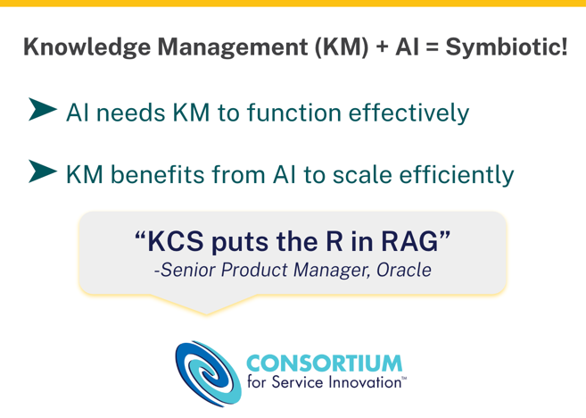
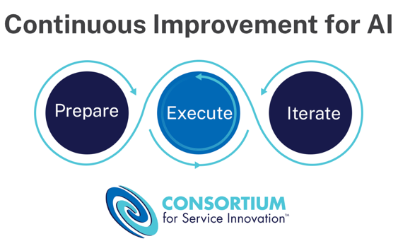

# AI Implementation Essentials

> 出典: Consortium for Service Innovation, *AI Implementation Essentials* — ページにクリエイティブ・コモンズの表示なし（© Consortium for Service Innovation）  
> 元のページ:
> - [AI Implementation Essentials](https://www.serviceinnovation.org/ai-implementation-essentials/)

Proven steps for successful AI initiatives.

*Essential actions to prepare, launch, and continuously improve your AI initiatives based on direct insights from [Consortium Member companies](https://www.serviceinnovation.org/current-members/).* *See [AI Case Studies](https://www.serviceinnovation.org/ai-case-studies/) for examples from specific companies.*

**For AI to deliver real business value, you need:**

- A foundation of trusted, well-managed knowledge
- Use cases aligned to organizational goals
- Comprehensive change management

This guidance highlights established methods to manage expectations and achieve successful outcomes as you enable new AI solutions.

## In This Guide

- Knowledge Management is the Foundation
- Key Phases for AI Implementations
- Action Items
- Be Part of the AI-Driven Future

*Consortium Members have access to the full [AI Blueprint](https://library.serviceinnovation.org/wiki/Featured_Member_Resources/AI_Blueprint), which provides more detail.*

## Knowledge Management is the Foundation

Knowledge management and AI fuel each other’s success. Well-managed knowledge enables reliable AI outputs, while AI accelerates how knowledge is captured, reused, and improved.

A disciplined knowledge management approach, [such as KCS](https://www.serviceinnovation.org/kcs/)^(®), ensures that the content AI draws from is validated and aligned with how people actually ask for help. In return, AI streamlines tasks like article drafting, duplicate detection, and gap analysis, allowing teams to focus on higher-value improvements.

Together, [knowledge-powered AI](https://www.serviceinnovation.org/knowledge-powered-ai/) creates a feedback loop where better knowledge drives better AI outcomes, and AI capabilities make it easier to maintain and evolve that knowledge at scale.

## Key Phases for AI Implementation

1.  **Prepare**
    The preparation phase is about setting expectations and building trust. Alignment before implementation grounds AI adoption in business strategy and helps executives see AI as a journey requiring thoughtful execution.
2.  **Execute**
    A structured approach to piloting and scaling AI ensures effective experimentation, informed decision-making, and successful long-term adoption. The Execute phase is where we learn a lot about the state of our AI readiness as it relates to the data we need and the overall technology infrastructure in place.
3.  **Iterate**
    Continuously evaluate, monitor, and improve along all stages of an automation journey. AI solutions require continuous monitoring, learning, and refinement to stay effective.

***Prepare** & **Iterate** phases apply holistically. **Execute** phase repeats for each use case.*

### Important Prerequisite!

Before you leap into any new AI implementation, it’s essential to think about what you’re trying to achieve:

- Which processes could be improved by applying AI?
- What business problem could be solved faster by leveraging AI?
- How can AI empower people to be more successful at their jobs?
- How can AI benefit customers and partners?

In other words: what’s your use case?

## Action Items

Use this as a checklist of things to do and think about as you launch and continuously improve AI solutions. See [AI Case Studies](https://www.serviceinnovation.org/ai-case-studies/) for examples of these action items in practice.

### Prepare – Build the Foundation

- **Establish strategy**
  - Connect automation plans to organizational goals.
  - Secure alignment among stakeholders.
  - Identify resources (both current and potential gaps) to move forward.
- **Assess organizational readiness**
  - Identify process, workflow, and data owners for relevant use cases.
  - Strengthen knowledge management programs.
  - Understand process or system dependencies.
  - Complete risk evaluation.
- **Leverage change management**
  - Create a thorough communication plan with defined audiences, cadence, delivery channels, and intended outcomes.
  - Develop a roadmap or phased approach outline with short, medium, and long-term milestones for your automation initiatives.
- **Define use case criteria**
  - Determine considerations for pilot prioritization.
  - Determine methods to evaluate success.

Investing the time to establish strategy, assess readiness, leverage change management, and define criteria for use cases accelerates success by building a solid foundation from which to move into execution.

### Execute – Launch with Intent

Follow these steps for each use case.

- **Start with a pilot**
  - Define goals and objectives, including evaluation criteria.
  - Identify the project team needed to move the use case to pilot.
  - Evaluate options to buy from a vendor versus build in-house.
  - Create an implementation plan with as limited of a scope as possible to assess viability.
  - Implement pilot and evaluate based on pre-defined criteria.
- **Scale to Production**
  - Define long term resources, both people and systems, needed to scale.
  - Determine measures and cadence to monitor ongoing performance, including feedback loops.
  - Validate governance and compliance frameworks to ensure that AI solutions respect data privacy, security, and regulatory requirements.

Pilots help establish proof of value, build trust, and surface risks to avoid expensive surprises. As AI expands into more workflows and interactions, ongoing oversight and feedback are essential to identify and mitigate unintended consequences at scale. Moving prototypes into production and scaling them requires the same governance, management, and support as any application.

### Iterate – Continuously Improve

- **Maintain Strategy**
  - Ensure ongoing alignment between business goals, your organization’s AI approach, and your program strategy.
  - Invest in training employees as AI evolves to ensure that teams remain capable of handling and optimizing new systems.
  - Incorporate and evaluate experiments at all stages of planning and implementation.
- **Maintain Technology**
  - Continuously monitor and optimize the performance of AI tools and automation workflows.
  - Adjust models and data sources as needed.
  - Track evolving AI trends and technologies to boost competitive advantage and ensure your solutions remain current.

Ongoing evolution ensures that AI initiatives remain aligned with business needs, resilient to disruption, and capable of delivering sustained value. Iteration is not just about fixing what’s broken, but also about proactively enhancing and future-proofing your AI approach.

## Be Part of the AI-Driven Future

Consortium Members continue their thoughtful approach to AI implementation, focusing on business processes, use cases, and operational transformation. Join the conversation!

- Sign up for the [Consortium mailing list](https://www.serviceinnovation.org/mailing-list/)
- Participate at [an event](https://www.serviceinnovation.org/events)
- Learn about [Consortium Membership](https://www.serviceinnovation.org/member-activities/)

### Member-Only Resources

- [AI Blueprint](https://library.serviceinnovation.org/wiki/Featured_Member_Resources/AI_Blueprint): a how-to guide with detailed examples and templates
- Join the [\#ml-llm-ai channel](https://consortiummembers.slack.com/archives/C04S5QT3B6Y) in the Consortium Member Slack
- [Thoughtful and Strategic Automation](https://library.serviceinnovation.org/wiki/Predictive_Customer_Engagement/Thoughtful_and_Strategic_Automation_Team_Meeting_2024)
- [The Intersection of ML-LLM-AI and KCS](https://library.serviceinnovation.org/wiki/KCS/Team_Meetings/ML-LLM-AI_and_KCS_Team_Meeting_2024)

If you are a [Consortium Member](https://www.serviceinnovation.org/current-members/) and need login assistance, contact [support@serviceinnovation.org](mailto:support@serviceinnovation.org).

## Attribution

The KCS^(®) methodology is service marked by the Consortium for Service Innovation.

The first mention of KCS in a written work must include the superscript ^(®).  Please also include this footnote or parenthetical statement: “KCS® is a service mark of the Consortium for Service Innovation^(TM).”

The correct use of KCS is as an adjective, for example: “\[Company Name\] endorses the KCS® methodology….”

KCS cannot be used in the name of an offering without explicit written permission from the Consortium for Service Innovation. Please [contact the Consortium](mailto:info@serviceinnovation.org) with questions.
