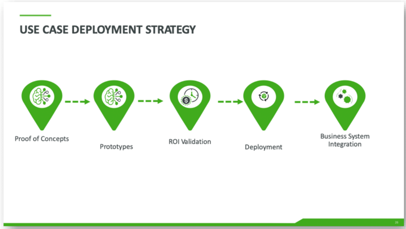
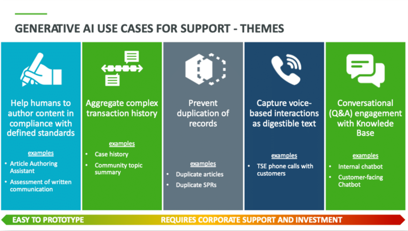
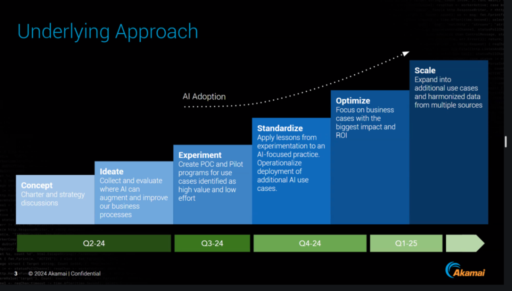
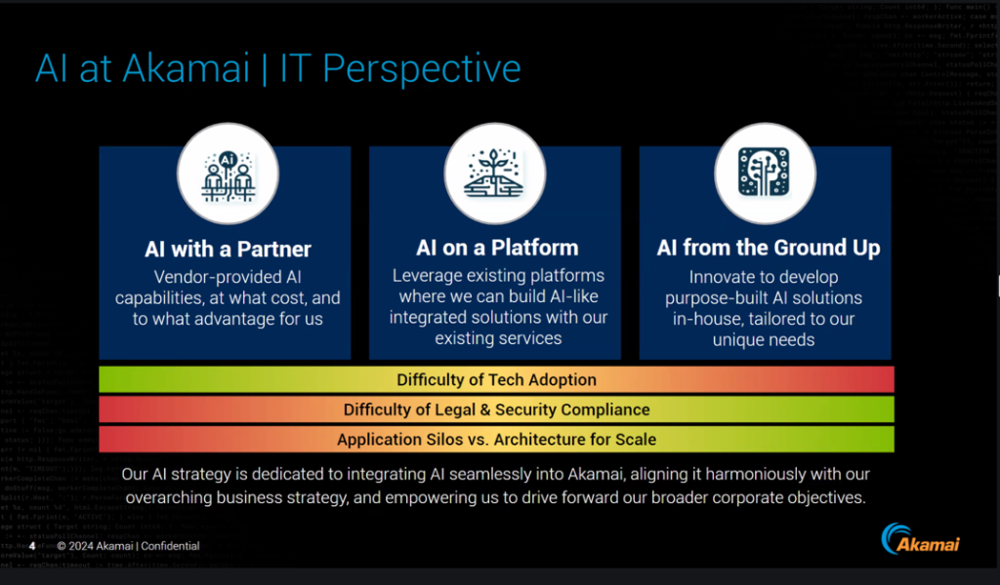
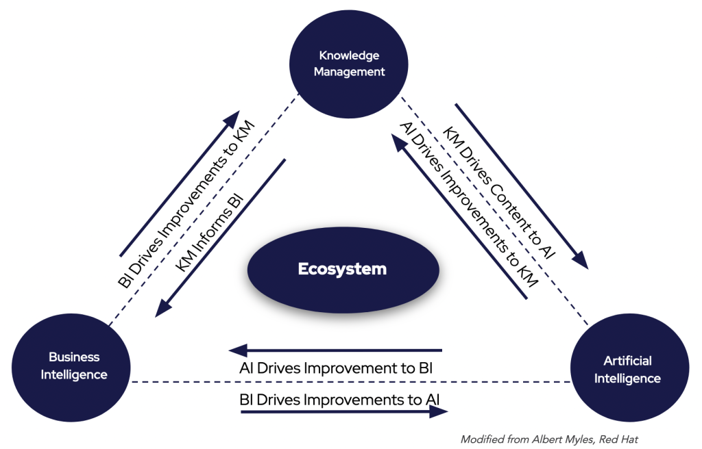
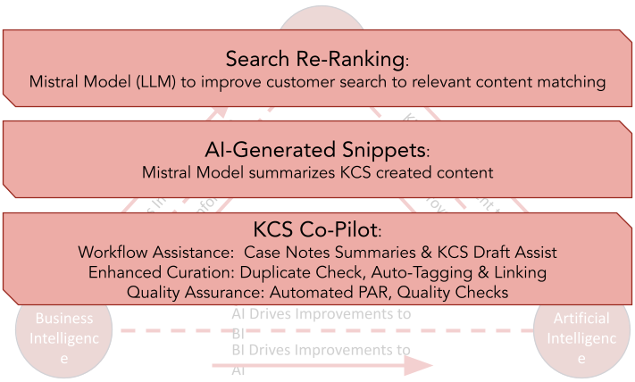

# AI Case Studies

> 出典: Consortium for Service Innovation, *AI Case Studies* — ページにクリエイティブ・コモンズの表示なし（© Consortium for Service Innovation）  
> 元のページ:
> - [AI Case Studies](https://www.serviceinnovation.org/ai-case-studies/)

Consortium Member examples of AI in action.

Consortium Members continue their thoughtful approach to AI implementation, focusing on business processes, use cases, and operational transformation, and share their experiences at [Consortium events](https://www.serviceinnovation.org/events/).

[AI Implementation Essentials](https://www.serviceinnovation.org/ai-implementation-essentials/) provides an overview of what’s required for success. Members can find more examples and templates in the full [AI Blueprint](https://library.serviceinnovation.org/wiki/Featured_Member_Resources/AI_Blueprint).

## Identify AI Use Cases for Support

*Member company: PTC*

**Approach**: Selected key processes for evaluation against AI, brought process owners and subject matter experts together, and held workshops to identify potential use cases.

**Strategy**: Focused on creating themes for Gen AI impact, such as helping humans author content and improving conversational engagement with the knowledge base.

PTC considered the ease of implementation against the value delivered, focusing on content creation and leveraging their mature KCS implementation.

**Result**: Launched an interactive article authoring assistant that automates the first draft to be reviewed by the Knowledge Worker, increasing content creation efficiency and accuracy.

*Consortium Members: [access PTC’s slides](https://library.serviceinnovation.org/wiki/Member_Summits/Member_Summit_2024)*

## **Manage Expectations and Evaluate Build-versus-Buy Options**

*Member company: Akamai*

**Approach**: Established company-wide protocols for AI deployments to thoughtfully move from experimentation to production while mitigating risk and prioritizing investments.

**Strategy**: Socialized an AI Adoption curve to standardize milestones and timeline expectations plus consistent evaluation dimensions for determining technology choices.

- Akamai’s approach highlights the importance of a structured process for managing both stakeholder expectations and the outputs of an AI implementation.
- A leadership committee helps prioritize use cases, moving them into proof of concept and testing phases.

**Result**: Leadership buy-in to this timeline provides the required space to be thoughtful and systematic about implementing AI at scale, while offering a structured approach to experimentation for all parts of the business as new tools and capabilities become available.

*Consortium Members: [learn more about Akamai’s strategy](https://library.serviceinnovation.org/wiki/KCS/One_Hour_Web_Sessions/Automation_and_Tools/2023_09_28_Connected_Data_Trusted_Knowledge)*

## **Automate Knowledge Enhancements**

*Member company: Red Hat*

**Approach**: Leveraged their strong KCS implementation and business intelligence systems to improve the employee and customer experience with AI.

**Strategy**: Used an ecosystem approach to understand relationships between interconnected elements, mitigate blindspots, and drive continuous improvement.

**Result**: Improved relevant content matching, AI-generated snippets for organic search, and KCS copilot for Knowledge Worker workflow while providing actionable feedback to all parts of the ecosystem.

*Consortium Members: [see Red Hat’s presentation](https://library.serviceinnovation.org/wiki/Predictive_Customer_Engagement/Thoughtful_and_Strategic_Automation_Team_Meeting_2024/AI_for_KCS_at_Red_Hat)*

*See more examples from Cisco, SAP, SAS, and Akamai: [How Industry Leaders are Building AI-Driven Customer Experiences](https://www.serviceinnovation.org/industry-leaders-build-ai-driven-customer-experiences/)*

## Be Part of the AI-Driven Future

Consortium Members continue their thoughtful approach to AI implementation, focusing on business processes, use cases, and operational transformation. Join the conversation!

- Sign up for the [Consortium mailing list](https://www.serviceinnovation.org/mailing-list/)
- Participate at [an event](https://www.serviceinnovation.org/events)
- Become a [Consortium Member](https://www.serviceinnovation.org/join-us/)

### Member-Only Resources

- [AI Blueprint](https://library.serviceinnovation.org/wiki/Featured_Member_Resources/AI_Blueprint): a how-to guide with detailed examples and templates
- Join the [\#ml-llm-ai channel](https://consortiummembers.slack.com/archives/C04S5QT3B6Y) in the Consortium Member Slack
- [Thoughtful and Strategic Automation](https://library.serviceinnovation.org/wiki/Predictive_Customer_Engagement/Thoughtful_and_Strategic_Automation_Team_Meeting_2024)
- [The Intersection of ML-LLM-AI and KCS](https://library.serviceinnovation.org/wiki/KCS/Team_Meetings/ML-LLM-AI_and_KCS_Team_Meeting_2024)

If you are a [Consortium Member](https://www.serviceinnovation.org/current-members/) and need login assistance, contact [support@serviceinnovation.org](mailto:support@serviceinnovation.org).
