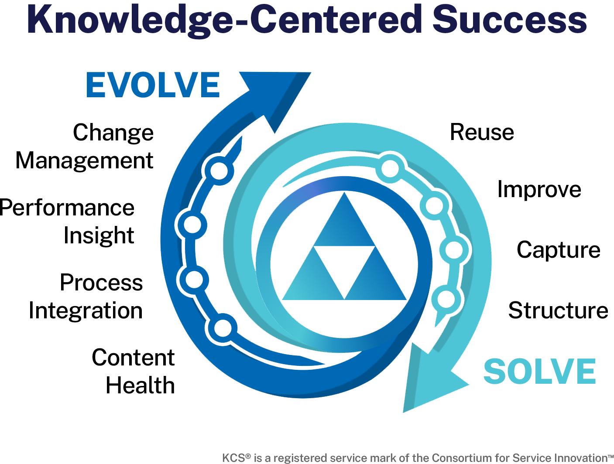
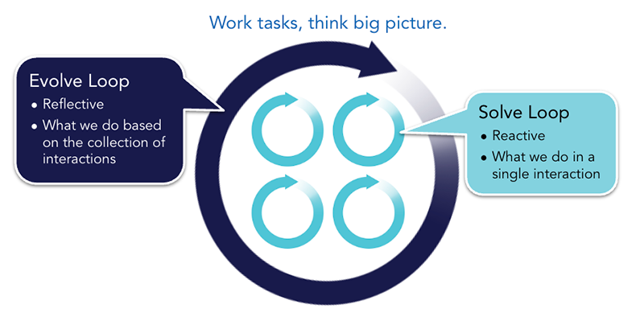
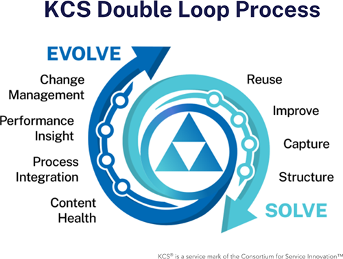
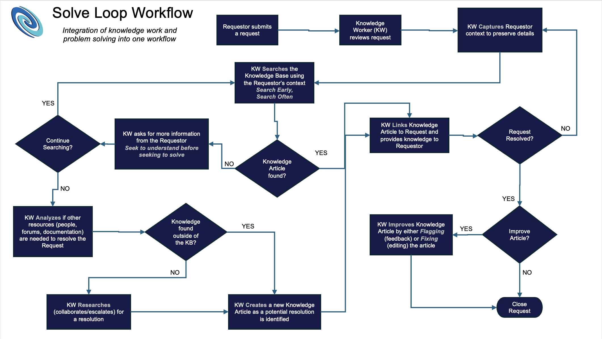
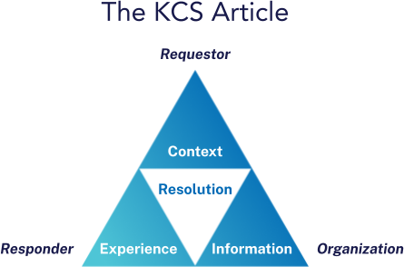
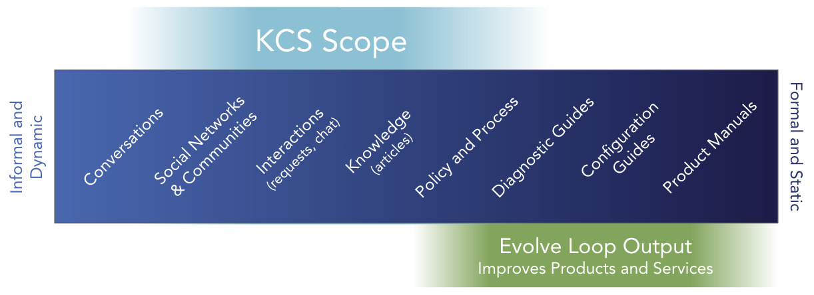

# Knowledge-Centered Success: Practices Guide (2027)

> 出典: Consortium for Service Innovation, *Knowledge-Centered Success: Practices Guide (2027)* — [CC BY-NC 4.0](https://creativecommons.org/licenses/by-nc/4.0/)  
> 元のページ:
> - [Knowledge-Centered Success: Practices Guide (2027)](https://library.serviceinnovation.org/KCS/Knowledge-Centered_Success_Practices_Guide)
> - [Why KCS Works](https://library.serviceinnovation.org/KCS/Knowledge-Centered_Success_Practices_Guide/101-Why_KCS_Works)
> - [Output: the KCS Article](https://library.serviceinnovation.org/KCS/Knowledge-Centered_Success_Practices_Guide/102-Output_the_KCS_Article)

Knowledge-Centered Success (KCS^(®)) is a simple idea that creates profound benefits.  If, as part of our workflow, we can reuse, improve, and (if it doesn't exist) create knowledge that is available to people who are looking for it, we can

1.  make gains in operational efficiency,
2.  increase success with self-service and automation, and
3.  improve products and services while enabling organizational learning.

We do this by enabling the people who are interacting with the knowledge to take ownership for it. This may require different ways to think about work, people, measures, and process.

KCS is built on a set of fundamental beliefs ([KCS Principles](01-principles-and-core-concepts.md)) that explain *why* we are doing what we do. The ten [Core Concepts](01-principles-and-core-concepts.md#page-355) (which are more detailed) are based on one or more Principles.  This guide focuses on the *how*; the best we know to-date about how to make KCS work, while the [KCS Adoption & Transformation Guide](https://library.serviceinnovation.org/KCS/KCS_v6/KCS_v6_Adoption_Guide) provides a step-by-step plan for adoption. See the [Glossary of KCS Terms](11-supplemental-resources.md#page-353) for details on terminology.

While the KCS acronym remains the same as previous versions, we have updated the name from Knowledge-Centered Service to Knowledge-Centered *Success*.  This change reflects the broadening application of the methodology. For organizations to leverage ongoing advances in automation and artificial intelligence, structured, up-to-date knowledge is the path to success. [What's New in Knowledge-Centered Success](11-supplemental-resources.md#page-8875) details changes from the KCS v6 methodology.

This guide is based on more than thirty years of Consortium Member experience with KCS, which is largely from the perspective of customer facing support and internal help desks, but the approach applies to any information- or knowledge-intensive environment.  A number of Members are adopting KCS across their entire company, including HR, legal, marketing, sales, product management and development organizations.

The [Consortium for Service Innovation](https://www.serviceinnovation.org) is the non-profit association that developed and continues to maintain the KCS methodology; it is the source for KCS resources and the certifying body for KCS. The Consortium offers [KCS certification](https://www.serviceinnovation.org/kcs/kcs-certifications/) for people and [KCS Verified and Aligned](https://www.serviceinnovation.org/kcs/kcs-v6-verified-tools/) designations for tools and services.  The KCS *Verified* and KCS *Aligned* programs are useful for assessing technology to enable KCS. The Consortium nurtures a network of KCS practitioners and vendors who support the successful adoption of KCS and contribute to the continuous improvement of the KCS methodology across all knowledge-intensive industries.

The KCS® methodology is a registered service mark of the Consortium for Service Innovation. The first mention of KCS in a written work or presentation must include the superscript ®. Please also include this footnote or parenthetical statement: “KCS® is a service mark of the Consortium for Service Innovation^(™).”

KCS cannot be used in the name of a commercial offering without explicit written permission from the Consortium for Service Innovation. Please [contact the Consortium](mailto:support@serviceinnovation.org) with questions.

## Why KCS Works

Defining knowledge, how it flows, and how the structure of KCS generates learning and keeps knowledge relevant.

### The Attributes of Knowledge

Understanding KCS starts with an understanding of what we mean by knowledge. It is helpful to put knowledge in the context of data and information. What distinguishes data from information? Data is just numbers or words, while information is organized numbers or words. The organization of data into information gives it some meaning. What distinguishes knowledge from information? **Knowledge is information upon which I can act.** Knowledge has action associated with it; we can do something with it.

KCS seeks to capture the collective experience of the organization in ways that others can use.  "Use" or "act on" being the key point.

For example: the long-range weather forecast for an office worker in San Francisco is interesting information. That same weather forecast for a vineyard manager in Napa is actionable; the vineyard manager will make decisions and take actions to maximize the yield and quality of his harvest.  What is knowledge to some is only information to others.

What are some of the key attributes of knowledge?  First, we must recognize that information I can act on is dependent on my having some context or experience with that information. That is, I have to already know some things that complement the information to make it actionable.  So information that is actionable to me might not be actionable to you. We all bring something to the knowledge party.  This introduces an uncomfortable ambiguity about knowledge.  What is knowledge to me might not be knowledge to you.  Knowledge is not an absolute! This means that what we have in our "knowledge base" is really only potential knowledge because the usefulness of that information depends on the context, experience, and need of the person looking at it.  Information becomes knowledge *in the moment of use*.

We all have some knowledge: the ability to take action on information. It is interesting to consider a few questions about our own knowledge:

- How did we get the knowledge we have?
- When do we stop learning?
- How confident are we in our knowledge? Are we ever one hundred percent confident in what we "know"?
- How do we gain confidence in what we know?

We gain knowledge through interaction and experience. Most of us would agree that we are never absolutely certain about our knowledge because in fact we never stop learning. We are constantly gaining new perspectives and enhancing what we know. And we gain confidence in what we know by trying it, the same way we gain it initially, through experience. We do not systematically get a subject matter expert to review our knowledge and tell us what is good and what isn't.

When considering the attributes of knowledge we could say knowledge is:

- Gained through interaction and experience
- Constantly changing (we never stop learning)
- Never 100% complete or 100% accurate
- Validated through use, experience and interaction (not by subject matter experts)

Is this what people in our organization expect when we say we are implementing a knowledge base or a knowledge management practice? Do they expect it to be created as a result of interaction and experience, constantly changing, never complete, not absolutely accurate, and validated through use?  Usually not!  Often, the expectation of a knowledge base or a knowledge management system is that it contains perfect, pristine knowledge approved by experts.  We have to shift these expectations if we want to harness the power of our collective knowledge and experience. This means a shift in thinking from:

- individual to team
- activity to value creation
- completion to evolution
- escalation to collaboration
- content to context
- knowing to learning and sharing

### Knowledge is a Complex System

This shift in thinking is helped along by a model built by Dave Snowden called the [Cynefin framework](https://thecynefin.co/about-us/about-cynefin-framework/). It's a decision making framework that identifies different kinds of problems and the best way to approach them. While the model describes five different domains, or types of problems, two are specifically helpful in thinking about our approach to knowledge management.

In the *complicated* domain, we find situations in which there is a direct relationship between cause and effect; there's a clear understanding of the relationship between the elements in the system.  Building an airplane is an example of a complicated problem. It can be managed with a checklist and a group of experts. To influence a system like this, we gather data, analyze and understand that data, and make decisions based on our analysis.

Organizations have a tendency to approach all problems as if they are complicated. It is tempting to think that if we just gather a bit more data, we will be able to analyze our way out of problems. But in some scenarios, the most effective approach is to experiment and observe the outcome before iterating and experimenting again.

In the *complex* domain, we find situations that are more than the sum of its parts: cause and effect between the elements is not clear. Corporate culture is an example of a complex system. It's hard to have a complete list of all of the influencing factors, and hard to know with any consistency what actions will lead to what outcomes.  To influence a complex system, we have to experiment, then observe and gather data, and then run the next experiment to tease out which of the elements impact the others.

Knowledge flows like a complex system: it's hard to know who knows what, in what context, and how to access it. One of the things that makes KCS so powerful is that it gives us an approach for influencing and learning from this complexity.

### Double Loops Address Complexity

KCS is a living system, not a project with a completion date. It is based largely on research done in the area of [complex adaptive systems](https://www.serviceinnovation.org/complex-adaptive-systems-and-the-illusion-of-control/), which describes double loop processes, as opposed to linear ones.

Loopy processes can be difficult to introduce, since each step is connected to the others, so let's begin what the whole system looks like, and then we'll see an example of how these loops show up in a workflow.

To optimize the health of the knowledge base and the capability of the organization, the eight Practices of the KCS methodology are organized into double loop processes that reinforce each other. These Solve and Evolve Loop processes are the operational activities that make up the system.

The Solve Loop represents the responsibilities of the responder, or knowledge worker, when they are resolving a requestor's issue. Solve Loop Practices are reactive and transactional.

The Evolve Loop represents the responsibilities of leadership and the organization-level process. Evolve Loop Practices define, learn from, and improve the interactions happening in the Solve Loop.

In the [Create Value](https://library.serviceinnovation.org/Archive/KCS_v6_FOR_RETHINKING/KCS_Principles_and_Core_Concepts/020/020) Principle, we say "Work tasks; think big picture."  The "work tasks" is the Solve Loop and the "big picture" is the Evolve Loop.  We want to focus on completing tasks in the Solve Loop with an understanding of the potential benefits the collection of tasks provides in the Evolve Loop.  The Evolve Loop reflects on and learns from a collection of Solve Loop tasks and associated knowledge articles. It only works if each task is done correctly. The Solve Loop and Evolve Loop are interdependent: each enables the other.

We need to look after interactions and activities if we want to learn from and influence the patterns. The Solve Loop and Evolve Loop together create a system that is self-correcting. It is the aggregate of lots of Solve Loop events, each handled correctly, that enables the Evolve Loop analysis. By analyzing the collection of events and related knowledge articles over time, the Evolve Loop identifies areas for improvement in the Solve Loop. And, perhaps most importantly, the Evolve Loop identifies opportunities for improvement to the business. The root cause analysis done in the Evolve Loop can drive improvements to products, services, processes, and policies that are based on the collective experiences of knowledge workers and of those we serve.

### Example Solve Loop Workflow

What might this look like in a support center? A question comes in to a knowledge worker, who reviews the request and captures the requestor's context. The responder searches the knowledge base, using that context. They find a knowledge article that answers the question, link that article to the request, and provide the knowledge to the requestor.

When this Solve Loop flow is followed, it provides usage data to analyze in the Evolve Loop, including insight into the requestor (and responder) experience and enabling corrective action like product, process, or policy improvements.

## Output: the KCS Article

The KCS methodology is organized into three components:

- KCS article: structured knowledge, the output
- The Solve Loop: the reactive process
- The Evolve Loop: the reflective and continuous improvement process

Delivering timely, findable, usable knowledge to the audience looking for it is the goal of KCS.  The Practices and techniques in the Solve Loop focus on reusing, improving, and if it doesn't exist, creating knowledge articles as a by-product of responding to requests: knowledge work.  The Practices and techniques in the Evolve Loop focus on learning from a collection of Solve Loop events and the patterns of knowledge reuse in the Solve Loop.

Knowledge is the by-product of interaction. To make knowledge relevant and findable, it is captured and structured during the request-response interaction and in the context of the requestor. In KCS, we want the knowledge workers to use the knowledge base as the first resource in seeking a resolution to an issue. The act of searching captures the request and the environment in which the issue occurs.  A KCS article captures the requestor's issue (in their own words) and the environment, as well as the resolution from the responder. The article can also capture the responder's experience of resolving the issue. Once captured, KCS articles are improved over time based on demand and usage as described by "reuse is review." This knowledge maintenance life cycle continues indefinitely as the knowledge evolves.

&nbsp;

&nbsp;

&nbsp;

### The KCS Article

The KCS article is the content created using the KCS methodology. Articles can be used for many different types of content including a simple question, a complex problem, or a procedure. [KCS articles have a little bit of structure](04-evolve-loop-content-health.md#page-7118), and they integrate the perspective of three groups: the requestor, the responder, and the organization.

- The **requestor's** perspective includes their experience of what is happening as well as information about the environment relevant to their situation. The issue statement is the requestor's view of what is happening. It is captured in their words and phrases so that we have a record of their context.
- The **responder's** perspective is captured in the resolution and cause (if appropriate).
- The **organizational** perspective is represented in metadata with information such as the article state, the date created, number of times the article has been used, modification history, and the date last modified.

The intent of the article is to connect these perspectives so that we have a full view of the question being asked (and how often) and the answer delivered (and what version). While in many cases a KCS article is a standalone object with designated fields, advancing automation tools and capabilities open the door to new possibilities.

### The Content Continuum

Every organization has a broad spectrum of content that contains valuable, reusable information. KCS provides a methodology and set of practices for consistently capturing information in a way that is both structured enough to be useful, and dynamic enough to suit a rapidly changing environment. In addition to drawing from many content sources and creating a context-sensitive knowledge base for daily use, KCS processes generate new material that may reference existing content and feed into other business content like product designs, marketing plans, field training, and documentation. KCS Principles may be helpful in maintaining many types of content, but KCS articles are not intended to be a one-size fits all content type.

