# Practice 7: Performance Insight

> 出典: Consortium for Service Innovation, *Practice 7: Performance Insight* — [CC BY-NC 4.0](https://creativecommons.org/licenses/by-nc/4.0/)  
> 元のページ:
> - [Practice 7: Performance Insight](https://library.serviceinnovation.org/KCS/Knowledge-Centered_Success_Practices_Guide/301-Evolve_Loop/Practice_7_Performance_Insight)
> - [Technique 7.1: Measure the Right Things](https://library.serviceinnovation.org/KCS/Knowledge-Centered_Success_Practices_Guide/301-Evolve_Loop/Practice_7_Performance_Insight/Technique_7.1)
> - [Technique 7.2: Measures for Individuals and Teams](https://library.serviceinnovation.org/KCS/Knowledge-Centered_Success_Practices_Guide/301-Evolve_Loop/Practice_7_Performance_Insight/Technique_7.2)
> - [Technique 7.3: KCS Program Benefits and ROI](https://library.serviceinnovation.org/KCS/Knowledge-Centered_Success_Practices_Guide/301-Evolve_Loop/Practice_7_Performance_Insight/Technique_7.3)

**Performance Insight allows us to promote learning and growth for individuals and teams and assess the success of the KCS program.**

## Measure the Right Things

**Triangulate to understand the full context of what's happening in the system.**

## Measures for Individuals and Teams

**Identify individuals and teams who are doing the right things and contributing to intended outcomes.**

## KCS Program Benefits and ROI

**Demonstrate that the system is working as intended and delivering the value it was built to provide.**

Shifting the culture and values of the organization is necessary to align with the desired behaviors of collaboration and shared ownership. Culture and values are reflected in what the organization measures.

## Technique 7.1: Measure the Right Things

**Triangulate to understand the full context of what's happening in the system.**

Now that we understand what we are trying to create (content standard) and how we are going to create it (structured workflow), we are ready to develop a measurement model to assess how we are doing. We want to know how we are doing as individuals as well as teams. The approach described in the book [The Balanced Scorecard](http://www.amazon.com/gp/product/B000SEIJPG/ref=as_li_ss_tl?ie=UTF8&camp=1789&creative=390957&creativeASIN=B000SEIJPG&linkCode=as2&tag=customersupportc) by Norton and Kaplan is very helpful. It describes a number of important concepts that we have embraced in the KCS Performance Insight model.

- Link individual goals to departmental and organizational goals to help people see how their performance is related to the bigger picture.
- Look at performance from multiple points of view. The typical scorecard considers the key stakeholders: customers, employees, and the business.
- Distinguish leading indicators (activities) from lagging indicators (outcomes).

If we put goals on activities (leading indicators), we will get what we ask for. Activity by itself is not an indicator of value nor does it necessarily lead to the outcome we are after. For example, if we set a goal for each knowledge worker to create ten KCS articles per month, we will get ten articles a month. However, these articles are often created on the last few days of the month and they contain little or no valuable information (things like "fixed customer problem"). They were created to meet the goal, without consideration of the desired outcome. Goals on activities seldom generate the desired outcome. In fact, in a knowledge management environment, if we put goals on activities it will corrupt the knowledge base. It's not just that the useless articles are a waste of time - their presence in the knowledge base is actually damaging to the health of the whole KCS system. This is why the distinction between activities and outcomes is so important, and why we **do not put goals on activities!**

The outcome we want is articles that are findable and usable by a target audience. We need to do the "create" activity in the context of the outcome. This reinforces the KCS Principle of [Create Value](https://library.serviceinnovation.org/Archive/KCS_v6_FOR_RETHINKING/KCS_Principles_and_Core_Concepts/020/020): work tasks, think big picture. The *outcome* needs to be the focus, not the activity.

Goals placed on activities will corrupt the knowledge base.

Putting goals on activities will:

- Create unwanted results
- Destroy the value of the measure as an indicator of behavior
- Distract people from the real objective
- Relieve people from using judgment
- Make leadership look dull
- Disenfranchise people

A very helpful concept from *The Balanced Scorecard* distinguishes performance drivers ([motivators](07-change-management.md#page-8217)) from leading indicators (activities) from lagging indicators (outcomes). While each of these three elements is important, the role each plays in the measurement system is different. Making a distinction between them is crucial.

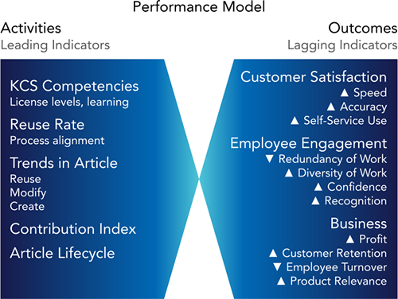We need to pay attention to the trends of the activities and their correlation to the outcomes.

- Are the activity measures heading in the right direction?
- How rapidly are they changing?
- Do knowledge workers have timely visibility to their performance indicators?

While the distinction between activity and outcome measures is critical, it is sometimes hard to identify which indicators are activities (leading indicators) and which are outcomes (lagging). Helpful ways to test an indicator:

- Easy to measure and easy to manipulate or game — it is probably an activity (do not put a goal on it)
- Hard to measure and hard to manipulate — it is probably an outcome
- Only measurable after the fact (when the event completed)— it is probably an outcome

Whenever we are having a discussion about an indicator or measure, we must be clear as to whether it is an activity or an outcome.

### Triangulation—Who is Creating Value?

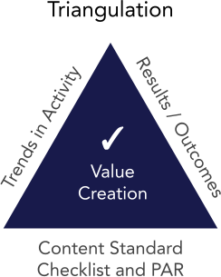The distinction between activities and outcomes is only part of the picture. Understanding KCS performance comes from the integration of multiple perspectives. Because there is no one measure that indicates value creation, we assess it by correlating at least three different perspectives. The basic model includes *trends in activities* (trend over time), *key outcomes* (measured against goals), and the KCS *Content Standard Checklist* (discussed in [Content Health](04-evolve-loop-content-health.md#page-7130)). These three perspectives consider measures that are both objective (quantifiable) and subjective (qualitative) to assess value creation by individuals and teams.

The concept of *triangulation* reflects the idea that the creation of value cannot be directly measured or counted—value is intangible. The best way to assess the creation of value is through a process of triangulation. As with GPS (global positioning system) devices that calculate our location on the earth based on input from multiple satellites, an effective performance assessment model incorporates multiple views to assess the creation of value.

We offer, as an example, a collection of measures to create an initial assessment model. Every organization must be thoughtful about developing its own set of metrics that align with their organization's goals (documented in the impact map).

The choice of measures for KCS must focus on the attributes that create *value* for the organization. The integration of the following dimensions creates a comprehensive view of performance, which in turn gives us confidence in assessing who is creating value and who might benefit from some help from a Coach.

## Technique 7.2: Measures for Individuals and Teams

**Identify individuals and teams who are doing the right things and contributing to intended outcomes.**

### Goals for Outcomes, Not Activities!

Because leading indicators are quantifiable activities, they are often easier to measure than outcomes. This creates a seemingly irresistible urge to put goals on the activities that are required for the outcome. As we have mentioned a few times, this is... counterproductive.

Consider the trip to Yosemite. If the stated goal were solely maintaining an average of 55 mph, it could be done. But in the absence of understanding the objective (Yosemite) the driver will choose roads that allow him to maintain the average speed regardless of destination. We might end up in Chico! Not that Chico is a bad place; it just is not where we wanted to go.

During the KCS adoption process, we have seen organizations put goals on KCS article creation (everyone should create five KCS articles a week) or KCS article reuse (knowledge workers will be measured on how often they link KCS articles). The goals for these leading indicators may have been met, but the quality of the knowledge base has been seriously compromised. Invalid and duplicate KCS articles are created, because the focus is on the activity, not the outcome. Worse, emphasis can shift to gaming the system rather than generating real value. Inevitably, quality and morale suffer, management looks less competent, and the value of the knowledge is diminished.

However, the *trends* in the activities (link, modify, create) give us valuable insights about knowledge worker behavior, so long as (we will say it again) there are not *goals* on the activities. If we put goals on these activities, the trends become meaningless as indicators of behavior and we will have lost valuable insights. The activities are also an early indicator of how effective the organization's leadership has been in describing the purpose and benefits of KCS and inspiring knowledge workers to embrace the Solve Loop practices. If people understand why they are doing it and what is in it for them (WIIFM), the likelihood that they will contribute appropriately is greatly increased. If the knowledge workers know we are trying to get to Yosemite, they will make good judgments about the activities it will take to achieve that outcome. If they don't know where we want to go, they may meet all the activity goals but who knows where we will end up. Refer to the [Change Management](https://library.serviceinnovation.org/Archive/KCS_v6_FOR_RETHINKING/Knowledge_Centered_Success_Practices_Guide/050/040) practice for more details on communication and motivation.

### Knowledge Worker Visibility to Measures

Knowledge worker visibility to measures is a delicate thing. We have conditioned them to expect goals on measures. In some cases if leadership does not put a goal on the activities, the knowledge worker will self impose one - which is as dysfunctional as leadership putting goals on activities. It is critical that knowledge workers get feedback on how they are doing and coaching on how they could improve. The conversation with both coaches and leaders needs to be focused on behaviors and outcomes. While the activity trends and a comparison of activities to peers doing similar work can provide helpful insight to the knowledge worker behavior, the conversation needs to be about their understanding of the Solve Loop and the content standard - not about the numbers.

On the other hand, numbers can have a positive impact when talking about outcomes. A key responsibility of leadership is providing knowledge workers with visibility to the impact their contribution to the knowledge base is having on the outcomes. Quantifying these benefits, using numbers and percent improvement on outcomes or progress toward a goal is very beneficial. If the knowledge workers can not see the impact of their contribution, they will stop contributing.

Consider a driving analogy: we want to go from San Francisco to Yosemite National Park. We could reasonably expect to make the 180-mile drive in three to four hours at an average speed of 55 miles per hour. Our desired outcome is to reach Yosemite in a reasonable period, but we will not know if we have been successful until we arrive. What would we need for the trip? We need a car, a driver's license, and some gas, but a successful trip requires that we also pay attention to many other factors (leading indicators) along the way. Because we would like to average 55 mph, we want to pay attention to how fast we are going. Because we have determined three to four hours is the acceptable period, we want to be aware of the passage of time at different speeds and how much gas we have in order to avoid refueling delays.

The dashboard in the car is very helpful in informing us about the enabling factors for a successful trip. In KCS, the trends in the leading indicators are the dashboard that let the knowledge worker and the organization know the status of the enabling factors. They must be visible to the people who are driving the KCS system: the knowledge workers.

See the [KCS Adoption and Transformation Guide](https://library.serviceinnovation.org/KCS/KCS_v6/KCS_v6_Adoption_Guide) as well as [Measurement Matters v6](https://library.serviceinnovation.org/KCS/KCS_v6/Measurement_Matters_v6) for additional details about measures and their evolution through KCS maturity.

### A Scenario: Examples of KCS Reports

The example to the right is for the first six months of an organization's adoption of KCS.

#### KCS Article Creation and Reuse

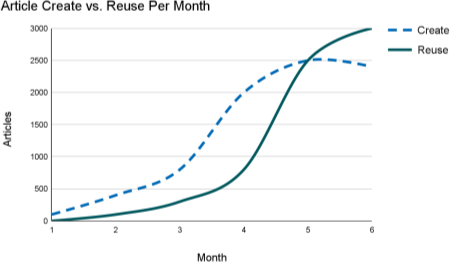KCS article creation will naturally lead KCS article reuse. As an organization approaches maturity, they will have already captured a high percentage of the known KCS articles, so the creation rate should drop off, and the reuse rate will continue to climb.

Because of its link to product life cycles, this pattern will repeat itself with each new product or application introduced.

###

#### KCS Article Life Cycle Trend

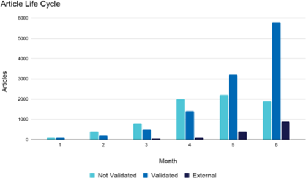

The KCS article life cycle gives us a sense for the speed with which articles are moving from a Not Validated state to a Validated state and/or External state. Because the value of the knowledge increases as the visibility of the article increases, we want to make sure that there is no bottleneck in the system. Articles in the Validated state are generally visible to a much larger audience than Not Validated articles, while External articles are generally available to people outside the organization.

In the chart on the left, we see good movement of KCS articles from Not Validated to Validated. Of the 9000 KCS articles that have been created in the knowledge base, about 7800 of them are Validated or External. There does seem to be some kind of hold-up in getting KCS articles published.

#### Link Rate as an Indicator

The link rate is powerful leading or early indicator of knowledge worker behavior. Link rate is defined as the percentage of events or incidents handled that have an article linked. We divide the number of incidents that have an article linked by the total number of applicable incidents closed. We should note that every organization has some events or incidents where linking does not make sense: it adds no value. Stated another way, link rate measures the percentage of times we link when linking is appropriate.

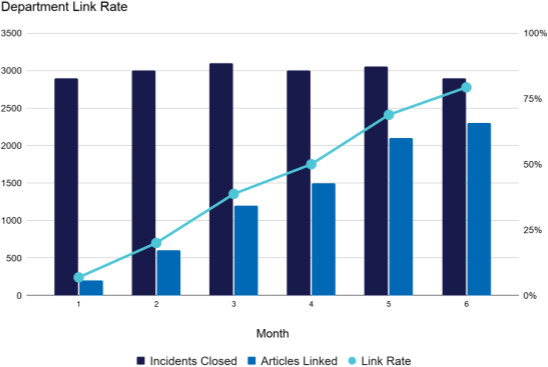

Link rate is an important trend to watch as the organization adopts KCS. In general, a healthy link rate for an organization is in the range of 60-80%, although specific numbers vary based on which incidents are included into this calculation. Link rate is an indicator of how often the knowledge base is being used as part of the knowledge worker's process. The link rate reflects reuse of known or existing articles as well as articles created because one didn't exist. For example, if we closed ten incidents this week, and we reused six KCS articles and created two new KCS articles, our link rate would be 80%.

In some organizations, there isn't an "incident" per se, so there is no ratio of knowledge use to incidents, and thus no link rate. Even without the rate, calculating an article utilization rate as the total number of articles used divided by volume of events provides insight into the organization's engagement with Solve Loop practices. This organization appears to be doing fairly well. We certainly like the trend in the department link rate.

 We must look at participation for the group as well as for the individual. As mentioned, link rate can be a good, early indicator of knowledge workers embracing the Solve Loop.... so long as there is not a goal placed on link rate.

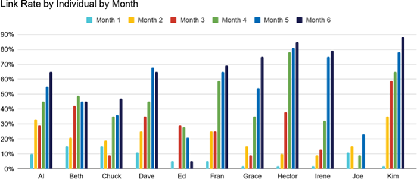Here we can see there is a wide range of link rates across the group. A conversation with Ed and Joe about their workflow and how they are using the knowledge base might be a good idea. Because link rate is the ratio of incidents closed to articles linked, it makes it hard to come up with a scenario for Joe or Ed that says they are "doing well." Link rate is a powerful indicator of anyone who is not playing. Again, we raise the caution that the conversation with the knowledge worker needs to be about their understanding of KCS, the Solve Loop, and their use of the knowledge base, not about their link rate "score."

Let us consider Kim and Hector —are they the new heroes of the organization? They seem to be doing really well. But, we don't know enough about Kim and Hector to know if they are creating value in the knowledge base or are just busy creating KCS articles that might be duplicates or incomplete. We need more information.

#### Profiles of the Players

[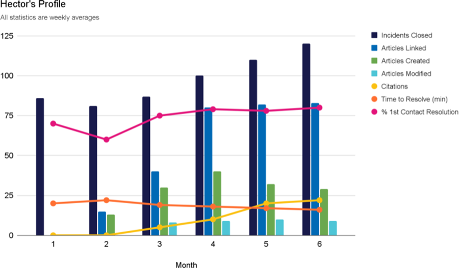](../images/5383-hector-profile-graph.png)It is interesting to look at a KCS indicators profile by individual. Here's an example of Hector's profile (click to open full size). While it contains a lot of data, the combination of factors gives us a better sense of Hector's contribution. We have averaged many of the factors over a week's time. Incidents closed, KCS articles linked, KCS articles created, KCS articles modified (improved), and citations (others use of KCS articles Hector has created) are all represented on a per week basis. Time to resolve and first contact resolution are the monthly averages.

On the link rate chart above, Hector and Kim both appear to be star performers. With the profile view, we see something different.

Kim, on the other hand...

[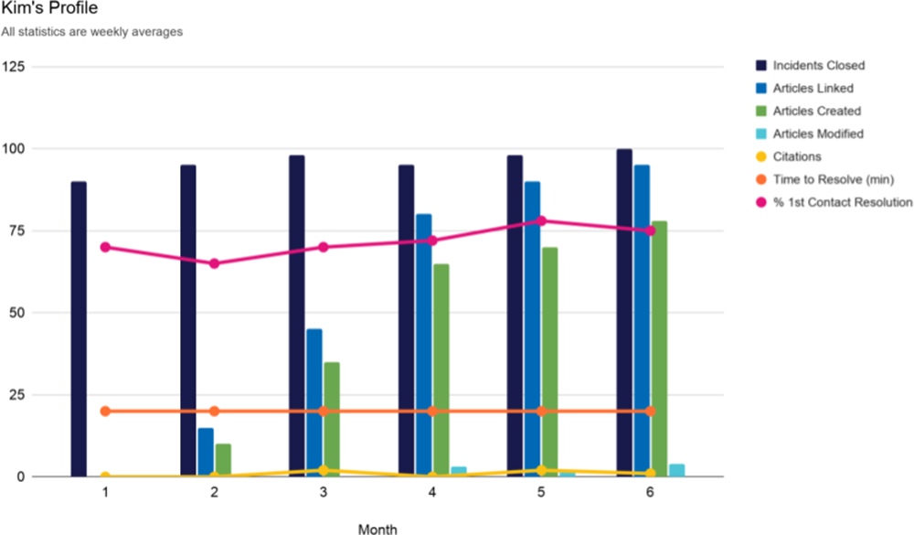](../images/5384-kim-profile-graph.png)Here is a great example of why a profile with multiple indicators is preferable over one with only a single measure (click to open full size). There is no single measure for value creation. If we looked only at link rate, then both Kim and Hector would appear to be doing very well. However, upon reviewing Kim's profile, we see that the article created rate represents most of her activity. She does not often modify others' articles and, in fact, does not reuse others' articles very often. The difference between KCS articles linked (used) and the articles created represents article reuse.

In Kim's case, we see KCS article creation makes up most of the KCS articles linked, which indicates relatively low reuse. Based on her citations levels, we can also see that others are not using the KCS articles that Kim creates. We might infer from all this that Kim is not searching the knowledge base before creating new articles, and that the KCS articles she creates are not very useful to others. A conversation with Kim is definitely in order. It may be that she does not understand the KCS processes. However, Kim may also be working on a new release or supporting a beta product, in which case her profile might represent a very good contribution.

Even with all this data, we still do not have enough information to determine who is creating value. We are missing a qualitative view (indicators of quality) to balance the quantitative view (activity).

If we refer back to the Content Standard Checklist we discussed earlier, we can get an additional perspective on Hector and Kim's behaviors and contribution.

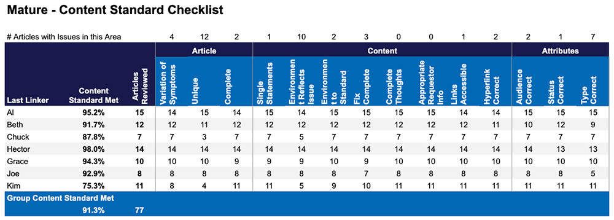

Hector's Content Standard Checklist percentage is 98%; he consistently creates articles that adhere to the content standard. In contrast, Kim's percentage is 75.3%, which is below the goal (the Content Standard Checklist percentage is an outcome and should have a goal), and the frequency of duplicates is very high. This high duplicate rate reinforces the idea that Kim is not searching before resolving and creating. While her activity level is excellent, that activity is corrupting the knowledge base because of the level of duplicate KCS articles introduced.

There is one more perspective that can further increase our confidence in who is creating value and who might need some help from a coach. The Content Standard Checklist tells us who understands and adheres to the content standard. The last piece of the puzzle is provided by the PAR (Process Adherence Review - formerly Process Integration Indicators) which helps us understand who is doing the Solve Loop: who has really integrated use of the knowledge base into their workflow.

[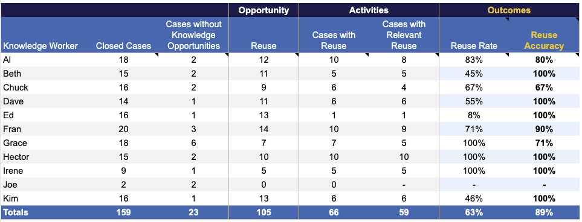](../images/5389-par-essential.png)Here is an example of the spreadsheet used to collect the data and calculate the Process Adherence Review (PAR). The key things we want to look at here are the Link Rate, Link Accuracy and the Contribution Index (see [Solve Loop Index in Technique 6.5: Process Adherence Review](05-process-integration.md#page-7862) for details on this).

Looking at the contribution rate and the link accuracy, we see more evidence that Hector is creating value and Kim needs some help. Hector's link rate, link accuracy, and contribution index are all very good. Looking at Kim we see her link rate is good, but her link accuracy is well below the required 90% and her link contribution index is very poor compared to her peers.

Looking at knowledge worker value creation requires that we use a comprehensive set of measures. By looking at a combination of Content Standard Checklist and PAR we get an accurate view of who is creating value and who needs some attention from a coach.

### Radar Charts: Creating a Value Footprint

The scenario with Hector and Kim requires a great deal of data and analysis with multiple charts for multiple people. A leader with a team of fifteen knowledge workers is not likely to have the time to routinely do that level of analysis. Can we make it easier to quickly identify who is creating value and who needs help? For rapid assessment, we use a tool called the Radar Chart.

Creating a Radar Chart requires some thought. First, we want to be sure we get a balanced view. Our key metrics should reflect a balance of:

- Leading and lagging indicators (activities and outcomes)
- Quantity and quality

The leading indicators (activities) are compared to the team average (not a goal) and lagging indicators (outcomes) are compared to the goal.

Secondly, we have to normalize the values to a common scale—for this example we will normalize to 1, so anything less than 1 is not meeting the team average or the goal, and anything greater than 1 is better than the team average or exceeds the goal. In the case of the leading indicators (activities), we will normalize it to the team average (do not put goals on activities). For the lagging indicators (outcomes), we will normalize the goal to 1.

We have to decide what measures to use in the radar chart. Organizations that use radar charts each have their own set of measures, usually defined by the KCS Council team.

For our example we will use Hector and Kim's data from the scenario and we will use the following measures:

- Customer satisfaction index (assuming this is captured at the individual level)
  - Based on post incident closure surveys, the goal is normalized to 1
- Knowledge contribution
  - Content Standard Checklist; based on sampling of articles, the goal is normalized to 1
  - Citations, (peer's use of articles, \# per month, 1 = team avg.)
- Process and Operations
  - Incidents handled; the number of incidents handled/month, the team average is normalized to 1
  - Avg TTR: Average time to relief (average minutes to provide relief/answer), the team average is normalized to 1 (note that the individual values for Avg TTR have to be inverted; a shorter TTR than the team average has to have a value greater than 1 and longer is less than 1)
  - Link rate; the % of cases closed with a resolution linked, the team average is normalized to 1

Once we have decided on the measures we want to include in the radar chart and the calculations for normalizing them to 1 we can plot the chart. Following are Hector and Kim's value footprint. We can see that these charts are much easier to read than the array of graphs we used in the scenario.

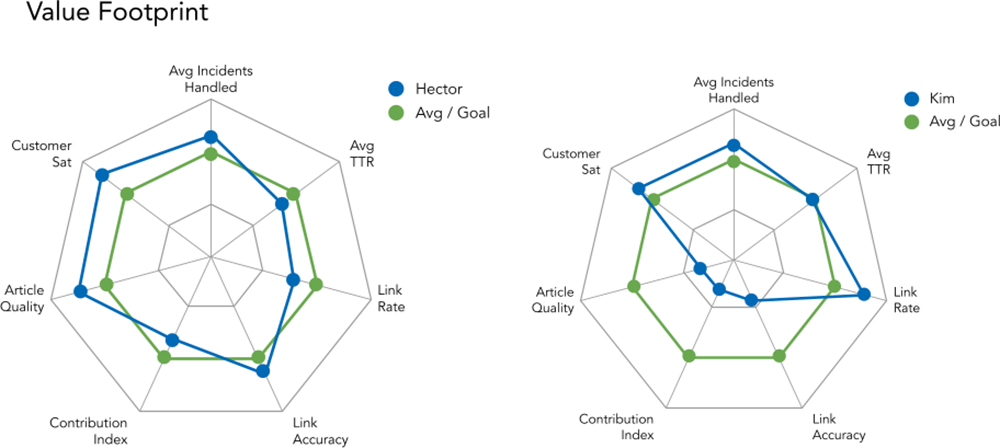

By comparing an individual's performance to the team averages for leading indicators and the goals for the lagging indicators, we can quickly see that Hector is creating value, and Kim needs some help. This is a helpful way to view measures so long as we have a balanced view of leading and lagging indicators as well as qualitative and quantitative measures. However, no measure or collection of measures can be meaningful without an understanding of the context in which the individual works and the role of the individual. Assessing the data in the context of the environment is a key responsibility of the team manager. We find that the assessment of value creation in a KCS environment is so different from the transaction and activity based measures we have conditioned first and second line managers to use that the managers need training on how to interpret and use value based measures.

#### Is What We Talk About Important?

Note that the eventual conversation with Kim should be about the behaviors and her process for problem solving, not about her participation numbers or the Content Standard Checklist percentage. The numbers are the indicators. If the conversation is about the numbers, then the numbers become the focus. We want Kim to adjust her behavior; her problem-solving process might not align with the KCS Practices. If we coach her on the structured problem solving process and the Solve Loop practices, the indicator should reflect the change. However, if we talk with Kim about "fixing her numbers," she can do that, but now the indicator becomes useless.

The moral of the story here is three-fold.

1.  We cannot depend on one measure or indicator to determine the health of the KCS system or the contribution of the players.
2.  The indicators must be used along with an understanding of the nature of the environment. Assessing the creation of value requires that we have a holistic view of performance.
3.  *Trends* in activities (leading indicators) can be very valuable, especially link rates. But the value of the indicator will be lost if we put a goal on the activity or we focus on the number during conversations with the employees.

The conversation about performance improvement is about behavior, process, and understanding - not about the numbers.

#### Team Performance - Management Effectiveness

We can use radar charts for the team performance and as a way to assess the effectiveness of the leadership in creating an environment for KCS success. For the team radar chart, the same rules for balance apply but the measures we use would be different. The measures for a team will depend on the size of the team and the size of the organization. We offer the following as an example where the team is the support organization and can influence the measures listed.

For the team's radar chart we might use the following measures: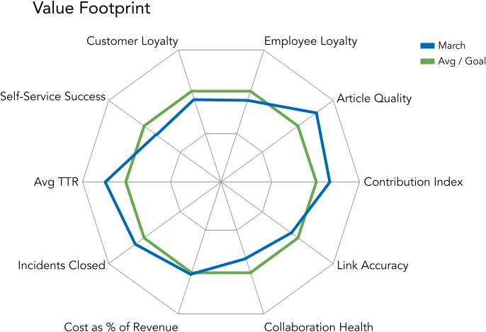

- Customer loyalty - unlike customer satisfaction, which typically measures the transaction, loyalty measures the customer experience over time and their emotional connection to the company (1 = the loyalty goal)
- Employee loyalty - loyal employees are a prerequisite to loyal customers (1 = the employee loyalty goal)
- Collaboration health index - the teams ability and willingness to collaborate; key indicators are trust and a sense of connectedness to the team
- Support cost as a percent of revenue
- Incidents closed
- Avg TTR - Average time to relief for the team
- Self-Service Success, (index = of % customers using self-service first x % success)

It is important to reiterate that numbers never tell the whole story. As with many things in the KCS methodology, judgment is required. This is true for the knowledge workers as well as managers.

While radar charts are good at showing a collection of data or measures at a point in time, they are not great at showing trends. Trends are especially important for the leading indicators (activities) like article creation and linking rates.

An organization can have the best measurement system in the world, but it is only effective if the managers know how to interpret the measures and how to have effective conversations with employees that influence behavior. Performance assessment and the creation of value is fundamentally about behavior and decision making, not about the numbers.

## Technique 7.3: KCS Program Benefits and ROI

**Demonstrate that the system is working as intended and delivering the value it was built to provide.**

An [impact map](07-change-management.md#page-7142) is helpful in identifying how the KCS benefits line up with the organization's goals. Based on the sample impact map, here are examples of organizational goals to establish baseline positions for and track progress on:

- Customer[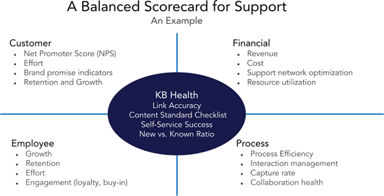](../images/5378-balanced-scorecard.png)
  - Loyalty (NPS)
  - Customer effort
  - Renewal rate
- Employee
  - Attrition rate
  - Employee engagement/loyalty
  - Employee effort
- Business (financial)
  - Revenue growth
  - Expense management
  - Profitability

When aligning to business objectives, a balanced scorecard format helps ensure that we have encompassed the full range of objectives.

Refer [The Balanced Scorecard](https://bookshop.org/a/79578/9780875846514) book for guidance in the process of scorecard creation.

### Operational Benefits and Return on Investment Considerations

In assessing the operational benefits from KCS, we use the same stakeholders we defined previously: the customer, the employees, and the business. Each will benefit differently from the adoption of KCS. The stakeholder benefits will be realized at three levels as the KCS Practices become mature:

- *Direct*—operational improvements that are near term
- *Applied*—new ways of delivering service and support enabled by KCS—for example, using knowledge that is created to power automation
- *Leveraged*—the knowledge and the capacity created by KCS enables new kinds of value-added support services to be offered

Experience has shown that while KCS is valuable across a wide range of environments, the investment required and the benefits achieved from KCS vary based on the characteristics of the environment. The key factor in determining if KCS will produce value for the stakeholders is the degree to which knowledge or experience plays a role in responding to user's or customer's requests for assistance.

Additionally, as we look to measure the benefits, we have to consider both quantitative (objective) and qualitative (subjective) metrics.

### Investment

Implementation of KCS requires investments in the following areas:

- Leadership and management—Sponsorship, program resources, and leadership development (training and coaching)
- Infrastructure and support—Modification of existing tools or the acquisition and implementation of new tools as well as the integration of those tools with existing systems
- Learning and growth—Training and coaching for knowledge workers
- Implementation and development of new roles and skills in the organization: Coaches, KDEs (Knowledge Domain Experts) and the knowledge domain analysis capabilities which should include access to Data Scientist
- KCS article management—The processes and resources for the Evolve Loop activities

Investments in these areas occur over the four phases of KCS adoption. These are:

- Plan and Design: Building the foundation elements like the content standard, workflow, and communications plan
- Adopt in Waves: Running Wave I to test the foundation elements
- Build Proficiency: Institutionalizing the practices across the whole organization
- Optimize and Innovate: Maximizing the benefits from self-service and improvements in process, policy, products, and services enabled by the Evolve Loop

Together, these areas and phases make up the total cost of ownership. Calculating the total investment can be difficult because many of the resources used are not incremental to the organization, in fact most are done with a redeployment of existing resources. Other elements, the incremental costs, are easier to identify. Each organization will have to calculate the non-incremental costs they wish to include. Once we have the total cost, we can divide it by the number of knowledge workers to figure the KCS investment per person.

One of the most challenging cost elements to estimate is coaching. During the startup of each wave of adoption, coaching represents a serious investment in capacity. In most organizations, no real cost is incurred because the organization simply lives with the reduced capacity. Other organizations that are under intense pressure may not be able to suffer through even a few months of decreased capacity and must back-fill knowledge workers during the coaching phase. Leaders must make a clear statement of their plans for allocating time to coach and their willingness to support coaching and perhaps compromise service levels in the short term for a dramatic long term gain.

### Return on Investment

The return or benefits from KCS will be different for each of the stakeholders. The benefits are numerous; examples include:

The organization:

- Increased capacity
- Organizational learning
- Improvement in the organizational image or brand

The knowledge workers:

- More interesting work (a high percentage of new issues, lower percentage of known)
- Increase in confidence, lower stress
- Increase capability and scope

The requestors (customers):

- Improvement in speed, accuracy, and consistency of responses
- Reduce the effort of finding resolutions (self-service)
- Increased loyalty

### Sample KCS ROIs for Support

Following are examples of the KCS ROI in three different environments. As we mentioned earlier, we must consider many factors in assessing the ROI. The complexity of the work most closely relates to the level of benefit. The following three examples are based on real organizations, and the actual results have been validated against this model. This ROI is solely based on the *Direct* benefits: the improvement in the operational efficiency of the group. It does not include the *Applied* benefits, such as self-service.

*Note that in this example, knowledge workers are referred to as Analysts.*

|                                                |            |         |         |
|------------------------------------------------|------------|---------|---------|
| Examples of KCS ROI                            | Complexity |         |         |
|                                                | High       | Med     | Low     |
|                                                |            |         |         |
| **Average Minutes To Resolve Known Problem**   | 10         | 7       | 3       |
| **Average Minutes To Resolve New Problem**     | 90         | 40      | 15      |
| **Average Incidents Closed Per Day**           | 4          | 12      | 44      |
| **Estimated % of Problems Which Are New**      | 50%        | 35%     | 20%     |
|                                                |            |         |         |
| **Monthly Analyst Cost (Fully Loaded)**        | \$9,000    | \$7,000 | \$5,500 |
| **Investment in KCS Per Analyst**              | \$4,500    | \$3,500 | \$3,000 |
|                                                |            |         |         |
| **Number of Analysts In the Group**            | 10         | 10      | 10      |
| **Cost Per Resolution (Base)**                 | \$107      | \$28    | \$6     |
|                                                |            |         |         |
| **Average % Analyst Link Rate**                | 70%        | 65%     | 65%     |
| **Months to KCS Article Set Maturity**         | 8.6        | 4.2     | 2.1     |
| **Average Analyst Daily Capacity at Maturity** | 8.5        | 18.9    | 53.3    |
| **Average Group Daily Capacity at Maturity**   | 84.7       | 188.9   | 533.3   |
| **Analyst Daily Capacity Improvement**         | 112%       | 57%     | 21%     |
| **Cost Per Resolution at Maturity**            | \$50.60    | \$17.65 | \$4.91  |
| **% Improvement in Cost/Resolution**           | 112%       | 57%     | 21%     |
|                                                |            |         |         |
| **KCS ROI**                                    |            |         |         |
| **ROI—First 12 Months**                        | 736%       | 802%    | 286%    |
| **ROI—First 24 Months**                        | 2450%      | 1564%   | 525%    |

The increased capacity is a function of the fact that it is much faster to find a KCS article in the knowledge base than create a new one. By consistently capturing the experience of solving issues in the knowledge base, a great percentage of the work moves to the known category (shorter time to resolve). We find that once KCS is implemented, most organizations are surprised at the level of redundancy in their work. The 80/20 rule (80% of the requests have already been answered somewhere in the organization) represents a good average.

This model forecasts the time it will take for "KCS article set maturity." Maturity is when most of what the organization knows is captured in the knowledge base. Maturity is measured in months. In the examples given above, it varies from 9 months for an environment with complex issues to 3 months for an environment with low complexity.

The assumptions used for this model are:

|     |                                              |             |
|-----|----------------------------------------------|-------------|
| 245 | Work Days Per Year Average                   |             |
| 21  | Work Days Per Month Average                  |             |
| 8   | Work Hrs Per Day                             |             |
| 168 | Total Work Hrs Per Month                     |             |
| 101 | Available Work Hrs/Mo, Utilization rate 60%  |             |
| 288 | Available Work Min/Day, Utilization rate 60% |             |
|     |                                              |             |
|     | Fully loaded annual cost/responder High      |  \$108,000  |
|     | Fully loaded annual cost/responder Med       |  \$  84,000 |
|     | Fully loaded annual cost/responder Low       |  \$  66,000 |

### Plan to Leverage Increased Capacity

KCS is a powerful best practice that initially improves the capacity of a support organization and over time creates new capabilities and benefits. At the outset, we need to consider how the increased capacity will be used and set knowledge worker and executive expectations realistically. These are the Leveraged benefits described earlier.

While the model shows a dramatic return on investment through the reduction in the average cost per problem, the savings may not be in a form the organization can or wants to directly realize. For most support organizations, the primary cost component is labor. While the adoption of KCS can reduce the labor costs on a per-unit-of-work basis, the savings can only be realized by reducing staff. This might be either difficult or undesirable due to shift coverage requirements or diversity of the technologies being supported. Reducing staff also diminishes the longer-term opportunity to create new capabilities and value-added services.

Capitalizing on increased capacity is a tricky thing.

Capitalizing on increased capacity is a tricky thing. Organizations that do not have a plan for how they will use the capacity are at risk of losing it. Incremental capacity can be absorbed by an organization without even thinking about it. In the absence of a plan, the existing work will naturally expand to fill the time.

Having a plan for how the increased capacity will be used is also an important element of setting executive and participant expectations. Executives like to see numbers that they can track, but some of these numbers (like incremental costs) are estimates. Be selective about the numbers touted. Placing the benefits of KCS in the bigger context of organizational goals including customer loyalty is very important here, to communicate the complete value of KCS (see the section on the impact map).

Of no less importance, knowledge workers want to know that their work to adopt KCS will not be "rewarded" with a layoff notice. Show them a plan and document the executive support for implementing the future changes and, specifically, how the incremental capacity will be used.

Following are some options to consider for how the organization can leverage newly available capacity:

- Improvement in service level to requestors without incremental cost.
- Creation of predictive and preemptive capability that will reduce demand
- Creation of value-added services that will increase revenue
- Increased interaction with product, process and policy owners to drive improvements that are based on user or customer experiences.
- Higher levels of participation in product testing during alpha and beta phases of development (this participation is also the best way to seed the knowledge base with experience about the new products).
- In an environment with increasing workload, the need for additional headcount can be reduced or postponed.
- In an environment with flat or decreasing workload, a reduction in staff may be the right thing. KCS will enable a lower cost of support while sustaining service levels. But we must be sure the reduction in staff is feasible.
