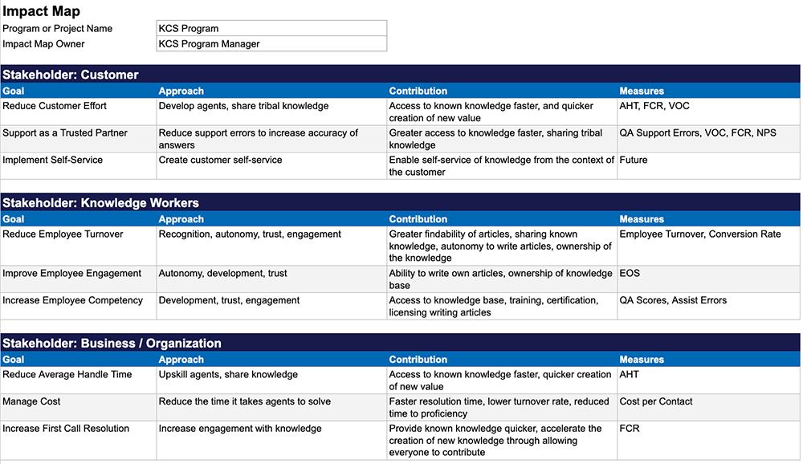

# Practice 8: Change Management

> 出典: Consortium for Service Innovation, *Practice 8: Change Management* — [CC BY-NC 4.0](https://creativecommons.org/licenses/by-nc/4.0/)  
> 元のページ:
> - [Practice 8: Change Management](https://library.serviceinnovation.org/KCS/Knowledge-Centered_Success_Practices_Guide/301-Evolve_Loop/Practice_8_Change_Management)
> - [Technique 8.1: Tap into Internal Motivators](https://library.serviceinnovation.org/KCS/Knowledge-Centered_Success_Practices_Guide/301-Evolve_Loop/Practice_8_Change_Management/Technique_8.1)
> - [Technique 8.2: Develop and Communicate a Vision](https://library.serviceinnovation.org/KCS/Knowledge-Centered_Success_Practices_Guide/301-Evolve_Loop/Practice_8_Change_Management/Technique_8.2)
> - [Technique 8.3: Create an Impact Map](https://library.serviceinnovation.org/KCS/Knowledge-Centered_Success_Practices_Guide/301-Evolve_Loop/Practice_8_Change_Management/Technique_8.3)
> - [Technique 8.4: Promote Teamwork](https://library.serviceinnovation.org/KCS/Knowledge-Centered_Success_Practices_Guide/301-Evolve_Loop/Practice_8_Change_Management/Technique_8.4)
> - [Technique 8.5: Communication is the Key](https://library.serviceinnovation.org/KCS/Knowledge-Centered_Success_Practices_Guide/301-Evolve_Loop/Practice_8_Change_Management/Technique_8.5)

**Change Management communicates why KCS matters and ensures everyone understands how their participation contributes to the bigger picture.**

## Tap into Internal Motivators

**Sustain change by leveraging the intrinsic motivators of autonomy, mastery, and purpose.
**

## Develop and Communicate a Vision

**Establish shared goals and create organizational alignment and sustainability. **

## Create an Impact Map

**Describe how KCS outcomes help achieve organizational goals. **

## Promote Teamwork

**Celebrate what is working.**

## Communication is the Key

**Inspire and sustain change with a robust communication plan. **

How do we get people, at all levels of the organization, to understand and buy in to KCS? Change Management promotes an understanding of why KCS is important and ensures those involved understand how their participation and contribution makes a difference in the context of the big picture.

Organizations who treat KCS adoption as a serious change initiative create greater benefit than those who approach it casually. Understanding and communicating the relevance of KCS to the organization—how KCS contributes to the organizational goals and what it creates for all the stakeholders—is critical. It is leadership's responsibility to create an environment where people are willing and eager to change their behavior; it is the behavior change that KCS requires of both the knowledge worker and the leadership of the organization that creates the profound benefits.

To do this, identify an organizational vision (defined as a compelling purpose that people can relate to), a mission statement, and a brand promise. Next, create an impact map that links the benefits of KCS to the higher-level goals of the organization, which align with and support the vision. With the vision and map in mind, a leader helps their team focus on *what* people need to accomplish, the right objectives and goals, and supports them in figuring out the *how*.

Organizations that embrace a formal change management methodology like Kotter or ADKAR tend to do well with their KCS adoption. If you have change management professionals in your organization, by all means engage them in supporting your KCS adoption.

## Technique 8.1: Tap into Internal Motivators

**Sustain change by leveraging the intrinsic motivators of autonomy, mastery, and purpose.
**

### What Motivates People?

As organizations become excited about KCS, the question often comes up: "How do we incentivize people to use or contribute to the knowledge base?" There is compelling research on what motivates knowledge work - and it is not about tangible incentives.  Extensive research done in the area of motivating employees shows that the factors that contribute to job dissatisfaction are different from motivating factors.

One of Harvard Business Review's most requested reprints is [One More Time: How Do You Motivate Employees?](https://store.hbr.org/product/one-more-time-how-do-you-motivate-employees/r0301f?sku=R0301F-PDF-ENG) by Frederick Herzberg.  Herzberg identified hygiene factors: things that can be a distracter to employee motivation if they are not taken care of, and motivational factors: the things that are actually motivating.  While hygiene factors include things like salary, work conditions, company policies, and relationships with co-workers, the four top motivation factors are achievement, recognition, the work itself, and responsibility. Let us consider how Herzberg's motivating factors show up in KCS.

**Achievement**

Applications in KCS:

- KCS proficiency level, earning the right to publish or becoming a KCS coach
- Creating KCS articles others are using
- Expanding breadth of product knowledge
- Contributing to the goals of the organization in a measurable way
- Collaborating as part of a group that is creating value for the business

**Recognition**

Applications in KCS

- Reputation based on creation of value in the knowledge base, others know you because of your KCS articles in the knowledge base
- Acknowledged for knowledge contribution through KCS measures and reports that are visible to the group
- Acknowledged by organization leaders as role model for others

**The Work Itself**

Applications in KCS

- Less redundancy, always working on interesting new things
- Confidence in taking broad range of incidents because the knowledge base complements existing knowledge

**Responsibility**

Applications in KCS

- Licensed to publish (KCS competency) without review by others (autonomy with accountabiilty)
- Licensed to modify / improve content
- Part of a team
- Collective ownership for content - "flag it or fix it"

New York Times columnist Daniel Pink presents his extensive research on what motivates people in his book [Drive: The Surprising Truth About What Motivates Us](http://www.amazon.com/gp/product/B004P1JDJO/ref=as_li_ss_tl?ie=UTF8&camp=1789&creative=390957&creativeASIN=B004P1JDJO&linkCode=as2&tag=customersupportc). (This should be required reading for all managers in a KCS environment; for a great animated summary of the book see his [YouTube video](https://www.youtube.com/watch?v=u6XAPnuFjJc).) Pink distills his work into three key motivation factors:

- Mastery
- Autonomy
- Purpose

These three factors are offered in the context of distinguishing physical tasks from intellectual work. Surprisingly, when we are talking about intellectual work - like knowledge work - tangible rewards (like bonuses) are more disruptive than effective.

Both Herzberg and Pink provide compelling evidence that in a knowledge-centered environment, "sticks and carrots," or rewards and punishment, don't work. The prerequisite for motivation is alignment to a purpose. If we care about the value proposition of the organization and we care about the people we work with, it creates the foundation for feeling good about our contribution: a sense of accomplishment is a powerful motivator. We only feel a sense of accomplishment in doing things that we care about.

### Leadership is Required

To sustain motivation and maximize KCS benefits over time, executive leadership must prioritize a few key things.

#### From Managing to Leading

KCS represents a bigger change for the front line managers than it does for the knowledge worker. Successful adoption requires a new way to think about process, measures, and how we assess contribution. As KCS matures, the need for management diminishes and the need for leadership increases.  This means a shift from directing and judging to engaging and coaching.  The single most common point of failure in a KCS adoption is the front line managers not making the shift and not taking ownership for KCS success.

Executive leadership needs to support the managers in making the transition by changing how the managers are measured and providing them with training and coaching on how to become leaders.

Consortium Members are doing a lot of work on this topic.  (See [Nurturing an Adaptive Workforce](https://library.serviceinnovation.org/Leadership_in_an_Adaptive_Organization/030_Nurturing_an_Adaptive_Workforce) as an example.) Key competencies that have been identified for team leaders in a KCS environment include:

- Strategic agility - understand how tasks relate to the big picture (double loop thinking)
- Innovation leadership - encourage creativity
- Dealing with ambiguity - measuring things we cannot count; there is no one indicator for the creation of value
- Courage - willing to try new things and iterate for improvement
- Motivating others - understand the motivation factors at play in knowledge work
- Customer focus - living the brand promise

Executive leadership must see the investment in leadership development as necessary to sustain the benefits of KCS for the long term. If they don't, all the investment in early phases of adoption will have been wasted.

#### Knowledge Worker Training and Coaching

Knowledge work requires judgment. The basis for that judgment comes in part from understanding the vision (see [Develop and Communicate a Vision](https://library.serviceinnovation.org/Archive/KCS_v6_FOR_RETHINKING/Knowledge_Centered_Success_Practices_Guide_2027/050/040/020)) and in part by understanding the benefits of KCS in the context of the bigger picture and how the the Solve Loop feeds the Evolve Loop. This understanding is what enables people to create value, when they work tasks in the context of bigger picture. The keys to establishing this perspective lie in consistent communication, training, and coaching.

#### Infrastructure Functionality, Integration, and Performance

The organization's infrastructure must support doing the Solve Loop at or near the speed of conversation.  While the tooling infrastructure does not have to be perfect in order to start on the KCS journey and realize some of the early benefits.  If the knowledge workers are inspired by the benefits they will figure out how to do the Solve Loop even with tools that are lacking.  However,

It is extremely difficult to maintain the knowledge workers' interest if they do not see continuous improvement over time in the functionality, integration, and performance of the infrastructure they use to get their work done. Our experience shows that leadership has 9-12 months to move the user interface from crude to obvious and easy.

#### Visibility to Impact of Contribution

A critical enabler to motivating knowledge workers is providing them with visibility to the impact of their contribution.  If people cannot see the value they are creating, they will lose interest. We entice the knowledge workers into KCS with a promise of a better, more interesting work environment. Because these benefits happen slowly over a period of time, their realization may not be obvious to the knowledge worker.  If leadership does not have baseline measures established and reporting capabilities in place to help the knowledge worker see the change, it is an opportunity missed.

Often one of the greatest contributions of the collective experience of the organization are the business improvements that come as a result of the Evolve Loop analysis.  This is a case of deferred gratification and leaders need to make the effort to help people see that the collective effort over time has lead to specific improvements in products, services, processes, or policies. It takes time for the pattern to emerge, and it takes time for the root cause analysis and corrective actions to be implemented. It is not unusual for the whole process to take 9-18 months.  Dramatic improvements may result, but it is far removed from the many well done Solve Loop events that it took to get there.  The people who made it happen won't realize it was a result of their effort if leadership doesn't provide that visibility.

## Technique 8.2: Develop and Communicate a Vision

**Establish shared goals and create organizational alignment and sustainability. **

We want everyone to be excited about the same thing, over the long-term, in a way that empowers us to work smarter.

People are much more likely to participate in a knowledge practice if they believe in the vision and purpose of the organization. Knowledge, our life's experiences, represents a large part of who we are as individuals; it is personal. Organizations that have a compelling purpose, one that people can connect with on an emotional level, have a stronger foundation for employee contribution of knowledge than those that do not.

> "Knowledge is personal...business, generally, is not."

### Creating a Vision

A vision can take on many forms. We see four common elements to an effective vision and define the elements as:

- A compelling purpose: a simple value proposition (a phrase, 1-5 words)
- A mission statement: our approach to achieving the purpose (a paragraph)
- Explicit values: defines acceptable behavior in achieving the purpose (a list)
- The brand promise: describes the attributes of our relationship with those we serve (a list)

Some organizations engage the employees in helping to create the vision.  This promotes understanding and buy-in, but if we engage people across the organization, we have to be willing to use and act on their input.  In other organizations the elements of the vision are developed by an executive committee.  We have seen both be effective.  The important point is that we have a compelling purpose, mission statement, explicit values, and brand promise and that there is a common understanding of them at all levels of the organization.

#### Engaging with a Purpose

A compelling purpose is a simple phrase that describes our value proposition. Alignment to a purpose is a result of understanding and caring. The purpose has to be something we care about, something we have a connection to. Motivation comes from a corresponding belief that one's actions will make a difference in achieving that purpose.

The purpose is what we are about. The values are the definition of acceptable behaviors in accomplishing the purpose. Our brand promise is the attributes of our relationship with those we serve.

How do we get there? To begin with, leaders have to have a strong sense of ownership and personal commitment to the compelling purpose, values and brand promise. An effective leader's enthusiasm for the purpose, values, and brand promise becomes contagious. Two key factors will make the difference: sincerity and consistency. People have an instinctive sense about leadership's integrity. That sense is reinforced or disrupted according to the consistency of the leaders' behavior with respect to the stated purpose, values and brand promise. Behavior that is consistent will resonate and create trust, buy-in, and engagement. Behavior that is inconsistent creates mistrust, dissonance, and disengagement.

People are inspired when they believe in what they are doing and feel good about their individual contribution and the contribution of the team. A powerful purpose has an emotional appeal. For example, if we ask the Support Analysts at VeriSign what VeriSign's purpose is, they will quickly respond, "Trust on the Internet." They feel a part of something that they value, it has meaning to them, and they are proud to be a part of it.

It is amazing how many employees do not know their company's purpose. It is also surprising how many companies have a purpose that is in no way compelling. What makes the difference?

A compelling purpose:

- Is known by all
- Is bigger than the company itself, not self-referencing
- Is brief, clear, concise
- Elicits an emotional response
- Is a value proposition

Some examples of compelling purposes:

- Trust on the Internet.—VeriSign
- Saving lives, one person at a time.—Sanofi
- We create happiness.—Disney

Two examples of non-compelling purposes:

- "To create the best video monitor in the industry"—this statement is self-referencing (not bigger than self), limiting, and does not have a strong emotional appeal.
- "To create wealth for the shareholders" —not much emotional appeal here either.

Equally important is understanding and buy in to the brand promise. The brand promise is reinforced or destroyed at each touch point with those we serve. Everyone must understand and buy-in to the brand promise as that must influence the knowledge workers' judgment in each interaction. Delivering on the brand promise means doing a lot of little things right.  A strong brand emerges when the aggregate of those things reinforce the desired attributes of the relationship.

What *about* money? Producing a profit for the company owners or stockholders is a responsibility of the business in a for-profit model.

Profitability is a by-product of being good at delivering on a compelling purpose.

#### Understanding the Mission

The mission statement is a paragraph that describes what we do, how we do it, and who we do it for. While the mission statement typically does not have the emotional appeal that a compelling purpose has it must align with and support the compelling purpose. The mission statement is mostly about us and the compelling purpose is about the value proposition we create for others.

#### Aligning to the Values

Our values are the rules of conduct: the guiding principles for our activities and behaviors in achieving the purpose. For example Cisco's values are:

- Focus intensely on customers,
- Make innovation happen,
- Win together,
- Respect and care for each other,
- Always do the right thing.

#### Living the Brand Promise

When we think about brand we often think about a company name or logo.  A brand promise is different from branding which defines the use of our logo and colors and fonts. A brand promise is the list of attributes that describe our relationship with those we serve (our customers).   A brand promise is often declared by the marketing organization.  In reality our brand promise is what those we serve say about the relationship they have with us.  And, what they say is based on their interactions with us over time.  If we have an intent with respect to what we would like those we serve to say about us, we are more likely to interact in a way that promotes those attributes.

For example the brand promise at Sage North America is:

- Peace of mind
- More control
- Smart and efficient
- Be there
- Enjoyable

Sage developed this list of what they want their customers to say about Sage by talking with their customers. These are the attributes of the relationship Sage customers want in the relationship.

Having a brand promise becomes a valuable touchstone for leadership decisions at all levels of the organization.  It is equally important that knowledge workers understand and believe in the brand promise.  By living the brand promise in each of our interactions both internally and externally we will create the desired image.

### Leadership is Fractal

Fractals occur in nature: the pattern of a snowflake is the same at a magnification of 1X (the shape of the whole flake) as it is at a magnification 10X or 100X, looking at one small section of the flake.  The pattern repeats itself at each level of magnification.  Its shape is made up of many smaller shapes just like it, which in turn are made up of many smaller shapes just like it... and so on.

"Leadership is fractal" means that at each level of the organization the understanding of what the organization is trying to accomplish is identical (compelling purpose, mission, values, and brand promise). This must be true in order to realize the vision. As people throughout the organization make judgments on how to handle each task or interaction, the vision is the basis or criteria for those judgments.  For example, it is each interaction and at the same time the aggregate of all the interactions that reinforces a brand promise... or destroys it.  If people at different places in the organization have different views or interpretations of the vision, it creates dissonance. Creating the vision and ensuring it is understood by all is the challenge of executive leadership. Helping the line managers become leaders who live and promote that vision is not a trivial task.

When we talk about strong leadership, it must exist at every level of the organization.

The importance of engagement with the purpose, mission, values and brand promise may seem remote to a knowledge worker responding to requests for assistance. However, as we make the transition to KCS, we will be asking people to change how they do their work and to exercise an increasing amount of judgment in what they do. The degree to which individuals understand the bigger picture not only gives them a basis on which to make good decisions, it encourages participation, gives them a sense of belonging, and enables them to feel good about their contribution and accomplishments. It is the foundation for what motivates us.

Leadership's role is critical in ensuring the elements of the vision exist and that they are well understood by all. Equally important is leadership's integrity with respect to the vision.  Leaders must model the values and live the brand promise.  The fastest way to render the vision impotent and negate all the ripple effect benefits is for leadership to live by different standards than what they espouse and to make decisions that do not align with the vision.

## Technique 8.3: Create an Impact Map

**Describe how KCS outcomes help achieve organizational goals. **

The impact map is a simple yet powerful document that links the benefits of KCS to the goals of the organization. It takes a small team an hour or two to develop, and is an investment that pays huge benefits. An impact map:

- forms the basis for the communication plan
- is a critical tool for gaining executive support and organizational alignment
- helps sustain KCS focus across executive turn over

Note that while the document is important, equally important is the exercise of creating the impact map. The conversation and understanding about the desired big picture, and how KCS is going to help, is extremely valuable for the KCS Council.

### Link KCS Benefits to Organizational Goals

The impact map improves the organization's engagement, helping people see the link between the KCS Practices and benefits to the organization's top-level goals. These, in turn, cascade down to departmental objectives and justify the outcomes that team leaders use to build their balanced scorecards (see [Performance Insight](06-performance-insight.md) for more information on balanced scorecards). This continuity in goals—from the big picture to the team to an individual is critical. The ability of the knowledge worker to see the link between their goals and the organization's is a key success factor in deploying KCS, sustaining the benefits, and promoting understanding and confidence across the organization.

The impact map is the foundation for a successful KCS adoption because it provides context for the three primary stakeholders: the requestors (customers), the knowledge workers (employees) and the organization. The map enables us to talk with executives on their terms by linking the KCS benefits to the top-level organizational objectives. When it comes to communicating with team members and others, an impact map provides the central messaging document.

Here is an example of an impact map expressed in terms of the primary stakeholders and the specific contributions of the KCS program:

Leaders should select the measures and goals that link to requestor success (the desired outcome), not activities. This is the same message that we deliver for individuals, but the metrics are implemented at a group or organizational level. Some good examples of higher-level metrics that are only measured at the group level include metrics about requestor's frequency of use and success with self-service, as well as internal metrics like time to publish to self-service. If we measure the wrong things or fail to balance them well, we are likely to drive the wrong behaviors and wrong results.

Knowledge worker loyalty and engagement is another important factor. The usual practices of employee loyalty, buy-in and job satisfaction surveys, as well as measures for turnover and attrition, fit in here.

The operational efficiency, productivity, and capacity are also typical goals. We have noted the KCS factors that influence costs and contribute to profitability. However, pure cost reduction is a going-out-of-business strategy. The discussion should be about increased capacity and identifying ways to increase revenue, instead of cost reduction. (See [KCS Program Benefits and ROI](06-performance-insight.md#page-7143) for more detail.)

In considering organizational goals and the right outcomes to emphasize, we need to consider all the support paths our requestors use, like assisted support, self-service, and community-based support. How will KCS enable or impact these different paths? Which metrics can we capture? How can KCS reduce requirements for expensive channels (assisted) and increase the use of inexpensive channels like self-service or communities? Most organizations will need to expand the scope of their measurement model and add measures for things like the percentage of our requestors who use self-service first, and what is their success rate with that? Baseline measures for these kinds of things allow us to forecast the benefits and assess our progress.

Keeping in mind our organization's objectives, here are KCS-oriented measures to consider:

Process and knowledge health:

- Link rate (%)
- Article create vs reuse ratio (%)
- Size of the knowledge base (total number of KCS articles)
- Articles visible through self-service (% of total visible externally)
- Knowledge base maturity (calculated percentage)
- New vs known ratio (%)
- Average time to relief/resolution for known problems
- Average time to relief/resolution for new problems

Since the goal of KCS is to increase and leverage the value of the knowledge, this concept has many potential metrics:

Requestor Loyalty Drivers:

- Average time from request resolved to publish an article (to the requestor audience, in minutes)
- Percentage of requestor-consumable KCS articles visible to customers
- Percentage of requestor success on self-service (survey data)

Cost Management Drivers:

- Percentage of new vs. known issues being reported to the support center (assisted model) (manager's goal—focus resources on solving new problems, not known problems, drive down costs)
- Percentage of requestors who use the self-service first (survey data)
- Percentage of requestor success on the self-service (survey data)
- Number of product, policy or process improvements recommended to the respective owners
- Percentage of improvements accepted

In this document, we are focusing on the KCS-relevant metrics. They do not replace existing management metrics, but should be integrated into them.

### Maintaining Balance

In many organizations, there is tension between the goals of requestor loyalty and operational efficiency. Improvements in one can starve the other. Typically, executives set goals for profitability and loyalty, but leave teams to determine implementation goals. Unlike traditional approaches to efficiency that can jeopardize customer satisfaction and loyalty, KCS outcomes reflect a healthy balance of these two goals. By implementing KCS to improve knowledge sharing, improvements such as self-service, proactive notification, and "treating known as known" can help organizations achieve both goals simultaneously.

For more information about measures in a KCS environment please see the [Measurement Matters](https://library.serviceinnovation.org/KCS/KCS_v6/Measurement_Matters_v6) paper.

## Technique 8.4: Promote Teamwork

**Celebrate what is working.**

Since the foundation of KCS is capturing and improving the collective experience of the organization, teamwork and collaboration are critical. While tools can enable collaboration, the behaviors are what drives the benefits. And, the behaviors are heavily influenced by the culture of the organization.

Creating a culture of collaboration and collective ownership is the leader's responsibility. The leader needs to ensure the environment nurtures and recognizes collaboration that is creating value. Historically, organizations have focused so heavily on individual contribution that the shift to valuing collaboration and teamwork can be a challenge. The old management practice of stack racking individuals is hugely dysfunctional if we want to create a knowledge sharing, collaborative environment.  Fortunately, organizations are moving toward recognizing collaboration and teamwork as important competencies.

A fairly well established and successful example of this shift from individual contribution to team capability is the adoption of the [Agile Methodology](http://agilemethodology.org/) in software development environments. The same kind of shift that software development has made with Agile is necessary for long term KCS success.

### Recognition Programs

As discussed in the [Internal Motivators technique](07-change-management.md#page-8217), recognition is far more powerful and effective than rewards. By rewards we mean tangible things like cash or prizes. We want to create an environment where we leverage the things that motivate knowledge workers to contribute to the knowledge base.  The two most powerful motivators are

1.  a sense of accomplishment (how we feel about our contribution) and
2.  recognition (acknowledgement of our contribution by others).

The impact of the recognition is dependent on the value the organization places on it. If the organization puts high value on having a KCS Publisher role or being in the role of Coach or Knowledge Optimizer, that makes those a high impact form of recognition.  There are lots of ways and opportunities for leadership to recognize knowledge workers and their contribution.

Is there a place for rewards and prizes?  Maybe. First, it depends on the culture of the organization.  In some environments it can be an effective way to create awareness, excitement, and fun.  The same program in another environment may be seen as silly or elementary.  Second, the program has to be thoughtfully designed.

To motivate the right behavior and promote KCS adoption early on, many companies implement reward and recognition programs. Historically we have seen that these programs are hard to get right. In addition to frequently misunderstanding what really motivates people, the programs are often based on activities, not outcomes, and end up driving the wrong behaviors. They become outdated as the organization progresses on the KCS journey, but the programs seldom have an end of life plan.

Any KCS rewards and recognition programs aimed at getting started must have an end date. If they continue too long, they send the signal that knowledge sharing and reuse are not part of the job, but something "above and beyond" to be specially rewarded. In fact, the opposite must happen—KCS Practices must be integrated into all participants' job descriptions and formal job evaluation programs. At this point, the primary reward and recognition for doing KCS well is the same as it is for doing any other part of the job well: continued employment, good reviews, and career advancement.

Some of the design principles of successful programs include:

- Legitimate metrics—tied to independent feedback and requestor input, most often done through satisfaction or effort surveys
- Alignment to organizational goals—measures directly link to and reinforce desired outcomes and the impact map
- Time constraints—clear beginning and end, and a plan for what is appropriate for the next phase of the KCS journey
- Balance of individual and team rewards—consider virtual teams as well as geographical and subject matter teams
- Compatibility with the individual—tailored to the values, interest, and styles of the person or team (don't embarrass an introvert!)
- Equal opportunity for participation—include recognition for different positions, roles, and responsibilities
- Recognition of diversity of skills—good generalists are as valuable as good specialists; recognition for each of the skills needed for success
- Promote collaboration, not competition—measure and recognize each individual's own progress and achievements

Given these guidelines, most organizations develop programs to appeal to different motivational factors. Here are some motivation and reward examples:

- *Challenge*—Set new records for key outcomes (often a team recognition)
- *Attention*—A visit with/from a senior level executive
- *Affirmation*—Add meaningful job opportunities or new roles, like membership in the KCS program team or trips to industry conferences or events

One key to using rewards and recognition programs effectively is to view them as part of the communications plan. These programs are an effective way for leaders to draw attention to new practices and priorities.

### Applying "The Five Dysfunctions of a Team"

Patrick Lencioni's book, [The Five Dysfunctions of a Team](http://www.amazon.com/gp/product/B006960LQW/ref=as_li_ss_tl?ie=UTF8&camp=1789&creative=390957&creativeASIN=B006960LQW&linkCode=as2&tag=customersupportc), calls out the hallmarks to watch for when assessing the health of the team. From his website, [www.tablegroup.com](http://www.tablegroup.com), we can see the following list of issues and strategies for overcoming them:

**Overcoming an Absence of Trust**

- Identify and discuss individual strengths and weaknesses
- Spend considerable time in face-to-face meetings and working settings

**Overcoming a Fear of Conflict**

- Acknowledge that conflict is required for productive meetings
- Understand each individual team member's natural conflict styles and establish common ground rules for engaging in conflict

**Overcoming a Lack of Commitment**

- Review commitments at the end of each meeting to ensure all team members are aligned
- Adopt a "disagree and commit" mentality - make sure all team members are committed regardless of initial disagreements

**Overcoming the Avoidance of Accountability**

- Explicitly communicate goals and standards of behavior
- Regularly discuss performance versus goals and standards

**Overcoming Inattention to Results**

- Keep the team focused on tangible group goals
- Reward individuals based on team goals and collective success

 In the appendix of Lencioni's book, he offers a simple survey for assessing the health of an organization which works for teams of all sizes. KCS is a team sport; *The Five Dysfunctions of a Team* is a great resource for organizations adopting KCS.

## Technique 8.5: Communication is the Key

**Inspire and sustain change with a robust communication plan. **

Effective communication in today's environment is difficult—there is a lot of competition. Market research has shown that in today's world of hype, a message must reach an audience 36 times before being acknowledged or absorbed.

There is considerable evidence that we are in the midst of a trust crisis.  The level of trust people feel towards leadership is dismal; less than one out of five people trust leaders to tell the truth (for more on this see the [Edelman Trust Barometer](http://www.edelman.com/trust-downloads/press-release/)).  This trust crisis has a domino effect that undermines the effectiveness of the organization, which creates apathetic or disengaged employees. Recent Gallup research indicates that 32.9% of employees are engaged in their work.  Amazingly, this is a new high for employee engagement over the last three years (see [Gallup](http://www.gallup.com/poll/181895/employee-engagement-reaches-three-year-high.aspx?utm_source=alert&utm_medium=email&utm_content=morelink&utm_campaign=syndication) research). Disengaged employees are not likely to contribute to the success of the organization or the knowledge base. Disengaged employees who interact with our customers are not likely to create the compelling customer experience that reinforces our brand promise.

Apathy is death to any knowledge management practice. The antidote for apathy is engagement, and the first step in engaging people is communications.  If people understand the compelling purpose of the organization and are apathetic towards that, then they are in the wrong organization.  More often the cause of the apathy is the absence of an opportunity to understand the organization's compelling purpose.  The compelling purpose is a key part of the overall company vision.  For more on creating a vision see the [Develop and Communicate a Vision](07-change-management.md#page-7141) technique.

The goal is to deliver thoughtful and well-designed messages about the organization's vision and how KCS serves that vision. To get the message across we must deliver these messages frequently and through different delivery vehicles. Knowledge workers need to hear the same message from executive leadership as they do from their team leadership. Communication is a key part of any change management effort.

### Develop a Communication Plan

A good KCS Communication Plan is really a marketing plan. It should include:

- **Target Audiences**—Whom do we need to engage and influence in order to have a successful adoption? Critical audiences include executives, managers, and knowledge workers. An expanded list might include IT staff, product management, marketing, and sales personnel.
- **Key Messages**—Different audiences (i.e., executives vs. knowledge workers) require different messages because they have different roles and objectives.
- **What's In It For Me? (WIIFM)**—Clearly communicate relevant personal benefits, not just benefits to the organization as a whole. Examples include:
  - Less redundant work
  - More interesting work, broader scope of work
  - Smaller backlog
  - Lower stress
  - Recognition for creation of value
- **Overcoming Objections**—We must consider the real and perceived objections for each audience and include enough detail in our responses to alleviate concerns.
- **Elevator Pitch**—A short (about 10 seconds) overview of the KCS benefits and why it matters to the listener. A good elevator pitch captures the listener's interest, makes them want to learn more, and creates a positive perception.
- **KCS Q&A/FAQ**—As we discuss implementation, we capture the questions that are frequently asked and develop thoughtful answers. An easily accessible written response ensures consistent messaging.
- **Delivery Vehicles**—Different audiences will require different communication tools—on-line, in-person, and through organizational communication tools. We must think through the most appropriate delivery vehicles, by audience, so that the message will be heard and remembered.
- **Programs and Activities for Engagement and Socialization**—With messages and communication tools in mind, we need to consider how to socialize the ideas. Are there ways to create interactive conversations, solicit input, and encourage support? What programs or activities will reach the target audiences?  Examples include:
  - Meetings (all-hands, group, 1:1)
  - Newsletters and email updates
  - Virtual workspaces and intranet
  - Videos
  - Coaching and training
  - Themed giveaways
- **Project Plan and Timeline**—all these elements should be organized in a project plan with timeline (and appropriate budget).

#### Objection Handling

Raising awareness and increasing support for KCS are everyday activities for leaders and the program champions. How we handle objections is crucial. Objections are a gift. They give us some insight as to how people are thinking about KCS. The confidence and consistency with which we handle objections has a big impact on people's confidence about the KCS program.  It is helpful to have a small team of people thoughtfully work through the likely objections and responses and capture them as part of the KCS Communication Plan.  In handling objections:

- Be sensitive to the feelings behind the objection
- Acknowledge the validity of feelings; empathize
- Seek to understand the issue from the other's perspective
- Offer an alternative perspective (don't debate or argue)
- Use WIIFM to craft a response that they can relate to

With these behavioral ideas in mind, we can effectively use pre-prepared "objection handling" content. For organizations where conflict is uncomfortable or communication is limited, written objection-handling material can also proactively address concerns that people might be reluctant or unable to raise themselves. For examples, see [Handling Specific Doubts](09-coach-reference-guide.md#page-6089) in the KCS Coach Reference Guide.

When we ask organizations that have successfully adopted KCS what they would do differently next time.... they almost always say "we should have done more communications."
