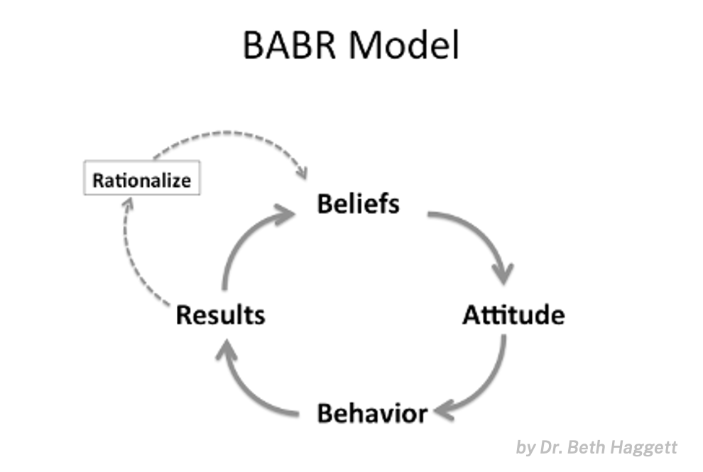
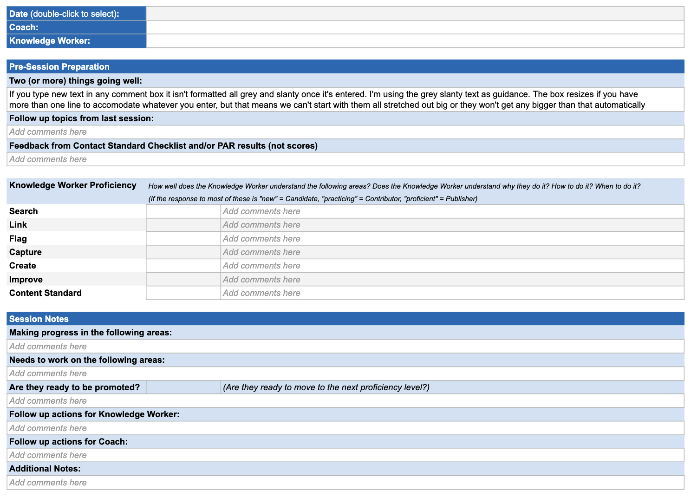

# KCS Coach Reference Guide

> 出典: Consortium for Service Innovation, *KCS Coach Reference Guide* — [CC BY-NC-ND 4.0](https://creativecommons.org/licenses/by-nc-nd/4.0/)  
> 元のページ:
> - [KCS Coach Reference Guide](https://library.serviceinnovation.org/KCS/Coach_Reference_Guide)
> - [Skills of a Coach](https://library.serviceinnovation.org/KCS/Coach_Reference_Guide/10_Skills_of_Coach)
> - [Structuring Coaching Sessions](https://library.serviceinnovation.org/KCS/Coach_Reference_Guide/20_Coaching_Session)
> - [Handling Specific Doubts](https://library.serviceinnovation.org/KCS/Coach_Reference_Guide/30_Handling_Specific_Doubts)
> - [Doubt: All our issues are unique.](https://library.serviceinnovation.org/KCS/Coach_Reference_Guide/30_Handling_Specific_Doubts/Doubt_All_our_issues_are_unique)
> - [Doubt: I already know the answers. Why should I use the knowledge base?](https://library.serviceinnovation.org/KCS/Coach_Reference_Guide/30_Handling_Specific_Doubts/Doubt_I_already_know_the_answers._Why_should_I_use_the_knowledge_base)
> - [Doubt: I don't have time.](https://library.serviceinnovation.org/KCS/Coach_Reference_Guide/30_Handling_Specific_Doubts/Doubt_I_don't_have_time)
> - [Doubt: I wasn’t hired as a tech writer. It’s not my job.](https://library.serviceinnovation.org/KCS/Coach_Reference_Guide/30_Handling_Specific_Doubts/Doubt_I_wasn%E2%80%99t_hired_as_a_tech_writer._It%E2%80%99s_not_my_job)
> - [Doubt: Knowledge is power. Why would I give that up?](https://library.serviceinnovation.org/KCS/Coach_Reference_Guide/30_Handling_Specific_Doubts/Doubt_Knowledge_is_power._Why_would_I_give_that_up)
> - [Doubt: Self-service doesn’t work.](https://library.serviceinnovation.org/KCS/Coach_Reference_Guide/30_Handling_Specific_Doubts/Doubt_Self-service_doesn%E2%80%99t_work)
> - [Doubt: The tools don’t work.](https://library.serviceinnovation.org/KCS/Coach_Reference_Guide/30_Handling_Specific_Doubts/Doubt_The_tools_don%E2%80%99t_work)
> - [Additional Coaching Resources](https://library.serviceinnovation.org/KCS/Coach_Reference_Guide/40_Additional_Resources)

The role of a KCS Coach is to support knowledge workers in their quest for KCS proficiency. KCS Coaches are change agents.

Coaching is the way KCS gets baked into the organization: it is the opportunity to make KCS personal. Coaching sessions provide knowledge workers with visibility to their impact, answers to their questions, and responses to their misconceptions and objections.

> At its heart, coaching is a confidential partnership to help you grow. A good coach creates a safe, non-judgmental space for you to explore solutions, push past limitations, and hold yourself accountable. They’re not here to dwell on mistakes or missteps but to amplify your strengths and abilities and help you be your best self.
>
> - [International Coaching Federation](https://coachingfederation.org/guide-to-experiencing-coaching-for-individuals/)

KCS Coaches help knowledge workers put KCS training into practice in a way that creates value for knowledge workers, the customer, and the organization.  This guide is designed for people who are in the role of a KCS Coach.  For more information about building a coaching program, please see the [KCS Practices Guide](05-process-integration.md#page-7138).

The speed at which organizations realize the benefits of KCS is directly related to the speed at which the Solve Loop behaviors become a habit for the knowledge workers. Coaching is how we increase the speed of adoption and maximize the benefits.
- Coaching for Success, KCS Principles & Core Concepts

## Skills of a Coach

The role of of a coach is first about understanding people’s doubts and concerns before it is about telling people about the benefits or inviting them to try something different. Sustainable change requires bringing to light the underlying assumptions and beliefs that justify a person’s doubts or misconceptions.

Effective KCS Coaching relies on:

- A thorough understanding of the KCS Practices
- Ability to articulate the why we are doing KCS and what's in it for the knowledge worker
- Demonstrated commitment to the success of team members
- Excellent communication skills, particularly in the following areas:
  - Listening skills, seek to understand
  - Explaining and describing concepts
  - Providing feedback
  - Influencing to generate results
- Mindfulness of feelings
- Understanding of support processes and tools
- Demonstrated ability to:
  - Manage time effectively
  - Ability to identify coaching moments - use data and measures to help others become more proficient
  - Appropriate communication with management
  - Deal with objections

Dr. Beth Haggett describes five key coaching skills in her KCS Coach Development workshop, a [KCS Aligned service](https://www.serviceinnovation.org/kcs/kcs-aligned-services/#thrive).  These support the coach competencies required by the International Coaching Federation.

- **Listening** - to what is said and to what is unsaid. This takes place when the influencer is not talking.
- **Inquiry** - asking open-ended questions to understand where others are coming from.
- **Reflection** - making connections, clarifying assumptions and beliefs.
- **Appreciation** - recognizing (out loud) the strengths and contribution of others.
- **Advocacy** - we can advocate for people or ideas; often this is where we advocate for a different point of view. Using the four previous skills builds trust and creates an opportunity for us to offer new ideas and perspectives as part of a conversation (not as a way to point out the ways in which the coachee is wrong).

### Identifying Underlying Beliefs

If we want to change someone's mind, we first have to understand what they believe. *Doubts, misconceptions and objections are gifts badly wrapped*; they give us insight into an individual’s point of view: their beliefs, what they understand, and more importantly, what they don’t understand.

Understanding or exposing the belief(s) that lead a doubter to have their doubt creates an opportunity to offer a different point of view. Beliefs are often not recognized or stated explicitly by the doubter. The goal is to identify the underlying belief(s).

A change in beliefs is required to create a change in results. One way to think about this is represented by the BABR model:

- Beliefs influence Attitude,
- Attitude influences Behaviors, and
- Behaviors drive Results.

To change the results, we have to understand the beliefs and offer a different way to think about things. Using influence skills is an effective way to expose the underlying belief(s). \[The BABR model and the influence skills are from Dr Beth Haggett’s KCS Coach Development workshop and materials.\]

Exposing underlying beliefs is critical in helping doubters think about things differently. We don’t change minds with one conversation. It is an iterative process, and a great opportunity to practice seeking to understand before seeking to solve.

### Suggestions for Discovery

> “Change that is imposed will be opposed.” - Spencer Johnson

It takes curiosity, patience, and practice to expose underlying beliefs.  Here are some ways to approach conversations in which there is resistance.

- Seek to understand before you seek to solve: “Tell me more about that”
- Meet them where they are with empathy: understanding a person's point of view is not the same as agreeing with it. Be curious about why a doubter feels the way they do.
- Recognize emotion-based versus logic-based objections. Most doubts or objections come from an emotional basis (fear, uncertainty, lack of trust).  We cannot use logic to diffuse emotion or change a person’s point of view. We must diffuse the emotion before we can use logic.
- It is far more effective to invite people to join a change initiative than to impose it upon them.  Generally we feel more positive about the things we *choose* to do rather than the things we are told we have to do. If we can offer people a different perspective and help them understand why we want to do things in a different way as well as the benefit for them, we can then invite them to try a different approach.
- And always…..Ask before coaching.
  - "Is now a good time?"
  - "Can I share something that has worked for me?"

## Structuring Coaching Sessions

The frequency with which you meet with a coachee will be determined by your particular program, but 1-4 times per month is typical. The structure of your sessions will depend on where the coachee is in the KCS learning process. [The GROW Framework](https://www.coachingcultureatwork.com/the-grow-model/) is one popular and useful way to structure coaching conversations.

It is management's responsiblity to create an environment where people want to learn KCS. Your role as a coach is to help people down the KCS path.

Focusing on the relationship, learning, and building confidence will go a long way. Remembering your ABC's, or "Ask Before Coaching," builds trust. Examples include:

- "Is this a good time?"
- "Can I share something that has worked for me?"

A KCS Coach has access to tools like the Content Standard Checklist and PAR, which are indicators of how well a knowledge worker understands KCS article structure and workflow. When using these tools, conversations should be focused on behaviors, not data.

### Coach Responsibilities

- Establish rapport and meet regularly with the knowledge workers they are coaching
- Act as a change agent by promoting understanding of the intent and benefits of KCS
- Help knowledge workers assess the quality of knowledge articles and adherence to the problem solving and knowledge management process
  - Review KCS articles framed by the KCS Candidate until they reach required levels of competency
- Promote understanding and adherence to the content standard (Content Standard Checklist)
- Promote understanding and adherence to the Solve Loop processes (Process Alignment Review)
- Provide feedback to the knowledge workers and, when appropriate, to management about KCS skill development
- Develop and monitor your own coaching skills
- Attend regular KCS Coach and/or KCS Council meetings
- Provide recommendations to the KCS Council to improve the workflow and the content standard

#### First Session

- Establish Rapport: Get to know the person you will be coaching.
- Discuss the Big Picture (benefits of KCS to us as knowledge workers, to customers using self-service).
- Negotiate an Agreement: Informal, discussing what expectations there are for each of you, how you will interact and be committed. Determine a cadence for coaching sessions.

#### Second Session

- Establish a baseline: This is the time to discover what was learned at KCS training and where the gaps are in learning.
- Establish milestones: What needs to be accomplished and what are the milestones along the way?
- Invite the person you're coaching to set goals and objectives for development: “Is there a time frame in which you hope to become a Publisher?”

#### Ongoing Sessions

- Prepare for Sessions: review articles, search for duplicates, query the KB, check in on contributions, results from Content Standard Checklist and PAR, review notes from last session.
- Coaching Session: be sensitive to where the knowledge worker is and what they need the most help with.
- Evaluate what you observe and discuss: track your notes and discussions for easy evaluation of proficiency progress.
- Ask for feedback with questions like “What about coaching is working for you?” and “What is not working as well for you?”
- Ask the coachee what they want to work on between now and next session and document that in your coach's notes.
- At the end of every session, set the expectations for the next session: schedule a time, initial agenda, and note any items to focus on or prep for.
- After Session Activities: take time for self-reflection. Ask yourself, “what can I do better?” and document your thoughts and ideas.

#### Proficiency Progress

Progress in KCS proficiency will happen at different rates for each knowledge worker, and timelines will vary by program.

When setting up your coaching program, build a sample timeline to guide your coaching and keep you and the knowledge worker on track. Iterate based on experience.

The below cadence is offered as an example. Amend for your environment!

- Session 1: Train
  - Review learning from training. Knowledge worker understands expectations and is starting to Capture, Search and Link and Flag.
- Sessions 2-3: Coach
  - Knowledge worker understands Capture, Search, Link and Flag, and is learning about Create and adhering to the Content Standard.
- Sessions 4-8: Practice
  - Knowledge worker understands Capture, Search, Link, Flag, Create, Content Standard adherence and is learning about Improving.
- Sessions 9-12: Monitor
  - Knowledge worker is proficiently and confidently Capturing, Searching, Linking, Flagging, Creating, Improving, adhering to the Content Standard and building on consistency in behaviors.

#### Sample Questions a Coach Might Ask

- How is it going with the KCS workflow?
- Walk me through your workflow.
- How's the experience of searching for articles while you work?
- What have you found that's been helpful?
- What have you found that's been distracting or difficult?
- What questions do you have about the Content Standard?
- Is there a case you worked this week that you want to look at together? Articles found while working case, create/modify an article, link an article?
- Do you find it is easy to create an article before moving onto the next case?
- What is currently challenging for you?
- How did it feel when you found that article and linked to the case to quickly help that customer?
- What would you like to get better at? (sample options include but are not limited to: capturing, searching, linking, flagging, creating, content standard, creating, improving, process adherence)
- Where have you made progress since we met last week?
- Can you show me how/where you are doing that so I can see what you are describing?

### Coach Session Tracking Template

Consortium Members have extensive experience with KCS Coaching and have developed both the offered coaching session guidance as well as this coach session tracking template.

Consortium Members have access to this [workbook in Google Sheets](https://docs.google.com/spreadsheets/d/10ioaG4NWdfXU0jd5NlREjBZlyerkwsCmt5wu8RjYjyQ/edit?gid=0#gid=0) for use in coaching sessions. Save a copy and duplicate tabs for separate sessions, or adapt this into your tool of choice.

*(Thanks to Jennifer Crippen and the work of the Connecting the Dots on Coaching team for this guidance and template!)*

## Handling Specific Doubts

Change is hard and any significant change will be met with resistance. As champions of change, KCS Coaches are key in helping those who have doubts or misconceptions about KCS understand and buy-in to the methodology.

The KCS Coach must tailor the conversation to how the organization has implemented the KCS Practices and techniques. Sometimes these conversations might feel awkward; it helps to practice these scenarios with a fellow coach.  The scenarios that follow are based on Consortium Member experience with the KCS Practices Guide. While the KCS Principles cannot be compromised, there are many different ways to implement the Practices and techniques.

Each situation will vary and coaches will have to adjust their approach based on the situation. Listening and good judgment are required; the coach needs to ask questions based on the situation. Asking people to explain their concerns by demonstrating how they do their work can be very insightful.

The skills leveraged and demonstrated throughout these examples are the [five coaching skills](https://library.serviceinnovation.org/Archive/KCS_v6_FOR_RETHINKING/KCS_Coach_Reference_Guide/10_Skills_of_Coach) described previously, developed by Dr. Beth Haggett in her KCS Coach Development workshop, a [KCS Aligned service](https://www.serviceinnovation.org/kcs/kcs-aligned-services/#thrive).

Each of the following examples is structured in the same way:

- a brief overview of the doubt
- a list of possible beliefs behind the doubt
- suggestions for discovering what the doubter believes
- key points for responding to the doubt
- available reference materials
- a sample scenario that outlines how a conversation might go and the coaching skills leveraged

In conversations like these, it is important to be really curious.  We’re aiming to [identify underlying beliefs](https://library.serviceinnovation.org/Archive/KCS_v6_FOR_RETHINKING/KCS_Coach_Reference_Guide/10_Skills_of_Coach#Identifing_Underlying_Beliefs) so we can offer a different way of looking at things!

- [Doubt: All our issues are unique.](09-coach-reference-guide.md#page-6099)
- [Doubt: I already know the answers. Why should I use the knowledge base?](09-coach-reference-guide.md#page-6104)
- [Doubt: I don't have time.](09-coach-reference-guide.md#page-6090)
- [Doubt: I wasn’t hired as a tech writer. It’s not my job.](09-coach-reference-guide.md#page-6101)
- [Doubt: Knowledge is power. Why would I give that up?](09-coach-reference-guide.md#page-6106)
- [Doubt: Self-service doesn’t work.](09-coach-reference-guide.md#page-6102)
- [Doubt: The tools don’t work.](09-coach-reference-guide.md#page-6103)

### Doubt: All our issues are unique.

#### Possible Underlying Beliefs

- Our environment is unique and very complex
- Our customers’ environments are all unique
- KCS is for organizations that have a high degree of repetitive/known issues
- We will never (or very seldom) have an opportunity to reuse an existing article

#### Suggestions for Discovery

- Ask before coaching.
- What contributes to the complexity of the issues?
- Tell me how you solve these complex issues?

#### Key Points for Advocacy

- We might not always reuse the resolution in an article to solve an issue, but having access to everyone’s experience in solving complex issues helps us solve new complex issues faster.
- The KB captures the experience of solving complex issues
- Because we don’t see all the issues customers raise around the world we can not really know how often the same issue is raised

#### Reference Materials

- Principle: Create Value - work tasks, think big picture
- Principle: Abundance - share more, learn more
- Technique: Content Standard

#### Sample Scenario

*NOTE: This is a sample scenario that provides an example of how a conversation might go between a coach/influencer (Sara) and a doubtful experienced knowledge worker (Brian). Coaching skills are denoted in blue.*

*Each situation will vary, and influencers will have to adjust their approach based on the situation. Listening and good judgment are required; it is important to be really curious.  We’re aiming to identify underlying beliefs so we can offer a different way of looking at things!.  Asking people to explain their concerns by demonstrating how they do their work can provide a lot of insight.*

- **Sara:** Hi Brian, is now still a good time to chat? *Inquiry, Ask Before Coaching*
- **Brian:** Hi, yeah … I guess so.
- **Sara:** Oh good.  How are things going? *Inquiry*
- **Brian:** Ehh.. fine. Lots of cases in my queue
- **Sara:** Does searching the knowledge base help? *Inquiry*
- **Brian:** Not really.  Like I said last time I don’t see any value in the KB.
- **Sara:** I know you are skeptical.  But I thought you were going to try to create an article for a few of the cases you handled last week. *Appreciation, Reflection*
- **Brian:** Hmm… I didn’t have time and besides, no one is going to use those articles or resolutions again. As I also mentioned last time all our case resolutions are unique to each customer.
- **Sara:** Ah yes I remember you were saying the product you support is highly customized for each installation. *Reflection*
- **Brian:** Right … so why create an article for the issues when there is no chance they will be reused again?
- **Sara:** I understand.  You don’t have many repeat issues. *Reflection*
- **Brian:** I can’t remember the last time I had a known issue.
- **Sara:** I think you had said you have been working with this product for the past 4 years. *Reflection, Inquiry*
- **Brian:** Yup
- **Sara:** Do you feel you are better at solving issues now than when you first started working in this area? *Inquiry*
- **Brian:** Oh absolutely. I am now the technical specialist in this area.
- **Sara:** That’s great.  And, what things have contributed to your expertise in this area? *Appreciation, Inquiry*
- **Brian:** Oh gosh...hmmm
- **Sara:** Did you have some formal training? *Inquiry*
- **Brian:** No… but  I would have to say I had a great mentor when I started on this team.
- **Sara:** And they taught you a lot about the product? *Inquiry*
- **Brian:** Yeah… mostly tips on how to troubleshoot issues.
- **Sara:** Is there a troubleshooting guide? *Inquiry*
- **Brian:** No… but early on I took a lot of notes \[*reaching into his desk drawer for notebook*\]
- **Sara:** Oh nice…. Do you still reference that? *Appreciation, Inquiry*
- **Brian:** Sometimes, after 4 years of experience in troubleshooting this product I know how to approach the issues.
- **Sara:** That’s impressive.  What if the information you have in your notebook were in the knowledge base? *Appreciation, Advocacy*
- **Brian:** Ahh… well… these aren’t fixes to issues.
- **Sara:** Well… In this environment, you might not reuse the exact fix from an article to resolve an issue but it sounds like having access to yours and others' past experiences in solving similar issues helps you solve new issues. The value of the knowledge base is more than just the resolutions to issues; it is the types of things you have captured in your notebook. *Advocacy, Reflection, Advocacy*
- **Brian:** I don’t think you can capture the experience in a knowledge base.
- **Sara:** We might not get it all perfectly … but what if everyone on the team had access to each other's experience in solving complex issues.  The KB replaces yours and other's notebooks. *Appreciation, Advocacy*
- **Brian:** Uummmmm…  not so sure about that
- **Sara:** Ok…Tell me more about your hesitation. *Inquiry*
- **Brian:** Well … my notebook is my place to document things….. and I don’t have confidence in all of it.  Some of it are things I have tried or resolutions I have proposed, but they are not validated or confirmed.
- **Sara:** Ah, I see. *Reflection*
- **Brian:** You know I have worked hard to establish a positive reputation here and I don’t want to damage that.
- **Sara:** Certainly not…. What if you had a way to identify or distinguish those things you are confident about from those things that were experimental? *Advocacy*
- **Brian:** Hmmmm… maybe
- **Sara:** Would you be willing to try capturing your experience in the KB  …rather than spending time writing in your notebook? It shouldn’t take more time than you spend now updating your notebook. *Advocacy*
- **Brian:** Well … I guess
- **Sara:** It really shouldn’t be extra work, it is just a different way to capture your experience and it would be available to others on the team. *Advocacy*
- **Brian:** And I can flag things as unconfirmed?
- **Sara:** Yes.

### Doubt: I already know the answers. Why should I use the knowledge base?

#### Possible Underlying Beliefs

- Everybody knows the answer to the easy issues
- If I know the answer and I know it is in the KB why should I have to search and link?

#### Suggestions for Discovery

- Ask before coaching.
- Tell me more about that?

#### Key Points for Advocacy

- A complete KB will help new people
- Reduce rework, reduce the number of known issues that come in as cases
- Enable customers to find the answers through self-service
- Linking, even if you know the answer is important for a number of reasons:
  - Capture information about how many times customers are experiencing an issue.
  - Ensure high-value content is available to customers through self-service
  - Linking helps improve the search engine
  - Use the linking data to drive root cause analysis and corrective actions.
  - In addition to driving product improvements, we leverage linking rates as one of the indicators that enable the Knowledge Domain Analysis such as identifying candidate issues for: top ten lists of issues by product, hub articles, multimedia presentation of content, and automation. The data can be leveraged to make improvements in many areas.

#### Reference Materials

- [KCS Benefits](https://library.serviceinnovation.org/KCS/KCS_v6/KCS_v6_Adoption_Guide/000_Introduction/020_KCS_Benefits)
- Technique: [Linking](https://library.serviceinnovation.org/KCS/KCS_v6/KCS_v6_Practices_Guide/030/030/030/030)
- Technique: [KCS Roles and the Licensing Model](https://library.serviceinnovation.org/KCS/KCS_v6/KCS_v6_Practices_Guide/030/040/030/020)
- Technique: [Knowledge Domain Analysis](https://library.serviceinnovation.org/KCS/KCS_v6/KCS_v6_Practices_Guide/030/040/010/060)

#### Sample Scenario

*NOTE: This is a sample scenario that provides an example of how a conversation might go between a coach/influencer (Heidi) and a doubter (Sophia). Coaching skills are denoted in blue.*

*Each situation will vary, and influencers will have to adjust their approach based on the situation. Listening and good judgment are required; it is important to be really curious.  We’re aiming to identify underlying beliefs so we can offer a different way of looking at things!.  Asking people to explain their concerns by demonstrating how they do their work can provide a lot of insight.*

- **Heidi:** Hi Sophia, how are you doing? *Inquiry*
- **Sophia:** Oh hi Heidi. Pretty good. Are you here to bug me about the knowledge base?
- **Heidi:** Ha, well I am sorry you feel that way.  You are not a fan of KCS? *Inquiry*
- **Sophia:** Not at all.
- **Heidi:** Can we talk about that a bit? *Inquiry*
- **Sophia:** I suppose.
- **Heidi:** Can you tell me what you don’t like about it? *Inquiry*
- **Sophia:** It seems like a lot of busy work to me.
- **Heidi:** Ok, tell me more about that. *Inquiry*
- **Sophia:** Well, I don’t know about the product area you work in but after a year or two in this product area, we pretty much know the answers to the issues.
- **Heidi:** Huh….how often do you get an issue that you already know the answer to? *Inquiry*
- **Sophia:** Uhhh… probably 60-70 percent of the time.
- **Heidi:** Ah.
- **Sophia:** Right, so why should I spend time searching and linking a KB article when I know the answer?
- **Heidi:** Well, do you enjoy answering the known issues? *Inquiry*
- **Sophia:** Oh, it's ok… but I wouldn’t mind if we didn’t get so many repeat issues.
- **Heidi:** And you know ….one of the goals of KCS is to enable customers to solve as many of those known issues through self-service. Another goal is to be able to identify those repeat issues so development can fix them. *Advocacy*
- **Sophia:** Yeah….I have heard that…. But it is not happening.
- **Heidi:** It does take some time to change the customers’ behavior.  And it takes some time to collect the data to present to the development team. *Reflection, Inquiry*
- **Sophia:** Well ….what does that have to do with me?
- **Heidi:** Hmmm.  That’s a good question. *Appreciation*
- **Sophia:** If I know the answers and I know an article exists in the KB…  why should I take the time to search and link?
- **Heidi:** Well….Linking has a number of benefits because it helps the search engine, frequently used articles will have a higher weight in the search ranking but also linking enables the Knowledge Domain Analysis that helps us identify the demand drivers. *Advocacy*
- **Sophia:** Well …why can’t I just tell you what the frequent issues are?
- **Heidi:** That works … to a point. But since we have support centers across many geographies, any one person might not see how often an issue is being raised by customers.  If we have input globally, through the link rates, we can identify the demand drivers much faster.  *Advocacy*
- **Sophia:** Hmmm… and why is that important?
- **Heidi:** It’s important for a number of reasons.  It tells what articles we should promote through self-service, like what articles should be on the top 10 list for this product. It also tells us what issues might be candidates for multimedia. And perhaps most importantly what issues development should look at for corrective actions. *Advocacy*
- **Sophia:** Really? That seems like the best reason to link but is development signed up for that?
- **Heidi:** Some of the dev groups are actually very interested in the customer experience. And the link rates help identify and provide quantitative, actionable data for the issues they should pay attention to.  *Advocacy*
- **Sophia:** And what about the dev groups that aren’t signed up for this?
- **Heidi:** Well…We are working with them. Once they see the benefit gained by the dev teams that are doing the root cause analysis and taking corrective action, I think they will come around quite quickly. *Advocacy*
- **Sophia:** So you think the link rates can actually drive product improvements?
- **Heidi:** I do. Remember the error message that came up for a whole bunch of our customers after the last release? *Advocacy*
- **Sophia:** Oh yeah…that was painful.
- **Heidi:** Right. It was both the number and speed of the linking activity for that article that gave Development a compelling incentive to fix it quickly.
- **Sohpia:** Well….it was surprising how quickly the Dev team fixed that one.
- **Heidi:** And we have real-life examples from other companies who have benefited from having linking data. But we need people to link, and link accurately, in order to make the data valid and actionable.
- **Sophia:** Ok… I didn’t know about the opportunity to influence our dev teams. But linking for known issues is a little tedious.  I wish we had an easy quick way to flag those frequent issues.
- **Heidi:** Oh…Have you used the favorites feature in our tool? *Inquiry*
- **Sophia:** Ahhh…. no
- **Heidi:** Well… you can create a list of the articles you use frequently and with one click link them to a case you are resolving. *Advocacy*
- **Sophia:** Really?
- **Heidi:** Yes.  And of course, for the data analysis to be valid we need the linking to be accurate.  *Advocacy*
- **Sophia:** Hmmm…. And what did you mean by accurate?
- **Heidi:** The article linked to a case needs to contain the resolution to the issue described in the case. It needs to be relevant and actionable. *Advocacy*
- **Sophia:** Ah. That makes sense.
- **Heidi:** So…. now that you know the benefits do you think you could try linking? *Advocacy*
- **Sophia:** Yeah … I will try it.  Also we should let the rest of the team know about this.

### Doubt: I don't have time.

This concern often comes from knowledge workers whose primary responsibility is resolving issues (cases). Knowledge workers are often under pressure to resolve an issue as quickly as possible so they can move on to the next, or in some cases, they are working on many issues at the same time. Even without KCS, this can be overwhelming.

#### Possible Underlying Beliefs

- No value to me
- I am measured on how many cases I close
- I have to create an article for every case
- I don’t want others to see a resolution that I wrote that I am not confident in

#### Suggestions for Discovery

- Is this more of a time management issue with the knowledge worker or really a concern about KCS?
- This doubt is often driven by an unstated belief or fear.
- Ask before coaching.
- Use inquiry, reflection, and appreciation while seeking to understand and diffuse the emotion.
  - Tell me more about that?
  - What kinds of things or reference materials do you use to solve issues?

#### Key Points for Advocacy

Use sparingly!

- Most likely, they are already spending time capturing, just not in a way that is structured, widely shared, or following quality case management practices. Most knowledge workers (in moderate to highly complex environments) take notes, especially when they encounter a new issue. The notes are often done in a notebook or in a digital form (word, excel), sometimes on a team-shared drive. But the repository lacks standards and isn’t shared with everyone who might benefit or contribute.
- Knowledge workers have to document the resolution and if it is a new issue the case was probably created by the customer in self-service. If they are in a tiered model, they should only have to complete the notes that were started at the first point of contact, which could be case create in self-service or captured by level 1.
- Creating an article from scratch should be an exception. Once KCS has been adopted for a few months, most issues should already have an article. And, if it is a new issue, with case create as part of most self-service mechanisms the customer has created some of the content that would become part of a new article. Creating an article from scratch by a knowledge worker generally only happens in the knowledge domain analysis activity (the Evolve Loop)
- Fewer disruptions from others - If the issue is in the KB others won’t have to bother you with questions about it.
- Eliminate redundant work - If the issue is available in self-service the customers can find it on their own or will have a better understanding of their issue by reviewing similar articles in the knowledge base.

#### Reference Materials

- [KCS Benefits](https://library.serviceinnovation.org/KCS/KCS_v6/KCS_v6_Adoption_Guide/000_Introduction/020_KCS_Benefits)
- Practice: [Capture](https://library.serviceinnovation.org/KCS/KCS_v6/KCS_v6_Practices_Guide/030/030/010)
- Technique: [Linking](https://library.serviceinnovation.org/KCS/KCS_v6/KCS_v6_Practices_Guide/030/030/030/030)
- Technique: [Self-service Success](https://library.serviceinnovation.org/KCS/KCS_v6/KCS_v6_Practices_Guide/030/040/010/080)

#### Sample Scenario

*NOTE: This is a sample scenario that provides an example of how a conversation might go between a coach/influencer (Nigel) and a doubter (Jan). Coaching skills are denoted in blue.*

*Each situation will vary, and influencers will have to adjust their approach based on the situation. Listening and good judgment are required; it is important to be really curious.  We’re aiming to identify underlying beliefs so we can offer a different way of looking at things!.  Asking people to explain their concerns by demonstrating how they do their work can provide a lot of insight.*

- **Nigel**: Hi Jan
- **Jan**: Oh…. it's the KCS guy.
- **Nigel**: Yes, I just wanted to see what you thought about the KCS training? *Inquiry *
- **Jan**: Well… I don’t think KCS is going to work for me.  I don’t see how we have time to write articles for all the cases.
- **Nigel**: I can see how it might appear that way, especially in the beginning. Can we explore that a bit? *Appreciation, Reflection*
- **Jan**: …Ok…
- **Nigel**: How often would you say you already know the answer to an issue? *Inquiry*
- **Jan**: Ummmm, well since I have become the point of escalation for this product… probably about half of the cases I get are new issues.
- **Nigel**: Ah… you are the point of escalation for the team? *Reflection*
- **Jan**: Yup
- **Nigel**: Do you enjoy that? *Inquiry*
- **Jan**: Yeah… mostly.  Some of the stuff I get should have been solved before it gets to me.
- **Nigel**: How long have you been on this team? *Inquiry*
- **Jan**: Oh….. a little over 2 years.
- **Nigel**: That’s impressive. *Appreciation*
- **Jan**: When I joined the team I had a great mentor, she has moved on to the development team.
- **Nigel**: So others on the team are sending you cases that they are struggling to solve? *Reflection, Inquiry *
- **Jan**: Yes.
- **Nigel**: And how do those cases get to you? *Inquiry*
- **Jan**: Well … usually they show up in my queue.
- **Nigel**: And you said you know the answers to about half of those issues? *Reflection, Inquiry*
- **Jan**: Yeah… depends on where we are in the release cycle … but yes, typically I already know the answer to about half of the cases I get.
- **Nigel**: And is there typically an article in the knowledge base for those known issues? *Inquiry*
- **Jan**: I guess so?
- **Nigel**: You probably remember the “solve it once, use it often” sound bite from the training?  *Advocacy*
- **Jan**: Yeah
- **Nigel**: Well….The great thing about “solve it once, use it often” is once we have captured those known issues that we have to deal with frequently, we should just be reusing an existing article.  No need to create one. So I think you said about half of your cases are known and for those, you would be reusing an existing article.  *Advocacy, Reflection *
- **Jan**: Hmmm…. ok
- **Nigel**: And our goal is to get those known issues and articles to our customers via self-service… so over time you should see fewer of those known issues in your queue.  Some of that “stuff” you mentioned you get in your queue would be resolved before it gets to you. *Advocacy*
- **Jan**: Well, I will say that is one thing I like about KCS is getting more content to the customers. But I don’t have the time to write them.
- **Nigel**: Can we talk about those cases you don’t already know the answer to?
- **Jan**: Sure
- **Nigel**: Do those cases usually come with some information about the issue, either in the case notes or in an attached work-in-progress article? *Inquiry*
- **Jan**: Ummm… yes there is usually some information about the issue.
- **Nigel**: So the description of the issue and the relevant environment and product information is already captured. *Advocacy*
- **Jan**: Oh?
- **Nigel**: Tell me a little bit about how you pursue a resolution, what kind of resources do you use? *Inquiry*
- **Jan**: Well, my past experience is very helpful.
- **Nigel**: Anything else? *Inquiry*
- **Jan**: I might ask one of my peers if it is something I think they have experience with.
- **Nigel**: Do you use any of the product documentation? *Inquiry*
- **Jan**: Not very often, I do search our shared drive if it is something that I am not familiar with.
- **Nigel**: Oh? What is the shared drive? *Inquiry*
- **Jan**: Well, some time ago our team started to use a shared drive to document diagnostic steps and some of the tough or critical issues we encounter.
- **Nigel**: Nice….. and who updates that? *Appreciation, Inquiry*
- **Jan**: We all do if we think it is critical.  But I would say it is mostly me since I get the tough ones.
- **Nigel**: It sounds like you are already spending time capturing your critical issues. What if you put them in the knowledge base instead of the shared drive? *Reflection, Advocacy*
- **Jan**: Ummmm… that would never work….
- **Nigel**: Why is that? *Inquiry*
- **Jan**: Because…. It’s our space, we don’t want to open it up to just anybody.
- **Nigel**: Ah, when you say it’s our space … is it just for the team here in Austin or do the people who work in this product area in Europe and Asia have access to it as well? *Inquiry*
- **Jan**: No, I think they would mess it up.
- **Nigel**: Oh? Say more about that. *Inquiry*
- **Jan**: The other teams don’t have the depth of experience we have here.  They often ask us for help.
- **Nigel**: Ah… do you think they could answer some of their questions themselves if they had access to your shared drive? *Inquiry*
- **Jan**: Yeah…. maybe
- **Nigel**: It could reduce the number of questions they ask you. *Advocacy*
- **Jan**: Hmmmm….. I don’t know, I think they each have their own shared drive….. Oh…. I see what you're getting at…. we should be using the same shared drive for the global support team.
- **Nigel**: That does seem like it would help. *Advocacy*
- **Jan**: I just don’t trust that they won’t screw it up.
- **Nigel**: Hmmm… it seems like having a common place to share our global experience in resolving customers issues would be a good idea.  Do you have any thoughts on what it would take to keep others from “screwing it up”? *Advocacy, Inquiry*
- **Jan**: Well… I did get a chance to look at the UK’s shared drive…. And they use a different format.
- **Nigel**: Ah… so we might need a standard format or structure for the content? *Inquiry*
- **Jan**: Yeah… but I am not sure how we would enforce that?
- **Nigel**: What if … we had coaching around the use of the shared drive to encourage standards? *Advocacy*
- **Jan**: Hmmm… maybe. I think a few of the folks in the UK would be good at it but I would be concerned about the others.
- **Nigel**: Ok… is there a way we might manage that? *Inquiry*
- **Jan**: I don’t know… can we tell some of the people they can update the content and others can’t?
- **Nigel**: Ah… we do have a way to do that. Do you remember hearing about the licensing model in KCS? *Advocacy, Inquiry*
- **Jan**: Oh… vaguely. So in the UK Lizz and Colin could contribute but others couldn’t.
- **Nigel**: Right, but the coaching could help the others earn the right to contribute in a helpful way. *Advocacy*
- **Jan**: Huhh..
- **Nigel**: So, what if we had a way to manage the risks through a combination of edit rights, content standards, checklists and Coaching? *Advocacy*
- **Jan**: That sounds complicated.
- **Nigel**: Well…The KB is already set up with all of that. Additionally, the articles have indicators of how often it has been used and updated.  *Advocacy*
- **Jan**: Oh?… hmmm…we don’t have anything like that in the shared drive but it would be helpful to know. Well…. I guess I can see where Europe and Asia might be able to solve more of their issues if they had access to the information in our shared drive.
- **Nigel**: And what makes it less complicated is tying it all together with Coaching. *Advocacy*
- **Jan**: Ummm… ok
- **Nigel**: Would you be willing to look at the licensing model and the article content standard and see if you think they would work for the global team? *Inquiry*
- **Jan**: I guess…. If it means it won’t turn the shared drive into a free for all… but it seems we are putting a lot of faith in the coaching.
- **Nigel**: Yes, coaching is critical to our success in implementing global standards. We should set up a time to go over the licensing model and the content standard. But before we do… can we get back to your initial concern about the time it takes to create articles? *Reflection, Inquiry, Reflection*
- **Jan**: Well…. I get it…. I don’t have to create an article for every case.
- **Nigel**: Right. The whole point of the KCS Solve Loop process is to capture what we collectively learn from solving customers’ issues and reuse it. So we should only be creating an article for new issues… And as the point of escalation, the case for a new issue should come with a lot of the information you would need to create a new article if a work-in-progress article hasn’t already been created.   *Advocacy*
- **Jan**: Hmmmm…. Ok, maybe it’s not as bad as I thought
- **Nigel**: Let’s set up a time to review the licensing model and the content standard for the KB and see how you might transition from the shared drive to the KB. *Advocacy*
- **Jan**: Ok…. I will take a look at it.

### Doubt: I wasn’t hired as a tech writer. It’s not my job.

This concern often comes from...

#### Possible Underlying Beliefs

- Fear of change
- Perception of extra work
- Need to write a “story” or create a document in sentences and paragraphs
- Customer description of the issue is never correct so why capture it?

#### Suggestions for Discovery

- Ask before coaching.
- I can see how you might expect it to be more work
- Can you show me how you handle your cases and where you see the extra effort

#### Key Points for Advocacy

- This is doubt is often driven by an unstated belief or fear.
- Only need to write the key points/facts
- We already write much of what should be in the article in the case notes
- We want to preserve and connect the customer’s perception of what is happening to the facts about the issue, the environment and the resolution
- KCS does not propose additional work it proposes we do our work in a different way that creates a structured and findable article

#### Reference Materials

- Principle: [Create value](01-principles-and-core-concepts.md#page-369) - work tasks, think big picture
- Practice: [Capture in the workflow](https://library.serviceinnovation.org/KCS/KCS_v6/KCS_v6_Practices_Guide/030/030/010)
- Technique: [Content Standard](https://library.serviceinnovation.org/KCS/KCS_v6/KCS_v6_Practices_Guide/030/040/010/040)

#### Sample Scenario

*NOTE: This is a sample scenario that provides an example of how a conversation might go between an influencer (Mala) and a doubtful knowledge worker (Stephan). Coaching skills are denoted in blue.*

*Each situation will vary, and influencers will have to adjust their approach based on the situation. Listening and good judgment are required; it is important to be really curious.  We’re aiming to identify underlying beliefs so we can offer a different way of looking at things!.  Asking people to explain their concerns by demonstrating how they do their work can provide a lot of insight.*

- **Stephan**: Oh, hi Mala
- **Mala**: Hello Stephan
- **Stephan**: I didn’t realize it was time for us to meet … let me just finish these case notes and email the customer the resolution.
- **Mala**: Sure
- **Stephan**: Ok, what’s on your mind today?
- **Mala**: I wanted to check in and see how you are doing with the knowledge base and creating articles. *Inquiry*
- **Stephan**: Oh…. well, ummmm I really don’t see how I am supposed to do that in addition to my case workload.  We have been very busy since the new release came out.
- **Mala**: Ah yes, I know I have seen the case volume reports. You have been busy! *Reflection*
- **Stephan**: So there is really no way I can write articles with all this activity.
- **Mala**: I know you have heard this before… but we are hoping that the KCS processes will be less work, not more. *Advocacy*
- **Stephan**: Well, good luck with that.  And besides, I think I was hired to solve customer issues not to be a technical writer.
- **Mala**: I see, maybe you can show me where you see it causing additional work? *Inquiry*
- **Stephan**: Ok.
- **Mala**: Can we use that case you just closed as an example?  *Reflection, Inquiry*
- **Stephan**: Sure, it was a tough one. But I did figure out the resolution.
- **Mala**: Was that what you were writing in the case notes? *Inquiry*
- **Stephan**: Yup.  And I suppose you think I should create an article in the KB … which is a lot of rework and takes more time.
- **Mala**: Well, it seems you have already written the resolution. Is there a way you could reuse that? *Inquiry*
- **Stephan**: I suppose I could cut and paste it into an article but I still have to create the other fields.
- **Mala**: Are you familiar with the “create article from the case” feature? It was just added to the system a few weeks ago. *Inquiry*
- **Stephan**: Oh…. that just doesn’t make sense because most of these cases are created by the customer on the service portal. I wouldn’t want to put the customer’s perception of the issue into the knowledge article. It’s never technically correct.
- **Mala**: Yes I know customers often have an inaccurate view of what is happening. *Reflection*
- **Stephan**: Right, so we certainly don’t want that misinformation to be in a KB article.
- **Mala**: Well….. Actually… the structure of the article allows us to capture the customer’s perception of what is happening and connect it to the technically correct information. *Advocacy*
- **Stephan**: Really?
- **Mala**: Yes, capturing the customer’s view as part of the article is what makes it findable for other customers because that is likely how other customers who encounter this problem would describe it.  As you said customers aren’t going to describe the issue in technically correct terms, they will use their own words. *Advocacy, Reflection*
- **Stephan**: Huhh… Ok… so how bout some of those other fields in the article?
- **Mala**: Right, like the environment statements? *Reflection*
- **Stephan**: I guess.
- **Mala**: I know when I am working the queues and encounter a new issue, I will often take a few notes as I diagnose the issue.  I see you have a notepad there. Did you take some notes when you were working on this case?  *Advocacy, Inquiry *
- **Stephan**: Ummm…. Yeah, I write down some of the key points about the situation based on my conversation with the customer.
- **Mala**: That’s great. Can we look at your notes for that case? *Appreciation, Inquiry*
- **Stephan**: Sure, there’s the customer name and his answers to some of my questions about what release they are on and a few points about the configuration parameters they had.
- **Mala**: Yup, I would do the same thing.  So a lot of those notes are in fact the environment statements in the article.  What if you captured them in a work-in-progress article instead of on your notepad? *Appreciation, Advocacy*
- **Stephan**: They are pretty cryptic
- **Mala**: Well, most of a good knowledge article is not written in sentences and paragraphs. We just want the facts. *Advocacy*
- **Stephan**: Oh
- **Mala**: So … my observation is we don’t want you to be a tech writer. And, you are already capturing or writing what is in a knowledge base article either in your case notes or in your notebook.  *Advocacy, Reflection*
- **Stephan**: hmmm
- **Mala**: I don’t see KCS as being additional work, it is about doing what we do in a different way.  *Advocacy*
- **Stephan**: I don’t know….
- **Mala**: I know it takes a little bit of time to get used to working in a different way but the benefits we see in teams that have mastered it are really compelling.  Would you be willing to try it next time you get a new issue? *Reflection, Inquiry*
- **Stephan**: ….. Maybe.
- **Mala**: Oh good.  Let me know if you have any questions.

### Doubt: Knowledge is power. Why would I give that up?

#### Possible Underlying Beliefs

- You want my knowledge so you can outsource my job and fire me.
- I am only valued for what I know
- No one else is going to give up their knowledge, why should I?

#### Suggestions for Discovery

- Ask before coaching.
- I can see how you could feel that way… can we talk more about that?
- What are the things you enjoy about your job?

#### Key Points for Advocacy

- Most support people don’t enjoy answering questions and solving issues they have already solved, they enjoy the challenge and satisfaction of solving new issues
- Eliminate repetitive work
- High-value work is solving new, we need people who are good at that

#### Reference Materials

- Principle: Create value - work tasks, think big picture
- Principle: Abundance - share more, learn more
- Practice: Performance assessment

#### Sample Scenario

*NOTE: This is a sample scenario that provides an example of how a conversation might go between a coach/influencer (Miguel) and a doubtful experienced knowledge worker (Scott). Coaching skills are denoted in blue.*

*Each situation will vary, and influencers will have to adjust their approach based on the situation. Listening and good judgment are required; it is important to be really curious.  We’re aiming to identify underlying beliefs so we can offer a different way of looking at things!.  Asking people to explain their concerns by demonstrating how they do their work can provide a lot of insight.*

- **Miguel:** Hi Scott
- **Scott:** Oh hi….
- **Miguel:** How’s it going?
- **Scott:** Ok, very busy
- **Miguel:** Well, do you have a few minutes to talk? *Ask Before Coaching*
- **Scott:** A few…
- **Miguel:** Thank you. Have you tried using the knowledge base? That might help you solve some of your many issues faster? *Advocacy*
- **Scott:** I am not using the knowledge base, there is nothing of value in there.
- **Miguel:** Oh… have you tried it? *Inquiry*
- **Scott:** No one is going to put their knowledge in the KB.
- **Miguel:** Oh?
- **Scott:** We get paid for what we know… if we put our knowledge in the KB then you don’t need us. I really think it is an attempt to reduce staff or outsource our jobs.
- **Miguel:** Well, I guess I can see how you could see it that way.  From what I have seen, management seems to appreciate the work you do. *Appreciation*
- **Scott:** Hmmm
- **Miguel:** Can you tell me more about the work you do? *Inquiry*
- **Scott:** You don’t want to talk about outsourcing our jobs?
- **Miguel:** We will get back to that. I would just like to understand more about what you do and what you like about it.*Inquiry*
- **Scott:** Humph… ok…. I guess …like helping our customers and solving their issues.
- **Miguel:** Nice, and are there types of issues you enjoy more than others? *Inquiry*
- **Scott:** I guess I enjoy the challenge of the tough ones… even though they often take longer to solve.
- **Miguel:** How often do you get tough ones? *Inquiry*
- **Scott:** Probably about one or two a week. Depends on the development cycle and new releases.
- **Miguel:** And the rest are pretty easy? *Inquiry*
- **Scott:** Yeah
- **Miguel:** Anything else you like about your job? *Inquiry*
- **Scott:** Well …. ummm…I really like working in new product areas. You know, expanding my expertise.
- **Miguel:** Would you like to work on more of the tough ones and fewer of the easy ones? *Reflection, Inquiry*
- **Scott:** Sure, there is no challenge in the easy ones.
- **Miguel:** Are the easy ones easy because you already know the answer or are they easy to figure out? *Inquiry*
- **Scott:** Oh, mostly they are familiar, I already know the answers.  But it's good for my stats.
- **Miguel:** Your stats?
- **Scott:** You know … the stats on how many cases I close a month.
- **Miguel:** Hmmm… I don’t think that is a key measure anymore. That was taken off the scorecard a few months ago. *Advocacy*
- **Scott:** What?  I didn’t hear that.
- **Miguel:** You should check with your manager about that.  But back to the work you get.  Would your job be more interesting if some of those easy cases went away? *Inquiry*
- **Scott:** I guess so… if they have really changed the measures.
- **Miguel:** Well the point of using the knowledge base is to solve an issue once and use it often. So if the easy, known issues are available through self-service the customer can find them and solve their issue without opening a case. *Advocacy*
- **Scott:** Yeah? That sounds good theoretically. But it seems like less work means we need fewer people.
- **Miguel:** Maybe… but we still need good problem solvers, like yourself to solve the new issues. Development isn’t going to stop doing new releases. *Appreciation, Advocacy*
- **Scott:** Well…That’s true.
- **Miguel:** The organization needs to keep people who create value, those who can solve the tough issues and have a broad skill set. *Advocacy*
- **Scott:** Ok, I guess I can see that.
- **Miguel:** If we are really successful with KCS, and that will take some time, the people we won’t need are those who are only solving the known issues. *Advocacy*
- **Scott:** Oh you mean like Sam who only takes the easy cases from the queue?
- **Miguel:** Well, I am not going to name any names but it does seem every team has a person or two who is known for that. *Advocacy*
- **Scott:** So… you are saying: knowing the answer is not as important, or as valuable, as being able to figure out the answer?
- **Miguel:** Right. Your value to the organization is not how many issues you know the answer to, it is your ability to solve new issues. And it sounds like you enjoy that. *Advocacy, Reflection*
- **Scott:** Humph…
- **Miguel:** But, to get rid of the known, easy issues, we have to capture them in the KB so we can promote them through self-service. *Advocacy*
- **Scott:** Ah…so that’s what this “solve it once, use it often” means?!
- **Miguel:** Yes! In fact, Barbara created an article about that common error message. It was published to self-service and has over 1000 hits just this month. AND… now development is looking at fixing the cause. *Advocacy*
- **Scott:** Well… I guess I can see where that makes sense. But I need to talk to my manager about those case closure measures
- **Miguel:** Yes. To your point earlier about outsourcing jobs. The business is growing and you have probably heard how hard it is to find the skills we need. Our goal is to improve our efficiency so that we don’t have to hire more people as the business grows. *Reflection, Advocacy*
- **Scott:** So getting rid of the known, repetitive issues is how we improve our efficiency?
- **Miguel:** That is one important piece of the puzzle. What do you think: would you be willing to try and use the knowledge base to capture the issues you solve so we won’t have to take that case again? *Advocacy*
- **Scott:** Well… ok.  I might try it for a few of my cases.

### Doubt: Self-service doesn’t work.

This concern often comes from...

#### Possible Underlying Beliefs

- Customers will always want to call us
- Customers pay for support why would they want to do it themselves
- Customers don’t/won’t search
- There isn’t enough content available through self-service
- Customers don’t understand the technical details about their issues

#### Suggestions for Discovery

- Ask before coaching.
- Tell me more about that?

#### Key Points for Advocacy

- We don’t have visibility to all the customers’ activity in pursuing answers.
- Customer demand for support is much greater than what we see as cases coming into the support center.
- Customers are using many different channels to get answers, including google, online communities, and forums.
- Volume of activity in online forums/communities and self-service is huge.
- For most customers finding an answer to their issue in self-service is much faster than opening a case and waiting to talk with someone.
- Industry stats show way more activity in Self-service than in case volume.
- How often have you called support for the products you use?
- What is the first thing you do if you have an issue with the tools you use?

#### Reference Materials

- Principle: [*Create Value*](01-principles-and-core-concepts.md#page-369) - work tasks, think big picture
- Principle: [*Demand Driven*](https://library.serviceinnovation.org/Leadership_in_an_Adaptive_Organization/010_Principles_for_an_Adaptive_Organization/030_Demand_Driven) - just in time, not just in case
- Technique: [*Self-service Success*](https://library.serviceinnovation.org/KCS/KCS_v6/KCS_v6_Practices_Guide/030/040/010/080)

#### Sample Scenario

*NOTE: This is a sample scenario that provides an example of how a conversation might go between an influencer (Pat) and a doubtful experienced knowledge worker (Luke). Coaching skills are denoted in blue.*

*Each situation will vary, and influencers will have to adjust their approach based on the situation. Listening and good judgment are required; it is important to be really curious.  We’re aiming to identify underlying beliefs so we can offer a different way of looking at things! Asking people to explain their concerns by demonstrating how they do their work can provide a lot of insight.*

- **Pat**: Hello Luke, how are things?
- **Luke**: Hi, just fine.
- **Pat**: I see you created a few KB articles last week and they are now available on self-service. That’s great! *Appreciation*
- **Luke**: Yeah… you’re welcome…. But I doubt anyone will use them.
- **Pat**: Oh…. why is that? *Inquiry*
- **Luke**: Customers will always call us.  They are not going to use self-service.
- **Pat**: Hmmmm… tell me more about why you feel that way? *Inquiry*
- **Luke**: Well… first of all most of them pay for support, which I assume we like the revenue. And, second I doubt they will go to the trouble of searching.
- **Pat**: I see.  *Reflection*
- **Luke**: I mean really…. they call us with the simplest stuff.
- **Pat**: I guess some of our customers might prefer to call us.  But what do you do when you have an issue with the products you use?  *Reflection, Inquiry*
- **Luke**: Google… I google it.
- **Pat**: I remember the google story you told about the battery on your car’s keyfob going dead.  You were dreading calling the car dealer or having to go to the car dealer to get the battery changed. *Reflection*
- **Luke**: Right, it wasn’t at all obvious how to open the keyfob so I googled it and found a youtube video that showed how to change the battery.
- **Pat**: And your car was under an extended warranty? *Reflection*
- **Luke**: Well yes… but googling it was much faster.  I found the video in less time it would have taken me to find the phone number and call Toyota.
- **Pat**: Industry data shows that most people are like you.  They would rather find an answer in online community forums or self-service than open a case.  *Advocacy*
- **Luke**: Yeah… but I don’t think that applies to our customers.
- **Pat**: Ah… I think that might be true if they have a really critical issue.  But for many issues, they can find an answer faster online than opening a case.  *Advocacy*
- **Luke**: Mmmm…. I don’t know.
- **Pat**: Have you seen the reports that show the volume of activity in the community forum for our products? *Inquiry*
- **Luke**: No.
- **Pat**: It is pretty enlightening. It really shows how we don’t see all our customers’ activity in pursuing resolutions to issues by just looking at our case volume. *Advocacy*
- **Luke**: Really?
- **Pat**: Also, we are doing some things to promote the self-service capabilities. We are trying to make it easier for customers to find what they need. *Advocacy*
- **Luke**: Well I would be interested in seeing that activity report you talked about.
- **Pat**: Ok, I will send you the link.

**Alternate to keyfob section**

- **Pat**: Right.  How often have you called Microsoft or our IT help desk when you have an issue?
- **Luke**: Ahh…. pretty much never. But I know what I am doing and I am not paying for support.

### Doubt: The tools don’t work.

Two scenarios:

1.  Perhaps the tools ARE actually broken! It is important to confirm that this is not the case.
2.  Limitations of functionality and/or integration (that’s what we focus on here)

#### Possible Underlying Beliefs

- Fear of change
- I don’t like the tools we used to use, but at least I knew how to use them
- I don’t want to learn a new set of tools
- Lack of belief or buy-in to the KCS methodology

#### Suggestions for Discovery

- This doubt is often driven by an unstated belief or fear. Complaints about the tool are a scapegoat.  Often there is a deeper issue like doubts about leadership’s intentions or a lack of buy-in to KCS.
- Ask before coaching.
- Tell me more about that?
- What doesn’t work?
- Do you have some suggestions for improvements?

#### Key Points for Advocacy

- Determine if the tool is actually broken. A broken tool is different than frustration with tool functionality and integration.
- Do people know how to use the tools (assuming they are working)? Do they need to refresh their understanding of how to use the tools? Do they need to take the training again, or do they need advanced training or coaching on the use of the tools?
- People are often the shock absorbers between what we want people to do and what the tools can do.
- Invite people to be part of the solution: build creative workarounds together.
- High performers will figure out how best to use what we have for functionality and integration.
- Input and feedback needs to be acknowledged and followed up on.
- Acknowledge creativity.

#### Reference Materials

- Practice: [*Capture*](https://library.serviceinnovation.org/KCS/KCS_v6/KCS_v6_Practices_Guide/030/030/010)
- Practice: [*Process Integration*](https://library.serviceinnovation.org/KCS/KCS_v6/KCS_v6_Practices_Guide/030/040/020)

#### Sample Scenario

*NOTE: This is a sample scenario that provides an example of how a conversation might go between Tadd, a knowledge worker (a doubter), and Kay, the team manager (an influencer). Coaching skills are denoted in blue.*

*Each situation will vary, and influencers will have to adjust their approach based on the situation. Listening and good judgment are required; it is important to be really curious.  We’re aiming to identify underlying beliefs so we can offer a different way of looking at things!.  Asking people to explain their concerns by demonstrating how they do their work can provide a lot of insight.*

- **Kay**: Hello Tadd, how are you doing? *Inquiry*
- **Tadd**: Hi Kay, pretty good.
- **Kay**: Is this a good time to talk? *Inquiry*
- **Tadd**: Sure.
- **Kay**: I think last time we talked you were going to try and use the knowledge base as you worked on your cases? *Reflection*
- **Tadd**: Yeah…. I did.
- **Kay**: And how was that? *Inquiry*
- **Tadd**: Well…. Not so good.
- **Kay**: Oh? *Inquiry*
- **Tadd**: The tools don’t really support the process we talked about last time.
- **Kay**: Oh… tell me more about that? *Inquiry*
- **Tadd**: Uhmm… well there are a number of things that are awkward.  The workflow they trained us on can’t be done because of the lack of integration between the case management system and the knowledge management system.
- **Kay**: I see…. I know the tool is not perfect. Have you talked with your coach about some ways to do it? *Reflection, Inquiry*
- **Tadd**: No… not since the training.
- **Kay**: Ok, well that might be a good idea. Do you have some suggestions on how to make it better?  We are about to submit a requirements list to the IT team. *Advocacy, Inquiry*
- **Tadd**: So … here is an issue I am working on… here is the case. I have to go to a different screen to get to the KB.
- **Kay**: Ah…I can see that is awkward. *Reflection*
- **Tadd**: Yeah, it's a pain.
- **Kay**: Hmm… do you have a suggestion on how that would be less of a pain? *Inquiry*
- **Tadd**: Well, obviously I should be able to see both my case and the KB open at the same time.
- **Kay**: I see. I know that we often feel like the shock absorbers between what we want to do and what the tools allow us to do. *Reflection*
- **Tadd**: That's true.  It adds time to my case handle time.
- **Kay**: Ah, well do you see any benefit in using the knowledge base as you solve issues? (checking to see if Tadd is bought into KCS). *Inquiry*
- **Tadd**: Yeah… I guess so.  Getting known issues to self-service…I mean it would be great to get rid of a bunch of the simple issues.
- **Kay**: Yes that would be good. Do any other benefits come to mind? *Reflection, Inquiry*
- **Tadd**: Oh… I would love to be able to give the development team the data on how often we get some of these repetitive issues.
- **Kay**: Those are two pretty good benefits. And while it might take a little extra time while we learn how to do it effectively those benefits seem to out way the short-term investment.  *Advocacy*
- **Tadd**: Well…..maybe.
- **Kay**: I can see it is a challenge. But I remember you had some great ideas on how to use the new case management tool when we rolled that out. That was pretty creative. *Reflection, Advocacy, Appreciation*
- **Tadd**: Yeah.
- **Kay**: I can see the lack of integration is a problem… but what if we looked at this as an opportunity to come up with some creative ideas? *Reflection, Advocacy*
- **Tadd**: Ah… well… it was a team effort.
- **Kay**: Oh, tell me more about that. *Inquiry*
- **Tadd**: A couple of us on the team were talking at lunch about some ideas and we actually had a couple of meetings about it.
- **Kay**: Maybe we should do that for these tools issues? *Advocacy*
- **Tadd**: Well…..I suppose that could work.
- **Kay**: It’s that old saying… do we want to be part of the problem or part of the solution? The lack of integration is a problem and it's also an opportunity.   *Appreciation, Advocacy*
- **Tadd**: Hmmm…. Ok I will think about that.
- **Kay**: Good…. Have a good weekend.
- **Tadd**: Thanks, you too.

## Additional Coaching Resources

### Public Resources

General Coaching Resources:

- [The GROW Framework](https://www.coachingcultureatwork.com/the-grow-model/) (a general coaching framework developed by Sir John Whitmore)
- International Coaching Federation
  - Coach Competencies
  - Code of Ethics
- Book: [Drive](https://bookshop.org/a/79578/9781594484803): the Surprising Truth About What Motivates Us by Daniel Pink
  - [10 minute summary video](https://youtu.be/u6XAPnuFjJc?si=PgyYdK3AggYFkhCf)
- Book: [The Coaching Habit](https://bookshop.org/a/79578/9780978440749) by Michael Bungay Stanier
- Book: [The Slight Edge](https://bookshop.org/a/79578/9781626340466): Turning Simple Disciplines Into Massive Success and Happiness by Jeff Olson (Author) and John David Mann

From the Consortium:

- KCS Principles and Core Concepts: [9) Coaching for Success](https://library.serviceinnovation.org/KCS/KCS_v6/KCS_Principles_and_Core_Concepts/030/090)
- KCS v6 Practices Guide: [Technique 6.4: Coaching for Success](https://library.serviceinnovation.org/KCS/KCS_v6/KCS_v6_Practices_Guide/030/040/030/025)
- KCS v6 Adoption & Transformation Guide: [KCS Coaching Program](https://library.serviceinnovation.org/KCS/KCS_v6/KCS_v6_Adoption_Guide/020_Adopt_in_Waves/010_Preparing_for_Wave_I/020_KCS_Coaching_Program)
- [Upcoming Trainer-Led Coach Workshops](https://www.serviceinnovation.org/events/category/trainer-led-workshops/kcs-coach-workshop/)
  - The [KCS Coach Development workshop](https://www.serviceinnovation.org/kcs/kcs-aligned-services/#thrive) by Dr. Beth Haggett
- [2023 Selling the Benefits of a KCS Coaching Program](https://www.serviceinnovation.org/selling-benefits-kcs-coaching/)
- [2021 KCS in Action: Maximize Success by Implementing Coaching](https://www.serviceinnovation.org/coaching-to-maximize-kcs-success/)
- [2019 KCS in Action: Improving Coaching with Automation](https://www.youtube.com/watch?v=Dtp56bkA_40)
- [The Benefits of KCS Coaching: A Conversation](https://www.serviceinnovation.org/benefits-of-kcs-coaching/)
- [Coaching and Motivation](https://www.serviceinnovation.org/coaching-and-motivation/)

### Member-Only Resources

_(If you are a [Consortium Member](https://www.serviceinnovation.org/current-members/) and need login assistance, please contact <support@serviceinnovation.org>.)

- 2022 A Field Guide for KCS Program Management (including designing a coaching program and a sample coach training agenda)
- [2021 Coaching in a Mature KCS Environment: A Conversation](https://library.serviceinnovation.org/wiki/KCS/One_Hour_Web_Sessions/KCS_Coaching_and_Leadership/2021_02_08_Coaching_in_a_Mature_KCS_Environment)
- [2020 KCS in Action: Coaching Program & Licensing Model at Chick-fil-A](https://library.serviceinnovation.org/wiki/KCS/One_Hour_Web_Sessions/KCS_Coaching_and_Leadership/2020_07_21_Coaching_Program_and_Licensing_Model_at_Chick-fil-A)
- 2020 Team Meeting - Enhancing KCS Roles
  - [Member Experience: Coaching at Chick-fil-A](https://library.serviceinnovation.org/wiki/KCS/Team_Meetings/Enhancing_KCS_Roles_Team_Meeting_2020/Member_Experience:_Coaching_at_Chick-fil-A)
  - [AQI as Coaching Tool: Group Discussion](https://library.serviceinnovation.org/wiki/KCS/Team_Meetings/Enhancing_KCS_Roles_Team_Meeting_2020/AQI_as_Coaching_Tool:_Group_Discussion)
  - [Member Experience: Implementing Coaching at F5](https://library.serviceinnovation.org/wiki/KCS/Team_Meetings/Enhancing_KCS_Roles_Team_Meeting_2020/Member_Experience:_Implementing_Coaching_at_F5)
- [2019 KCS Coaching Meet Up](https://library.serviceinnovation.org/wiki/KCS/One_Hour_Web_Sessions/KCS_Coaching_and_Leadership/2019_10_08_KCS_Coaching_Meetup)
- [2019 KCS in Action: Coaching at PointClickCare](https://library.serviceinnovation.org/wiki/KCS/One_Hour_Web_Sessions/KCS_Coaching_and_Leadership/2019_02_25_Coaching_at_PointClickCare)
- 2018 Team Meeting - Intelligent Swarming
  - [A Coaching Dashboard](https://library.serviceinnovation.org/wiki/Intelligent_Swarming/Intelligent_Swarming_2018/A_Coaching_Dashboard)
  - [The Role of the Coach](https://library.serviceinnovation.org/wiki/Intelligent_Swarming/Intelligent_Swarming_2018/The_Role_of_the_Coach)
- [2018 KCS in Action: Coaching and Licensing](https://library.serviceinnovation.org/wiki/KCS/One_Hour_Web_Sessions/KCS_Coaching_and_Leadership/2018_10_02_Coaching_and_Licensing)
- [2018 KCS in Action: Coaching Dashboard at Akamai](https://library.serviceinnovation.org/wiki/KCS/One_Hour_Web_Sessions/KCS_Coaching_and_Leadership/2018_06_27_Coaching_Dashboard_at_Akamai)
