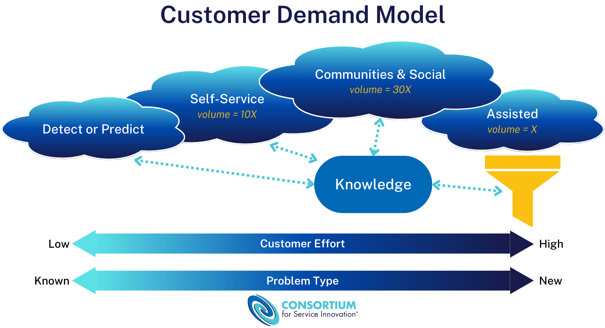
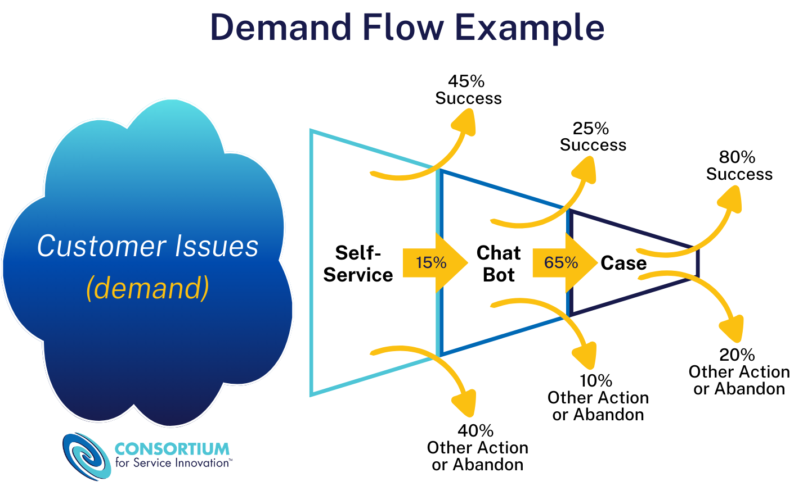
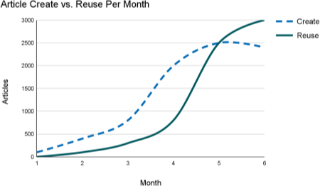
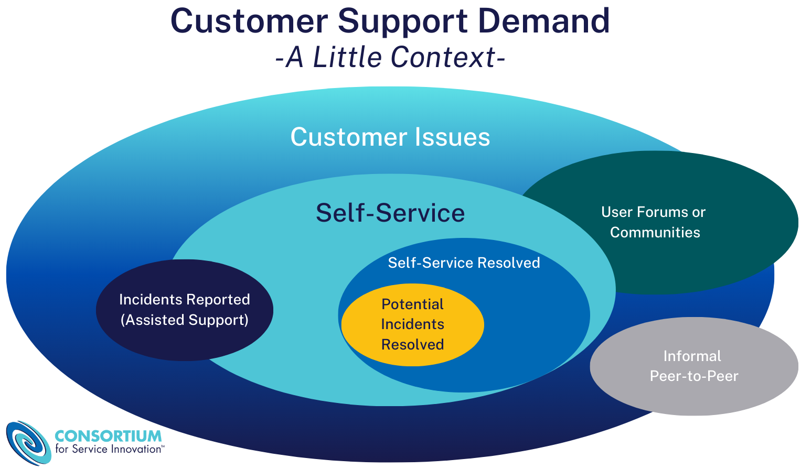

# Measuring Self-Service Success (2027)

> 出典: Consortium for Service Innovation, *Measuring Self-Service Success (2027)* — [CC BY-NC 4.0](https://creativecommons.org/licenses/by-nc/4.0/)  
> 元のページ:
> - [Measuring Self-Service Success (2027)](https://library.serviceinnovation.org/KCS/Measuring_Self-Service_Success)
> - [Self-Service Strategy](https://library.serviceinnovation.org/KCS/Measuring_Self-Service_Success/10_Self-Service_Strategy)
> - [Why Measure Self-Service Success?](https://library.serviceinnovation.org/KCS/Measuring_Self-Service_Success/20_Why_Measure_Self-Service_Success)
> - [Self-Service Measures](https://library.serviceinnovation.org/KCS/Measuring_Self-Service_Success/30_Self-Service_Measures)
> - [Service Engagement Measures Template](https://library.serviceinnovation.org/KCS/Measuring_Self-Service_Success/40_Service_Engagement_Measures_Template)
> - [Glossary of Terms](https://library.serviceinnovation.org/KCS/Measuring_Self-Service_Success/50_Glossary_of_Terms)
> - [Project Acknowledgements](https://library.serviceinnovation.org/KCS/Measuring_Self-Service_Success/70_Project_Acknowledgements)

Improved customer success due to better knowledge-sharing is a key benefit of KCS. How can we determine the value of knowledge delivery across multiple channels, particularly for self-service and community implementations?

The goal of a service organization is to improve customer success and productivity with our products and services. To do this successfully, we must understand the customer's activity and experience.

Historically, service organizations began by focusing on on managing the cost of incoming calls and emails, but the scope of customer engagement has expanded way beyond these types of assisted interactions. Especially in environments where Knowledge-Centered Service (KCS^(®)) is practiced, we must look at the value created for the organization in the context of the entirety of customer demand - not just engagement through assisted channels.

Successful delivery of knowledge through self-service and communities has provided business-wide benefits, leading to industry changes in customer engagement strategies and the introduction of a wide array of new tools and technology for content creation, delivery, and measurement.

## Understanding Demand

The Customer Demand Model is one of the foundational ideas that identifies the value of knowledge sharing.  As Consortium Members gained more visibility into the activity of their customers, it became clear that:

- The volume of questions asked or issues raised in self-service is ten times the demand coming into assisted channels.
- In communities and social media spaces, the demand is thirty times what we see in assisted channels.
- Assisted channels serve less that 3% of the total demand from our customers.

This means we have a huge opportunity to improve customer success and productivity with our products and services. If we leverage what we are learning in the assisted model by publishing that knowledge to other, more easily-accessible channels, we can reduce time and level of effort spent on finding answers to known issues, while making sure our Knowledge Workers are available in the assisted channel to work on new issues.

Greg Oxton describes the [Customer Demand Model in this 10 minute video](https://youtu.be/wW1eXHd-U9I).

## Definition of Self-Service

Self-service is the mechanism by which anyone can solve an issue or answer a question without a 1:1 assisted interaction. Historically, the most common form of self-service has been a digital experience offering information such as frequently asked questions and a searchable knowledge base. However, many of the Consortium members are investing in integrating self-service into the user interface for the product, application, or service. This moves the self-service experience from a distinct and separate event to an integrated experience within the product. Additionally, technology vendors are investing in automation that will detect and repair issues or programmatically assist with the resolution of issues. AI also plays a role here, synthesizing answers on-demand or proactively for requestors out of organizational knowledge. Regardless of the approach, self-service success is dependent on knowledge.

For our purposes, self-service interactions are defined as: Information that improves customer success and productivity with our products and services (instructional, troubleshooting, recommendations) where user intent is about solving an issue as opposed to purchase, design, or value-added services.

See [Glossary of Terms](10-measuring-self-service-success.md#page-3968) for more definitions used in this project.

## Audience

This work was developed with two audiences in mind:

1.  The introduction, background and context, executive overview, and assumptions and limitations sections are intended to provide context for practitioners and leadership around why this is important.
2.  The remainder is guidance for folks who develop and manage the organization’s measurement model.

The *[Service Engagement Measures Template](10-measuring-self-service-success.md#page-3969)* enables us to articulate the value of an effective customer engagement model beyond the mindset of only focusing on cost-savings or preferences for a single number to measure success. The spreadsheet is designed to be used for an organization to benchmark against itself.

- [Self-Service Strategy](10-measuring-self-service-success.md#page-3967)

- [Why Measure Self-Service Success?](10-measuring-self-service-success.md#page-4050)

- [Self-Service Measures](10-measuring-self-service-success.md#page-3973)

- [Service Engagement Measures Template](10-measuring-self-service-success.md#page-3969)

- [Glossary of Terms](10-measuring-self-service-success.md#page-3968)
  Definitions relevant to self-service measures and in the context of customer support.

- [Project Acknowledgements](10-measuring-self-service-success.md#page-4045)
  History and participants.

## Self-Service Strategy

The benefits of self-service are profound. When done correctly, it becomes the path of least resistance and best results for the audience you serve.  The goal in designing the self-service mechanisms is to provide access to knowledge with the least amount of effort on the part of those who are seeking knowledge.  We have learned that designing such a system is not trivial. To deliver self-service in a way that minimizes the requestor's effort and maximizes their success requires careful thought and planning.  If done well it is mutually beneficial for both requestors and responders.

### Have a Strategy and a Process of Continuous Improvement

It is important to develop a strategy for self-service.  We should be very clear on why we are developing a self-service capability. Some of the items that should be included are:

- Vision statement
- Who is (are) the intended audience(s)?
- Goals: what does success look like?
- Measures
- Assessment and continuous improvement process

The greatest value from self-service comes from viewing it as a customer engagement strategy. It enables us to leverage what we know to support greater user success. While a side benefit of self-service is cost reduction for the organization, it is not a deflection or avoidance strategy.

#### The Customer Experience

Two key concepts that are fundamental to the Consortium’s work are the Value Erosion and Value Add Models. These models address the dynamics of maximizing customer value realization from our products and services and provide additional context around our efforts to measure channel success.

To summarize: value erosion happens when a customer encounters an issue. We want to minimize value erosion by facilitating customer success in finding a resolution as early in their pursuit of a resolution as possible. Customer service and support has focused on the value erosion model for years, but we have an opportunity to look at how we add value. Can we increase the customer’s capability, reduce their effort, and create a pleasant experience without them experiencing an issue? These can be important components of a successful self-service interaction.

### Self-Service Design Criteria

In designing the self-service capability there are five key enablers we have observed about successful self-service models:

1.  **Discoverability** - Discoverability is driven by three things (all of which are enabled by KCS): context, structure, and rich environment statements.
2.  **Availability** - Most of what we know, that is self-serviceable, needs to be available quickly (also a focus of KCS).  While the 90/0 rule (90% of what we know is made available 0 minutes - at or before the time of case closure) is a bit provocative, we continue to learn how time sensitive knowledge is.
3.  **Access** - Is it easy to find the self-service access point?  Ideally access to self-service is integrated into the user interface and is context sensitive for where we are in the product.  If self-service is a dedicated digital experience, is it obvious and easy to find?
4.  **Navigation** - Is the navigation in the self-service mechanism intuitive for the users and does it align with the requestor's intent? "No dead ends" ensures there is a smooth way to transition from self-service to assisted support: click to chat or click to submit.  Suggested or generated answers provided by AI should always be in the requestor's context, and should not create a barrier between the requestor and assisted interactions. Navigation should provide for browsing and searching.
5.  **Marketing** - Self-service requires a marketing plan. The "build it and they will come" model doesn't work for self-service mechanisms. We have to take overt, intentional actions to get requestors to use it.  If they have a positive experience (see items 1- 4 above) they will use it...a lot.

A positive experience with self-service means that the requestor will use it again.  Not only will they come back, but they will use it a lot; in fact, they will use it more often than they ever requested assistance in the past.  As a general rule of thumb, if requestors find helpful information 40-50% of the time, they are likely to use self-service again.  This is the industry average for self-service success (see Service XRG for the research). In a mature KCS environment where 90% of what we know is available on self-service immediately, the success rates reported are in the 80-85% range!

#### Discoverability

It doesn't matter how much content we have available to requestors for self-service - if it is not in their context, they are not likely to be able to find it. This re-enforces the need for capture in the workflow.  As we discussed in the Capture practice, it is very difficult to re-create the user's perception of the issue if we are not users, and if we know the answer.  Creating articles in the requestor's context requires that we capture their context or experience when they first express it. The second factor for both findability and readability is structure. KCS proposes a simple structure for knowledge articles which helps search engines and AI tools be more effective and improves the users experience.  The last key element in discoverability is rich environment statements. The environment statements in the article helps the precision and confidence that we have the correct article for our issue.

#### Availability

How many articles are visible externally, and how fast?  The primary enabler of success with self-service is volume and speed.  The goal is to get as much as we know into the self-service channel as fast as we can.  For requestors to be successful with self-service, articles have to be making it to a Validated state (depending on the business rules) with audience set to External. In the early phases of the KCS adoption, this is driven by reuse.  Articles that are reused internally are moved externally quickly. In the Optimize and Innovate phase, we want to be validating and moving externally as much as we can in the moment.  The model of reuse driving validation and external visibility should be a temporary state, because we know from member experience that reuse rates in a digital self-service experience are different from reuse rates in an assisted model.  It turns out that requestors will use a good self-service model 10 times more often than they will call us.  An issue that one requestor raised but has never been reused internally might be used externally a lot; other requestors would use the information, but would not bother to contact us for an answer.  Our goal is to get most of what we know into the self-service model as quickly as we can.

When do we turn on and promote self-service? If our KCS articles are complementary to content we already have in the self-service channel, then an incremental approach might work.  If we are building a new self-service knowledge base, when do we have enough content in the knowledge base to ensure a 40-50% success rate? One key indicator of sufficient volume in the knowledge base is when the reuse rate of articles intersects with the create rate for a given domain. Plotting the team's create rate against the reuse rate over time gives us a sense of how often people or machines find something useful in the knowledge base (reuse) versus how often they are creating new articles. When the lines cross it means that they are re-using as often as they are creating, or 50% of the time they are linking to an existing article.  It is now time to enable and promote the self-service model.

The point at which the create activity equals the reuse activity indicates there is sufficient content in the knowledge base to enable external requestors to find something useful 50% of the time.

Three caveats: first, the linking quality for the domain needs to be at 90% or above and the linking rate has to be in the 60-80% range.  This means the internal users are using the knowledge base (creating, re-using, and improving articles) in the problem-solving process a high percentage of the time.  Second, articles must be making it to External visibility/audience. And third, the content has to be in the requestors' context which reinforces the finadability factor.

#### Access

Designing access to self-service to be obvious and low effort is another key to engaging the audience in self-service. Making the self-service mechanism easy to find for the requestors is not trivial.  As mentioned earlier, integrating access to self-service knowledge into the user interface for the product is ideal but typically requires a sizable investment. If you are using a digital self-service experience it is important to make it easy to find by the audience you intend to serve.

#### Navigation

Research has shown that "no dead ends" is the number one factor for users in deciding if they would use self-service again. "No dead ends" means once the requestor has started the problem-solving process in the self-service channel, they don't have to stop and start over if they don't find something helpful.  An example of "no dead ends" in the self-service interface is the click-to-submit (create an incident) or click-to-chat functionality. If the self-service model isn't helpful, there is a graceful transition to the assisted model. Because the self-service activities of the requestor are captured and made available to the responder, the requestor doesn't feel like they are starting over.  An in-depth research project at Microsoft found that even when customers were unsuccessful with self-service, they were far more willing to go back to try it again if there were no dead ends.

Another key factor in requestors willingness to use self-service is the availability of multiple ways to find things.  People use different methods of finding information based on a number of factors.  Options for finding articles include:

- A list of product specific, frequently asked questions or "top ten" articles
- An index or table of contents
- Basic or keyword search
- Advanced search
- AI-powered tools such as generative answers

The other design criteria is understanding the audience's intent in using self-service.  What are the top three to five reasons people use the self-service mechanism?

#### Marketing

The "build it and they will come" model doesn't work for self-service.  Once we have taken care of the first four success criteria: volume and speed, findability, and access/navigation, we have to think about how to get requestors to use self-service. Trying to change our requestors' behavior is not trivial.  Engaging a marketing specialist is recommended.  Get advice from those who understand messaging and communications and build a marketing plan.

In addition to a marketing plan, below are some tactics that have been successfully used to encourage their customers to use self-service. We offer these as observations, not recommendations; these tactics must be evaluated based on the business and customer engagement model.

- Recorded message promoting self-service (when requestors call for support)
- Extended hold times - make self-service the path of least resistance and best results
- Turn off the phones - make self-service the only path. Requestors can only open an incident via the digital experience (we must have high confidence that the requestors' self-service experience will be positive)
- Co-browsing - as a responder solves issues, the requestor can see the responder's desktop and watch them search (teaching them to use the self-service tools)
  When sending a requestor a resolution, send them the link to the article in the online knowledge base (promotes exposure)
- Provide citations with generated answers. Visible references to information available in the knowledge base lead the requestor to further exploration.

Requestor use of and success with self-service becomes two critical measures to assess the success and health of KCS in the Optimize and Innovate phase. If the articles are not making it to the self-service model or if customers are not using self-service, the KCS implementation will stall.

For some examples of good support digital experiences see the Association of Support Professionals (ASP) list of [Ten Best Web Support Sites](https://asponline.com/product-category/ten-best-web-support-sites/). The ASP conducts an annual assessment of support sites and the criteria they use is available on their web site.  It is a great collection of attributes to use in designing your self-service support mechanism.

### Integrating Feedback

The most powerful and valuable feedback about KCS articles comes from the audience using them. Every time a user acknowledges getting value from an answer, that feedback should be visible to all who contributed to the KCS article: the creator, as well as people who reused and modified the article. If an end-user flags a KCS article as incomplete or confusing, that KCS article must be queued for rework.

In order to promote trust and to increase the credibility of the KCS articles, some organizations are making feedback visible to all audiences. A ranking system can be put in place similar to what Amazon.com does with product reviews, or Trip Advisor and Yelp provide for user reviews of hotels and restaurants. This information can feed into the triangulation model for assessing the self-service experience.

An underlying premise of KCS is "the best people to create and maintain the knowledge base are the people who use it every day."  As organizations begin to Build Proficiency in KCS and make the majority of what they know available to users through a self-service model, that premise still holds.

This raises the question of how to engage users as part of the process. In fact, as organizations mature to the point where a large portion of their articles are external in a just-in-time manner (lots of KCS Publishers across the organization publishing in the moment), good user feedback mechanisms become critical.  Users become part of the quality management process for KCS articles.   Here are some of the ways member companies have implemented this when allowing users to comment on articles:

- Some make comments private and ask the user if they want to be contacted about the comment. If the user checks the "contact me" box, the system opens an incident for that customer and it goes into the normal incident handling process. This approach is probably feasible only for high complexity/low volume environments.
- Some make the comment public with a wiki-like section on each article that allows users to contribute their experience and opinions and see the comments of others
- Some allow trusted users (often identified through the community forums) to create and modify articles in the knowledge base. The source of the article or modification is indicated in the article.
- Some have segmented the knowledge base and have a governance model in place that allows all users to contribute to open-source type content.

If an AI-powered tool is generating answers out of knowledge, feedback provided to the AI tool should flow back into the knowledge used to generate the answer.

## Why Measure Self-Service Success?

We generally refer to the benefits of KCS in three stages:

1.  Operational efficiency
2.  Customer success with self-service
3.  Improved products & services

Operational efficiency is relatively easy to measure.  After implementing KCS, it doesn't take long to see improved resolution times, improved first call resolution, and/or reduced escalations. But after those gains in efficiency are achieved, it becomes how you run your business. The incremental value has already been realized.

Success with self-service is a mid-term benefit of KCS. It takes some time to publish and improve articles that are findable and usable by an external audience. For years, Consortium Members struggled with quantifying the benefits realized by improved success with self-service. We have lots of anecdotal evidence that customers are happier when they find answers without opening a case and Knowledge Workers are happier when they get to solve new problems instead of repeating known answers. However, these things often do not help justify an investment in knowledge and self-service.

### Justify Your Investment in Knowledge

Delivering knowledge through self-service and communities is about multiplying reach! We can leverage knowledge captured during assisted interactions at a significantly lower cost. How do we know we are getting full value out of our knowledge investments?

The [Service Engagement Measures Template](10-measuring-self-service-success.md#page-3969) is intended to help justify your transformation investment. It demonstrates ROI for your KCS program, community, and self-service program investments, including staff and your tools. It also offers a way to understand customer health and engagement. This may require an investment in analytics, or at least connecting with folks who have the data you need.

#### Cost Avoidance is a Limiting Perspective

Also known as contact avoidance or case deflection, assessing the cost savings associated with issues solved through self-service engagement includes a number of pitfalls.

From a holistic look at customer demand, customers pursue resolution to their issues in a number of ways. Some of these issues are resolved with self-service, but only a small percentage of failed self-service attempts becomes a case or incident in the assisted model.

The Demand Flow example helps visualize this. While there is some small percentage of issues that a customer will start researching in self-service, move to a chat bot, and then open a case in pursuit of an answer, there are many others where a customer will poke around in Google, maybe land on a self-service article, get distracted, and then decide it wasn't that it is not worth the effort to resolve.

Therefore, approaching self-service or community success with only cost avoidance in mind is a limiting perspective. Our focus is improved customer success and reduced customer effort. Leveraging our internal investment in KCS by providing knowledge through self-service is a key factor in meeting that goal.

### Benchmark Against Yourself

Measuring success with self-service and communities becomes very complex, very quickly.  Because of the variables involved, the only meaningful baseline is against your own performance. This means you need to define your scope in a way that makes sense in your environment. Judgment is required!

This work was developed and tested over the course of several years with a group of Consortium Members representing 18 widely varied companies - including small, medium, and large enterprises, both publicly and privately traded, focused on both business and consumer audiences, and at multiple stages of KCS maturity. The one constant in our initial findings was: these numbers are only meaningful as part of the larger environment of an organization and there is little value in attempting to benchmark against other organizations. Our recommendation is to gather data monthly, and report out quarterly.  After you have a completed spreadsheet and you start to get a sense of the total demand for support outside the assisted model, it is scary to imagine what would happen if you turned off self-service!

See the [Measurement Matters v6 paper](https://library.serviceinnovation.org/KCS/KCS_v6/Measurement_Matters_v6) for more benefits offered by a mature KCS implementation.

## Self-Service Measures

Measuring self-service success and the self-service experience is hard. In the assisted model, we can count events or interactions and the citation of articles gives us a view of article use. In online communities, we can count posts and responses, which have a strong correlation to requests and responses.  In the self-service model, we can count activity like searches and page views and sessions, but they don't have a one-to-one relationship to issues pursued and resolved. So, we have to infer things about the self-service experience from a number of different sources. And, just like in Performance Assessment, where the creation of value can not be directly counted, we find a triangulation model is very useful.

There are a number of things we want to measure about our self-service mechanism.

- User's view
  - What value is being realized by those who use self-service?
  - What is the experience of those who use it?
  - How often is self-service used before a case is opened?
  - How often are users of self-service finding things that are helpful?
- Internal view
  - What value is the organization realizing:
    - How much demand is being satisfied through self service success?
    - How much demand is being satisfied through self-service success that would have come to the assisted model (cost reduction)?
  - What is the pattern of article use - what articles are valuable to the users or cited in generated answers that users approve of?
  - What impact is self-service having on the nature of the work that still comes into the assisted path (new versus known ratio)?

### The Measures

Assessing the self-service experience and value relies on a combination of data analysis, user feedback, and observation.

Data analysis:

- User behavior patterns
  - Click stream analysis
- Volume variation
- Citations in successful generated answers

Direct user feedback:

- Surveys
- Comments and feedback from users

Observation:

- Usability tests

Because none of the self-service measures mentioned above are precise - that is, none of them by themselves directly represent the user experience, we have to look at them together using the triangulation concept. For the above measures, it is the trends that are most important, not the absolute value.  And, it is our ability to correlate the different perspectives to gain confidence in our assessment of the user experience.

As we discussed in Technique 5.10: Content Health Indicators, we need a way to assess the value of the articles in the knowledge base as it grows. The three perspectives discussed in [Assessing the Value of Articles](https://library.serviceinnovation.org/KCS/KCS_v6/KCS_v6_Practices_Guide/030/040/010/065#Assessing_the_Value_of_Articles) are relevant here as well: frequency of reuse, frequency of reference, and the value of the collection of articles.  The articles available through self-service should be included in value assessment.

### Limitations

Given the varying maturity of self-service deployments and resources available, we provide "good," "better," and "best" measurement options.

Every Consortium Member company who worked on this project brought their own handful of indicators - and everyone felt their indicators could be improved. Different business models need different metrics. For example, when looking at clickstream analysis, everyone has different levels of sophistication or a different journey map as to when/where clickstream analysis starts.

Not all unsuccessful self-service or community attempts result in case creation, and not all successful self-service or community engagements represent an avoided incident. While we attempt to delineate attempts between self-service, community, and assisted interactions, another perspective to consider is parallel solving while a case is open. We cannot accurately measure all scenarios at scale.

Due to the complexity, the most useful strategy is to trend against yourself. Consider how you can establish a baseline for your organization and measure your progress against it.

#### Questions That Require Assumptions to Answer

- How many customers with support demand never made it somewhere that we can measure their engagement? (e.g. they started in Google and stayed there)
- What does a successful engagement look like? There are numerous possibilities for a successful pattern of engagement for various personas (break/fix versus goal-oriented tasks versus long-form learning) and from different origins (Google, Direct, Click Navigation vs. Search, In-Product Help, Generated Answers).
- Are anonymous users customers? Members experimenting with this report that after adjusting for bots, approximately 90% of hits to their public self-service content comes from external search engines (like Google). Based on clickstream data and surveys, it appears a very large percentage of those hits are from customers who did not take the effort to log into the support portal.

#### Metrics and Measurement Challenges

- **Sessions**: We measure by sessions, but not all sessions are equal. We aim to measure sessions that provide value, not just the total quantity of sessions. This may mean figuring out how to remove non-valuable / ineligible sessions from your count.
- **Data sources**: Measurement tools (Google Analytics versus SEMrush versus Internal measures) may have visibility or measurement parameters that differ.
- **Effort**: What is a high effort versus low effort visit? It's a subjective measurement that constantly evolves.
- **Goals**: Measurement goals change based on user persona or use case.
- **Bounce Rate**: Bounce is not a good qualitative measure because a single-page session can be successful. Bounce calculations can be impacted by event tracking. Better calculations are time on page, scroll percentage, and other contextual measures.
- **Feedback**: Limited value due to low participation (~1.5%). Article or generated answer feedback lacks user context. Are customers rating the solution quality or their overall experience regarding their issue?
- **Context**: Not all metrics are actionable or have a clear 'why'. When self-service fails, did customers not find what they were looking for or not understand the answer they received? Often times, we have to drill down on supporting or related metrics to understand the context of the data.

## Service Engagement Measures Template

There are three areas in which our measures are focused: Traffic & Success, Length & Cost, and Customer Experience. You don't have to tackle these all at once!

For each measurement, the goal is to use the most sophisticated approach you can from the good, better, and best guidance below - but don't let that stop you from using what you have available now to get started. Remember to get clear on your definitions first.

Guidance on the approaches are mostly offered for self-service and community engagements. Use your existing measures for agent assisted engagements.

Enter data in the yellow cells and the spreadsheet will calculate for you. Copy or download the [Google Sheets template](https://docs.google.com/spreadsheets/d/1eatz8eWy0nq12ggUpEfyHzaemazMT7l5mvAnU5BiEjU/edit?usp=sharing).

### Prerequisites

#### Definitions

It is important to define, for your environment, what will be included in *your* Service Engagement Measures Spreadsheet. We have provided good, better, and best formulas for calculations in the spreadsheet and an extensive glossary of terms, but judgment is required in terms of what makes sense for your environment! You may start out with whatever set of data you can get your hands on. Define it, and trend it over time, but the intent should be widening your scope to more thoroughly and accurately reflect the full customer experience.

For example, what you do or do not count as a self-service engagement will depend on your business and may change over time.

#### Data

Recommended formulas in the [Service Engagement Measures Template](10-measuring-self-service-success.md#page-3969) include multiple data sources. While some of these things can be mined from tools directly, you may need to do some detective work to find out where they live. Some Members discovered that they needed to enable the capturing of the data first - and all Members recommend using your organization's existing data models wherever possible. Don't reinvent the wheel!

**Engagements**

- Self-Service: user sessions for self-service mechanisms (usually in a digital experience)
- Community: user sessions and threads
- Assisted: cases, tickets, or service requests

**Cost Per Engagement**

- Self-Service: Total associated costs (may include salary, systems, overhead - based on how your company organizes their cost structure) / /number of successful self-service engagements
- Community: Total associated costs (may include salary, systems, overhead-based on how your company organizes their cost structure)/number of successful self-service engagements
- Assisted: Time spent on tasks and the volume of demand (again, based on how your company calculates cost per case)

**Survey Data**

- Session surveys: self-service success
- Generated answer feedback
- Customer Satisfaction
- Customer Effort
- Net Promoter Score (NPS)

#### Time

Due to [data limitations](10-measuring-self-service-success.md#page-3973), the most useful strategy is to [benchmark against yourself](10-measuring-self-service-success.md#page-4050). Filling out the measures template one time will provide limited insight. Track the data over time (weekly, monthly, quarterly) against optimization efforts to assess what changes lead to meaningful positive change. We propose measuring monthly and presenting quarterly.  Year-over-year analysis can account for seasonal behavior.

### Filling In the Template

#### Number of Engagements

Volume of issues for which requestors pursue a resolution that we have visibility to. Often measured through attempts, sessions, sign-ons, searches and content views.

- **Good** = number of sessions or views per month
- **Better** = number of sessions per month that include at least one content view
- **Best** = same as better and includes criteria for a meaningful content view (i.e. time on page)

**Consortium Members**: sign in to see an example of how to use Google Analytics to define sessions containing specific pages.

#### % of total engagement demand (volume)

Calculated percent of all the demand through all channels that we can assess​​​​​​.

#### % channel success

Approximation of issues resolved in channel. Often measured by surveys (low response rate and response bias), an estimated percent of sessions/visits without opening a case in some period of time (24 hours - 7 days), or number of views divided by an average number of views/issue. The intent is to measure how often a requestor issue is resolved per self-service (the requestor is done with indication of success) and assisted (closed case with resolution offered).

- **Good** = percent of sessions/visit without request for assistance OR number of views divided by an assumed avg number of views/issue. Note: this does not account for the significant % of issues that are abandoned (without resolution or an assist request). Some apply a % abandon rate.
- **Better** = survey "were you successful?" percent "yes", apply confidence interval to ensure you have a large enough sample size.  Correlate your results with "good".
- **Best** = sophisticated clickstream analysis (percent of patterns that represent success or failure). This is an area of exploration and we are looking for examples of what this might look like!

**Consortium Members**: sign in to see an example of how to use Google Analytics to define sessions containing specific pages.

#### Number of successful engagements

Calculated volume of completed engagements based on number of total engagements multiplied by % channel success.

#### % of total successful engagements

Calculated ratio of successful engagements in channel as a percent of total demand.

This calculation is a reflection of Customer Experience and indicates opportunities to improve content and mechanisms.

#### Average Length of Successful Engagement

Customer time to resolve, requires assumptions based on your products and customers. Authentication can help with measuring length of engagement.

- Average time of a sample of successful sessions (using clickstream analysis). Note: as you improve the accuracy of identifying successful sessions, this will improve the accuracy of your measures.

**Consortium Members**: sign in to see an example of how to use Google Analytics to define sessions containing specific pages.

#### Cost Per Successful Engagement

Total costs (may include salary, systems, overhead) associated with self-service (not easy) allocated based on time spent on tasks and the volume being served (cost/min and cost/engagement).

This is a great spot to use your organization's existing calculation for costs.  The Consortium's position is that all KCS-related costs should be counted under Assisted Engagements since even without fueling self-service, KCS provides ongoing benefit to the organization.

**Consortium Members**: sign in to see an example of how to use Google Analytics to define sessions containing specific pages.

#### Customer Satisfaction

Existing standards: survey. How satisfied were you with your experience?

**Consortium Members**: sign in to see an example of how to use Google Analytics to define sessions containing specific pages.

#### Customer Effort

Survey results depends largely on customer expectations.

- **Good** = Survey
- **Better** = Sophisticated click stream analysis
- **Best** = Journey mapping and tracking improvements in the journey over time

#### Customer Loyalty

Use Net Promoter Score (NPS) or other existing standards.

## Glossary of Terms

Definitions relevant to self-service measures and in the context of customer support.

See also: [KCS Glossary of terms](11-supplemental-resources.md#page-353).

### \[A\]

**Abandoned**
When people give up the pursuit of a resolution to an issue.

**Analytics**
Indicators of behavior, activities, performance (outcomes): search, Google, clickstream.

**Article feedback**
Article based - when a person views an article they are asked if the article was helpful. If using an AI-powered generative answers tool, feedback on the answer should be applied to the articles cited.

**Assisted**
Requestors pursuing a resolution to an issue or seeking information (learning), often requesting help or information from a vendor about their products and/or services.

**Assisted eligibility**
An issue's eligibility for human assistance. Some requests are not applicable for human assistance.

**Attempt**
An action taken to pursue a resolution to an issue. By channel (self-service, community, social, assisted). There may be many attempts for a given issue, each in different channels. There may be multiple attempts per session/visit. Each company will have to set criteria based on average requestor's behavior to assess attempts/session.

**Automated alerts**
Based on automated detection the notification of potential issues (could be machine-to-machine or machine-to-human).

**Automated interactions**
Use of bots or other digital capabilities to provide requestors with possible resolutions or information.

**Automated recommendation**
Use of digital capabilities to recommend articles or information based on pattern recognition (for anonymous users) or data about the requestor (for authenticated users).

**Automatic detection**
Automated detection of potential issues based on data from sensors (hardware) or programmatic analysis (software), or a combination of the two.

**Automatic repair**
Corrective action(s) taken by robotic or programmatic capabilities that resolve a requestors issue based on information provided by the requestor or the system. Examples: password reset, profile updates.

**Average work time to resolve**
See [KCS Glossary of terms](11-supplemental-resources.md#page-353).

**Avoidance**
In the context of interactions (incidents/cases) - when a request for agent assistance has been started and the requestor has interacted with/used a suggested resolution and does not complete the request for assistance. The preferred term for this is "interception" - we do not want to avoid requestors, we want to intercept their journey with an answer or solution at the earliest opportunity.

### \[B\]

**Browse**
Navigating information using facets, a table of contents, a list of frequently asked questions, site map, or knowledge maps (not a search).

### \[C\]

**Case close without assistance**
Requestor submitted a case and then solved it without human assistance.

**Case/incident/ticket**
The record of a request for assistance that may include things like the requestor's name, company, contact information, entitlement information, issue description, severity of the issue and status of the request.

**Channels**
The different interaction modes, including but not limited to: online communities or forums, social media, chat, self-service, in product help, or assisted.

**Clickstream**
The activity and navigation pattern of people interacting with a digital experience or in a community.

**Click through**
The requestor viewed an article (in full) or piece of content from a list of possible articles and/or content or articles cited in a generated answer.

**Click through rate (CTR)**
The percentage of searches or generated answer citations that resulted in a user clicking on one or more of the results.

**Community/forums**
People with common interests asking questions, providing responses and sharing information in a digital experience.

**Confidence interval**
In the context of statistics and assessing survey responses - a confidence interval is a type of interval estimate, computed from the statistics of the observed data, that might contain the true value of an unknown population parameter \[[Wikipedia](https://en.wikipedia.org/wiki/Confidence_interval)\]. For example, if we asked customers in a self-service survey “did you find what you were looking for during your visit”. 60% of all respondents might say yes. Dependent on the statistics associated with responses and the population for whom the question is relevant we can calculate a margin of error. 60% of survey respondents said yes and we have 95% confidence interval of plus or minus 2% - we are 95% confident that customers feel they find what they are looking for 58%-62% of the time.

**Crowd-sourced content**
Content created by the users, peers of customers, typically in a forum or community. See <https://en.wikipedia.org/wiki/Crowdsourcing>.

**Customer engagement network**
All the ways customers get information about us, all the ways we interact with customers. A network of content and people. We want to connect people to content for known issues and people to people for new issues with ever-increasing relevance.

### \[D\]

**Deflection**
In the context of interactions (incidents/cases) - when a request for agent assistance has been started and the requestor has interacted with/used a suggested resolution and does not complete the request for assistance. Synonymous with avoidance. The preferred term for this is "interception" - we do not want to deflect requestors, we want to intercept their journey with an answer or solution at the earliest opportunity.

**Download**
In the context of a digital experience - retrieving content (article, document or executable file) by saving a copy of the content on the requestor's system.

### \[E\]

**Effort**
In the context of people - the work and/or time it takes to accomplish a task. “Customer Effort” was made popular by the book “[The Effortless Experience](https://www.penguinrandomhouse.com/books/312730/the-effortless-experience-by-matthew-dixon/)”, which explains that reducing customer effort results in increased customer loyalty (and renewals) more so than delightful experiences.

**Elapsed time to resolution (customer view)**
Elapsed time (min or days) from customer start of pursuing a resolution to resolution found. Not work minutes - see "Average work time to resolve".

**Elapsed time to resolution (business view)**
Elapsed time (min or days) from when the customer issue is known until a resolution is suggested.

**Embedded help**
In the context of self-service - enabling requestors to access content in the user interface for the product or service.

**Engagement**
A customer touch point or interaction. Reactive is when the customer initiates the engagement, proactive is when the vendor initiates the engagement. Engagement is meant to capture all touch points, assisted, self-service, etc.

**Entitlement (to view, read)**
No authentication required, open, anonymous, gated, authentication/login required, entitled by contract.

**Entitlement to contribute (create a case, respond to post)**
People authorized to create requests or replies to requests.

### \[I\]

**Interaction**
Proactive or reactive pursuit of a resolution to an issue or information for learning in any of a number of different channels or mechanisms.

**Issue**
Anything that disrupts the customer’s ability to be successful, including but not limited to questions, needs, or problems with a product, service, policy or process. Issue drivers can be functional, social or emotional.

### \[J\]

**Journey mapping**
A detailed description and/or images of the steps a person does to accomplish a task. Often used to assess the customer experience. See [https](https://en.wikipedia.org/wiki/Customer_experience#Customer_journey_mapping)[://en.wikipedia.org/wiki/Custom...ourney_mapping](https://en.wikipedia.org/wiki/Customer_experience#Customer_journey_mapping)

### \[K\]

**Knowledge use**
People or machines accessing and making use of knowledge articles. Although "knowledge consumption" is a commonly used phrase, we discourage its use as it is a misnomer because things that are consumed cannot be used again or by others.

**Knowledge gap**
People or machines are looking for knowledge that does not exist or is not available in the channel in which they are looking (searching/browsing/generating answers)

### \[M\]

**Meaningful view**
Content viewed that meets specific criteria that implies use of the content (time on page, scroll to view significant portion of the content, bookmark, download)

### \[N\]

**NPS - Net Promoter Score**
An indicator of customer loyalty.

### \[O\]

**Omnichannel**
Enabling requestors to use many different channels for support (phone, digital self-service experience, social networks, communities) and a strategy to provide a consistent and integrated experience across the channels. Different from multichannel, which is multiple channels available without a unified or integrated experience.

### \[P\]

**Peer-to-peer**
Customers interacting with customers, partners interacting with partners, or employees interacting with employees in pursuit of a resolution to an issue.

**Persona**
An identity, in the context of journey mapping, communities and self-service, labeling a collection of people with common attributes, sometimes the role a person is in defines their persona (accounts receivable administrator, IT professionals, HR administrators, lawyers), sometimes the skill within in a domain (novice, experienced, expert) may define their persona. See <https://en.wikipedia.org/wiki/Persona>

### \[R\]

**Rank**
The position a result or selected article appears within search results or is cited in a generated answer. A common measure of search or answer performance combined with content health is average click-through or citation rank.

### \[S\]

**Satisfaction**
In the context of customer satisfaction - an assessment of a requestor’s experience with a transaction(s) or interaction(s).

**Search**
In the context of self-service - an activity or effort to find or discover something specific bthat exists within a large, broad collection of content. Keyword search uses specific words or phrases. Natural language search accepts everyday, conversational language. Many AI-powered tools enable coversational search with answers generated out of knowledge (with citation) rather than presenting a list of discrete search results.

**Self-service**
Enabling requestors (customers or users) to interact with knowledge or capabilities that resolve their issue without interacting with a human. What you do or do not consider to count as self-service engagement will depend on your business and may change over time.

**Self-solved or semi-assisted**
After submitting a request for human assistance, requestor resolved their own issue before being provided with a complete solution.

**Session (self-service)**
Requestor is active on in the self-service mechanism. In the context of self-service, the frequency of a person’s use of the self-service mechanism to pursue a resolution to one or more issues that has a distinct beginning and end. A session/visit has a duration or time spent as well as frequency. This needs be defined by each organization based on the products/services being supported and the nature of the customer engagements. Example AARP (low complexity) will have different criteria for \# of issues/session as well as the criteria for what constitutes a successful engagement vs what PTC's criteria (high complexity). Advanced measures determine that session activity meets criteria to indicate meaningful engagement.

**Social networks**
Relationship-based connections between people and people or people and companies usually facilitated by a digital platform like Facebook, LinkedIn, etc.

**Survey**
A request to a target audience to collect feedback about performance and expectations. A key advantage to surveys is that the data is explicit, and conclusions drawn typically have a high degree of confidence, whereas evaluating behavior patterns through session data often requires inference and therefore comes with a lower degree of confidence. The challenge with surveys is collecting enough data to be statistically significant.

- Session-based: when a requester begins or ends a self-service session they are asked questions about their experience during the session.
- Interaction-based or event-driven: a survey sent after the conclusion of an interaction, such as the closure of a case.
- Answer-based: a survey presented to provide feedback on a session with generated answers.
- Relationship survey: A questionnaire sent periodically (6 month or annual) to assess the customer's opinion of the relationship. The surveys often cover overall satisfaction, loyalty or effort.

### \[T\]

**Time on page/content/object**
Number of seconds the user is "active" on a piece of content, the threshold for a meaningful use will vary based on  the type of content and the nature of  your environment (each org will have to calibrate the thresholds that are meaningful for them). In a generative answer environment, "active" may need to be applied to all content cited in an answer.

**Touchpoint model**
A visual representation of all the points of interaction with customers, also called a lifecycle model. Usually done at a high level of abstraction.

### \[U\]

**Unsolicited suggestions (searchless search)**
In the context of self-service - offering helpful information based on a customer or user’s behavior and or text submission(s).

### \[V\]

**Vendor-sourced content**
Content that is developed and provided by the company that is selling or providing the product or service.

**View (content)**
In the context of a digital self-service experience - opening, navigating to a page, often used as “page view” which implies the person read the content on a page. If a "hover" provides sufficient information to resolve the issue it counts as a view (this will vary by implementation and complexity of the environment). In a generative answer environment, citations may be interpreted as views.

## Project Acknowledgements

History and participants.

This project was inspired by an Open Space session convened at the Consortium for Service Innovation's 2019 Member Summit by Jennifer MacIntosh. Rosalie Girard made sure the work continued after the session adjourned.

Over the course of several years, many Consortium Members offered their experience, ideas, and passion for this work.  Deep thanks to them for their participation, which made this resource possible.

- Kimaya Agarwal
- Arnfinn Austefjord
- Kris Anderson
- James Ayecue
- Richard Bekolay
- Monique Cadena
- Justin Calhoun
- Peter Case
- Bonnie Chase
- Matt Chinn
- JC Coynel
- Janine Deegan
- Keri Detrick
- Amy Dotson
- Ross Edgecombe
- Jeff Elser
- Rosalie Girard
- Sara Feldman
- John Fronius
- Rosalie Girard
- Kristin Hunter
- David Kay
- Aditya Kulkarni
- Aftab Ali
- Jennifer MacIntosh
- Theresa Manzo
- Salman Mumin-Ahmed
- Domonic Masilmani
- Patrick McBride
- Sabrina Meditz
- Sarup Paul
- Laurel Poertner
- Bit Rambusch
- Christina Roosen
- Brad Smith
- Steve Springer
- Devra Struzenberg
- Jacob Watts
- Lief Zimmerman
- Dave Thorp
- Heidi Wagstaff
- Jacob Watts
- Kelly Murray
- Matt Seaman
- Greg Oxton
