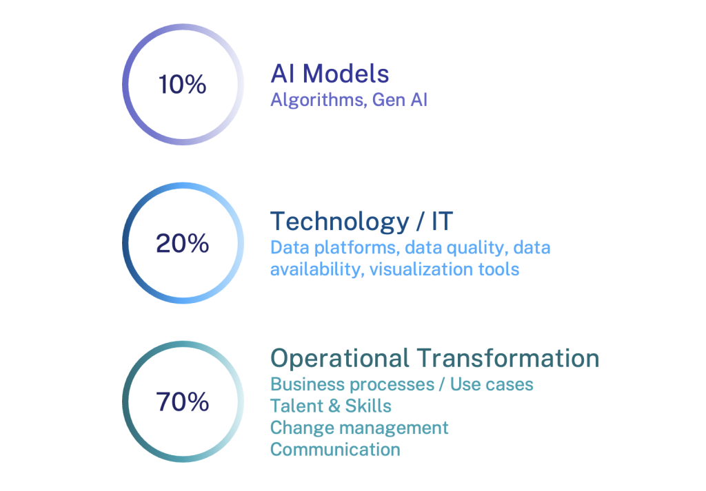

# Knowledge-Powered AI

> 出典: Consortium for Service Innovation, *Knowledge-Powered AI* — ページにクリエイティブ・コモンズの表示なし（© Consortium for Service Innovation）  
> 元のページ:
> - [Knowledge-Powered AI](https://www.serviceinnovation.org/knowledge-powered-ai/)

Consortium Members are at the forefront of leveraging knowledge-powered AI capabilities.

AI outcomes are only as good as the knowledge it pulls from. For AI to scale successfully, you need trusted content, consistent structure, and clear workflows for curation and reuse. Organizations that have implemented [KCS](https://www.serviceinnovation.org/kcs/) are uniquely positioned to harness the power of AI.

Consortium Members have determined that, in addition to a knowledge management practice, success also requires defining clear objectives, securing business buy in, and obtaining proper resources.

## Implementing AI: Challenges and Strategy

While it’s tempting to focus on the shiny aspects of what AI technologies may be able to do for organizations, Boston Consulting Group findings highlight that successful AI implementation involves focusing 10% on AI models, 20% on technology, and 70% on operational transformation.

While data and technology are important, *operational transformation* is the most critical factor for success.

*This echoes Consortium Member experience in building systematic AI implementations. For details about what we’ve learned:*

- **[AI Implementation Essentials](https://www.serviceinnovation.org/ai-implementation-essentials/):** an overview of what’s required for success
- [**AI Case Studies**](https://www.serviceinnovation.org/ai-case-studies/): how Members are implementing AI in practice
- **[AI Blueprint](https://library.serviceinnovation.org/wiki/Featured_Member_Resources/AI_Blueprint):** a Member-only resource including detailed examples and templates

## The AI Landscape: Where We Are Going

We help organizations move from AI hype to reality by providing structured approaches and sharing best practices based on operational experiences from Member companies and other industry groups.

[Watch “The AI Landscape \| Part 2 of 2 \| Where We Are Going” on YouTube](https://youtu.be/fEGfVAvVmeI)

*This is part 2 of 2. Explore part 1* – [The AI Landscape: Where We Have Been](https://www.serviceinnovation.org/navigating-the-ai-landscape/)

## Be Part of the AI-Driven Future

Consortium Members continue their thoughtful approach to AI implementation, focusing on business processes, use cases, and operational transformation. Join the conversation!

- Sign up for the [Consortium mailing list](https://www.serviceinnovation.org/mailing-list/)
- Participate at [an event](https://www.serviceinnovation.org/events)
- Become a [Consortium Member](https://www.serviceinnovation.org/member-activities/)

### Member-Only Resources

- [AI Blueprint](https://library.serviceinnovation.org/wiki/Featured_Member_Resources/AI_Blueprint): a how-to guide with detailed examples and templates
- Join the [\#ml-llm-ai channel](https://consortiummembers.slack.com/archives/C04S5QT3B6Y) in the Consortium Member Slack
- [Thoughtful and Strategic Automation](https://library.serviceinnovation.org/wiki/Predictive_Customer_Engagement/Thoughtful_and_Strategic_Automation_Team_Meeting_2024)
- [The Intersection of ML-LLM-AI and KCS](https://library.serviceinnovation.org/wiki/KCS/Team_Meetings/ML-LLM-AI_and_KCS_Team_Meeting_2024)

If you are a [Consortium Member](https://www.serviceinnovation.org/current-members/) and need login assistance, contact [support@serviceinnovation.org](mailto:support@serviceinnovation.org).

## Attribution

The KCS^(®) methodology is service marked by the Consortium for Service Innovation.

The first mention of KCS in a written work must include the superscript ^(®).  Please also include this footnote or parenthetical statement: “KCS® is a service mark of the Consortium for Service Innovation^(TM).”

The correct use of KCS is as an adjective, for example: “\[Company Name\] endorses the KCS® methodology….”

KCS cannot be used in the name of an offering without explicit written permission from the Consortium for Service Innovation. Please [contact the Consortium](mailto:info@serviceinnovation.org) with questions.
