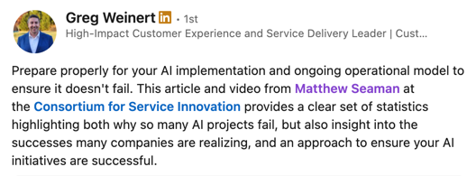
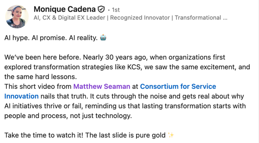

# Why AI Projects Fail or Succeed

> 出典: Consortium for Service Innovation, *Why AI Projects Fail or Succeed* — ページにクリエイティブ・コモンズの表示なし（© Consortium for Service Innovation）  
> 元のページ:
> - [Why AI Projects Fail or Succeed](https://www.serviceinnovation.org/why-ai-projects-fail-or-succeed/)

Beneath the headlines and hype, many teams are wrestling with a challenge: **Why are so many AI initiatives stalling, and what does it actually take to succeed in production?**

*Watch or read insights based on global [AI case studies](https://www.serviceinnovation.org/ai-case-studies/) to understand what the headline numbers really mean, why high pilot “failure” rates may actually be a good sign, and how organizations can set themselves up for meaningful and scalable AI success.*

## 12 minute video summary

Many AI initiatives fail to generate measurable impact, especially after moving into production. Understand common causes of failure and where organizations should focus their resources for successful AI implementations.

[Watch “Why AI Projects Fail or Succeed (Beyond the Clickbait Numbers)” on YouTube](https://youtu.be/N7q8-MAZhAc?si=txp54Ua29XYkPD1H)

## What the failure numbers really mean

High pilot “failure” rates aren’t necessarily bad; they signal experimentation and broad access to tools. The more concerning numbers are the **70–90% failure rates of AI projects *after* they reach production**, which represent real cost, disruption, and lost momentum.

> “To have that high a failure rate \[after moving to production\], that is a real impact on the business.”

## Why are AI Projects Failing?

The most common issues with AI initiatives include:

- **Hype / Flashy ideas dominate** – instead of specific and scalable use cases
- **Misaligned Business goals** – “We need AI” is not a business objective
- **Bad Data** – up to 85% of reasons for failure
- **Systems** – legacy workflows, scaling barriers
- **Growing / Hidden Costs** – infrastructure, operations, tokens
- **People & Culture** – inadequate change management

> Leadership pressure to “use AI” causes teams to spin or pivot, wasting resources.
> Without alignment and a clear business problem to solve, potentially valuable pilots won’t scale.

## Ensure Production Success

AI-powered solutions are part of ongoing cycles that require discipline, clarity, and honest assessments.

- Establish strategy and objectives
- Be honest about organizational readiness
- Build a plan with governance and milestones
- Focus and prioritize use cases
- Implement and evaluate
- Iterate continuously

See [AI Implementation Essentials](https://www.serviceinnovation.org/ai-implementation-essentials) for specific action items.

> Reframe AI not as a technical implementation, but as business and operational solution.

