# プラクティス7：パフォーマンスの把握（Practice 7: Performance Insight）

> 出典: Consortium for Service Innovation, *Knowledge-Centered Success: Practices Guide (2027)* — [CC BY-NC 4.0](https://creativecommons.org/licenses/by-nc/4.0/)（原文を日本語に翻訳し、ページを章ごとにまとめ直したもの）  
> 元のページ:
> - [Practice 7: Performance Insight](https://library.serviceinnovation.org/KCS/Knowledge-Centered_Success_Practices_Guide/301-Evolve_Loop/Practice_7_Performance_Insight)
> - [Technique 7.1: Measure the Right Things](https://library.serviceinnovation.org/KCS/Knowledge-Centered_Success_Practices_Guide/301-Evolve_Loop/Practice_7_Performance_Insight/Technique_7.1)
> - [Technique 7.2: Measures for Individuals and Teams](https://library.serviceinnovation.org/KCS/Knowledge-Centered_Success_Practices_Guide/301-Evolve_Loop/Practice_7_Performance_Insight/Technique_7.2)
> - [Technique 7.3: KCS Program Benefits and ROI](https://library.serviceinnovation.org/KCS/Knowledge-Centered_Success_Practices_Guide/301-Evolve_Loop/Practice_7_Performance_Insight/Technique_7.3)

**パフォーマンスの把握によって、個人とチームの学習と成長を促し、KCSプログラムの成功を評価できる。**

## 正しいものを測る

**三角測量によって、システムで起きていることの全体のコンテキストを理解する。**

## 個人とチームの測定

**正しいことを行い、意図した成果に貢献している個人とチームを見つける。**

## KCSプログラムの効果とROI

**システムが意図したとおりに機能し、提供するために作られた価値を届けていることを示す。**

協働と共有のオーナーシップという望ましい行動に沿うには、組織の文化と価値観を変える必要がある。文化と価値観は、組織が何を測るかに表れる。

## テクニック7.1：正しいものを測る（Technique 7.1: Measure the Right Things）

**三角測量によって、システムで起きていることの全体のコンテキストを理解する。**

何を作ろうとしているのか（コンテンツ標準）と、それをどう作るのか（構造化されたワークフロー）を理解したので、どれだけうまくいっているかを評価する測定モデルを作る準備が整った。個人としてもチームとしても、どれだけうまくいっているかを知りたい。Norton と Kaplan の著書 [The Balanced Scorecard](http://www.amazon.com/gp/product/B000SEIJPG/ref=as_li_ss_tl?ie=UTF8&camp=1789&creative=390957&creativeASIN=B000SEIJPG&linkCode=as2&tag=customersupportc)（邦題『バランス・スコアカード』）に書かれている手法が非常に役立つ。この本は、KCSのパフォーマンスの把握のモデルに取り入れた、いくつもの重要な考え方を述べている。

- 個人の目標を部門と組織の目標に結び付け、自分のパフォーマンスがより大きな全体像とどう関係しているかを人が理解できるようにする。
- 複数の視点からパフォーマンスを見る。典型的なスコアカードは、主要な利害関係者、つまり顧客・従業員・事業を考慮する。
- 先行指標（活動）と遅行指標（成果）を区別する。

活動（先行指標）に目標を設定すれば、求めたものが手に入る。活動それ自体は価値の指標ではなく、必ずしも私たちが求める成果につながるわけでもない。例えば、ナレッジワーカー一人ひとりに月10件のKCS記事を作成するという目標を設定すれば、月に10件の記事が手に入る。しかし、こうした記事は月末の数日に作成されることが多く、価値のある情報がほとんど、あるいはまったく入っていない（「顧客の問題を修正した」のようなもの）。望ましい成果を考慮せず、目標を達成するために作られたのである。活動への目標が望ましい成果を生むことはめったにない。それどころか、ナレッジマネジメントの環境では、活動に目標を設定するとナレッジベースが損なわれる。役に立たない記事が時間の無駄だというだけではない。それらがナレッジベースにあること自体が、KCSのシステム全体の健全性を実際に損なうのである。だからこそ、活動と成果の区別がこれほど重要であり、だからこそ**活動に目標を設定してはならない**のである。

私たちが求める成果は、対象者が見つけられ、使える記事である。「作成」の活動は、成果のコンテキストの中で行う必要がある。これは、[価値を生む](https://library.serviceinnovation.org/Archive/KCS_v6_FOR_RETHINKING/KCS_Principles_and_Core_Concepts/020/020)（作業はタスク単位で、思考は全体像で）というKCSの原則を強めるものである。焦点を当てるべきなのは、活動ではなく*成果*である。

活動に設定した目標は、ナレッジベースを損なう。

活動に目標を設定すると、次のようなことが起きる。

- 望ましくない結果を生む
- 行動の指標としての測定項目の価値を壊す
- 本当の目的から人の注意をそらす
- 人が判断を使わなくて済むようにしてしまう
- リーダーシップが冴えなく見える
- 人の意欲を奪う

*The Balanced Scorecard* の非常に役立つ考え方の1つは、パフォーマンスの推進要因（[動機](07-change-management.md#page-8217)）、先行指標（活動）、遅行指標（成果）を区別することである。この3つの要素はどれも重要だが、測定の仕組みの中でそれぞれが果たす役割は異なる。それらを区別することが極めて重要である。

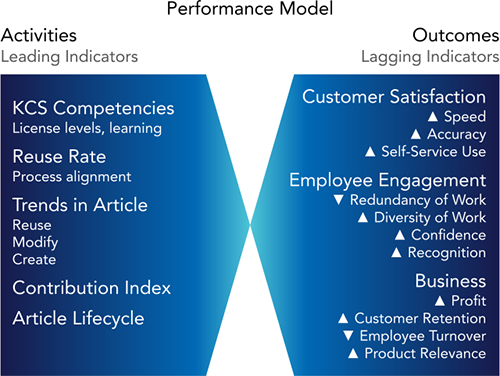

*図：パフォーマンスのモデル。左が活動（先行指標）：KCSの能力（ライセンスの段階、学習）、再利用率（プロセスの整合）、記事の傾向（再利用・変更・作成）、貢献指数、記事のライフサイクル。右が成果（遅行指標）：顧客満足（速さ・正確さ・セルフサービスの利用が上がる）、従業員の関与（仕事の重複が減り、仕事の多様さ・自信・承認が上がる）、事業（利益・顧客の維持・製品の関連性が上がり、離職が減る）。*

活動の傾向と、それと成果との相関に注意を払う必要がある。

- 活動の測定項目は正しい方向に向かっているか。
- それはどれだけ速く変化しているか。
- ナレッジワーカーは、自分のパフォーマンスの指標をタイムリーに見られるか。

活動の測定項目と成果の測定項目の区別は極めて重要だが、どの指標が活動（先行指標）でどれが成果（遅行指標）なのかを見分けるのが難しいこともある。指標を確かめるのに役立つ方法を挙げる。

- 測るのが簡単で、操作したりごまかしたりするのも簡単なもの：おそらく活動である（目標を設定しない）
- 測るのが難しく、操作するのも難しいもの：おそらく成果である
- 事後に（出来事が完了したときに）しか測れないもの：おそらく成果である

指標や測定項目について話し合うときはいつでも、それが活動なのか成果なのかをはっきりさせておかなければならない。

### 三角測量：誰が価値を生み出しているのか

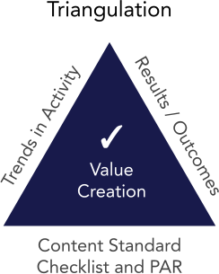

*図：三角測量。活動の傾向（Trends in Activity）、結果・成果（Results / Outcomes）、コンテンツ標準チェックリストとPARの3つの視点から、価値の創出（Value Creation）を評価する。*

活動と成果の区別は、全体像の一部にすぎない。KCSのパフォーマンスの理解は、複数の視点を統合することから生まれる。価値の創出を示す単一の測定項目は無いので、少なくとも3つの異なる視点を突き合わせて評価する。基本のモデルには、*活動の傾向*（時間的な傾向）、*主要な成果*（目標と比べて測る）、そしてKCSの*コンテンツ標準チェックリスト*（[コンテンツの健全性](04-evolve-loop-content-health.md#page-7130)で述べた）が含まれる。この3つの視点は、客観的（定量的）な測定と主観的（定性的）な測定の両方を考慮して、個人とチームによる価値の創出を評価する。

*三角測量*という考え方は、価値の創出を直接測ったり数えたりすることはできない、価値は無形のものだ、という考えを反映している。価値の創出を評価する最善の方法は、三角測量のプロセスによるものである。複数の衛星からの入力に基づいて地球上の位置を計算するGPS（全地球測位システム）の機器と同じように、効果的なパフォーマンス評価のモデルは、複数の見方を取り入れて価値の創出を評価する。

例として、最初の評価モデルを作るための測定項目の集まりを示す。どの組織も、自らの組織の目標（インパクトマップに記録したもの）に沿った独自の測定項目の組み合わせを、よく考えて作らなければならない。

KCSの測定項目の選択は、組織にとって*価値*を生み出す特性に焦点を当てなければならない。次の次元を統合することで、パフォーマンスの包括的な見方ができあがり、それによって、誰が価値を生み出していて、誰がコーチの手助けを受けるとよさそうかを確信を持って評価できる。

## テクニック7.2：個人とチームの測定（Technique 7.2: Measures for Individuals and Teams）

**正しいことを行い、意図した成果に貢献している個人とチームを見つける。**

### 目標は活動ではなく、成果に

先行指標は数値化できる活動なので、成果より測りやすいことが多い。そのため、成果に必要な活動に目標を設定したいという、抗いがたいように見える衝動が生まれる。何度か述べてきたように、これは……逆効果である。

ヨセミテへの旅を考えてみよう。掲げた目標が平均時速55マイルを保つことだけなら、それは達成できる。しかし、目的地（ヨセミテ）を理解していなければ、運転する人は目的地にかかわらず平均速度を保てる道を選ぶだろう。行き着いた先はチコかもしれない。チコが悪い場所だというわけではない。ただ、そこは私たちが行きたかった場所ではないのである。

KCS導入の過程で、KCS記事の作成（全員が週に5件のKCS記事を作成すべき）や、KCS記事の再利用（ナレッジワーカーは、KCS記事を紐付けた頻度で評価される）に目標を設定した組織を見てきた。こうした先行指標の目標は達成されたかもしれないが、ナレッジベースの質は深刻に損なわれた。焦点が成果ではなく活動に置かれているため、無効なKCS記事や重複したKCS記事が作られるのである。さらに悪いことに、本当の価値を生み出すことよりも、システムをごまかすことに重点が移りかねない。必然的に、質と士気が落ち、マネジメントは能力が低く見え、ナレッジの価値は下がる。

しかし、活動（紐付け、変更、作成）の*傾向*は、ナレッジワーカーの行動について価値ある知見を与えてくれる。ただし（もう一度言うが）、活動に*目標*が無い限りにおいてである。これらの活動に目標を設定すると、傾向は行動の指標として意味を失い、価値ある知見を失うことになる。活動は、組織のリーダーシップがKCSの目的と効果をどれだけうまく説明し、ナレッジワーカーが Solve Loop のプラクティスを受け入れるようどれだけ鼓舞できたかを示す、早い段階の指標でもある。なぜそれをするのか、それが自分にとって何の得になるのか（WIIFM）を人が理解していれば、適切に貢献する可能性は大きく高まる。ナレッジワーカーが、私たちがヨセミテに向かっていることを知っていれば、その成果を達成するのに必要な活動について良い判断を下すだろう。どこに行きたいのかを知らなければ、活動の目標はすべて達成するかもしれないが、どこに行き着くかは誰にもわからない。コミュニケーションと動機付けについて詳しくは、[チェンジマネジメント](https://library.serviceinnovation.org/Archive/KCS_v6_FOR_RETHINKING/Knowledge_Centered_Success_Practices_Guide/050/040)のプラクティスを参照のこと。

### ナレッジワーカーに測定項目を見せる

ナレッジワーカーに測定項目を見せるのは、繊細な問題である。私たちは彼らを、測定項目には目標があるものだと思うように慣らしてしまっている。リーダーシップが活動に目標を設定しなくても、ナレッジワーカーが自分で目標を課してしまう場合もある。それは、リーダーシップが活動に目標を設定するのと同じくらい機能不全である。ナレッジワーカーが、自分がどれだけうまくやっているかについてのフィードバックと、どう改善できるかについてのコーチングを受けることが極めて重要である。コーチとリーダーとの会話は、行動と成果に焦点を当てる必要がある。活動の傾向と、似た仕事をしている同僚との活動の比較は、ナレッジワーカーの行動について役立つ知見を与えうるが、会話は数字についてではなく、Solve Loop とコンテンツ標準への理解についてのものである必要がある。

一方、成果について話すときには、数字が良い影響を与えうる。リーダーシップの重要な責任の1つは、ナレッジベースへの貢献が成果にどのような影響を与えているかを、ナレッジワーカーに見えるようにすることである。これらの効果を、成果についての数字や改善率、あるいは目標に向けた進み具合を使って数値化することは非常に有益である。ナレッジワーカーが自分の貢献の影響を見られなければ、貢献するのをやめてしまう。

運転のたとえで考えてみよう。サンフランシスコからヨセミテ国立公園に行きたいとする。180マイルの道のりを平均時速55マイルで、3〜4時間で走れると見込むのは妥当だろう。望ましい成果は、妥当な時間でヨセミテに着くことだが、成功したかどうかは着くまでわからない。旅には何が必要だろうか。車、運転免許、ガソリンが必要だが、旅を成功させるには、途中でほかにもたくさんの要因（先行指標）に注意を払う必要がある。平均時速55マイルを保ちたいので、どれだけの速さで走っているかに注意を払いたい。3〜4時間が許容できる時間だと決めたので、さまざまな速度で走ったときの時間の経過と、給油で遅れないようガソリンがどれだけ残っているかを把握しておきたい。

車のダッシュボードは、旅を成功させるための要因について教えてくれるので非常に役立つ。KCSでは、先行指標の傾向が、ナレッジワーカーと組織にそうした要因の状況を知らせるダッシュボードである。それは、KCSのシステムを運転している人たち、つまりナレッジワーカーに見えていなければならない。

測定項目と、KCSの成熟に伴うその進化について詳しくは、[KCS Adoption and Transformation Guide](https://library.serviceinnovation.org/KCS/KCS_v6/KCS_v6_Adoption_Guide) と [Measurement Matters v6](https://library.serviceinnovation.org/KCS/KCS_v6/Measurement_Matters_v6) を参照のこと。

### シナリオ：KCSの報告の例

以下の例は、ある組織がKCSを導入してから最初の6か月間のものである。

#### KCS記事の作成と再利用

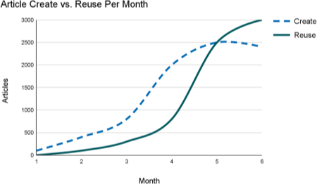

*図：月ごとの記事の作成と再利用。破線が作成（Create）、実線が再利用（Reuse）。最初は作成が先行し、5か月目あたりで再利用が作成に追いつき、その後は再利用が上回る。*

KCS記事の作成は、自然とKCS記事の再利用に先行する。組織が成熟に近づくと、既知のKCS記事の大部分はすでに記録されているので、作成率は下がり、再利用率は上がり続けるはずである。

このパターンは製品のライフサイクルと結び付いているので、新しい製品やアプリケーションが導入されるたびに繰り返される。

#### KCS記事のライフサイクルの傾向

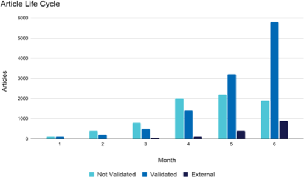

*図：記事のライフサイクル。月ごとの未検証（Not Validated）・検証済み（Validated）・社外向け（External）の記事数。6か月目には検証済みが約5,800件まで増えるが、社外向けは約900件にとどまる。*

KCS記事のライフサイクルは、記事が未検証の状態から検証済みの状態や社外向けの状態へとどれだけ速く移っているかの感触を与えてくれる。ナレッジの価値は記事が見える範囲が広がるほど高まるので、システムにボトルネックが無いことを確かめたい。検証済みの状態の記事は一般に未検証の記事よりはるかに多くの対象者から見え、社外向けの記事は一般に組織の外の人も利用できる。

上のグラフでは、KCS記事が未検証から検証済みへと順調に移っている。ナレッジベースで作成された9,000件のKCS記事のうち、約7,800件が検証済みか社外向けである。ただし、KCS記事の公開には何らかの滞りがあるようだ。

#### 指標としての紐付け率

紐付け率は、ナレッジワーカーの行動を示す強力な先行指標、つまり早い段階の指標である。紐付け率は、処理した出来事やインシデントのうち、記事が紐付けられているものの割合と定義される。記事が紐付けられたインシデントの数を、閉じられた該当するインシデントの総数で割る。どの組織にも、紐付けが意味を持たない、つまり何の価値も加えない出来事やインシデントがあることに注意すべきである。言い換えれば、紐付け率は、紐付けが適切なときに紐付けた割合を測る。

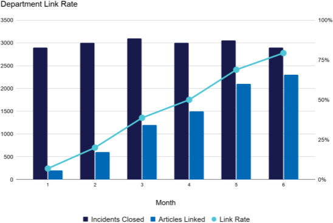

*図：部門の紐付け率。月ごとの閉じたインシデント（約3,000件で横ばい）と紐付けた記事（約200件から約2,300件へ増加）、紐付け率（折れ線。約5%から約80%へ上昇）。*

紐付け率は、組織がKCSを導入する際に見守るべき重要な傾向である。一般に、組織にとって健全な紐付け率は60〜80%の範囲にあるが、具体的な数字はどのインシデントをこの計算に含めるかによって変わる。紐付け率は、ナレッジワーカーのプロセスの一部として、ナレッジベースがどれだけ頻繁に使われているかを示す指標である。紐付け率には、既知の、あるいは既存の記事の再利用と、記事が無かったために作成した記事の両方が反映される。例えば、今週インシデントを10件閉じ、KCS記事を6件再利用し、新しいKCS記事を2件作成したなら、紐付け率は80%になる。

組織によっては「インシデント」というものがそもそも無いので、インシデントに対するナレッジの利用の比率も、したがって紐付け率も無い。比率が無くても、使われた記事の総数を出来事の量で割った記事の活用率を計算すれば、組織が Solve Loop のプラクティスにどれだけ取り組んでいるかについての知見が得られる。この組織はかなりうまくいっているようだ。部門の紐付け率の傾向は確かに好ましい。

グループとしての参加と、個人としての参加の両方を見なければならない。述べたように、紐付け率は、ナレッジワーカーが Solve Loop を受け入れていることを示す、良い早い段階の指標になりうる……紐付け率に目標が設定されていない限りは。

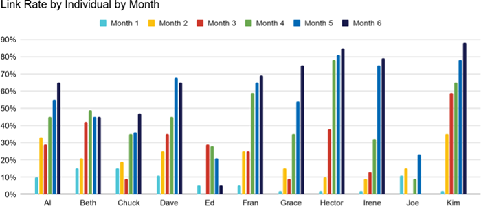

*図：個人ごと・月ごとの紐付け率。Hector と Kim は6か月目に80%を超える一方、Ed と Joe は低いまま推移している。*

ここでは、グループの中で紐付け率に大きな幅があることがわかる。Ed と Joe と、そのワークフローとナレッジベースの使い方について話してみるのがよいかもしれない。紐付け率は、閉じたインシデントと紐付けた記事の比率なので、Joe や Ed が「うまくやっている」と言えるシナリオを考えるのは難しい。紐付け率は、参加していない人を見つける強力な指標である。繰り返しになるが、ナレッジワーカーとの会話は、紐付け率の「点数」についてではなく、KCS、Solve Loop、ナレッジベースの使い方についての理解についてのものである必要がある、と注意しておく。

Kim と Hector について考えてみよう。彼らは組織の新しいヒーローだろうか。とてもうまくやっているように見える。しかし、Kim と Hector について、ナレッジベースで価値を生み出しているのか、それとも重複していたり不完全だったりするかもしれないKCS記事の作成に忙しいだけなのかを知るには、まだ情報が足りない。もっと情報が必要である。

#### プレイヤーのプロファイル

[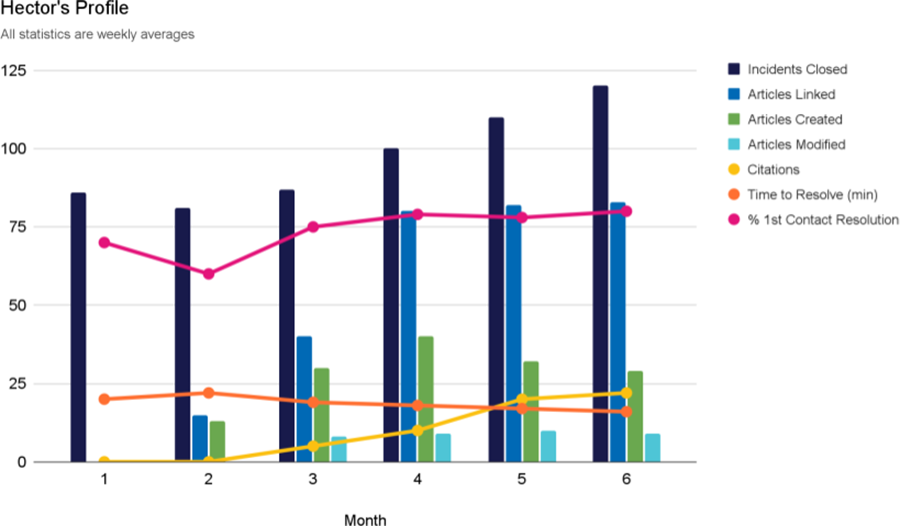](../images/5383-hector-profile-graph.png)

*図：Hector のプロファイル（すべて週の平均）。閉じたインシデント、紐付けた記事、作成した記事、変更した記事、引用、解決時間（分）、一次解決率（%）。紐付けた記事は作成した記事を大きく上回り（再利用が多い）、引用も伸びている。*

個人ごとのKCSの指標のプロファイルを見ると興味深い。これは Hector のプロファイルの例である（クリックすると原寸で開く）。多くのデータが入っているが、要因を組み合わせることで、Hector の貢献をよりよく把握できる。多くの要因は1週間の平均にしてある。閉じたインシデント、紐付けたKCS記事、作成したKCS記事、変更（改善）したKCS記事、引用（Hector が作成したKCS記事を他の人が使ったこと）は、すべて週あたりで示している。解決までの時間と一次解決率は月の平均である。

上の紐付け率のグラフでは、Hector も Kim もスター選手に見える。プロファイルの見方をすると、違うものが見えてくる。

一方 Kim は……

[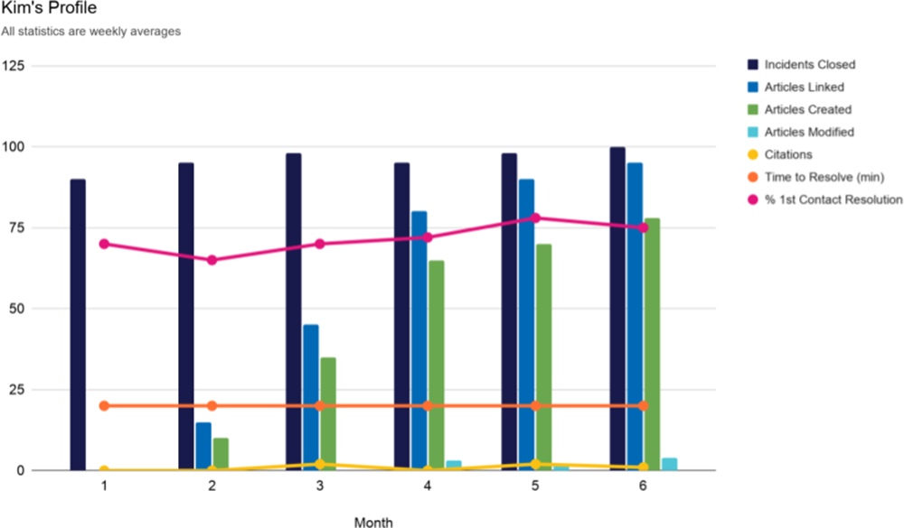](../images/5384-kim-profile-graph.png)

*図：Kim のプロファイル（すべて週の平均）。項目は Hector と同じ。紐付けた記事のほとんどを作成した記事が占め（再利用が少ない）、変更や引用はほとんど無い。*

これは、単一の測定項目だけのプロファイルより、複数の指標を持つプロファイルのほうが望ましい理由を示す絶好の例である（クリックすると原寸で開く）。価値の創出を示す単一の測定項目は無い。紐付け率だけを見れば、Kim も Hector もとてもうまくやっているように見える。しかし、Kim のプロファイルを見直すと、活動の大部分を記事の作成率が占めていることがわかる。Kim は他の人の記事をあまり変更しておらず、実際、他の人の記事をあまり再利用していない。紐付けた（使った）KCS記事と作成した記事の差が、記事の再利用を表している。

Kim の場合、紐付けたKCS記事の大部分をKCS記事の作成が占めており、再利用が比較的少ないことを示している。引用の水準からは、Kim が作成するKCS記事を他の人が使っていないこともわかる。これらすべてから、Kim は新しい記事を作成する前にナレッジベースを検索しておらず、作成するKCS記事は他の人にとってあまり役に立っていない、と推測できるかもしれない。Kim との会話は間違いなく必要である。KCSのプロセスを理解していないのかもしれない。しかし、Kim は新しいリリースに取り組んでいるか、ベータ版の製品をサポートしているのかもしれず、その場合、そのプロファイルは非常に良い貢献を表していることになる。

これだけのデータがあっても、誰が価値を生み出しているかを判断するには、まだ情報が足りない。定量的な見方（活動）と釣り合いを取るための、定性的な見方（質の指標）が欠けている。

先に述べたコンテンツ標準チェックリストに立ち返ると、Hector と Kim の行動と貢献について、さらに別の視点が得られる。

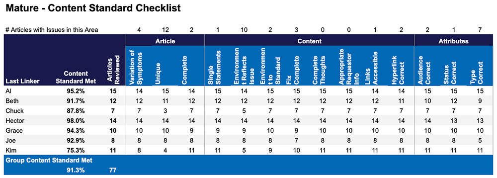

*図：成熟した環境でのコンテンツ標準チェックリスト。Hector は98.0%、Kim は75.3%で、Kim は固有（Unique）の項目で11件中4件しか満たしておらず、重複が多い。項目は拡張した基準の例と同じ。*

Hector のコンテンツ標準チェックリストの割合は98%であり、一貫してコンテンツ標準に従った記事を作成している。対照的に、Kim の割合は75.3%で目標を下回っており（コンテンツ標準チェックリストの割合は成果なので、目標を設定すべきである）、重複の頻度も非常に高い。この高い重複率は、Kim が解決し作成する前に検索していない、という見方を裏付けている。Kim の活動の水準は素晴らしいが、持ち込まれた重複したKCS記事の多さのために、その活動はナレッジベースを損なっている。

誰が価値を生み出していて、誰がコーチの手助けを必要としているかについての確信をさらに高められる視点が、もう1つある。コンテンツ標準チェックリストは、誰がコンテンツ標準を理解し、それに従っているかを教えてくれる。パズルの最後のピースは、PAR（プロセス整合性レビュー。以前はプロセスの統合の指標と呼んでいた）が与えてくれる。これは、誰が Solve Loop を実践しているか、つまり誰がナレッジベースの利用を本当にワークフローに組み込んでいるかを理解する助けになる。

[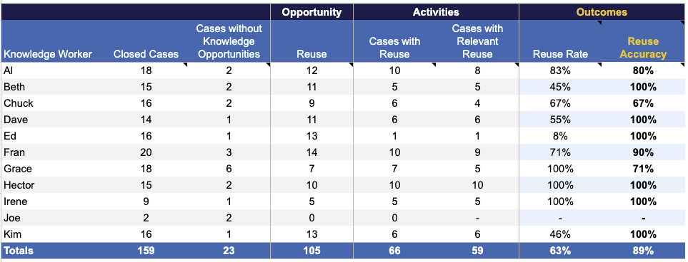](../images/5389-par-essential.png)

*図：PARの基本モデルの例。ナレッジワーカーごとに、閉じたケース、ナレッジの機会が無いケース、再利用の機会、再利用のあるケース、関連性のある再利用のあるケース、再利用率、再利用の正確さを示す。Al は18件中、再利用の機会12件、再利用10件、関連性のある再利用8件で、再利用率83%、再利用の正確さ80%。*

これは、データを集めてプロセス整合性レビュー（PAR）を計算するのに使うスプレッドシートの例である。ここで見たい主な点は、紐付け率、紐付けの正確さ、貢献指数である（詳しくは[プロセス整合性レビューの Solve Loop 指数](05-process-integration.md#page-7862)を参照。原文では「テクニック6.5」と書かれているが、現行の番号は6.3）。

貢献率と紐付けの正確さを見ると、Hector が価値を生み出していて Kim が手助けを必要としているという、さらなる証拠が見えてくる。Hector の紐付け率、紐付けの正確さ、貢献指数はどれも非常に良い。Kim を見ると、紐付け率は良いが、紐付けの正確さは必要な90%を大きく下回っており、紐付けの貢献指数は同僚と比べて非常に低い。

ナレッジワーカーによる価値の創出を見るには、包括的な測定項目の組み合わせを使う必要がある。コンテンツ標準チェックリストとPARを組み合わせて見ることで、誰が価値を生み出していて、誰がコーチの手当てを必要としているかを正確に把握できる。

### レーダーチャート：バリューフットプリントを作る

Hector と Kim のシナリオには、何人分ものグラフを使った大量のデータと分析が必要である。15人のナレッジワーカーのチームを持つリーダーに、そのレベルの分析を日常的に行う時間があるとは考えにくい。誰が価値を生み出していて誰が手助けを必要としているかを、もっと素早く簡単に見分けられないだろうか。素早く評価するために、レーダーチャートと呼ばれるツールを使う。

レーダーチャートを作るには、少し考える必要がある。まず、釣り合いの取れた見方を確実に得たい。主要な測定項目は、次のものの釣り合いを反映しているべきである。

- 先行指標と遅行指標（活動と成果）
- 量と質

先行指標（活動）はチームの平均（目標ではない）と比べ、遅行指標（成果）は目標と比べる。

次に、値を共通の尺度に正規化しなければならない。この例では1に正規化するので、1未満はチームの平均や目標に達していないことを、1より大きいものはチームの平均より良いか目標を上回っていることを表す。先行指標（活動）の場合は、チームの平均に正規化する（活動に目標を設定しない）。遅行指標（成果）の場合は、目標を1に正規化する。

レーダーチャートにどの測定項目を使うかを決めなければならない。レーダーチャートを使っている組織は、それぞれ独自の測定項目の組み合わせを持っており、たいていは KCS Council のチームが定めている。

この例では、シナリオの Hector と Kim のデータを使い、次の測定項目を使う。

- 顧客満足度の指数（個人単位で記録されていると仮定する）
  - インシデントを閉じた後のアンケートに基づく。目標を1に正規化する
- ナレッジへの貢献
  - コンテンツ標準チェックリスト。記事のサンプリングに基づく。目標を1に正規化する
  - 引用（同僚による記事の利用、月あたりの件数、1 = チームの平均）
- プロセスと運用
  - 処理したインシデント。月あたりの処理インシデント数。チームの平均を1に正規化する
  - 平均TTR：平均の応急対応時間（応急対応や回答を提供するまでの平均分数）。チームの平均を1に正規化する（平均TTRの個人の値は逆数にしなければならないことに注意。チームの平均より短いTTRは1より大きい値に、長いものは1未満にする必要がある）
  - 紐付け率。解決策が紐付けられて閉じられたケースの割合。チームの平均を1に正規化する

レーダーチャートに含めたい測定項目と、それを1に正規化する計算を決めたら、チャートを描ける。以下は Hector と Kim のバリューフットプリントである。これらのチャートは、シナリオで使ったグラフの数々よりずっと読みやすいことがわかる。

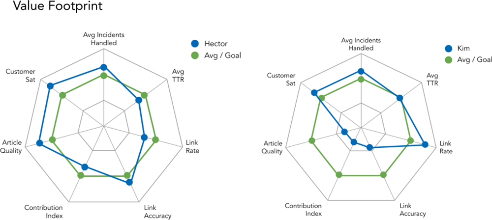

*図：バリューフットプリント（個人）。左が Hector、右が Kim。項目は平均処理インシデント数、平均TTR、紐付け率、紐付けの正確さ、貢献指数、記事の質、顧客満足。緑がチームの平均または目標。Hector はほとんどの項目で平均・目標を上回り、Kim は紐付け率だけが高く、紐付けの正確さ・貢献指数・記事の質が大きく下回っている。*

個人のパフォーマンスを、先行指標についてはチームの平均と、遅行指標については目標と比べることで、Hector が価値を生み出していて、Kim が手助けを必要としていることがすぐにわかる。先行指標と遅行指標、定性的な測定と定量的な測定の釣り合いの取れた見方がある限り、これは測定項目を見る役立つ方法である。しかし、個人が働いているコンテキストとその個人の役割を理解していなければ、どんな測定項目も、測定項目の集まりも意味を持たない。環境のコンテキストの中でデータを評価することは、チームのマネージャーの重要な責任である。KCSの環境での価値の創出の評価は、1次・2次の現場のマネージャーに使うよう慣らしてきた処理件数や活動に基づく測定とあまりに違うので、マネージャーには価値に基づく測定の解釈と使い方についての研修が必要だということがわかっている。

#### 何について話すかは重要か

最終的な Kim との会話は、参加の数字やコンテンツ標準チェックリストの割合についてではなく、行動と問題解決のプロセスについてのものであるべきだということに注意してほしい。数字は指標である。会話が数字についてのものなら、数字が焦点になってしまう。私たちは Kim に行動を調整してほしいのである。Kim の問題解決のプロセスは、KCSのプラクティスに沿っていないのかもしれない。構造化された問題解決のプロセスと Solve Loop のプラクティスについてコーチングすれば、指標にその変化が表れるはずである。しかし、「数字を直す」ことについて Kim と話せば、Kim はそれを実現できるが、そうなると指標は役に立たなくなる。

この話の教訓は3つある。

1. KCSのシステムの健全性やプレイヤーの貢献を判断するのに、1つの測定項目や指標に頼ることはできない。
2. 指標は、環境の性質への理解と合わせて使わなければならない。価値の創出を評価するには、パフォーマンスの全体的な見方が必要である。
3. 活動（先行指標）の*傾向*、特に紐付け率は非常に価値がありうる。しかし、活動に目標を設定したり、従業員との会話で数字に焦点を当てたりすれば、指標の価値は失われる。

パフォーマンスの改善についての会話は、数字についてではなく、行動・プロセス・理解についてのものである。

#### チームのパフォーマンス：マネジメントの効果

レーダーチャートは、チームのパフォーマンスにも、KCSの成功のための環境を作るうえでのリーダーシップの効果を評価する方法としても使える。チームのレーダーチャートでも、釣り合いについての同じルールが当てはまるが、使う測定項目は異なる。チームの測定項目は、チームの規模と組織の規模によって変わる。以下は、チームがサポート組織であり、挙げた測定項目に影響を与えられる場合の例である。

チームのレーダーチャートには、次の測定項目を使うことが考えられる。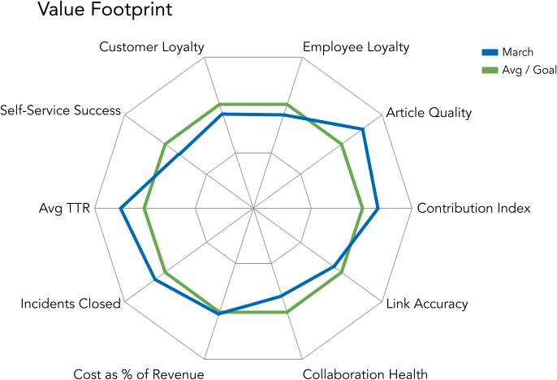

*図：バリューフットプリント（チーム）。項目は顧客ロイヤルティ、従業員ロイヤルティ、記事の質、貢献指数、紐付けの正確さ、協働の健全性、売上に対するコストの割合、閉じたインシデント、平均TTR、セルフサービスの成功。青が3月の実績、緑が平均または目標。*

- 顧客ロイヤルティ：一般に1件ごとのやり取りを測る顧客満足度とは違い、ロイヤルティは時間をかけた顧客の体験と、会社との感情的なつながりを測る（1 = ロイヤルティの目標）
- 従業員ロイヤルティ：ロイヤルティの高い従業員は、ロイヤルティの高い顧客の前提条件である（1 = 従業員ロイヤルティの目標）
- 協働の健全性の指数：チームの協働する能力と意欲。主な指標は、信頼とチームとのつながりの感覚である
- 売上に対するサポートコストの割合
- 閉じたインシデント
- 平均TTR：チームの平均の応急対応時間
- セルフサービスの成功（指数 = 最初にセルフサービスを使う顧客の割合 × 成功率）

数字が全体の物語を語ることは決してない、ということを改めて強調しておきたい。KCSの方法論の多くのことと同じく、判断が必要である。これはナレッジワーカーにもマネージャーにも当てはまる。

レーダーチャートは、ある時点でのデータや測定項目の集まりを示すのには優れているが、傾向を示すのはあまり得意ではない。傾向は、記事の作成率や紐付け率のような先行指標（活動）にとって特に重要である。

組織が世界最高の測定システムを持っていても、それが効果を持つのは、マネージャーが測定項目の解釈の仕方と、行動に影響を与える効果的な会話を従業員とする方法を知っている場合だけである。パフォーマンスの評価と価値の創出は、根本的には数字についてではなく、行動と意思決定についてのものである。

## テクニック7.3：KCSプログラムの効果とROI（Technique 7.3: KCS Program Benefits and ROI）

**システムが意図したとおりに機能し、提供するために作られた価値を届けていることを示す。**

[インパクトマップ](07-change-management.md#page-7142)は、KCSの効果が組織の目標とどう結び付くかを見極めるのに役立つ。インパクトマップの例に基づいて、基準となる現状を定め、進み具合を追跡すべき組織の目標の例を挙げる。

- 顧客[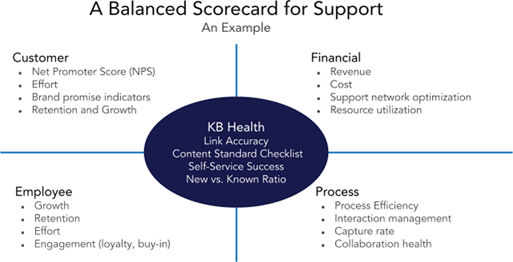](../images/5378-balanced-scorecard.png)
  - ロイヤルティ（NPS）
  - 顧客の労力
  - 契約更新率
- 従業員
  - 離職率
  - 従業員エンゲージメント／ロイヤルティ
  - 従業員の労力
- 事業（財務）
  - 売上の伸び
  - 費用の管理
  - 収益性

*図：サポートのためのバランスト・スコアカードの例。顧客（NPS、労力、ブランドプロミスの指標、維持と成長）、財務（売上、コスト、サポートネットワークの最適化、資源の活用）、従業員（成長、定着、労力、関与（ロイヤルティ・賛同））、プロセス（プロセスの効率、やり取りの管理、記録率、協働の健全性）。中央はナレッジベースの健全性（紐付けの正確さ、コンテンツ標準チェックリスト、セルフサービスの成功、新規と既知の比率）。*

事業目標に合わせるとき、バランスト・スコアカードの形式は、目標の全範囲を網羅していることを確かめるのに役立つ。

スコアカードを作るプロセスの指針は、[The Balanced Scorecard](https://bookshop.org/a/79578/9780875846514) を参照のこと。

### 業務上の効果と投資対効果の考慮事項

KCSによる業務上の効果を評価するときは、先に定めたのと同じ利害関係者、つまり顧客・従業員・事業を使う。それぞれが、KCSの導入から異なる形で恩恵を受ける。利害関係者の効果は、KCSのプラクティスが成熟するにつれて3つのレベルで実現される。

- *直接的*：短期的な業務の改善
- *応用的*：KCSによって可能になる、サービスとサポートの新しい届け方。例えば、作られたナレッジを自動化の動力として使う
- *波及的*：KCSが生み出すナレッジと能力の余裕によって、新しい種類の付加価値のあるサポートサービスを提供できるようになる

経験から、KCSは幅広い環境で価値を持つ一方で、必要な投資と得られる効果は環境の特性によって異なることがわかっている。KCSが利害関係者に価値を生み出すかどうかを決める主な要因は、利用者や顧客からの支援の依頼に応えるうえで、ナレッジや経験がどの程度の役割を果たしているかである。

さらに、効果を測ろうとするときは、定量的（客観的）な測定項目と定性的（主観的）な測定項目の両方を考慮しなければならない。

### 投資

KCSの実践には、次の領域への投資が必要である。

- リーダーシップとマネジメント：スポンサーシップ、プログラムの資源、リーダーシップの育成（研修とコーチング）
- 基盤とサポート：既存のツールの修正、あるいは新しいツールの取得と導入、そしてそれらのツールと既存のシステムとの統合
- 学習と成長：ナレッジワーカーの研修とコーチング
- 組織における新しい役割とスキルの導入と育成：コーチ、KDE（Knowledge Domain Expert）、そしてデータサイエンティストへのアクセスを含むべきナレッジドメイン分析の能力
- KCS記事の管理：Evolve Loop の活動のためのプロセスと資源

これらの領域への投資は、KCS導入の4つの段階にわたって行われる。それは次のとおりである。

- 計画と設計：コンテンツ標準、ワークフロー、コミュニケーション計画といった基盤となる要素を作る
- ウェーブに分けた導入：基盤となる要素を試すためにウェーブIを実施する
- 習熟度の構築：組織全体でプラクティスを定着させる
- 最適化とイノベーション：セルフサービスと、Evolve Loop によって可能になるプロセス・方針・製品・サービスの改善から得られる効果を最大にする

これらの領域と段階が合わさって、総保有コストになる。使われる資源の多くは組織にとって追加のものではなく、実際にはほとんどが既存の資源の再配置で賄われるため、総投資額を計算するのは難しいことがある。他の要素、つまり追加のコストは、見極めるのが比較的容易である。各組織は、含めたい追加でないコストを計算しなければならない。総コストがわかれば、それをナレッジワーカーの数で割って、1人あたりのKCSへの投資額を求められる。

見積もるのが最も難しいコスト要素の1つは、コーチングである。導入の各ウェーブの立ち上げ期には、コーチングは処理能力の点で大きな投資になる。ほとんどの組織では、単に処理能力が下がった状態で過ごすので、実際のコストは発生しない。強い圧力にさらされている他の組織では、数か月の処理能力の低下にさえ耐えられず、コーチングの期間中はナレッジワーカーの欠員を埋めなければならないかもしれない。リーダーは、コーチングに時間を割り当てる計画と、コーチングを支え、場合によっては長期的な劇的な利益のために短期的にサービスレベルを妥協する意志について、はっきりと表明しなければならない。

### 投資対効果

KCSから得られる見返り、つまり効果は、利害関係者ごとに異なる。効果は数多くあり、例として次のものがある。

組織にとって：

- 処理能力の向上
- 組織的な学習
- 組織のイメージやブランドの向上

ナレッジワーカーにとって：

- より面白い仕事（新しい課題の割合が高く、既知の課題の割合が低い）

- 自信の向上、ストレスの軽減
- 能力と仕事の範囲の拡大

依頼者（顧客）にとって：

- 応答の速さ、正確さ、一貫性の向上
- 解決策を見つける労力の軽減（セルフサービス）
- ロイヤルティの向上

### サポートにおけるKCSのROIの例

以下は、3つの異なる環境でのKCSのROIの例である。先に述べたように、ROIを評価するには多くの要因を考慮しなければならない。効果の水準と最も密接に関係しているのは、仕事の複雑さである。以下の3つの例は実在の組織に基づいており、実際の結果をこのモデルと照らして検証している。このROIは、*直接的*な効果、つまりグループの業務効率の改善だけに基づいている。セルフサービスのような*応用的*な効果は含んでいない。

*この例では、ナレッジワーカーをアナリストと呼んでいることに注意。*

| KCSのROIの例 | 複雑さ：高 | 中 | 低 |
|---|---|---|---|
| **既知の問題の平均解決時間（分）** | 10 | 7 | 3 |
| **新しい問題の平均解決時間（分）** | 90 | 40 | 15 |
| **1日あたりの平均クローズ件数** | 4 | 12 | 44 |
| **新しい問題の割合（推定）** | 50% | 35% | 20% |
| **アナリストの月額コスト（諸経費込み）** | \$9,000 | \$7,000 | \$5,500 |
| **アナリスト1人あたりのKCSへの投資** | \$4,500 | \$3,500 | \$3,000 |
| **グループのアナリスト数** | 10 | 10 | 10 |
| **解決1件あたりのコスト（基準）** | \$107 | \$28 | \$6 |
| **アナリストの平均紐付け率** | 70% | 65% | 65% |
| **KCS記事の集まりが成熟するまでの月数** | 8.6 | 4.2 | 2.1 |
| **成熟時のアナリスト1人の1日あたり平均処理能力** | 8.5 | 18.9 | 53.3 |
| **成熟時のグループの1日あたり平均処理能力** | 84.7 | 188.9 | 533.3 |
| **アナリストの1日あたり処理能力の改善** | 112% | 57% | 21% |
| **成熟時の解決1件あたりのコスト** | \$50.60 | \$17.65 | \$4.91 |
| **解決1件あたりのコストの改善率** | 112% | 57% | 21% |
| **KCSのROI：最初の12か月** | 736% | 802% | 286% |
| **KCSのROI：最初の24か月** | 2450% | 1564% | 525% |

処理能力が上がるのは、新しいKCS記事を作成するより、ナレッジベースでKCS記事を見つけるほうがはるかに速いからである。課題を解決した経験を一貫してナレッジベースに記録することで、仕事の大部分が既知の区分（解決までの時間が短い）に移る。KCSを実践すると、ほとんどの組織が、自分たちの仕事の重複の多さに驚く。80対20の法則（依頼の80%は、組織のどこかですでに答えられている）が、良い平均を表している。

このモデルは、「KCS記事の集まりの成熟」までにかかる時間を予測する。成熟とは、組織が知っていることの大部分がナレッジベースに記録された状態である。成熟は月数で測る。上に挙げた例では、複雑な課題の環境の9か月から、複雑さの低い環境の3か月までの幅がある。

このモデルで使った前提は次のとおりである。

| 値 | 項目 |
|---|---|
| 245 | 年間の平均勤務日数 |
| 21 | 月間の平均勤務日数 |
| 8 | 1日あたりの勤務時間 |
| 168 | 月あたりの総勤務時間 |
| 101 | 月あたりの稼働可能時間（稼働率60%） |
| 288 | 1日あたりの稼働可能分数（稼働率60%） |
| \$108,000 | 対応者1人あたりの年間コスト（諸経費込み）：高 |
| \$84,000 | 対応者1人あたりの年間コスト（諸経費込み）：中 |
| \$66,000 | 対応者1人あたりの年間コスト（諸経費込み）：低 |

### 増えた処理能力を活かす計画を立てる

KCSは強力なベストプラクティスであり、最初はサポート組織の処理能力を高め、時間とともに新しい能力と効果を生み出す。初めの段階で、増えた処理能力をどう使うかを考え、ナレッジワーカーと経営層の期待を現実的に設定する必要がある。これが、先に述べた波及的な効果である。

このモデルは、問題1件あたりの平均コストの削減を通じて劇的な投資対効果を示しているが、その節約は、組織が直接実現できる、あるいは実現したい形のものではないかもしれない。ほとんどのサポート組織にとって、主なコスト要素は人件費である。KCSの導入によって仕事の単位あたりの人件費を下げられるが、その節約は人員を減らすことでしか実現できない。シフトの配置の要件やサポートしている技術の多様さのために、それは難しいか、望ましくないかもしれない。人員を減らすと、新しい能力と付加価値のあるサービスを生み出す長期的な機会も小さくなる。

増えた処理能力を活かすのは、厄介なことである。

増えた処理能力を活かすのは、厄介なことである。処理能力をどう使うかの計画を持たない組織は、それを失うおそれがある。増えた処理能力は、組織が意識しないうちに吸収されてしまうことがある。計画が無ければ、既存の仕事が自然と膨らんで時間を埋めてしまう。

増えた処理能力をどう使うかの計画を持つことは、経営層と参加者の期待を設定するうえでも重要な要素である。経営層は追跡できる数字を見たがるが、それらの数字の一部（追加のコストなど）は見積もりである。売り込む数字は選ぼう。KCSの価値全体を伝えるには、顧客ロイヤルティを含む組織の目標という、より大きなコンテキストの中にKCSの効果を位置付けることが、ここでは非常に重要である（インパクトマップの節を参照）。

同じくらい重要なこととして、ナレッジワーカーは、KCSの導入に取り組んだ「褒美」が解雇の通知にならないことを知りたがっている。計画を示し、将来の変化を実行することへの経営層の支持と、特に増えた処理能力をどう使うかを文書にしておこう。

新たに使えるようになった処理能力を組織がどう活かせるかについて、検討すべき選択肢をいくつか挙げる。

- 追加のコスト無しに、依頼者へのサービスレベルを改善する。
- 需要を減らす、予測的・予防的な能力を作る
- 売上を増やす、付加価値のあるサービスを作る
- 利用者や顧客の体験に基づく改善を推し進めるため、製品・プロセス・方針の責任者とのやり取りを増やす。
- 開発のアルファとベータの段階で、製品テストへの参加の度合いを高める（この参加は、新しい製品についての経験でナレッジベースに種をまく最善の方法でもある）。
- 仕事量が増えている環境では、追加の人員の必要を減らしたり先送りしたりできる。
- 仕事量が横ばいか減っている環境では、人員の削減が正しいこともある。KCSは、サービスレベルを保ちながらサポートのコストを下げることを可能にする。ただし、人員の削減が実行可能であることを確かめなければならない。
