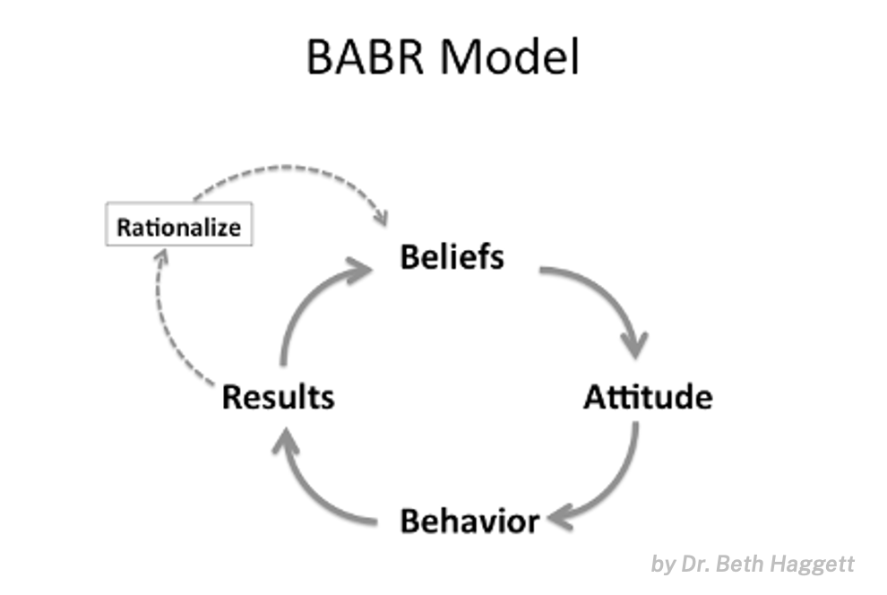
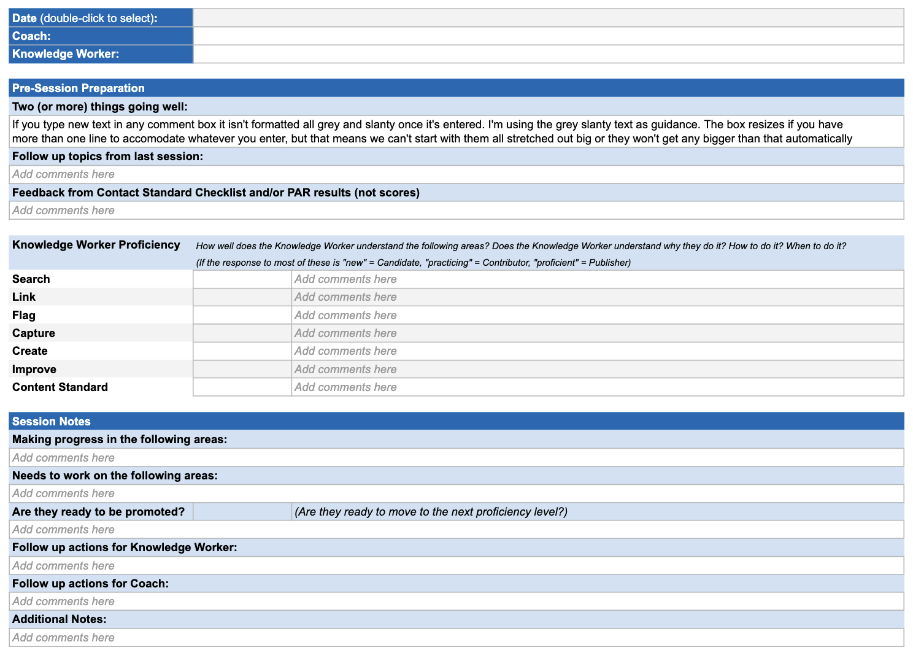

# KCSコーチ・リファレンスガイド（KCS Coach Reference Guide）

> 出典: Consortium for Service Innovation, *KCS Coach Reference Guide* — ページにライセンス表示なし。KCS全体の規定（[CC BY-NC-ND 4.0](https://creativecommons.org/licenses/by-nc-nd/4.0/)）に従うものとみなす（原文を日本語に翻訳し、ページを章ごとにまとめ直したもの）  
> 元のページ:
> - [KCS Coach Reference Guide](https://library.serviceinnovation.org/KCS/Coach_Reference_Guide)
> - [Skills of a Coach](https://library.serviceinnovation.org/KCS/Coach_Reference_Guide/10_Skills_of_Coach)
> - [Structuring Coaching Sessions](https://library.serviceinnovation.org/KCS/Coach_Reference_Guide/20_Coaching_Session)
> - [Handling Specific Doubts](https://library.serviceinnovation.org/KCS/Coach_Reference_Guide/30_Handling_Specific_Doubts)
> - [Doubt: All our issues are unique.](https://library.serviceinnovation.org/KCS/Coach_Reference_Guide/30_Handling_Specific_Doubts/Doubt_All_our_issues_are_unique)
> - [Doubt: I already know the answers. Why should I use the knowledge base?](https://library.serviceinnovation.org/KCS/Coach_Reference_Guide/30_Handling_Specific_Doubts/Doubt_I_already_know_the_answers._Why_should_I_use_the_knowledge_base)
> - [Doubt: I don't have time.](https://library.serviceinnovation.org/KCS/Coach_Reference_Guide/30_Handling_Specific_Doubts/Doubt_I_don't_have_time)
> - [Doubt: I wasn’t hired as a tech writer. It’s not my job.](https://library.serviceinnovation.org/KCS/Coach_Reference_Guide/30_Handling_Specific_Doubts/Doubt_I_wasn%E2%80%99t_hired_as_a_tech_writer._It%E2%80%99s_not_my_job)
> - [Doubt: Knowledge is power. Why would I give that up?](https://library.serviceinnovation.org/KCS/Coach_Reference_Guide/30_Handling_Specific_Doubts/Doubt_Knowledge_is_power._Why_would_I_give_that_up)
> - [Doubt: Self-service doesn’t work.](https://library.serviceinnovation.org/KCS/Coach_Reference_Guide/30_Handling_Specific_Doubts/Doubt_Self-service_doesn%E2%80%99t_work)
> - [Doubt: The tools don’t work.](https://library.serviceinnovation.org/KCS/Coach_Reference_Guide/30_Handling_Specific_Doubts/Doubt_The_tools_don%E2%80%99t_work)
> - [Additional Coaching Resources](https://library.serviceinnovation.org/KCS/Coach_Reference_Guide/40_Additional_Resources)

KCSのコーチの役割は、KCSの習熟を目指すナレッジワーカーを支えることである。KCSのコーチは変革の推進役である。

コーチングは、KCSを組織に根付かせる方法である。KCSを一人ひとりにとって身近なものにする機会である。コーチングのセッションは、ナレッジワーカーに自分の影響を見えるようにし、疑問に答え、誤解や反対意見に応える。

KCSのコーチは、ナレッジワーカーが、ナレッジワーカー・顧客・組織にとって価値を生む形でKCSの研修を実践に移すのを助ける。本ガイドは、KCSのコーチの役割を担う人のためのものである。コーチングの仕組みの作り方について詳しくは、[KCS Practices Guide](05-process-integration.md#page-7138) を参照のこと。

組織がKCSの効果を実現する速さは、Solve Loop の行動がナレッジワーカーの習慣になる速さに直接関係している。コーチングは、導入の速度を上げ、効果を最大にするための手段である。
- 成功のためのコーチング（Coaching for Success）、KCS Principles & Core Concepts より

## コーチのスキル（Skills of a Coach）

コーチの役割は、人に効果を説明したり、違うことを試すよう誘ったりする前に、まず人の疑問や懸念を理解することにある。持続可能な変化のためには、その人の疑問や誤解を正当化している根底の前提と信念を明るみに出す必要がある。

効果的なKCSのコーチングは、次のものに支えられている。

- KCSのプラクティスについての十分な理解
- なぜKCSを行うのか、そしてナレッジワーカーにとって何の得があるのかを言葉にする力
- チームのメンバーの成功への献身を示していること
- 特に次の領域での優れたコミュニケーションのスキル
  - 聞くスキル。理解しようとすること
  - 考え方を説明し、描写すること
  - フィードバックを与えること
  - 結果を生むよう影響を与えること
- 気持ちへの配慮
- サポートのプロセスとツールへの理解
- 次の能力を示していること
  - 時間を効果的に管理する
  - コーチングの好機を見つける。データと測定項目を使って、他の人がより習熟するのを助ける
  - マネジメントと適切にコミュニケーションをとる
  - 反対意見に対処する

Beth Haggett 博士は、[KCS Aligned のサービス](https://www.serviceinnovation.org/kcs/kcs-aligned-services/#thrive)である KCS Coach Development のワークショップで、5つの主要なコーチングのスキルを説明している。これらは、国際コーチング連盟（International Coaching Federation）が求めるコーチの能力を支えるものである。

- **傾聴**：語られたことと、語られなかったことに耳を傾ける。これは影響を与える側が話していないときに行われる。
- **問いかけ**：相手の立場を理解するため、開かれた質問をする。
- **振り返り**：つながりを見つけ、前提と信念を明確にする。
- **承認**：相手の強みと貢献を（声に出して）認める。
- **提唱**：人や考えを支持して主張できる。多くの場合、ここで別の視点を主張する。前の4つのスキルを使うことで信頼が築かれ、（コーチ対象者が間違っている点を指摘する方法としてではなく）会話の一部として、新しい考えや視点を示す機会が生まれる。

### 根底にある信念を見つける

誰かの考えを変えたいなら、まずその人が何を信じているかを理解しなければならない。*疑問、誤解、反対意見は、包み方の下手な贈り物である*。それらは、個人の視点、つまりその人の信念、理解していること、そしてもっと重要なことに、理解していないことについての知見を与えてくれる。

疑う人がなぜ疑うのか、その疑いにつながっている信念を理解し、あるいは明るみに出すことで、別の視点を示す機会が生まれる。信念は、疑う人自身に認識されていなかったり、はっきり言葉にされていなかったりすることが多い。目標は、根底にある信念を見つけることである。

結果を変えるには、信念を変える必要がある。これを考える1つの方法が、BABRモデルである。

*図：BABRモデル（Beth Haggett 博士）。信念（Beliefs）→ 態度（Attitude）→ 行動（Behavior）→ 結果（Results）→ 信念へと循環する。結果は「合理化（Rationalize）」を通じて信念を強めることもある。*

- 信念（Beliefs）が態度に影響し、
- 態度（Attitude）が行動に影響し、
- 行動（Behaviors）が結果（Results）を生む。

結果を変えるには、信念を理解し、物事についての別の考え方を示さなければならない。影響力のスキルを使うことは、根底にある信念を明るみに出す効果的な方法である。［BABRモデルと影響力のスキルは、Beth Haggett 博士の KCS Coach Development のワークショップと資料による。］

根底にある信念を明るみに出すことは、疑う人が物事を違うふうに考えられるよう助けるうえで極めて重要である。一度の会話で考えが変わることはない。それは繰り返しのプロセスであり、解決しようとする前に理解しようとすることを実践する絶好の機会である。

### 探るための提案

根底にある信念を明るみに出すには、好奇心、忍耐、練習が必要である。抵抗がある会話への取り組み方をいくつか挙げる。

- 解決しようとする前に理解しようとする：「そのことについてもう少し聞かせて」
- 共感をもって相手のいるところから始める：人の視点を理解することは、それに同意することと同じではない。疑う人がなぜそう感じるのかに好奇心を持とう。
- 感情に基づく反対意見と論理に基づく反対意見を見分ける。ほとんどの疑問や反対意見は感情（恐れ、不確かさ、信頼の欠如）から来ている。論理で感情を和らげたり、人の視点を変えたりすることはできない。論理を使う前に、感情を和らげなければならない。
- 変革の取り組みは、人に押し付けるより、参加するよう誘うほうがはるかに効果的である。一般に、私たちは、しなければならないと言われたことより、自分で*選んで*することのほうを好ましく感じる。人に別の視点を示し、なぜ違うやり方をしたいのか、そしてそれがその人にとってどんな利点があるのかを理解する助けができれば、そのうえで別の取り組み方を試すよう誘える。
- そして常に……コーチングの前に尋ねる。
  - 「今、大丈夫ですか？」
  - 「私がうまくいったことを共有してもいいですか？」

## コーチングのセッションを組み立てる（Structuring Coaching Sessions）

コーチ対象者と会う頻度は、それぞれのプログラムによって決まるが、月に1〜4回が典型的である。セッションの組み立ては、コーチ対象者がKCSの学習のプロセスのどこにいるかによって変わる。[GROW フレームワーク](https://www.coachingcultureatwork.com/the-grow-model/)は、コーチングの会話を組み立てる、よく使われる役立つ方法の1つである。

人がKCSを学びたいと思う環境を作るのは、マネジメントの責任である。コーチとしてのあなたの役割は、人がKCSの道を進むのを助けることである。

関係、学習、自信を築くことに焦点を当てれば、大きく前進できる。ABC、つまり「Ask Before Coaching（コーチングの前に尋ねる）」を覚えておくことで、信頼が築かれる。例えば次のようなものである。

- 「今、大丈夫ですか？」
- 「私がうまくいったことを共有してもいいですか？」

KCSのコーチは、コンテンツ標準チェックリストやPARのようなツールを使える。これらは、ナレッジワーカーがKCS記事の構造とワークフローをどれだけ理解しているかを示す指標である。これらのツールを使うとき、会話はデータではなく行動に焦点を当てるべきである。

### コーチの責任

- コーチ対象のナレッジワーカーと信頼関係を築き、定期的に会う
- KCSの意図と効果への理解を広めることで、変革の推進役として行動する
- ナレッジワーカーが、ナレッジ記事の質と、問題解決とナレッジマネジメントのプロセスへの準拠を評価するのを助ける
  - KCS Candidate が必要な能力の水準に達するまで、彼らが枠組みを作ったKCS記事をレビューする
- コンテンツ標準への理解と準拠を広める（コンテンツ標準チェックリスト）
- Solve Loop のプロセスへの理解と準拠を広める（プロセス整合性レビュー）
- KCSのスキルの向上について、ナレッジワーカーに、そして適切な場合にはマネジメントにフィードバックする
- 自分自身のコーチングのスキルを伸ばし、見守る
- KCSのコーチの定例会議や KCS Council の会議に出席する
- ワークフローとコンテンツ標準を改善するための提案を KCS Council に行う

#### 1回目のセッション

- 信頼関係を築く：コーチングする相手のことを知る。
- 全体像について話し合う（ナレッジワーカーである私たちにとっての、セルフサービスを使う顧客にとってのKCSの効果）。
- 合意を取り決める：形式張らずに、お互いに何を期待するか、どうやり取りし、どう取り組むかを話し合う。コーチングのセッションの頻度を決める。

#### 2回目のセッション

- 基準となる現状を把握する：KCSの研修で何を学んだか、学習にどこに欠落があるかを見つけ出すときである。
- 節目を定める：何を成し遂げる必要があり、途中の節目は何か。
- コーチングする相手に、成長のための目標と目的を設定するよう促す：「Publisher になりたい時期の目安はありますか？」

#### 継続的なセッション

- セッションの準備をする：記事を確認し、重複を探し、ナレッジベースに問い合わせ、貢献の状況、コンテンツ標準チェックリストとPARの結果を確認し、前回のセッションのメモを見直す。
- コーチングのセッション：ナレッジワーカーがどこにいて、何について最も助けを必要としているかに敏感になる。
- 観察したことを評価し、話し合う：習熟度の進み具合を評価しやすいよう、メモと話し合いを記録しておく。
- 「コーチングのどんなところが役に立っていますか？」「あまり役に立っていないのはどんなところですか？」といった質問でフィードバックを求める。
- 今から次のセッションまでに何に取り組みたいかをコーチ対象者に尋ね、コーチのメモに記録する。
- 毎回のセッションの最後に、次のセッションへの期待を決める。日時を決め、最初の議題を決め、重点を置くことや準備することがあれば書き留める。
- セッション後の活動：自分を振り返る時間をとる。「もっとうまくできることは何か」と自問し、考えとアイデアを記録する。

#### 習熟度の進み具合

KCSの習熟度の進み具合はナレッジワーカーごとに異なり、スケジュールもプログラムによって異なる。

コーチングの仕組みを作るときは、コーチングの指針とし、あなたとナレッジワーカーが予定どおりに進めるよう、スケジュールの例を作っておこう。経験に基づいて繰り返し手を入れていく。

以下の頻度は一例として示す。自分の環境に合わせて変えてほしい。

- セッション1：研修
  - 研修で学んだことを振り返る。ナレッジワーカーは期待されていることを理解し、記録・検索・紐付け・指摘を始めている。
- セッション2〜3：コーチング
  - ナレッジワーカーは記録・検索・紐付け・指摘を理解し、作成とコンテンツ標準への準拠について学んでいる。
- セッション4〜8：実践
  - ナレッジワーカーは記録・検索・紐付け・指摘・作成・コンテンツ標準への準拠を理解し、改善について学んでいる。
- セッション9〜12：見守り
  - ナレッジワーカーは、習熟して自信を持って記録・検索・紐付け・指摘・作成・改善を行い、コンテンツ標準に準拠し、行動の一貫性を高めている。

#### コーチが尋ねるとよい質問の例

- KCSのワークフローはどうですか？
- あなたのワークフローを順に見せてください。
- 仕事をしながら記事を検索するのはどんな体験ですか？
- 役に立ったと感じたものは何ですか？
- 気が散ったり、難しかったりしたものは何ですか？
- コンテンツ標準について、どんな疑問がありますか？
- 今週取り組んだケースで、一緒に見てみたいものはありますか？ケースに取り組みながら見つけた記事、記事の作成や変更、記事の紐付けなど。
- 次のケースに移る前に記事を作成するのは簡単だと感じますか？
- 今、難しいと感じていることは何ですか？
- その記事を見つけてケースに紐付け、そのお客様をすぐに助けられたとき、どう感じましたか？
- 何がもっと上手になりたいですか？（選択肢の例：記録、検索、紐付け、指摘、作成、コンテンツ標準、改善、プロセスへの準拠など）
- 先週会ってから、どこが進歩しましたか？
- あなたが説明していることを私も見られるよう、どのように／どこでそれをしているのか見せてもらえますか？

### コーチングのセッションの記録テンプレート

Consortiumのメンバーは、KCSのコーチングについて豊富な経験を持っており、ここに示したコーチングのセッションの指針と、このコーチングのセッションの記録テンプレートの両方を作った。

*図：コーチングのセッションの記録テンプレート。日付・コーチ・ナレッジワーカー、セッション前の準備（うまくいっていること2つ以上、前回からのフォローアップ、コンテンツ標準チェックリストやPARの結果からのフィードバック（点数ではなく））、ナレッジワーカーの習熟度（検索・紐付け・指摘・記録・作成・改善・コンテンツ標準のそれぞれについて、「新しい」なら Candidate、「練習中」なら Contributor、「習熟」なら Publisher）、セッションのメモ（進歩している領域、取り組む必要がある領域、昇格の準備ができているか、ナレッジワーカーとコーチのフォローアップ、その他）。*

Consortiumのメンバーは、コーチングのセッションで使うための [Google スプレッドシートのワークブック](https://docs.google.com/spreadsheets/d/10ioaG4NWdfXU0jd5NlREjBZlyerkwsCmt5wu8RjYjyQ/edit?gid=0#gid=0)を利用できる。コピーを保存してセッションごとにタブを複製するか、好みのツールに合わせて作り変えてほしい。

*（この指針とテンプレートについて、Jennifer Crippen と Connecting the Dots on Coaching チームの取り組みに感謝する。）*

## 特定の疑問への対応（Handling Specific Doubts）

変化は難しく、どんな大きな変化にも抵抗がつきものである。変化の推進者として、KCSのコーチは、KCSに疑問や誤解を持つ人がこの方法論を理解し、賛同するのを助けるうえで重要な存在である。

KCSのコーチは、組織がKCSのプラクティスとテクニックをどう実践しているかに合わせて会話を調整しなければならない。こうした会話はぎこちなく感じられることもあるので、仲間のコーチと一緒にこれらのシナリオを練習しておくと役に立つ。以下のシナリオは、KCS Practices Guide を用いたConsortiumのメンバーの経験に基づいている。KCSの原則は妥協できないが、プラクティスとテクニックを実践する方法はたくさんある。

状況はそれぞれ異なり、コーチは状況に応じて取り組み方を調整しなければならない。傾聴と良い判断が必要であり、コーチは状況に基づいて質問する必要がある。仕事のやり方を実際に見せてもらいながら懸念を説明してもらうと、非常に多くの知見が得られることがある。

これらの例全体を通じて活用され、示されているスキルは、先に述べた[5つのコーチングのスキル](https://library.serviceinnovation.org/Archive/KCS_v6_FOR_RETHINKING/KCS_Coach_Reference_Guide/10_Skills_of_Coach)である。これは Beth Haggett 博士が、[KCS Aligned のサービス](https://www.serviceinnovation.org/kcs/kcs-aligned-services/#thrive)である KCS Coach Development のワークショップで作ったものである。

以下の例は、どれも同じ構成になっている。

- 疑問の簡単な概要
- 疑問の背後にありうる信念の一覧
- 疑う人が何を信じているかを探るための提案
- 疑問に応えるための要点
- 利用できる参考資料
- 会話がどう進みうるかと、活用されるコーチングのスキルを示すシナリオの例

こうした会話では、本当に好奇心を持つことが重要である。物事についての別の見方を示せるよう、[根底にある信念を見つける](https://library.serviceinnovation.org/Archive/KCS_v6_FOR_RETHINKING/KCS_Coach_Reference_Guide/10_Skills_of_Coach#Identifing_Underlying_Beliefs)ことを目指している。

- [疑問：私たちの課題はどれも固有のものだ。](09-coach-reference-guide.md#page-6099)
- [疑問：答えはもう知っている。なぜナレッジベースを使う必要があるのか。](09-coach-reference-guide.md#page-6104)
- [疑問：時間が無い。](09-coach-reference-guide.md#page-6090)
- [疑問：テクニカルライターとして雇われたわけではない。私の仕事ではない。](09-coach-reference-guide.md#page-6101)
- [疑問：ナレッジは力だ。なぜそれを手放すのか。](09-coach-reference-guide.md#page-6106)
- [疑問：セルフサービスは機能しない。](09-coach-reference-guide.md#page-6102)
- [疑問：ツールが使い物にならない。](09-coach-reference-guide.md#page-6103)

### 疑問：私たちの課題はどれも固有のものだ（Doubt: All our issues are unique.）

#### 根底にありうる信念

- 私たちの環境は固有で、非常に複雑である
- 顧客の環境はどれも固有である
- KCSは、繰り返し起きる既知の課題が多い組織のためのものである
- 既存の記事を再利用する機会は決して（あるいはめったに）無い

#### 探るための提案

- コーチングの前に尋ねる。
- 何が課題の複雑さにつながっているのか。
- こうした複雑な課題をどうやって解決しているのか教えてほしい。

#### 提唱のための要点

- 課題を解決するのに記事の解決策をいつも再利用するとは限らないが、複雑な課題を解決した全員の経験にアクセスできることは、新しい複雑な課題をより速く解決する助けになる。
- ナレッジベースは、複雑な課題を解決した経験を記録する
- 世界中の顧客が挙げるすべての課題を私たちが見ているわけではないので、同じ課題がどれだけ頻繁に挙がっているかは本当のところわからない

#### 参考資料

- 原則：価値を生む（作業はタスク単位で、思考は全体像で）
- 原則：豊かさ（多く共有するほど、多く学ぶ）
- テクニック：コンテンツ標準

#### シナリオの例

*注：これは、コーチ（影響を与える側）の Sara と、懐疑的な経験豊富なナレッジワーカーの Brian とのあいだで会話がどう進みうるかの例を示すシナリオである。コーチングのスキルは斜体の注記で示す（原文では青字）。*

*状況はそれぞれ異なり、影響を与える側は状況に応じて取り組み方を調整しなければならない。傾聴と良い判断が必要であり、本当に好奇心を持つことが重要である。物事についての別の見方を示せるよう、根底にある信念を見つけることを目指している。仕事のやり方を実際に見せてもらいながら懸念を説明してもらうと、多くの知見が得られることがある。*

- **Sara：** こんにちは Brian、今まだ話しても大丈夫？ *問いかけ、コーチングの前に尋ねる*
- **Brian：** ああ、うん……たぶん。
- **Sara：** よかった。調子はどう？ *問いかけ*
- **Brian：** うーん……まあまあ。キューにケースがたくさんある。
- **Sara：** ナレッジベースを検索するのは役に立ってる？ *問いかけ*
- **Brian：** そうでもない。前にも言ったけど、ナレッジベースに価値を感じないんだ。
- **Sara：** 懐疑的なのはわかってる。でも、先週対応したケースのいくつかについて、記事を作ってみるって言ってたよね。 *承認、振り返り*
- **Brian：** うーん……時間が無かったし、それにどうせ誰もその記事や解決策を二度と使わないよ。前にも言ったけど、うちのケースの解決策はどれもお客様ごとに固有なんだ。
- **Sara：** ああ、そうだった。あなたがサポートしている製品は、導入ごとに大きくカスタマイズされているって言ってたね。 *振り返り*
- **Brian：** そう……だから、二度と再利用される見込みの無い課題について、なぜ記事を作るのさ。
- **Sara：** わかる。繰り返し起きる課題はあまり無いんだね。 *振り返り*
- **Brian：** 最後に既知の課題に当たったのがいつか思い出せないくらいだよ。
- **Sara：** この製品にはこの4年間携わってるって言ってたよね。 *振り返り、問いかけ*
- **Brian：** そう。

- **Sara：** この分野で働き始めた頃より、今のほうが課題を解決するのがうまくなったと感じる？ *問いかけ*
- **Brian：** それはもちろん。今ではこの分野の技術スペシャリストだからね。
- **Sara：** すごいね。それで、この分野であなたが専門性を身に付けるのに役立ったのは何だった？ *承認、問いかけ*
- **Brian：** ええと……うーん。
- **Sara：** 正式な研修を受けた？ *問いかけ*
- **Brian：** いや……でも、このチームに来たとき、素晴らしいメンターがいたのは確かだね。
- **Sara：** その人が製品についていろいろ教えてくれたの？ *問いかけ*
- **Brian：** うん……ほとんどは課題のトラブルシューティングのコツだけど。
- **Sara：** トラブルシューティングのガイドはある？ *問いかけ*
- **Brian：** いや……でも最初の頃はたくさんメモを取ったよ［*机の引き出しからノートを取り出す*］。
- **Sara：** いいね……今でもそれを見返す？ *承認、問いかけ*
- **Brian：** たまにね。この製品のトラブルシューティングを4年もやっていれば、課題への取り組み方はわかってる。
- **Sara：** すごいね。そのノートにある情報がナレッジベースにあったらどうだろう？ *承認、提唱*
- **Brian：** ああ……でも……これは課題の修正方法じゃないんだ。
- **Sara：** そうだね……この環境では、課題を解決するのに記事の修正方法をそのまま再利用することはないかもしれない。でも、似た課題を解決したあなたや他の人の過去の経験にアクセスできることは、新しい課題を解決する助けになっているみたいだね。ナレッジベースの価値は課題の解決策だけじゃない。あなたがノートに記録してきたような種類のものこそが価値なんだ。 *提唱、振り返り、提唱*
- **Brian：** 経験をナレッジベースに記録できるとは思えないな。
- **Sara：** 完璧にはいかないかもしれない……でも、チームの全員が、複雑な課題を解決したお互いの経験にアクセスできたらどうだろう。ナレッジベースが、あなたや他の人のノートの代わりになるんだ。 *承認、提唱*
- **Brian：** うーん……それはどうかな。
- **Sara：** わかった……ためらう理由をもう少し聞かせて。 *問いかけ*
- **Brian：** ええと……ノートは自分用に書き留める場所なんだ……それに、全部に自信があるわけじゃない。試してみたことや自分が提案した解決策もあるけど、検証も確認もされていないんだ。
- **Sara：** ああ、なるほど。 *振り返り*
- **Brian：** ここで良い評判を築くために頑張ってきたから、それを傷つけたくないんだよ。
- **Sara：** もちろん……自信のあるものと、試しにやってみたものを見分けたり区別したりする方法があったらどうだろう？ *提唱*
- **Brian：** うーん……それならいいかも。
- **Sara：** ノートに書く時間を使う代わりに……ナレッジベースに経験を記録してみてもいいと思う？今ノートを更新しているのと同じくらいの時間しかかからないはずだよ。 *提唱*
- **Brian：** まあ……いいかな。
- **Sara：** 本当に余分な仕事にはならないはず。経験を記録する方法が違うだけで、それがチームの他の人にも使えるようになるんだ。 *提唱*
- **Brian：** それで、未確認のものには印を付けられるの？
- **Sara：** うん。

### 疑問：答えはもう知っている。なぜナレッジベースを使う必要があるのか（Doubt: I already know the answers. Why should I use the knowledge base?）

#### 根底にありうる信念

- 簡単な課題の答えは誰でも知っている
- 答えを知っていて、それがナレッジベースにあることも知っているなら、なぜ検索して紐付けなければならないのか

#### 探るための提案

- コーチングの前に尋ねる。
- そのことについてもう少し聞かせて。

#### 提唱のための要点

- 完全なナレッジベースは新しい人の助けになる
- 手戻りを減らし、ケースとして入ってくる既知の課題の数を減らす
- 顧客がセルフサービスで答えを見つけられるようにする
- 答えを知っていても紐付けることは、いくつもの理由で重要である。
  - 顧客がある課題を何回経験しているかについての情報を記録する。
  - 価値の高いコンテンツが、セルフサービスを通じて確実に顧客に届くようにする
  - 紐付けは検索エンジンの改善に役立つ
  - 紐付けのデータを使って、根本原因分析と是正措置を推し進める。
  - 製品の改善を推し進めることに加えて、紐付け率はナレッジドメイン分析を可能にする指標の1つとして活用される。例えば、製品ごとの課題のトップ10の一覧、ハブとなる記事、コンテンツのマルチメディアでの提示、自動化の候補となる課題を見つけることである。データは多くの領域での改善に活用できる。

#### 参考資料

- [KCS Benefits](https://library.serviceinnovation.org/KCS/KCS_v6/KCS_v6_Adoption_Guide/000_Introduction/020_KCS_Benefits)
- テクニック：[Linking](https://library.serviceinnovation.org/KCS/KCS_v6/KCS_v6_Practices_Guide/030/030/030/030)
- テクニック：[KCS Roles and the Licensing Model](https://library.serviceinnovation.org/KCS/KCS_v6/KCS_v6_Practices_Guide/030/040/030/020)
- テクニック：[Knowledge Domain Analysis](https://library.serviceinnovation.org/KCS/KCS_v6/KCS_v6_Practices_Guide/030/040/010/060)

#### シナリオの例

*注：これは、コーチ（影響を与える側）の Heidi と、疑いを持つ Sophia とのあいだで会話がどう進みうるかの例を示すシナリオである。コーチングのスキルは斜体の注記で示す（原文では青字）。*

*状況はそれぞれ異なり、影響を与える側は状況に応じて取り組み方を調整しなければならない。傾聴と良い判断が必要であり、本当に好奇心を持つことが重要である。物事についての別の見方を示せるよう、根底にある信念を見つけることを目指している。仕事のやり方を実際に見せてもらいながら懸念を説明してもらうと、多くの知見が得られることがある。*

- **Heidi：** こんにちは Sophia、調子はどう？ *問いかけ*
- **Sophia：** ああ Heidi。まあまあだよ。ナレッジベースのことで小言を言いに来たの？
- **Heidi：** はは、そう感じさせてしまったならごめんね。KCSは好きじゃない？ *問いかけ*
- **Sophia：** 全然。
- **Heidi：** そのことについて少し話してもいい？ *問いかけ*
- **Sophia：** いいけど。
- **Heidi：** どんなところが好きじゃないか教えてくれる？ *問いかけ*
- **Sophia：** ただの手間の多い作業に思えるんだ。
- **Heidi：** なるほど、もう少し聞かせて。 *問いかけ*
- **Sophia：** うーん、あなたの担当の製品分野のことは知らないけど、この製品分野で1〜2年やっていれば、課題の答えはだいたいわかってるんだ。
- **Heidi：** へえ……答えをもう知っている課題はどれくらいの頻度で来る？ *問いかけ*
- **Sophia：** うーん……たぶん6〜7割くらい。
- **Heidi：** そうなんだ。
- **Sophia：** でしょ。だから、答えを知ってるのに、なぜ時間をかけてナレッジベースの記事を検索して紐付けなきゃいけないの？
- **Heidi：** そうだね、既知の課題に答えるのは楽しい？ *問いかけ*
- **Sophia：** まあ、悪くはないけど……同じ課題がこんなに繰り返し来なければいいのにとは思う。
- **Heidi：** 実はね……KCSの目標の1つは、そういう既知の課題をできるだけ多く、お客様がセルフサービスで解決できるようにすることなんだ。もう1つの目標は、繰り返し起きる課題を見つけて、開発に直してもらえるようにすること。 *提唱*
- **Sophia：** うん……それは聞いたことがある……でも実際にはそうなってない。
- **Heidi：** お客様の行動を変えるには時間がかかるよね。開発チームに見せるデータを集めるのにも時間がかかる。 *振り返り、問いかけ*
- **Sophia：** でも……それが私と何の関係があるの？
- **Heidi：** うーん。いい質問だね。 *承認*
- **Sophia：** 答えを知ってて、ナレッジベースに記事があることも知ってるなら……なぜ時間をかけて検索して紐付けなきゃいけないの？
- **Heidi：** そうだね……紐付けにはいくつも利点があるんだ。検索エンジンの助けになって、よく使われる記事は検索順位で重みが高くなる。それに、紐付けがあることで、需要を生んでいる要因を見つける助けになるナレッジドメイン分析ができるようになるんだ。 *提唱*
- **Sophia：** ふうん……よくある課題が何かは、私が教えてあげればいいんじゃない？
- **Heidi：** それもある程度は使える。でも、いろいろな地域にサポートセンターがあるから、1人だけでは、ある課題がお客様からどれくらい頻繁に挙がっているかはわからないかもしれない。紐付け率を通じて世界中から情報が集まれば、需要を生んでいる要因をずっと速く見つけられる。 *提唱*
- **Sophia：** うーん……それはなぜ大事なの？
- **Heidi：** いくつも理由があるんだ。どの記事をセルフサービスで目立たせるべきか、例えばこの製品のトップ10の一覧にどの記事を載せるべきかがわかる。どの課題がマルチメディアの候補になりそうかもわかる。そしておそらく一番大事なのは、どの課題について開発が是正措置を検討すべきかがわかること。 *提唱*
- **Sophia：** 本当に？それが紐付ける一番の理由みたいだけど、開発はそれに乗ってるの？
- **Heidi：** 開発グループの中には、お客様の体験にすごく関心を持っているところもあるんだ。紐付け率は、彼らが注意を払うべき課題を見つけ、定量的で行動に移せるデータを提供する助けになる。 *提唱*
- **Sophia：** じゃあ、乗ってない開発グループはどうなの？
- **Heidi：** そうだね……その人たちとも取り組んでいるところ。根本原因分析をして是正措置を取っている開発チームが得ている効果を見れば、すぐに考えを変えてくれると思う。 *提唱*
- **Sophia：** つまり、紐付け率が本当に製品の改善を推し進められると思ってるの？
- **Heidi：** そう思う。前回のリリースの後、たくさんのお客様に出たエラーメッセージを覚えてる？ *提唱*
- **Sophia：** ああ、あれね……大変だった。
- **Heidi：** そう。あの記事への紐付けの件数と速さの両方が、開発がすぐに直す強い動機になったんだ。
- **Sophia：** まあ……開発チームがあれをすごく早く直したのには驚いたよ。
- **Heidi：** 紐付けのデータがあることで恩恵を受けた、他の会社の実例もあるんだ。でも、データを有効で行動に移せるものにするには、みんなに紐付けてもらう必要があるし、正確に紐付けてもらう必要がある。
- **Sophia：** わかった……開発チームに影響を与えられる機会があるとは知らなかった。でも、既知の課題を紐付けるのはちょっと面倒なんだよね。よくある課題に簡単に素早く印を付けられる方法があればいいのに。
- **Heidi：** ああ……ツールのお気に入り機能は使ったことある？ *問いかけ*
- **Sophia：** ええと……ない。
- **Heidi：** よく使う記事の一覧を作っておけば、ワンクリックで、解決しているケースに紐付けられるよ。 *提唱*
- **Sophia：** 本当に？
- **Heidi：** うん。それと、もちろん、データ分析が有効であるためには、紐付けが正確である必要がある。 *提唱*
- **Sophia：** うーん……正確って、どういう意味？
- **Heidi：** ケースに紐付けた記事に、そのケースに書かれている課題の解決策が入っている必要がある。関連していて、行動に移せるものでなければならないんだ。 *提唱*
- **Sophia：** なるほど。納得した。
- **Heidi：** じゃあ……利点がわかった今、紐付けを試してみてもいいと思う？ *提唱*
- **Sophia：** うん……やってみる。それと、このことはチームの他の人にも知らせたほうがいいね。

### 疑問：時間が無い（Doubt: I don't have time.）

この懸念は、主な責任が課題（ケース）の解決であるナレッジワーカーからよく出てくる。ナレッジワーカーは、次の課題に移れるよう、できるだけ早く課題を解決するよう圧力を受けていることが多く、場合によっては多くの課題に同時に取り組んでいる。KCSが無くても、これは手に負えないと感じられることがある。

#### 根底にありうる信念

- 自分にとって価値が無い
- 閉じたケースの数で評価されている
- すべてのケースについて記事を作成しなければならない
- 自分が書いた、自信の無い解決策を他の人に見られたくない

#### 探るための提案

- これは、そのナレッジワーカーの時間管理の問題なのか、それとも本当にKCSについての懸念なのか。
- この疑問は、多くの場合、口にされていない信念や恐れによって生まれている。
- コーチングの前に尋ねる。
- 理解しようとし、感情を和らげながら、問いかけ・振り返り・承認を使う。
  - そのことについてもう少し聞かせて。
  - 課題を解決するのに、どんなものや参考資料を使っている？

#### 提唱のための要点

控えめに使うこと。

- おそらく、彼らはすでに記録に時間を使っている。ただ、構造化されていない、広く共有されていない、あるいは質の高いケース管理の慣行に従っていない形でそうしているだけである。（中程度から高度に複雑な環境の）ナレッジワーカーのほとんどは、特に新しい課題に出会ったとき、メモを取っている。メモはノートやデジタルの形（Word、Excel）で取られることが多く、チームの共有ドライブに置かれることもある。しかし、その保管場所には基準が無く、恩恵を受けたり貢献したりしうる全員には共有されていない。
- ナレッジワーカーは解決策を記録しなければならず、新しい課題であれば、ケースはおそらく顧客がセルフサービスで起票している。段階的なモデルであれば、最初の接点で書き始められたメモを仕上げるだけで済むはずである。最初の接点は、セルフサービスでのケースの起票か、1次対応による記録かもしれない。
- 記事を一から作成するのは例外であるべきだ。KCSを導入して数か月たてば、ほとんどの課題にはすでに記事があるはずである。そして、新しい課題であっても、ほとんどのセルフサービスの仕組みにはケースの起票が含まれているので、新しい記事の一部になる内容の一部は顧客がすでに作っている。ナレッジワーカーが記事を一から作成するのは、一般にナレッジドメイン分析の活動（Evolve Loop）の中だけである。
- 他の人からの邪魔が減る：課題がナレッジベースにあれば、他の人がそれについての質問であなたを煩わせなくて済む。
- 重複した仕事が無くなる：課題がセルフサービスで手に入れば、顧客は自分で見つけられるか、ナレッジベースで似た記事を見て自分の課題をよりよく理解できる。

#### 参考資料

- [KCS Benefits](https://library.serviceinnovation.org/KCS/KCS_v6/KCS_v6_Adoption_Guide/000_Introduction/020_KCS_Benefits)
- プラクティス：[Capture](https://library.serviceinnovation.org/KCS/KCS_v6/KCS_v6_Practices_Guide/030/030/010)
- テクニック：[Linking](https://library.serviceinnovation.org/KCS/KCS_v6/KCS_v6_Practices_Guide/030/030/030/030)
- テクニック：[Self-service Success](https://library.serviceinnovation.org/KCS/KCS_v6/KCS_v6_Practices_Guide/030/040/010/080)

#### シナリオの例

*注：これは、コーチ（影響を与える側）の Nigel と、疑いを持つ Jan とのあいだで会話がどう進みうるかの例を示すシナリオである。コーチングのスキルは斜体の注記で示す（原文では青字）。*

*状況はそれぞれ異なり、影響を与える側は状況に応じて取り組み方を調整しなければならない。傾聴と良い判断が必要であり、本当に好奇心を持つことが重要である。物事についての別の見方を示せるよう、根底にある信念を見つけることを目指している。仕事のやり方を実際に見せてもらいながら懸念を説明してもらうと、多くの知見が得られることがある。*

- **Nigel**：こんにちは Jan。
- **Jan**：ああ……KCSの人か。
- **Nigel**：うん、KCSの研修についてどう思ったか聞きたくて。 *問いかけ*
- **Jan**：うーん……KCSは自分には合わないと思う。すべてのケースについて記事を書く時間がどこにあるのかわからないよ。
- **Nigel**：特に最初はそう見えるかもしれないのはわかる。そのことを少し一緒に考えてみてもいい？ *承認、振り返り*
- **Jan**：……いいよ……
- **Nigel**：課題の答えをもう知っていることは、どれくらいの頻度である？ *問いかけ*
- **Jan**：ええと、この製品のエスカレーション先になってからは……受け取るケースの半分くらいは新しい課題かな。
- **Nigel**：へえ……あなたがチームのエスカレーション先なんだ？ *振り返り*
- **Jan**：そう。
- **Nigel**：それは楽しい？ *問いかけ*
- **Jan**：うん……だいたいは。中には、自分のところに来る前に解決されているべきものもあるけど。
- **Nigel**：このチームにはどれくらいいるの？ *問いかけ*
- **Jan**：ええと……2年ちょっと。
- **Nigel**：すごいね。 *承認*
- **Jan**：チームに入ったとき、素晴らしいメンターがいたんだ。今は開発チームに移ったけど。
- **Nigel**：じゃあ、チームの他の人たちが、解決に苦労しているケースをあなたに回してくるんだね？ *振り返り、問いかけ*
- **Jan**：そう。
- **Nigel**：そういうケースは、どうやってあなたのところに来るの？ *問いかけ*
- **Jan**：まあ……たいていは自分のキューに入ってくる。
- **Nigel**：そして、そういう課題の半分くらいは答えを知っているって言ったよね？ *振り返り、問いかけ*
- **Jan**：うん……リリースサイクルのどこにいるかによるけど……そう、受け取るケースの半分くらいは、たいてい答えを知ってる。
- **Nigel**：その既知の課題については、たいていナレッジベースに記事がある？ *問いかけ*
- **Jan**：たぶんね？
- **Nigel**：研修で聞いた「一度解決したら、何度でも使う」という決まり文句を覚えているかな？ *提唱*
- **Jan**：うん。
- **Nigel**：そうだね……「一度解決したら、何度でも使う」の素晴らしいところは、頻繁に対応しなければならない既知の課題をいったん記録してしまえば、あとは既存の記事を再利用するだけで済むことなんだ。作成する必要は無い。ケースの半分くらいは既知だって言ってたよね。それについては既存の記事を再利用することになる。 *提唱、振り返り*
- **Jan**：うーん……なるほど。
- **Nigel**：それに、私たちの目標は、そういう既知の課題と記事をセルフサービスでお客様に届けることなんだ……だから、時間がたつにつれて、キューに来る既知の課題は減っていくはず。キューに来るって言ってた「もの」の一部は、あなたのところに来る前に解決されるようになる。 *提唱*
- **Jan**：まあ、お客様にもっとコンテンツを届けられるのは、KCSの好きなところの1つではあるね。でも、それを書く時間が無いんだ。
- **Nigel**：答えをまだ知らないケースについて話してもいい？
- **Jan**：いいよ。
- **Nigel**：そういうケースには、たいてい、ケースのメモか、添付された作成中の記事に、課題についての情報がいくらか入って来る？ *問いかけ*
- **Jan**：ええと……うん、たいてい課題についての情報はいくらかある。
- **Nigel**：つまり、課題の記述と、関連する環境と製品の情報はすでに記録されているんだね。 *提唱*
- **Jan**：そうなの？
- **Nigel**：解決策をどうやって探しているか、少し教えて。どんな資料を使ってる？ *問いかけ*
- **Jan**：まあ、過去の経験がとても役に立つ。
- **Nigel**：ほかには？ *問いかけ*
- **Jan**：同僚の誰かが経験していそうなことなら、その人に聞くかもしれない。
- **Nigel**：製品のドキュメントは使う？ *問いかけ*
- **Jan**：あまり使わない。慣れていないことなら、共有ドライブを検索するけど。
- **Nigel**：へえ？共有ドライブって？ *問いかけ*
- **Jan**：少し前から、チームで共有ドライブを使って、診断の手順や、出くわした難しい課題や重大な課題を書き留めるようになったんだ。
- **Nigel**：いいね……それは誰が更新してるの？ *承認、問いかけ*
- **Jan**：重大だと思ったらみんなでやる。でも、難しいのは自分のところに来るから、ほとんど自分かな。
- **Nigel**：すでに、重大な課題を記録するのに時間を使っているみたいだね。それを共有ドライブじゃなくて、ナレッジベースに入れたらどうだろう？ *振り返り、提唱*
- **Jan**：ええと……それは絶対うまくいかないよ……
- **Nigel**：どうして？ *問いかけ*
- **Jan**：だって……あれは私たちの場所なんだ。誰にでも開放したくはない。
- **Nigel**：なるほど、私たちの場所というのは……ここオースティンのチームだけのもの？それとも、ヨーロッパやアジアでこの製品分野を担当している人たちもアクセスできる？ *問いかけ*
- **Jan**：いや、彼らはめちゃくちゃにすると思う。
- **Nigel**：そうなの？もう少し聞かせて。 *問いかけ*
- **Jan**：他のチームには、ここほどの深い経験が無いんだ。よく私たちに助けを求めてくる。
- **Nigel**：なるほど……あなたたちの共有ドライブにアクセスできたら、彼らは自分の質問の一部に自分で答えられると思う？ *問いかけ*
- **Jan**：うん……たぶん。
- **Nigel**：あなたへの質問の数を減らせるかもしれないね。 *提唱*
- **Jan**：うーん……どうかな、それぞれ自分たちの共有ドライブを持ってると思う……ああ……言いたいことがわかった……グローバルのサポートチームで同じ共有ドライブを使うべきなんだ。
- **Nigel**：それは役に立ちそうだね。 *提唱*
- **Jan**：ただ、彼らがめちゃくちゃにしないと信用できないんだよ。
- **Nigel**：うーん……お客様の課題を解決したグローバルな経験を共有する共通の場所を持つのは、良い考えに思えるよね。他の人が「めちゃくちゃにしない」ようにするには何が必要だと思う？ *提唱、問いかけ*
- **Jan**：そうだね……イギリスの共有ドライブを見る機会があったんだけど……違う形式を使ってた。
- **Nigel**：なるほど……じゃあ、コンテンツの標準的な形式や構造が必要かもしれないね？ *問いかけ*
- **Jan**：うん……でも、それをどうやって守らせるのかわからない。
- **Nigel**：もし……共有ドライブの使い方についてコーチングをして、標準を促したらどうだろう？ *提唱*
- **Jan**：うーん……かもね。イギリスの何人かはうまくやれると思うけど、他の人たちが心配だな。
- **Nigel**：わかった……それをうまく管理する方法はあるかな？ *問いかけ*
- **Jan**：わからない……一部の人にはコンテンツを更新できて、他の人はできない、ってことにできる？
- **Nigel**：ああ……それをする方法はあるよ。KCSのライセンスモデルについて聞いたのを覚えてる？ *提唱、問いかけ*
- **Jan**：ああ……なんとなく。じゃあ、イギリスでは Lizz と Colin は貢献できるけど、他の人はできない、と。
- **Nigel**：そう。でも、コーチングによって、他の人も役に立つ形で貢献する権利を得られるよう助けられる。 *提唱*
- **Jan**：へえ……
- **Nigel**：それで、編集の権限、コンテンツ標準、チェックリスト、コーチングを組み合わせて、リスクを管理する方法があったらどうだろう？ *提唱*
- **Jan**：複雑そうだね。
- **Nigel**：実はね……ナレッジベースにはすでにそれが全部用意されているんだ。さらに、記事には、どれだけ頻繁に使われ、更新されたかの指標もある。 *提唱*
- **Jan**：へえ？……うーん……共有ドライブにはそういうものは無いけど、わかると便利だね。まあ……ヨーロッパやアジアが、うちの共有ドライブの情報にアクセスできたら、もっと多くの課題を自分たちで解決できるかもしれない、というのはわかる気がする。
- **Nigel**：そして、それを複雑でなくしてくれるのが、コーチングで全部を結び付けることなんだ。 *提唱*
- **Jan**：ええと……わかった。
- **Nigel**：ライセンスモデルと記事のコンテンツ標準を見て、グローバルのチームに合いそうか考えてみてもらえる？ *問いかけ*
- **Jan**：いいよ……共有ドライブが無法地帯にならないなら……でも、コーチングにずいぶん期待をかけているみたいだね。
- **Nigel**：そう、グローバルな標準を実践するうえで、コーチングは成功に欠かせないんだ。ライセンスモデルとコンテンツ標準を一緒に見る時間を取ろう。でもその前に……記事を作成するのにかかる時間についての、最初の懸念に戻ってもいい？ *振り返り、問いかけ、振り返り*
- **Jan**：まあ……わかったよ……すべてのケースについて記事を作成しなくていいんだね。
- **Nigel**：そう。KCSの Solve Loop のプロセスの肝は、お客様の課題を解決して集合的に学んだことを記録し、それを再利用することなんだ。だから、記事を作成するのは新しい課題についてだけでいい……それに、エスカレーション先として、新しい課題のケースには、作成中の記事がまだ作られていなければ、新しい記事を作成するのに必要な情報の多くがすでに入って来るはずだよ。 *提唱*
- **Jan**：うーん……わかった、思っていたほど悪くないかもしれない。
- **Nigel**：ナレッジベースのライセンスモデルとコンテンツ標準を見直して、共有ドライブからナレッジベースにどう移れるかを考える時間を取ろう。 *提唱*
- **Jan**：わかった……見てみるよ。

### 疑問：テクニカルライターとして雇われたわけではない。私の仕事ではない（Doubt: I wasn’t hired as a tech writer. It’s not my job.）

この懸念はよく……から出てくる。（原文もここで途切れている）

#### 根底にありうる信念

- 変化への恐れ
- 余分な仕事だという受け止め
- 「物語」を書いたり、文と段落で文書を作ったりする必要があるという思い込み
- 課題についての顧客の記述は決して正しくないのに、なぜ記録するのか

#### 探るための提案

- コーチングの前に尋ねる。
- もっと手間がかかると思うのはわかる
- ケースをどう扱っているか、そしてどこに余分な手間を感じるかを見せてもらえる？

#### 提唱のための要点

- この疑問は、多くの場合、口にされていない信念や恐れによって生まれている。
- 書く必要があるのは要点・事実だけである
- 記事に入るべきことの多くは、すでにケースのメモに書いている
- 何が起きているかについての顧客の捉え方を保存し、それを課題・環境・解決策についての事実に結び付けたい
- KCSは追加の仕事を提案しているのではない。構造化された、見つけられる記事を生み出す、違うやり方で仕事をすることを提案している

#### 参考資料

- 原則：[価値を生む](01-principles-and-core-concepts.md#page-369)（作業はタスク単位で、思考は全体像で）
- プラクティス：[Capture in the workflow](https://library.serviceinnovation.org/KCS/KCS_v6/KCS_v6_Practices_Guide/030/030/010)
- テクニック：[Content Standard](https://library.serviceinnovation.org/KCS/KCS_v6/KCS_v6_Practices_Guide/030/040/010/040)

#### シナリオの例

*注：これは、影響を与える側の Mala と、懐疑的なナレッジワーカーの Stephan とのあいだで会話がどう進みうるかの例を示すシナリオである。コーチングのスキルは斜体の注記で示す（原文では青字）。*

*状況はそれぞれ異なり、影響を与える側は状況に応じて取り組み方を調整しなければならない。傾聴と良い判断が必要であり、本当に好奇心を持つことが重要である。物事についての別の見方を示せるよう、根底にある信念を見つけることを目指している。仕事のやり方を実際に見せてもらいながら懸念を説明してもらうと、多くの知見が得られることがある。*

- **Stephan**：ああ、こんにちは Mala。
- **Mala**：こんにちは Stephan。
- **Stephan**：もう会う時間だったとは気づかなかった……このケースのメモを書き終えて、お客様に解決策をメールさせて。
- **Mala**：どうぞ。
- **Stephan**：よし、今日はどんな用件？
- **Mala**：ナレッジベースと記事の作成がどうなっているか、様子を聞きたくて。 *問いかけ*
- **Stephan**：ああ……ええと、ケースの仕事に加えてそれをどうやればいいのか、本当にわからないんだ。新しいリリースが出てからずっと忙しくて。
- **Mala**：ああ、そうだよね。ケース件数の報告を見たよ。忙しかったね。 *振り返り*
- **Stephan**：だから、こんなに忙しいのに記事を書くなんて本当に無理だよ。
- **Mala**：前にも聞いたと思うけど……私たちは、KCSのプロセスで仕事が増えるんじゃなくて減ることを期待しているんだ。 *提唱*
- **Stephan**：まあ、うまくいくといいね。それに、私はお客様の課題を解決するために雇われたのであって、テクニカルライターになるためじゃないと思う。
- **Mala**：なるほど。どこで余分な仕事が生まれると感じるか、見せてもらえる？ *問いかけ*
- **Stephan**：いいよ。
- **Mala**：今閉じたケースを例に使ってもいい？ *振り返り、問いかけ*
- **Stephan**：いいよ、難しいケースだった。でも解決策は見つけたよ。
- **Mala**：ケースのメモに書いていたのはそれ？ *問いかけ*
- **Stephan**：そう。それで、ナレッジベースに記事を作るべきだって思ってるんでしょ……それだと手戻りが多くて、もっと時間がかかる。
- **Mala**：そうだね、解決策はもう書いてあるみたいだね。それを再利用する方法はあるかな？ *問いかけ*
- **Stephan**：記事に切り貼りすることはできるだろうけど、他の欄はやっぱり作らないといけない。
- **Mala**：「ケースから記事を作成する」機能は知ってる？数週間前にシステムに追加されたばかりなんだ。 *問いかけ*
- **Stephan**：ああ……それは意味が無いよ。こういうケースのほとんどは、お客様がサービスポータルで起票してるんだから。課題についてのお客様の捉え方をナレッジ記事に入れたくはない。技術的に正しいことなんて一度も無いからね。
- **Mala**：そうだね、お客様は何が起きているかについて不正確な見方をしていることが多いよね。 *振り返り*
- **Stephan**：でしょ。だから、そんな誤った情報をナレッジベースの記事に入れたくはないんだ。
- **Mala**：うーん……実はね……記事の構造のおかげで、何が起きているかについてのお客様の捉え方を記録して、それを技術的に正しい情報に結び付けられるんだ。 *提唱*
- **Stephan**：本当に？
- **Mala**：うん。お客様の見方を記事の一部として記録することで、他のお客様が記事を見つけられるようになる。この問題に出くわした他のお客様も、おそらく同じように表現するからね。あなたが言ったように、お客様は技術的に正しい言葉で課題を表現しない。自分の言葉を使うんだ。 *提唱、振り返り*
- **Stephan**：へえ……わかった……じゃあ、記事の他の欄はどうなの？
- **Mala**：そうだね、環境の記述とか？ *振り返り*
- **Stephan**：たぶん。
- **Mala**：私がキューの仕事をしていて新しい課題に出会うと、課題を診断しながらメモを少し取ることが多いんだ。そこにメモ帳があるね。このケースに取り組んでいたとき、メモを取った？ *提唱、問いかけ*
- **Stephan**：ええと……うん、お客様との会話から、状況の要点をいくつか書き留めてる。
- **Mala**：いいね。そのケースのメモを見てもいい？ *承認、問いかけ*
- **Stephan**：いいよ。お客様の名前と、どのリリースを使っているかについての質問への答えと、設定パラメーターについてのいくつかの点が書いてある。
- **Mala**：うん、私も同じことをするよ。つまり、そのメモの多くは、実は記事の環境の記述なんだ。メモ帳の代わりに作成中の記事に記録したらどうだろう？ *承認、提唱*
- **Stephan**：かなり暗号みたいなメモだけど。
- **Mala**：そうだね、良いナレッジ記事のほとんどは文や段落で書かれていないんだ。事実だけが欲しいんだよ。 *提唱*
- **Stephan**：へえ。
- **Mala**：だから……私の見たところでは、私たちはあなたにテクニカルライターになってほしいわけじゃない。それに、あなたはナレッジベースの記事に入ることを、ケースのメモかノートに、すでに記録したり書いたりしているんだ。 *提唱、振り返り*
- **Stephan**：うーん。
- **Mala**：KCSは追加の仕事だとは思わない。今していることを違うやり方でするということなんだ。 *提唱*
- **Stephan**：どうかなあ……
- **Mala**：違うやり方で仕事をすることに慣れるには少し時間がかかるのはわかってる。でも、それを身に付けたチームに見られる効果は本当に説得力があるんだ。次に新しい課題が来たときに、試してみてもいいと思う？ *振り返り、問いかけ*
- **Stephan**：……たぶん。
- **Mala**：よかった。何か質問があったら教えてね。

### 疑問：ナレッジは力だ。なぜそれを手放すのか（Doubt: Knowledge is power. Why would I give that up?）

#### 根底にありうる信念

- 私のナレッジが欲しいのは、私の仕事を外部委託して私を解雇するためだろう。
- 私は知っていることでしか評価されていない
- 他の誰も自分のナレッジを手放さないのに、なぜ私がそうしなければならないのか

#### 探るための提案

- コーチングの前に尋ねる。
- そう感じるのはわかる……そのことについてもう少し話してもいい？
- 仕事のどんなところが楽しい？

#### 提唱のための要点

- ほとんどのサポート担当者は、すでに解決した質問に答えたり課題を解決したりすることを楽しんではいない。新しい課題を解決することの挑戦と満足を楽しんでいる
- 繰り返しの仕事を無くす
- 価値の高い仕事は新しいものを解決することであり、それが得意な人が必要である

#### 参考資料

- 原則：価値を生む（作業はタスク単位で、思考は全体像で）
- 原則：豊かさ（多く共有するほど、多く学ぶ）
- プラクティス：パフォーマンスの評価

#### シナリオの例

*注：これは、コーチ（影響を与える側）の Miguel と、懐疑的な経験豊富なナレッジワーカーの Scott とのあいだで会話がどう進みうるかの例を示すシナリオである。コーチングのスキルは斜体の注記で示す（原文では青字）。*

*状況はそれぞれ異なり、影響を与える側は状況に応じて取り組み方を調整しなければならない。傾聴と良い判断が必要であり、本当に好奇心を持つことが重要である。物事についての別の見方を示せるよう、根底にある信念を見つけることを目指している。仕事のやり方を実際に見せてもらいながら懸念を説明してもらうと、多くの知見が得られることがある。*

- **Miguel：** こんにちは Scott。
- **Scott：** ああ、どうも……
- **Miguel：** 調子はどう？
- **Scott：** まあまあ、すごく忙しい。
- **Miguel：** そうか、少し話す時間はある？ *コーチングの前に尋ねる*
- **Scott：** 少しなら……
- **Miguel：** ありがとう。ナレッジベースは使ってみた？たくさんある課題のいくつかを、もっと速く解決する助けになるかもしれないよ。 *提唱*
- **Scott：** ナレッジベースは使ってない。あそこには価値のあるものなんて何も無いよ。
- **Miguel：** そうなの……試してみた？ *問いかけ*
- **Scott：** 誰も自分のナレッジをナレッジベースに入れたりしないよ。
- **Miguel：** そうなの？
- **Scott：** 私たちは知っていることで給料をもらってるんだ……ナレッジをナレッジベースに入れたら、私たちは要らなくなる。本当は人員を減らすか、私たちの仕事を外部委託しようとしてるんだと思う。
- **Miguel：** うーん、そう見えるのはわかる気がする。私が見てきた限りでは、マネジメントはあなたの仕事を評価しているみたいだけど。 *承認*
- **Scott：** ふうん。
- **Miguel：** あなたがしている仕事について、もう少し教えてくれる？ *問いかけ*
- **Scott：** 仕事の外部委託の話はしたくないの？
- **Miguel：** それにはまた戻るよ。ただ、あなたが何をしていて、どんなところが好きなのかをもっと理解したいんだ。 *問いかけ*
- **Scott：** ふん……わかった……まあ……お客様を助けて、課題を解決するのが好きかな。
- **Miguel：** いいね。他より楽しい課題の種類はある？ *問いかけ*
- **Scott：** 難しい課題の挑戦が楽しいかな……解決するのに時間がかかることが多いけど。
- **Miguel：** 難しい課題はどれくらいの頻度で来る？ *問いかけ*
- **Scott：** たぶん週に1〜2件。開発サイクルと新しいリリースによる。
- **Miguel：** 残りはかなり簡単なもの？ *問いかけ*
- **Scott：** そう。
- **Miguel：** 仕事で他に好きなところはある？ *問いかけ*
- **Scott：** ええと……うーん……新しい製品分野で働くのがすごく好きだね。ほら、専門性を広げられるから。
- **Miguel：** 難しい課題にもっと取り組んで、簡単な課題を減らしたい？ *振り返り、問いかけ*
- **Scott：** もちろん。簡単な課題には挑戦が無いからね。
- **Miguel：** 簡単な課題が簡単なのは、もう答えを知っているから？それとも、答えを見つけるのが簡単だから？ *問いかけ*
- **Scott：** ああ、ほとんどは見慣れたもので、もう答えを知ってる。でも、自分の成績には良いんだ。
- **Miguel：** 成績？
- **Scott：** ほら……月に何件ケースを閉じたかの成績だよ。
- **Miguel：** うーん……それはもう主要な測定項目じゃないと思うよ。数か月前にスコアカードから外されたはず。 *提唱*
- **Scott：** え？それは聞いてないな。
- **Miguel：** それはマネージャーに確認してみるといいよ。でも、あなたのところに来る仕事の話に戻ろう。簡単なケースのいくつかが無くなったら、仕事はもっと面白くなる？ *問いかけ*
- **Scott：** そうかもね……本当に測定項目が変わったのなら。
- **Miguel：** ナレッジベースを使うことの要点は、課題を一度解決して、何度も使うことなんだ。だから、簡単な既知の課題がセルフサービスで手に入れば、お客様はそれを見つけて、ケースを起票せずに課題を解決できる。 *提唱*
- **Scott：** そう？理屈の上では良さそうだね。でも、仕事が減るってことは、人も少なくて済むってことに思えるけど。
- **Miguel：** そうかもしれない……でも、新しい課題を解決するには、あなたのような優れた問題解決者がやっぱり必要なんだ。開発が新しいリリースを出すのをやめることはないからね。 *承認、提唱*
- **Scott：** まあ……それは確かに。
- **Miguel：** 組織は、価値を生み出す人、つまり難しい課題を解決でき、幅広いスキルを持つ人を残す必要があるんだ。 *提唱*
- **Scott：** わかった、それはわかる気がする。
- **Miguel：** KCSで本当に成功したら、それには時間がかかるけど、要らなくなるのは既知の課題だけを解決している人なんだ。 *提唱*
- **Scott：** ああ、キューから簡単なケースしか取らない Sam みたいな人ってこと？
- **Miguel：** うーん、名前は挙げないけど、どのチームにもそういうことで知られている人が1人か2人いるみたいだね。 *提唱*
- **Scott：** じゃあ……答えを知っていることは、答えを見つけ出せることほど重要でも、価値があるわけでもない、ってこと？
- **Miguel：** そう。組織にとってのあなたの価値は、いくつの課題の答えを知っているかじゃなくて、新しい課題を解決できる力なんだ。それに、あなたはそれを楽しんでいるみたいだね。 *提唱、振り返り*
- **Scott：** ふん……
- **Miguel：** でも、既知の簡単な課題を無くすには、それをナレッジベースに記録して、セルフサービスで目立たせられるようにしなきゃいけない。 *提唱*
- **Scott：** ああ……それがこの「一度解決したら、何度でも使う」の意味なのか！
- **Miguel：** そう！実際、Barbara があのよくあるエラーメッセージについて記事を作ったんだ。セルフサービスに公開されて、今月だけで1,000回以上閲覧されてる。しかも……今では開発がその原因の修正を検討しているんだ。 *提唱*
- **Scott：** まあ……それが理にかなうのはわかる気がする。でも、ケースのクローズ件数の測定項目のことは、マネージャーと話さないと。
- **Miguel：** そうだね。さっきの仕事の外部委託の話だけど。事業は成長していて、必要なスキルを持つ人を見つけるのがどれだけ難しいかは聞いたことがあるよね。私たちの目標は効率を高めて、事業が成長しても人を増やさなくて済むようにすることなんだ。 *振り返り、提唱*
- **Scott：** じゃあ、既知の繰り返しの課題を無くすことが、効率を高める方法なの？
- **Miguel：** それはパズルの重要なピースの1つだね。どうかな、解決した課題をナレッジベースに記録して、そのケースをもう一度受けなくて済むよう、ナレッジベースを使ってみてもいいと思う？ *提唱*
- **Scott：** まあ……わかった。いくつかのケースで試してみるかもしれない。

### 疑問：セルフサービスは機能しない（Doubt: Self-service doesn’t work.）

この懸念はよく……から出てくる。（原文もここで途切れている）

#### 根底にありうる信念

- 顧客はいつも私たちに電話したがる
- 顧客はサポートにお金を払っているのに、なぜ自分でやりたがるのか
- 顧客は検索しない／しようとしない
- セルフサービスで手に入るコンテンツが足りない
- 顧客は自分の課題の技術的な詳細を理解していない

#### 探るための提案

- コーチングの前に尋ねる。
- そのことについてもう少し聞かせて。

#### 提唱のための要点

- 顧客が答えを探す活動のすべてが、私たちに見えているわけではない。
- サポートに対する顧客の需要は、サポートセンターに入ってくるケースとして私たちが目にするものよりはるかに大きい。
- 顧客は、Google、オンラインコミュニティ、フォーラムなど、答えを得るのに多くの異なるチャネルを使っている。
- オンラインのフォーラムやコミュニティ、セルフサービスでの活動の量は膨大である。
- ほとんどの顧客にとって、セルフサービスで課題の答えを見つけるほうが、ケースを起票して誰かと話すのを待つよりはるかに速い。
- 業界の統計は、ケースの件数よりもセルフサービスでの活動のほうがはるかに多いことを示している。
- 自分が使っている製品のサポートに電話したことはどれくらいある？
- 使っているツールで課題が起きたら、まず何をする？

#### 参考資料

- 原則：[*価値を生む*](01-principles-and-core-concepts.md#page-369)（作業はタスク単位で、思考は全体像で）
- 原則：[*需要主導*](https://library.serviceinnovation.org/Leadership_in_an_Adaptive_Organization/010_Principles_for_an_Adaptive_Organization/030_Demand_Driven)（「念のため」ではなく「必要なときに必要なだけ」）
- テクニック：[*Self-service Success*](https://library.serviceinnovation.org/KCS/KCS_v6/KCS_v6_Practices_Guide/030/040/010/080)

#### シナリオの例

*注：これは、影響を与える側の Pat と、懐疑的な経験豊富なナレッジワーカーの Luke とのあいだで会話がどう進みうるかの例を示すシナリオである。コーチングのスキルは斜体の注記で示す（原文では青字）。*

*状況はそれぞれ異なり、影響を与える側は状況に応じて取り組み方を調整しなければならない。傾聴と良い判断が必要であり、本当に好奇心を持つことが重要である。物事についての別の見方を示せるよう、根底にある信念を見つけることを目指している。仕事のやり方を実際に見せてもらいながら懸念を説明してもらうと、多くの知見が得られることがある。*

- **Pat**：こんにちは Luke、調子はどう？
- **Luke**：やあ、まあまあだよ。
- **Pat**：先週ナレッジベースの記事をいくつか作って、それが今セルフサービスで見られるようになってるね。素晴らしい！ *承認*
- **Luke**：ああ……どういたしまして……でも、誰も使わないと思うよ。
- **Pat**：そうなの……どうして？ *問いかけ*
- **Luke**：お客様はいつも電話してくるからさ。セルフサービスなんて使わないよ。
- **Pat**：うーん……そう感じる理由をもう少し聞かせて。 *問いかけ*
- **Luke**：ええと……まず、ほとんどのお客様はサポートにお金を払ってる。それに、うちとしてもその売上はありがたいはずだし。それから、わざわざ検索する手間をかけるとは思えない。
- **Pat**：なるほど。 *振り返り*
- **Luke**：だって本当に……一番簡単なことでも電話してくるんだよ。
- **Pat**：お客様の中には、電話するほうを好む人もいるかもしれないね。でも、あなたが使っている製品で課題が起きたら、どうする？ *振り返り、問いかけ*
- **Luke**：Google……ググるよ。
- **Pat**：車のキーフォブの電池が切れたときの、Google の話を覚えてるよ。電池を替えてもらうのに、ディーラーに電話したり、ディーラーまで行ったりしなきゃいけないのが憂鬱だったんだよね。 *振り返り*
- **Luke**：そうそう、キーフォブの開け方が全然わからなかったからググったら、電池の替え方を見せてくれる YouTube の動画が見つかったんだ。
- **Pat**：それで、車は延長保証の期間中だった？ *振り返り*
- **Luke**：まあ、そうだけど……ググるほうがずっと速かった。電話番号を探して Toyota に電話するより短い時間で動画が見つかったよ。
- **Pat**：業界のデータでは、ほとんどの人があなたと同じなんだ。ケースを起票するより、オンラインのコミュニティのフォーラムやセルフサービスで答えを見つけるほうを好む。 *提唱*
- **Luke**：うん……でも、うちのお客様には当てはまらないと思う。
- **Pat**：ああ……本当に重大な課題なら、そうかもしれない。でも、多くの課題については、ケースを起票するよりオンラインで答えを見つけるほうが速いんだ。 *提唱*
- **Luke**：うーん……どうかな。
- **Pat**：うちの製品のコミュニティフォーラムでの活動の量を示す報告書は見たことある？ *問いかけ*
- **Luke**：ない。
- **Pat**：かなり目を開かされるよ。ケースの件数を見ているだけでは、お客様が課題の解決策を探す活動のすべては見えていないということが、本当によくわかる。 *提唱*
- **Luke**：本当に？
- **Pat**：それに、セルフサービスの機能を広めるための取り組みもいくつかしているんだ。お客様が必要なものを見つけやすくしようとしている。 *提唱*
- **Luke**：じゃあ、さっき言ってた活動の報告書は見てみたいな。
- **Pat**：わかった、リンクを送るね。

**キーフォブの部分の別バージョン**

- **Pat**：そうだね。課題が起きたとき、Microsoft や社内のITヘルプデスクに電話したことはどれくらいある？
- **Luke**：ええと……ほとんど無いね。でも、自分は何をすべきかわかってるし、サポートにお金を払ってもいない。

### 疑問：ツールが使い物にならない（Doubt: The tools don’t work.）

2つのシナリオがある。

1. もしかすると、ツールが本当に壊れているのかもしれない。そうでないことを確かめることが重要である。
2. 機能や統合の制約（ここで焦点を当てるのはこちら）

#### 根底にありうる信念

- 変化への恐れ
- 前に使っていたツールは好きではなかったが、少なくとも使い方はわかっていた
- 新しいツール一式を覚えたくない
- KCSの方法論への信念や賛同の欠如

#### 探るための提案

- この疑問は、多くの場合、口にされていない信念や恐れによって生まれている。ツールについての不満はスケープゴートである。リーダーシップの意図への疑いや、KCSへの賛同の欠如といった、より深い問題があることが多い。
- コーチングの前に尋ねる。
- そのことについてもう少し聞かせて。
- 何が機能しない？
- 改善の提案はある？

#### 提唱のための要点

- ツールが本当に壊れているのかを見極める。壊れたツールは、ツールの機能や統合への不満とは違う。
- 人はツールの使い方を知っているか（ツールが動いていると仮定して）。ツールの使い方の理解をおさらいする必要があるか。研修を受け直す必要があるか、それともツールの使い方について上級の研修やコーチングが必要か。
- 人は多くの場合、私たちが人にしてほしいこととツールにできることとのあいだの緩衝材になっている。
- 人に解決策の一部になるよう誘う。一緒に創造的な回避策を作る。
- 成績の高い人は、今ある機能と統合を最もうまく使う方法を考え出す。
- 意見とフィードバックは受け止め、フォローアップする必要がある。
- 創造性を認める。

#### 参考資料

- プラクティス：[*Capture*](https://library.serviceinnovation.org/KCS/KCS_v6/KCS_v6_Practices_Guide/030/030/010)
- プラクティス：[*Process Integration*](https://library.serviceinnovation.org/KCS/KCS_v6/KCS_v6_Practices_Guide/030/040/020)

#### シナリオの例

*注：これは、ナレッジワーカー（疑いを持つ側）の Tadd と、チームのマネージャー（影響を与える側）の Kay とのあいだで会話がどう進みうるかの例を示すシナリオである。コーチングのスキルは斜体の注記で示す（原文では青字）。*

*状況はそれぞれ異なり、影響を与える側は状況に応じて取り組み方を調整しなければならない。傾聴と良い判断が必要であり、本当に好奇心を持つことが重要である。物事についての別の見方を示せるよう、根底にある信念を見つけることを目指している。仕事のやり方を実際に見せてもらいながら懸念を説明してもらうと、多くの知見が得られることがある。*

- **Kay**：こんにちは Tadd、調子はどう？ *問いかけ*
- **Tadd**：やあ Kay、まあまあだよ。
- **Kay**：今、話しても大丈夫？ *問いかけ*
- **Tadd**：いいよ。
- **Kay**：前回話したとき、ケースに取り組みながらナレッジベースを使ってみるって言ってたよね？ *振り返り*
- **Tadd**：うん……やってみたよ。
- **Kay**：どうだった？ *問いかけ*
- **Tadd**：うーん……あまり良くなかった。
- **Kay**：そうなの？ *問いかけ*
- **Tadd**：ツールが、前回話したプロセスをちゃんと支えてくれないんだ。
- **Kay**：そうか……もう少し聞かせて。 *問いかけ*
- **Tadd**：ええと……やりにくいことがいくつもあるんだ。ケース管理システムとナレッジマネジメントシステムが統合されていないから、研修で教わったワークフローができない。
- **Kay**：なるほど……ツールが完璧じゃないのはわかってる。やり方について、コーチと話してみた？ *振り返り、問いかけ*
- **Tadd**：いや……研修以来話してない。
- **Kay**：わかった、それは良い考えかもしれないね。もっと良くする方法について、何か提案はある？ちょうどITチームに要件の一覧を出すところなんだ。 *提唱、問いかけ*
- **Tadd**：じゃあ……これが今取り組んでいる課題で……これがそのケース。ナレッジベースに行くには、別の画面に移らなきゃいけない。
- **Kay**：ああ……それはやりにくいね。 *振り返り*
- **Tadd**：そう、面倒なんだ。
- **Kay**：うーん……それをもっと面倒でなくする方法について、提案はある？ *問いかけ*
- **Tadd**：まあ、当然、ケースとナレッジベースを同時に開いて見られるべきだよね。
- **Kay**：なるほど。私たちはよく、自分たちがしたいこととツールが許してくれることとのあいだの緩衝材になっているように感じるよね。 *振り返り*
- **Tadd**：それは本当にそう。ケースの処理時間が増えるんだ。
- **Kay**：そうか。課題を解決しながらナレッジベースを使うことに、何か利点はあると思う？（Tadd がKCSに賛同しているかを確かめている） *問いかけ*
- **Tadd**：うん……あると思う。既知の課題をセルフサービスに載せること……つまり、簡単な課題をまとめて無くせたら素晴らしいよね。
- **Kay**：そう、それは良いね。他に思い浮かぶ利点はある？ *振り返り、問いかけ*
- **Tadd**：ああ……こういう繰り返しの課題がどれくらいの頻度で来るかのデータを開発チームに渡せたら、すごくいいな。
- **Kay**：どちらもかなり良い利点だね。効果的にやる方法を覚えるあいだは少し余分に時間がかかるかもしれないけど、その利点は短期的な投資を上回りそうだね。 *提唱*
- **Tadd**：まあ……そうかもね。
- **Kay**：難しいのはわかる。でも、新しいケース管理ツールを展開したとき、あなたがその使い方についてすごく良いアイデアを出してくれたのを覚えてるよ。かなり創造的だった。 *振り返り、提唱、承認*
- **Tadd**：うん。
- **Kay**：統合されていないのが問題なのはわかる……でも、これを創造的なアイデアを考え出す機会だと捉えてみたらどうだろう？ *振り返り、提唱*
- **Tadd**：ああ……でも……あれはチームでの取り組みだったんだ。
- **Kay**：そうなの、もう少し聞かせて。 *問いかけ*
- **Tadd**：チームの何人かでお昼にアイデアについて話していて、実際にそれについて何回か打ち合わせもしたんだ。
- **Kay**：今回のツールの課題についても、そうしてみたらどうだろう？ *提唱*
- **Tadd**：まあ……それはうまくいくかもしれない。
- **Kay**：昔から言うよね……問題の一部になりたいか、解決策の一部になりたいか。統合されていないのは問題だけど、機会でもあるんだ。 *承認、提唱*
- **Tadd**：うーん……わかった、考えてみるよ。
- **Kay**：よかった……良い週末を。
- **Tadd**：ありがとう、そちらも。

## コーチングの追加資料（Additional Coaching Resources）

### 公開されている資料

コーチング全般の資料：

- [GROW フレームワーク](https://www.coachingcultureatwork.com/the-grow-model/)（Sir John Whitmore が作った、コーチング全般の枠組み）
- 国際コーチング連盟（International Coaching Federation）
  - コーチの能力
  - 倫理規定
- 書籍：[Drive](https://bookshop.org/a/79578/9781594484803): the Surprising Truth About What Motivates Us、Daniel Pink 著（邦題『モチベーション3.0』）
  - [10分間の要約動画](https://youtu.be/u6XAPnuFjJc?si=PgyYdK3AggYFkhCf)
- 書籍：[The Coaching Habit](https://bookshop.org/a/79578/9780978440749)、Michael Bungay Stanier 著（邦題『リーダーが覚えるコーチングメソッド』）
- 書籍：[The Slight Edge](https://bookshop.org/a/79578/9781626340466): Turning Simple Disciplines Into Massive Success and Happiness、Jeff Olson（著）・John David Mann 著

Consortiumの資料：

- KCS Principles and Core Concepts：[9) Coaching for Success](https://library.serviceinnovation.org/KCS/KCS_v6/KCS_Principles_and_Core_Concepts/030/090)
- KCS v6 Practices Guide：[Technique 6.4: Coaching for Success](https://library.serviceinnovation.org/KCS/KCS_v6/KCS_v6_Practices_Guide/030/040/030/025)
- KCS v6 Adoption & Transformation Guide：[KCS Coaching Program](https://library.serviceinnovation.org/KCS/KCS_v6/KCS_v6_Adoption_Guide/020_Adopt_in_Waves/010_Preparing_for_Wave_I/020_KCS_Coaching_Program)
- [今後開催されるトレーナー主導のコーチ・ワークショップ](https://www.serviceinnovation.org/events/category/trainer-led-workshops/kcs-coach-workshop/)
  - Beth Haggett 博士による [KCS Coach Development ワークショップ](https://www.serviceinnovation.org/kcs/kcs-aligned-services/#thrive)
- [2023 Selling the Benefits of a KCS Coaching Program](https://www.serviceinnovation.org/selling-benefits-kcs-coaching/)
- [2021 KCS in Action: Maximize Success by Implementing Coaching](https://www.serviceinnovation.org/coaching-to-maximize-kcs-success/)
- [2019 KCS in Action: Improving Coaching with Automation](https://www.youtube.com/watch?v=Dtp56bkA_40)
- [The Benefits of KCS Coaching: A Conversation](https://www.serviceinnovation.org/benefits-of-kcs-coaching/)
- [Coaching and Motivation](https://www.serviceinnovation.org/coaching-and-motivation/)

### メンバー限定の資料

_（[Consortiumのメンバー](https://www.serviceinnovation.org/current-members/)でログインに助けが必要な場合は、<support@serviceinnovation.org> に連絡すること。）_

- 2022 A Field Guide for KCS Program Management（コーチングの仕組みの設計と、コーチ研修の議題の例を含む）
- [2021 Coaching in a Mature KCS Environment: A Conversation](https://library.serviceinnovation.org/wiki/KCS/One_Hour_Web_Sessions/KCS_Coaching_and_Leadership/2021_02_08_Coaching_in_a_Mature_KCS_Environment)
- [2020 KCS in Action: Coaching Program & Licensing Model at Chick-fil-A](https://library.serviceinnovation.org/wiki/KCS/One_Hour_Web_Sessions/KCS_Coaching_and_Leadership/2020_07_21_Coaching_Program_and_Licensing_Model_at_Chick-fil-A)
- 2020 Team Meeting - Enhancing KCS Roles
  - [Member Experience: Coaching at Chick-fil-A](https://library.serviceinnovation.org/wiki/KCS/Team_Meetings/Enhancing_KCS_Roles_Team_Meeting_2020/Member_Experience:_Coaching_at_Chick-fil-A)
  - [AQI as Coaching Tool: Group Discussion](https://library.serviceinnovation.org/wiki/KCS/Team_Meetings/Enhancing_KCS_Roles_Team_Meeting_2020/AQI_as_Coaching_Tool:_Group_Discussion)
  - [Member Experience: Implementing Coaching at F5](https://library.serviceinnovation.org/wiki/KCS/Team_Meetings/Enhancing_KCS_Roles_Team_Meeting_2020/Member_Experience:_Implementing_Coaching_at_F5)
- [2019 KCS Coaching Meet Up](https://library.serviceinnovation.org/wiki/KCS/One_Hour_Web_Sessions/KCS_Coaching_and_Leadership/2019_10_08_KCS_Coaching_Meetup)
- [2019 KCS in Action: Coaching at PointClickCare](https://library.serviceinnovation.org/wiki/KCS/One_Hour_Web_Sessions/KCS_Coaching_and_Leadership/2019_02_25_Coaching_at_PointClickCare)
- 2018 Team Meeting - Intelligent Swarming
  - [A Coaching Dashboard](https://library.serviceinnovation.org/wiki/Intelligent_Swarming/Intelligent_Swarming_2018/A_Coaching_Dashboard)
  - [The Role of the Coach](https://library.serviceinnovation.org/wiki/Intelligent_Swarming/Intelligent_Swarming_2018/The_Role_of_the_Coach)
- [2018 KCS in Action: Coaching and Licensing](https://library.serviceinnovation.org/wiki/KCS/One_Hour_Web_Sessions/KCS_Coaching_and_Leadership/2018_10_02_Coaching_and_Licensing)
- [2018 KCS in Action: Coaching Dashboard at Akamai](https://library.serviceinnovation.org/wiki/KCS/One_Hour_Web_Sessions/KCS_Coaching_and_Leadership/2018_06_27_Coaching_Dashboard_at_Akamai)
