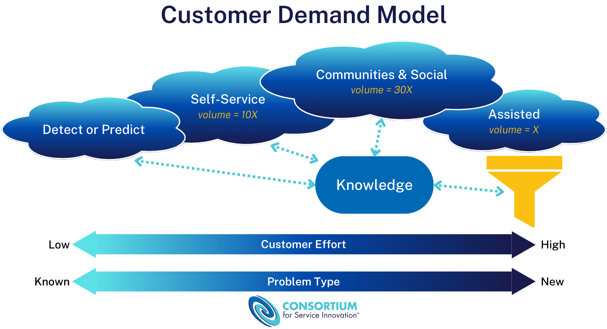
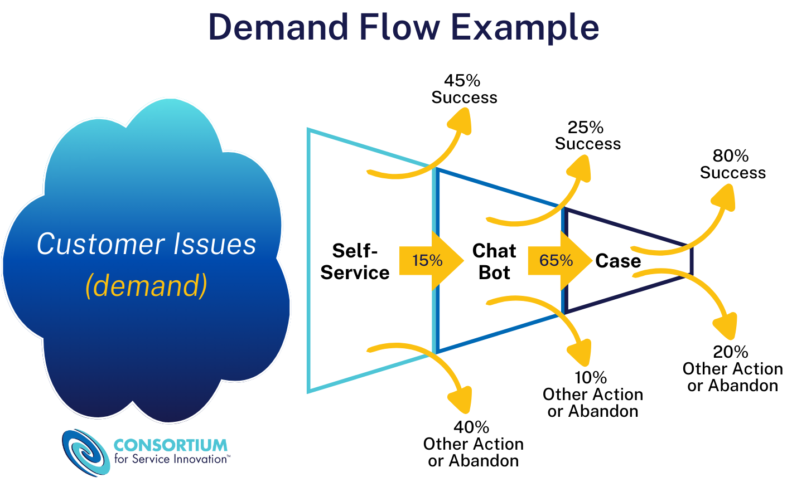
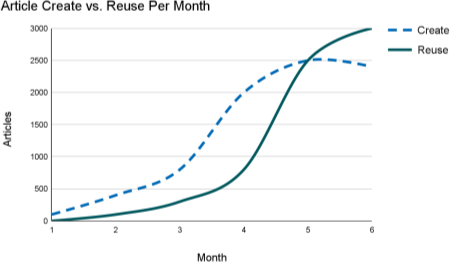
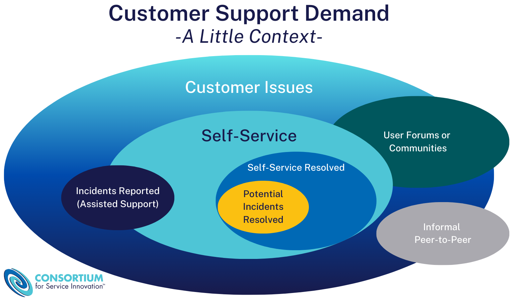

# セルフサービスの成功の測定（2027年版）（Measuring Self-Service Success (2027)）

> 出典: Consortium for Service Innovation, *Measuring Self-Service Success (2027)* — [CC BY-NC 4.0](https://creativecommons.org/licenses/by-nc/4.0/)（原文を日本語に翻訳し、ページを章ごとにまとめ直したもの）  
> 元のページ:
> - [Measuring Self-Service Success (2027)](https://library.serviceinnovation.org/KCS/Measuring_Self-Service_Success)
> - [Self-Service Strategy](https://library.serviceinnovation.org/KCS/Measuring_Self-Service_Success/10_Self-Service_Strategy)
> - [Why Measure Self-Service Success?](https://library.serviceinnovation.org/KCS/Measuring_Self-Service_Success/20_Why_Measure_Self-Service_Success)
> - [Self-Service Measures](https://library.serviceinnovation.org/KCS/Measuring_Self-Service_Success/30_Self-Service_Measures)
> - [Service Engagement Measures Template](https://library.serviceinnovation.org/KCS/Measuring_Self-Service_Success/40_Service_Engagement_Measures_Template)
> - [Glossary of Terms](https://library.serviceinnovation.org/KCS/Measuring_Self-Service_Success/50_Glossary_of_Terms)
> - [Project Acknowledgements](https://library.serviceinnovation.org/KCS/Measuring_Self-Service_Success/70_Project_Acknowledgements)

ナレッジの共有が良くなることによる顧客の成功の向上は、KCSの重要な効果である。複数のチャネルにわたるナレッジの提供、特にセルフサービスとコミュニティの実践の価値を、どうすれば見極められるだろうか。

サービス組織の目標は、私たちの製品とサービスを使う顧客の成功と生産性を高めることである。これをうまく行うには、顧客の活動と体験を理解しなければならない。

歴史的に、サービス組織は、入ってくる電話とメールのコストの管理に焦点を当てることから始めたが、顧客との関わりの範囲は、こうした有人のやり取りをはるかに超えて広がっている。特に Knowledge-Centered Service（KCS^(®)）が実践されている環境では、有人のチャネルを通じた関わりだけでなく、顧客の需要全体のコンテキストの中で、組織に生み出される価値を見なければならない。

セルフサービスとコミュニティを通じたナレッジの提供の成功は、事業全体に効果をもたらし、顧客との関わりの戦略における業界の変化と、コンテンツの作成・提供・測定のための多種多様な新しいツールとテクノロジーの登場につながった。

## 需要を理解する

顧客の需要モデル（Customer Demand Model）は、ナレッジの共有の価値を明らかにする基礎的な考え方の1つである。Consortiumのメンバーが顧客の活動をより多く見られるようになるにつれて、次のことが明らかになった。

- セルフサービスで寄せられる質問や挙がる課題の量は、有人のチャネルに入ってくる需要の10倍である。
- コミュニティとソーシャルメディアの場では、需要は有人のチャネルで目にするものの30倍である。
- 有人のチャネルが応えているのは、顧客からの需要全体の3%未満である。

*図：顧客の需要モデル。需要の量は、有人（Assisted）を X とすると、セルフサービスが10X、コミュニティとソーシャルが30X。検出・予測（Detect or Predict）を含むすべてのチャネルがナレッジ（Knowledge）を中心につながっている。左ほど顧客の労力が低く既知の問題、右ほど労力が高く新しい問題になる。*

つまり、私たちの製品とサービスを使う顧客の成功と生産性を高める非常に大きな機会がある。有人のモデルで学んでいることを、より簡単にアクセスできる他のチャネルにナレッジとして公開することで活かせば、既知の課題の答えを見つけるのに費やす時間と労力を減らし、同時にナレッジワーカーが有人のチャネルで新しい課題に取り組めるようにできる。

Greg Oxton が [この10分間の動画で顧客の需要モデル](https://youtu.be/wW1eXHd-U9I)を説明している。

## セルフサービスの定義

セルフサービスとは、1対1の有人のやり取り無しに、誰でも課題を解決したり質問に答えを得たりできる仕組みである。歴史的に、最も一般的な形のセルフサービスは、よくある質問や検索できるナレッジベースといった情報を提供するデジタルの体験だった。しかし、Consortiumのメンバーの多くは、製品・アプリケーション・サービスのユーザーインターフェースにセルフサービスを統合することに投資している。これにより、セルフサービスの体験は、独立した別の出来事から、製品の中に統合された体験へと移る。さらに、テクノロジーのベンダーは、課題を検出して修復したり、課題の解決をプログラムで支援したりする自動化に投資している。AIもここで役割を果たしており、組織のナレッジから、依頼者のために必要に応じて、あるいは先回りして答えを合成する。どの取り組み方であれ、セルフサービスの成功はナレッジにかかっている。

ここでは、セルフサービスのやり取りを次のように定義する。私たちの製品とサービスを使う顧客の成功と生産性を高める情報（説明、トラブルシューティング、推奨）であって、利用者の意図が、購入・設計・付加価値サービスではなく、課題の解決にあるもの。

*図：需要の流れの例。顧客の課題（需要）のうち、セルフサービスで45%が成功し40%は別の行動か放棄、15%がチャットボットへ。チャットボットでは25%が成功し10%は別の行動か放棄、65%がケースへ。ケースでは80%が成功し20%は別の行動か放棄。*

このプロジェクトで使うその他の定義は、[用語集](10-measuring-self-service-success.md#page-3968)を参照のこと。

## 対象者

この成果物は、2種類の対象者を念頭に置いて作られた。

1. 序文、背景とコンテキスト、経営層向けの概要、前提と制約の節は、なぜこれが重要なのかについて、実践者とリーダーシップにコンテキストを提供することを意図している。
2. 残りは、組織の測定モデルを作り管理する人たちのための指針である。

*[サービス・エンゲージメントの測定項目のテンプレート](10-measuring-self-service-success.md#page-3969)* は、コスト削減だけに焦点を当てる考え方や、成功を測る単一の数字を好む考え方を超えて、効果的な顧客との関わりのモデルの価値を言葉にできるようにする。このスプレッドシートは、組織が自らを基準に比較するために使うよう設計されている。

- [セルフサービス戦略](10-measuring-self-service-success.md#page-3967)

- [なぜセルフサービスの成功を測るのか](10-measuring-self-service-success.md#page-4050)

- [セルフサービスの測定項目](10-measuring-self-service-success.md#page-3973)

- [サービス・エンゲージメントの測定項目のテンプレート](10-measuring-self-service-success.md#page-3969)

- [用語集](10-measuring-self-service-success.md#page-3968)
  セルフサービスの測定項目に関係し、顧客サポートのコンテキストでの定義。

- [プロジェクトの謝辞](10-measuring-self-service-success.md#page-4045)
  経緯と参加者。

## セルフサービス戦略（Self-Service Strategy）

セルフサービスの効果は大きい。正しく行えば、それはサービスを提供する対象者にとって、最も抵抗が少なく最良の結果が得られる道筋になる。セルフサービスの仕組みを設計する目標は、ナレッジを探している人の側の労力を最小にしてナレッジにアクセスできるようにすることである。そのようなシステムを設計するのは簡単ではないことがわかっている。依頼者の労力を最小にし成功を最大にする形でセルフサービスを提供するには、慎重な検討と計画が必要である。うまく行えば、依頼者と対応者の双方に利益がある。

### 戦略と継続的改善のプロセスを持つ

セルフサービスの戦略を作ることが重要である。なぜセルフサービスの能力を作っているのかについて、非常にはっきりさせておくべきだ。含めるべき項目には次のものがある。

- ビジョンステートメント
- 想定対象者は誰か
- 目標：成功とはどのようなものか
- 測定項目
- 評価と継続的改善のプロセス

セルフサービスの最大の価値は、それを顧客との関わりの戦略とみなすことから生まれる。それは、わかっていることを活かして、利用者のより大きな成功を支えることを可能にする。セルフサービスの副次的な効果として組織のコスト削減があるが、それは問い合わせをそらしたり避けたりする戦略ではない。

#### 顧客体験

Consortiumの取り組みの基礎となる2つの重要な考え方が、価値の目減りのモデル（Value Erosion）と価値の付加のモデル（Value Add）である。これらのモデルは、製品とサービスから顧客が実現する価値を最大にする力学を扱い、チャネルの成功を測る取り組みに追加のコンテキストを提供する。

要約すると、価値の目減りは顧客が課題に遭遇したときに起きる。顧客が解決策を探し始めてからできるだけ早い段階で解決策を見つけられるよう助けることで、価値の目減りを最小にしたい。顧客サービスとサポートは長年、価値の目減りのモデルに焦点を当ててきたが、私たちにはどう価値を加えるかを考える機会がある。顧客が課題を経験しなくても、顧客の能力を高め、労力を減らし、心地よい体験を生み出せないだろうか。これらは、セルフサービスのやり取りを成功させる重要な要素になりうる。

### セルフサービスの設計基準

セルフサービスの能力を設計するにあたり、成功しているセルフサービスのモデルについて観察してきた5つの重要な要素がある。

1. **見つけやすさ**：見つけやすさは3つのもの（どれもKCSによって可能になる）によって決まる。コンテキスト、構造、豊かな環境の記述である。
2. **入手しやすさ**：わかっていることのうち、セルフサービスで解決できるものの大部分は、素早く手に入るようにする必要がある（これもKCSの焦点である）。90/0のルール（わかっていることの90%を0分で、つまりケースを閉じる時点かそれより前に手に入るようにする）はやや挑発的だが、ナレッジがいかに時間に敏感かを私たちは学び続けている。
3. **アクセス**：セルフサービスの入口は見つけやすいか。理想的には、セルフサービスへのアクセスはユーザーインターフェースに統合され、製品の中のどこにいるかに応じてコンテキストに即したものになる。セルフサービスが専用のデジタル体験であれば、それはわかりやすく、見つけやすいか。
4. **ナビゲーション**：セルフサービスの仕組みのナビゲーションは、利用者にとって直感的で、依頼者の意図に沿っているか。「行き止まりを作らない」ことで、セルフサービスから有人のサポートへと円滑に移れる方法が確保される。クリックしてチャット、あるいはクリックして送信である。AIが提案したり生成したりする答えは、常に依頼者のコンテキストに即しているべきであり、依頼者と有人のやり取りとのあいだに障壁を作るべきではない。ナビゲーションは、閲覧と検索の両方に対応すべきである。
5. **マーケティング**：セルフサービスにはマーケティング計画が必要である。「作れば人は来る」というモデルは、セルフサービスの仕組みには通用しない。依頼者に使ってもらうには、はっきりとした意図的な行動を取らなければならない。良い体験をすれば（上の1〜4を参照）、依頼者はそれを使う……それも、たくさん。

セルフサービスで良い体験をすれば、依頼者はまたそれを使う。戻ってくるだけでなく、たくさん使う。実際、過去に支援を依頼したよりも頻繁に使うようになる。一般的な目安として、依頼者が40〜50%の確率で役に立つ情報を見つけられれば、またセルフサービスを使う可能性が高い。これがセルフサービスの成功率の業界平均である（調査は Service XRG を参照）。わかっていることの90%がすぐにセルフサービスで手に入る成熟したKCSの環境では、報告されている成功率は80〜85%の範囲にある。

#### 見つけやすさ

依頼者がセルフサービスで使えるコンテンツがどれだけあっても、それが依頼者のコンテキストに即していなければ、見つけられる可能性は低い。これは、ワークフローの中で記録する必要性を強めるものである。記録のプラクティスで述べたように、私たちが利用者でなく、しかも答えを知っている場合、課題についての利用者の捉え方を作り直すのは非常に難しい。依頼者のコンテキストで記事を作るには、依頼者が最初にそれを表現したときに、そのコンテキストや体験を記録する必要がある。見つけやすさと読みやすさの両方にとっての2つ目の要因は構造である。KCSは、検索エンジンとAIツールがより効果的に働き、利用者の体験を改善する助けになる、ナレッジ記事の単純な構造を提案している。見つけやすさの最後の重要な要素は、豊かな環境の記述である。記事の環境の記述は、自分の課題に正しい記事を見つけたという厳密さと確信を高める。

#### 入手しやすさ

社外から見える記事はどれだけあり、どれだけ速く見えるようになるのか。セルフサービスで成功するための主な要因は、量と速さである。目標は、わかっていることをできるだけ多く、できるだけ速くセルフサービスのチャネルに載せることである。依頼者がセルフサービスで成功するには、記事が（業務ルールによるが）検証済みの状態になり、公開範囲が社外向けに設定されている必要がある。KCS導入の初期段階では、これは再利用によって進む。社内で再利用された記事は、すぐに社外へと移される。「最適化とイノベーション」の段階では、できるだけ多くのものをその場で検証し、社外に移したい。メンバーの経験から、デジタルのセルフサービス体験での再利用率は有人のモデルでの再利用率とは異なることがわかっているので、再利用が検証と社外への公開を推し進めるというモデルは一時的な状態であるべきだ。依頼者は、良いセルフサービスのモデルを、私たちに電話するより10倍多く使うことがわかっている。ある依頼者が挙げたが社内では一度も再利用されていない課題が、社外ではたくさん使われることもある。他の依頼者はその情報を使うが、答えを求めてわざわざ私たちに連絡しようとはしないのである。私たちの目標は、わかっていることの大部分をできるだけ速くセルフサービスのモデルに載せることである。

セルフサービスをいつ始め、いつ広めるのか。KCS記事が、すでにセルフサービスのチャネルにあるコンテンツを補うものであれば、段階的な取り組み方がうまくいくかもしれない。新しいセルフサービスのナレッジベースを作っているのであれば、40〜50%の成功率を確保できるだけのコンテンツがナレッジベースに集まるのはいつか。ナレッジベースの量が十分であることを示す主な指標の1つは、ある領域で記事の再利用率が作成率と交わることである。チームの作成率と再利用率を時間に沿って描くと、人や機械がナレッジベースで役に立つものを見つける頻度（再利用）と、新しい記事を作成する頻度の感触が得られる。線が交わったら、それは作成するのと同じくらい再利用している、つまり50%の確率で既存の記事に紐付けていることを意味する。今こそセルフサービスのモデルを有効にし、広めるときである。

*図：月ごとの記事の作成と再利用。破線が作成（Create）、実線が再利用（Reuse）。最初は作成が先行し、5か月目あたりで再利用が作成に追いつき、その後は再利用が上回る。*

作成の活動が再利用の活動と等しくなる時点は、社外の依頼者が50%の確率で役に立つものを見つけられるだけのコンテンツがナレッジベースにあることを示している。

注意点が3つある。第一に、その領域の紐付けの質が90%以上で、紐付け率が60〜80%の範囲にある必要がある。これは、社内の利用者が問題解決のプロセスで高い割合でナレッジベースを使っている（記事を作成・再利用・改善している）ことを意味する。第二に、記事が社外向けの公開範囲に到達していなければならない。そして第三に、コンテンツが依頼者のコンテキストに即していなければならない。これが見つけやすさの要因を強める。

#### アクセス

セルフサービスへのアクセスを、わかりやすく労力の少ないものに設計することも、対象者をセルフサービスに関わらせるもう1つの鍵である。依頼者にとってセルフサービスの仕組みを見つけやすくするのは簡単ではない。先に述べたように、セルフサービスのナレッジへのアクセスを製品のユーザーインターフェースに統合するのが理想的だが、一般には大きな投資が必要になる。デジタルのセルフサービス体験を使っているなら、サービスを提供しようとしている対象者が見つけやすいようにすることが重要である。

#### ナビゲーション

調査によれば、「行き止まりを作らない」ことが、利用者がセルフサービスをまた使うかどうかを決める第一の要因である。「行き止まりを作らない」とは、依頼者がセルフサービスのチャネルで問題解決のプロセスを始めたら、役に立つものが見つからなかったとしても、中断して最初からやり直す必要が無いことを意味する。セルフサービスのインターフェースで「行き止まりを作らない」例が、クリックして送信（インシデントを起票する）やクリックしてチャットの機能である。セルフサービスのモデルが役に立たなければ、有人のモデルへと円滑に移れる。依頼者のセルフサービスでの活動は記録され、対応者が見られるようになっているので、依頼者は最初からやり直しているとは感じない。Microsoft での綿密な調査プロジェクトでは、顧客がセルフサービスで成功しなかった場合でも、行き止まりが無ければ、もう一度試そうとする意欲がはるかに高いことがわかった。

依頼者がセルフサービスを使おうとする意欲のもう1つの重要な要因は、物事を見つける方法が複数あることである。人は、いくつもの要因に基づいて、情報を見つけるのに異なる方法を使う。記事を見つける選択肢には次のものがある。

- 製品ごとの、よくある質問や「トップ10」の記事の一覧
- 索引や目次
- 基本的な検索、キーワード検索
- 高度な検索
- 生成された回答のような、AIを活用したツール

もう1つの設計基準は、対象者がセルフサービスを使う意図を理解することである。人がセルフサービスの仕組みを使う理由の上位3〜5つは何か。

#### マーケティング

「作れば人は来る」というモデルは、セルフサービスには通用しない。最初の4つの成功基準、つまり量と速さ、見つけやすさ、アクセスとナビゲーションに対処したら、依頼者にどうセルフサービスを使ってもらうかを考えなければならない。依頼者の行動を変えようとするのは簡単ではない。マーケティングの専門家に関わってもらうことを勧める。メッセージとコミュニケーションを理解している人から助言を得て、マーケティング計画を作ろう。

マーケティング計画に加えて、顧客にセルフサービスを使ってもらうのに成功裏に使われてきた戦術をいくつか以下に挙げる。これらは推奨ではなく観察として示すものであり、事業と顧客との関わりのモデルに基づいて評価しなければならない。

- セルフサービスを勧める録音メッセージ（依頼者がサポートに電話してきたとき）
- 保留時間を長くする：セルフサービスを、最も抵抗が少なく最良の結果が得られる道筋にする
- 電話を止める：セルフサービスを唯一の道筋にする。依頼者はデジタルの体験を通じてしかインシデントを起票できない（依頼者のセルフサービス体験が良いものになると、高い確信を持っていなければならない）
- 共同ブラウジング：対応者が課題を解決するあいだ、依頼者は対応者のデスクトップを見て、対応者が検索する様子を見られる（依頼者にセルフサービスのツールの使い方を教えることになる）
  依頼者に解決策を送るときは、オンラインのナレッジベースの記事へのリンクを送る（目に触れる機会を増やす）
- 生成された回答に出典を付ける。ナレッジベースにある情報への参照が見えることで、依頼者はさらに探索するよう導かれる。

依頼者によるセルフサービスの利用と成功は、「最適化とイノベーション」の段階でKCSの成功と健全性を評価するための2つの極めて重要な測定項目になる。記事がセルフサービスのモデルに届いていない、あるいは顧客がセルフサービスを使っていないなら、KCSの実践は停滞する。

良いサポートのデジタル体験の例は、Association of Support Professionals（ASP）の [Ten Best Web Support Sites](https://asponline.com/product-category/ten-best-web-support-sites/) の一覧を参照のこと。ASPは毎年サポートサイトの評価を行っており、使っている基準はWebサイトで公開されている。セルフサービスのサポートの仕組みを設計するのに使える特性の、素晴らしい集まりである。

### フィードバックを取り込む

KCS記事についての最も強力で価値のあるフィードバックは、それを使う対象者から来る。利用者が答えから価値を得たと認めるたびに、そのフィードバックは、KCS記事に貢献したすべての人、つまり作成者と、記事を再利用し変更した人たちに見えるべきである。エンドユーザーがKCS記事を不完全またはわかりにくいと指摘したら、そのKCS記事は手直しのキューに入れなければならない。

信頼を広め、KCS記事の信用を高めるために、フィードバックをすべての対象者に見えるようにしている組織もある。Amazon.com の製品レビューや、Trip Advisor と Yelp のホテルやレストランの利用者レビューのような評価の仕組みを導入できる。この情報は、セルフサービス体験を評価する三角測量のモデルに取り込める。

KCSの根底にある前提は、「ナレッジベースを作成し維持するのに最もふさわしいのは、それを毎日使っている人たちである」というものである。組織がKCSの習熟度を築き始め、わかっていることの大部分をセルフサービスのモデルを通じて利用者に提供するようになっても、この前提は変わらない。

ここから、利用者をどうプロセスの一部として関わらせるかという問いが生まれる。実際、組織が成熟し、記事の大部分が必要なときに必要なだけ社外向けになる（組織全体の多くの KCS Publisher がその場で公開する）ところまで来ると、良い利用者のフィードバックの仕組みが極めて重要になる。利用者は、KCS記事の品質管理のプロセスの一部になる。利用者が記事にコメントできるようにする際に、メンバー企業が実践してきた方法をいくつか挙げる。

- コメントを非公開にし、そのコメントについて連絡を受けたいかを利用者に尋ねる企業がある。利用者が「連絡を希望する」にチェックを入れると、システムがその顧客のインシデントを起票し、通常のインシデント処理のプロセスに入る。この方法はおそらく、複雑さが高く量が少ない環境でしか実行できない。
- 各記事に wiki のような節を設けてコメントを公開し、利用者が自分の経験と意見を提供し、他の人のコメントを見られるようにする企業がある。
- 信頼できる利用者（多くの場合、コミュニティのフォーラムを通じて特定される）が、ナレッジベースで記事を作成・変更できるようにする企業がある。記事や変更の出所は記事の中に示される。
- ナレッジベースを区分けし、すべての利用者がオープンソースのようなコンテンツに貢献できるようにするガバナンスのモデルを導入している企業もある。

AIを活用したツールがナレッジから回答を生成している場合、AIツールに寄せられたフィードバックは、回答の生成に使われたナレッジへと還流されるべきである。

## なぜセルフサービスの成功を測るのか（Why Measure Self-Service Success?）

KCSの効果は、一般に3つの段階で語られる。

1. 業務の効率
2. セルフサービスでの顧客の成功
3. 製品とサービスの改善

業務の効率は比較的測りやすい。KCSを実践すると、すぐに解決時間の短縮、一次解決率の向上、エスカレーションの減少などが見られる。しかし、そうした効率の向上が達成されると、それが事業の運営のあり方そのものになる。追加の価値はすでに実現されているのである。

セルフサービスでの成功は、KCSの中期的な効果である。社外の対象者が見つけられ、使える記事を公開し改善するには、ある程度の時間がかかる。Consortiumのメンバーは長年、セルフサービスでの成功の向上によって実現された効果を数値化するのに苦労してきた。顧客はケースを起票せずに答えを見つけるとより満足し、ナレッジワーカーは既知の答えを繰り返す代わりに新しい問題を解決できるとより満足する、という逸話的な証拠はたくさんある。しかし、こうしたことは多くの場合、ナレッジとセルフサービスへの投資を正当化する助けにはならない。

### ナレッジへの投資を正当化する

セルフサービスとコミュニティを通じてナレッジを届けることは、到達範囲を何倍にも広げることである。有人のやり取りで記録したナレッジを、大幅に低いコストで活かせる。ナレッジへの投資から十分な価値を得ていることを、どうすれば知ることができるのか。

[サービス・エンゲージメントの測定項目のテンプレート](10-measuring-self-service-success.md#page-3969)は、変革への投資を正当化する助けになることを意図している。人員とツールを含め、KCSプログラム、コミュニティ、セルフサービスのプログラムへの投資のROIを示す。顧客の健全性と関与を理解する方法も提供する。これには分析への投資、あるいは少なくとも必要なデータを持っている人とつながることが必要になるかもしれない。

#### コスト回避は視野の狭い見方である

問い合わせの回避やケースの削減とも呼ばれるが、セルフサービスでの関わりによって解決された課題に伴うコスト削減を評価することには、いくつもの落とし穴がある。

*図：顧客のサポートの需要（少しのコンテキスト）。顧客の課題全体の中に、セルフサービス、ユーザーフォーラムやコミュニティ、非公式なピアツーピアがある。有人サポートに報告されたインシデントはその一部にすぎない。セルフサービスで解決されたものの中に、インシデントになっていたかもしれないもの（Potential Incidents Resolved）が含まれる。*

顧客の需要を全体的に見ると、顧客はさまざまな方法で課題の解決を目指している。そうした課題の一部はセルフサービスで解決されるが、セルフサービスでの失敗のうち、有人のモデルでケースやインシデントになるのはごく一部にすぎない。

*図：需要の流れの例。顧客の課題（需要）のうち、セルフサービスで45%が成功し40%は別の行動か放棄、15%がチャットボットへ。チャットボットでは25%が成功し10%は別の行動か放棄、65%がケースへ。ケースでは80%が成功し20%は別の行動か放棄。*

需要の流れの例が、これを視覚化する助けになる。顧客がセルフサービスで調べ始め、チャットボットに移り、答えを求めてケースを起票する課題もわずかな割合であるが、顧客が Google であちこち探し、セルフサービスの記事にたどり着くかもしれないが、気が散って、解決するほどの労力をかける価値は無いと判断する課題もたくさんある。

したがって、コスト回避だけを念頭に置いてセルフサービスやコミュニティの成功に取り組むのは、視野の狭い見方である。私たちの焦点は、顧客の成功の向上と顧客の労力の削減である。セルフサービスを通じてナレッジを提供し、KCSへの社内の投資を活かすことが、その目標を達成する重要な要因である。

### 自分自身を基準にする

セルフサービスとコミュニティでの成功を測ることは、すぐに非常に複雑になる。関わる変数が多いので、意味のある基準は自分自身のパフォーマンスだけである。つまり、自分の環境で理にかなう形で範囲を定める必要がある。判断が必要である。

この成果物は、数年にわたり、18の多種多様な企業を代表するConsortiumのメンバーのグループとともに作られ、試された。小規模・中規模・大規模の企業、上場企業と非上場企業、法人向けと消費者向け、KCSの成熟度もさまざまな段階のものが含まれていた。最初の調査結果で唯一変わらなかったのは、これらの数字は組織のより大きな環境の一部としてしか意味を持たず、他の組織と比較しようとしてもほとんど価値が無い、ということだった。毎月データを集め、四半期ごとに報告することを勧める。スプレッドシートを完成させ、有人のモデルの外にあるサポートの需要全体の感触がつかめてくると、セルフサービスを止めたら何が起きるかを想像するのは恐ろしくなるだろう。

成熟したKCSの実践がもたらすさらなる効果については、[Measurement Matters v6](https://library.serviceinnovation.org/KCS/KCS_v6/Measurement_Matters_v6) を参照のこと。

## セルフサービスの測定項目（Self-Service Measures）

セルフサービスの成功とセルフサービス体験を測るのは難しい。有人のモデルでは、出来事ややり取りを数えられ、記事の引用によって記事の利用状況がわかる。オンラインのコミュニティでは、投稿と返信を数えられ、それは依頼と応答と強く相関している。セルフサービスのモデルでは、検索やページビューやセッションといった活動を数えられるが、それらは目指され解決された課題と1対1の関係にはない。そのため、セルフサービス体験について、いくつもの異なる情報源から推測しなければならない。そして、価値の創出を直接数えられないパフォーマンスの評価と同じように、三角測量のモデルが非常に役立つことがわかっている。

セルフサービスの仕組みについて測りたいことはいくつもある。

- 利用者の見方
  - セルフサービスを使う人は、どんな価値を得ているか。
  - 使う人の体験はどのようなものか。
  - ケースを起票する前に、セルフサービスはどれくらいの頻度で使われているか。
  - セルフサービスの利用者は、どれくらいの頻度で役に立つものを見つけているか。
- 社内の見方
  - 組織はどんな価値を得ているか。
    - セルフサービスでの成功によって、どれだけの需要が満たされているか。
    - セルフサービスでの成功によって満たされている需要のうち、有人のモデルに来ていたであろうものはどれだけか（コスト削減）。
  - 記事の利用のパターンはどのようなものか。どの記事が利用者にとって価値があるか、あるいは利用者が評価した生成された回答で引用されているか。
  - セルフサービスは、依然として有人の道筋に入ってくる仕事の性質（新規と既知の比率）にどんな影響を与えているか。

### 測定項目

セルフサービス体験と価値の評価は、データ分析、利用者のフィードバック、観察の組み合わせに頼っている。

データ分析：

- 利用者の行動のパターン
  - クリックストリームの分析
- 量の変動
- 成功した生成された回答での引用

利用者からの直接のフィードバック：

- アンケート
- 利用者からのコメントとフィードバック

観察：

- ユーザビリティテスト

上に挙げたセルフサービスの測定項目はどれも厳密ではない、つまりどれもそれだけで利用者の体験を直接表すものではないので、三角測量の考え方を使って合わせて見なければならない。上の測定項目では、絶対値ではなく傾向が最も重要である。そして、異なる視点を突き合わせることで、利用者の体験についての評価に確信を得ることが重要である。

テクニック5.10：コンテンツの健全性指標（訳注：現行の番号では5.4）で述べたように、ナレッジベースが大きくなるにつれて、その記事の価値を評価する方法が必要になる。[Assessing the Value of Articles](https://library.serviceinnovation.org/KCS/KCS_v6/KCS_v6_Practices_Guide/030/040/010/065#Assessing_the_Value_of_Articles) で述べた3つの視点、つまり再利用の頻度、参照の頻度、記事の集まりの価値は、ここでも当てはまる。セルフサービスで手に入る記事も、価値の評価に含めるべきである。

### 制約

セルフサービスの展開の成熟度と使える資源はさまざまなので、「良い」「より良い」「最善」の測定の選択肢を示す。

このプロジェクトに取り組んだConsortiumのメンバー企業は、それぞれ一握りの指標を持ち寄った。そして全員が、自分たちの指標は改善できると感じていた。事業モデルが違えば、必要な測定項目も違う。例えば、クリックストリームの分析を見ると、高度さの段階も、クリックストリームの分析をいつ・どこで始めるかのジャーニーマップも、組織ごとに異なる。

セルフサービスやコミュニティでの試みが失敗しても、すべてがケースの起票につながるわけではなく、セルフサービスやコミュニティでの関わりが成功しても、すべてが回避されたインシデントを表すわけではない。セルフサービス・コミュニティ・有人のやり取りのあいだで試みを区別しようとはしているが、考慮すべき別の視点として、ケースが開いているあいだに並行して解決しようとすることもある。すべてのシナリオを大規模に正確に測ることはできない。

この複雑さのため、最も役立つ戦略は、自分自身を基準に傾向を見ることである。組織の基準となる現状をどう定め、それに対して進み具合をどう測るかを考えよう。

#### 答えるのに前提が必要な問い

- サポートの需要を持つ顧客のうち、私たちが関わりを測れる場所に一度もたどり着かなかった人はどれだけいるか。（例えば、Google で始めて、そのままそこにとどまった人）
- 成功した関わりとはどのようなものか。さまざまなペルソナ（故障の修理、目的志向のタスク、長期的な学習）や、さまざまな出発点（Google、直接、クリックによるナビゲーションと検索、製品内のヘルプ、生成された回答）について、成功した関わりのパターンには数多くの可能性がある。
- 匿名の利用者は顧客か。これを試しているメンバーの報告では、ボットを除外すると、公開しているセルフサービスのコンテンツへのアクセスの約90%は外部の検索エンジン（Google など）から来ている。クリックストリームのデータとアンケートに基づくと、そうしたアクセスの非常に大きな割合は、サポートポータルにログインする手間をかけなかった顧客からのもののようだ。

#### 測定項目と測定の難しさ

- **セッション**：セッションで測るが、すべてのセッションが同じではない。セッションの総数だけでなく、価値を提供するセッションを測ることを目指す。そのためには、価値の無い、あるいは対象外のセッションを数から除く方法を考え出す必要があるかもしれない。
- **データソース**：測定ツール（Google Analytics、SEMrush、社内の測定）によって、見えるものや測定のパラメーターが異なることがある。
- **労力**：労力の大きい訪問と小さい訪問とは何か。それは主観的な測定であり、絶えず変化する。
- **目標**：測定の目標は、利用者のペルソナや利用場面によって変わる。
- **直帰率**：1ページだけのセッションでも成功しうるので、直帰は良い定性的な測定ではない。直帰の計算はイベントのトラッキングの影響を受けることがある。より良い計算は、ページの滞在時間、スクロールの割合、その他のコンテキストに即した測定である。
- **フィードバック**：参加率が低い（約1.5%）ため、価値は限られる。記事や生成された回答へのフィードバックには、利用者のコンテキストが欠けている。顧客は解決策の質を評価しているのか、それとも課題についての全体的な体験を評価しているのか。
- **コンテキスト**：すべての測定項目が行動に移せるものだったり、明確な「なぜ」を持っていたりするわけではない。セルフサービスが失敗したとき、顧客は探していたものを見つけられなかったのか、それとも受け取った答えを理解できなかったのか。データのコンテキストを理解するには、補助的な、あるいは関連する測定項目を掘り下げる必要があることが多い。

## サービス・エンゲージメントの測定項目のテンプレート（Service Engagement Measures Template）

測定項目が焦点を当てる領域は3つある。トラフィックと成功、長さとコスト、顧客体験である。これらを一度に全部扱う必要はない。

それぞれの測定について、目標は以下の「良い」「より良い」「最善」の指針のうち、できる限り高度な取り組み方を使うことである。ただし、それを理由に、今手元にあるものを使って始めるのをためらわないこと。まず定義をはっきりさせることを忘れないでほしい。

取り組み方の指針は、主にセルフサービスとコミュニティでの関わりについて示している。担当者による有人の関わりについては、既存の測定項目を使ってほしい。

黄色のセルにデータを入力すると、スプレッドシートが計算してくれる。[Google スプレッドシートのテンプレート](https://docs.google.com/spreadsheets/d/1eatz8eWy0nq12ggUpEfyHzaemazMT7l5mvAnU5BiEjU/edit?usp=sharing)をコピーするかダウンロードしてほしい。

### 前提条件

#### 定義

自分の環境について、*自分の*サービス・エンゲージメントの測定項目のスプレッドシートに何を含めるかを定めることが重要である。スプレッドシートには計算のための「良い」「より良い」「最善」の式と、充実した用語集を用意したが、自分の環境で何が理にかなうかについては判断が必要である。最初は、手に入るどんなデータの組み合わせから始めてもよい。それを定義し、時間とともに傾向を見る。ただし、意図すべきなのは、顧客体験全体をより徹底的かつ正確に反映するよう範囲を広げていくことである。

例えば、何をセルフサービスでの関わりとして数え、何を数えないかは、事業によって変わり、時間とともに変わることもある。

#### データ

[サービス・エンゲージメントの測定項目のテンプレート](10-measuring-self-service-success.md#page-3969)で推奨している式には、複数のデータソースが含まれる。その一部はツールから直接取り出せるが、それがどこにあるのかを突き止める調査が必要なこともある。メンバーの中には、まずデータの記録を有効にする必要があるとわかったところもあった。そしてどのメンバーも、可能な限り組織の既存のデータモデルを使うことを勧めている。車輪を再発明しないこと。

**関わり**

- セルフサービス：セルフサービスの仕組み（たいていはデジタル体験）の利用者セッション
- コミュニティ：利用者セッションとスレッド
- 有人：ケース、チケット、サービス依頼

**関わり1件あたりのコスト**

- セルフサービス：関連する総コスト（会社がコスト構造をどう組み立てているかに応じて、給与、システム、間接費を含むことがある）÷ 成功したセルフサービスでの関わりの数
- コミュニティ：関連する総コスト（会社がコスト構造をどう組み立てているかに応じて、給与、システム、間接費を含むことがある）÷ 成功したセルフサービスでの関わりの数
- 有人：タスクに費やした時間と需要の量（これも、会社がケース1件あたりのコストをどう計算しているかに基づく）

**アンケートのデータ**

- セッションのアンケート：セルフサービスでの成功
- 生成された回答へのフィードバック
- 顧客満足度
- 顧客の労力
- ネットプロモータースコア（NPS）

#### 時間

[データの制約](10-measuring-self-service-success.md#page-3973)のため、最も役立つ戦略は[自分自身を基準にする](10-measuring-self-service-success.md#page-4050)ことである。測定項目のテンプレートを一度だけ埋めても、得られる知見は限られる。最適化の取り組みと照らし合わせて、時間とともにデータを追跡し（毎週、毎月、四半期ごと）、どの変化が意味のある良い変化につながるかを評価する。毎月測り、四半期ごとに報告することを提案する。前年との比較で、季節による行動の変化を考慮できる。

### テンプレートを埋める

#### 関わりの数

依頼者が解決策を求める課題のうち、私たちに見えているものの量。試み、セッション、サインオン、検索、コンテンツの閲覧によって測ることが多い。

- **良い** = 月あたりのセッション数または閲覧数
- **より良い** = 少なくとも1回のコンテンツの閲覧を含む、月あたりのセッション数
- **最善** = 「より良い」と同じで、意味のあるコンテンツの閲覧の基準（例えばページの滞在時間）を含める

**Consortiumのメンバー**：サインインすると、Google Analytics を使って特定のページを含むセッションを定義する方法の例を見られる。

#### 関わりの需要全体に占める割合（量）

評価できるすべてのチャネルを通じたすべての需要のうちの、計算した割合。

#### チャネルでの成功率

チャネルの中で解決された課題の近似値。アンケート（回答率が低く、回答の偏りがある）、一定期間（24時間〜7日）内にケースを起票しなかったセッション・訪問の推定割合、あるいは閲覧数を課題あたりの平均閲覧数で割ったもので測ることが多い。意図は、依頼者の課題が、セルフサービス（依頼者が成功を示して終えた）と有人（解決策を示してケースを閉じた）でどれだけの頻度で解決されているかを測ることである。

- **良い** = 支援の依頼が無かったセッション・訪問の割合、または閲覧数を課題あたりの想定平均閲覧数で割ったもの。注：これは、（解決も支援の依頼も無く）放棄される課題の大きな割合を考慮していない。放棄率を当てはめるところもある。
- **より良い** = アンケートで「成功しましたか？」に「はい」と答えた割合。十分なサンプル数を確保するため信頼区間を当てはめる。結果を「良い」と突き合わせる。
- **最善** = 高度なクリックストリームの分析（成功または失敗を表すパターンの割合）。これは探索中の領域であり、それがどのようなものになりうるかの例を探している。

**Consortiumのメンバー**：サインインすると、Google Analytics を使って特定のページを含むセッションを定義する方法の例を見られる。

#### 成功した関わりの数

関わりの総数にチャネルでの成功率を掛けて計算した、完了した関わりの量。

#### 成功した関わり全体に占める割合

チャネルでの成功した関わりの、需要全体に対する割合として計算したもの。

この計算は顧客体験を反映し、コンテンツと仕組みを改善する機会を示す。

#### 成功した関わりの平均の長さ

顧客が解決にかかった時間。製品と顧客に基づく前提が必要である。認証は、関わりの長さを測るのに役立つことがある。

- 成功したセッションのサンプルの平均時間（クリックストリームの分析を使う）。注：成功したセッションを見分ける正確さが上がるにつれて、測定の正確さも上がる。

**Consortiumのメンバー**：サインインすると、Google Analytics を使って特定のページを含むセッションを定義する方法の例を見られる。

#### 成功した関わり1件あたりのコスト

セルフサービスに関連する総コスト（給与、システム、間接費を含むことがある）（簡単ではない）を、タスクに費やした時間と対応している量（分あたりのコストと関わりあたりのコスト）に基づいて配分したもの。

ここは、組織の既存のコストの計算を使うのに絶好の箇所である。Consortiumの立場は、KCS関連のコストはすべて有人の関わりに計上すべきだ、というものである。セルフサービスに燃料を供給しなくても、KCSは組織に継続的な効果をもたらすからである。

**Consortiumのメンバー**：サインインすると、Google Analytics を使って特定のページを含むセッションを定義する方法の例を見られる。

#### 顧客満足度

既存の標準：アンケート。体験にどれくらい満足しましたか。

**Consortiumのメンバー**：サインインすると、Google Analytics を使って特定のページを含むセッションを定義する方法の例を見られる。

#### 顧客の労力

アンケートの結果は、顧客の期待に大きく左右される。

- **良い** = アンケート
- **より良い** = 高度なクリックストリームの分析
- **最善** = ジャーニーマッピングと、時間をかけたジャーニーの改善の追跡

#### 顧客ロイヤルティ

ネットプロモータースコア（NPS）やその他の既存の標準を使う。

## 用語集（Glossary of Terms）

セルフサービスの測定項目に関係し、顧客サポートのコンテキストでの定義。

[KCS用語集](11-supplemental-resources.md#page-353)も参照のこと。

用語は英語の見出し語のアルファベット順に並べ、訳語を括弧で添える。

### \[A\]

**Abandoned（放棄）**
人が課題の解決策を探すのをあきらめること。

**Analytics（分析）**
行動・活動・パフォーマンス（成果）の指標：検索、Google、クリックストリーム。

**Article feedback（記事へのフィードバック）**
記事単位のもの。記事を閲覧した人に、その記事が役に立ったかを尋ねる。AIを活用した回答生成のツールを使っている場合、回答へのフィードバックは、引用された記事に当てはめるべきである。

**Assisted（有人）**
依頼者が課題の解決策や情報（学習）を求めて、多くの場合、製品やサービスについてベンダーに助けや情報を依頼すること。

**Assisted eligibility（有人対応の対象）**
課題が人による支援の対象になるかどうか。依頼の中には、人による支援の対象にならないものもある。

**Attempt（試み）**
課題の解決策を求めて取る行動。チャネル別（セルフサービス、コミュニティ、ソーシャル、有人）。1つの課題に対して、それぞれ異なるチャネルで多くの試みがあることもある。1回のセッション・訪問に複数の試みがあることもある。各社は、セッションあたりの試みを評価するために、平均的な依頼者の行動に基づいて基準を定めなければならない。

**Automated alerts（自動アラート）**
自動検出に基づく、潜在的な課題の通知（機械から機械へ、あるいは機械から人へ）。

**Automated interactions（自動化されたやり取り）**
ボットやその他のデジタルの機能を使って、依頼者に考えられる解決策や情報を提供すること。

**Automated recommendation（自動レコメンデーション）**
パターン認識（匿名の利用者の場合）や依頼者についてのデータ（認証済みの利用者の場合）に基づいて、記事や情報を推奨するデジタルの機能の利用。

**Automatic detection（自動検出）**
センサー（ハードウェア）からのデータやプログラムによる分析（ソフトウェア）、あるいはその両方の組み合わせに基づく、潜在的な課題の自動検出。

**Automatic repair（自動修復）**
依頼者やシステムから提供された情報に基づき、ロボットやプログラムの機能によって依頼者の課題を解決する是正措置。例：パスワードのリセット、プロファイルの更新。

**Average work time to resolve（平均の解決作業時間）**
[KCS用語集](11-supplemental-resources.md#page-353)を参照。

**Avoidance（回避）**
やり取り（インシデント／ケース）のコンテキストで、担当者による支援の依頼が始められ、依頼者が提案された解決策とやり取りした、あるいはそれを使い、支援の依頼を完了しなかった場合。望ましい用語は「インターセプション（interception）」である。私たちは依頼者を避けたいのではなく、できるだけ早い機会に答えや解決策で依頼者の道のりに割り込みたいのである。

### \[B\]

**Browse（閲覧）**
ファセット、目次、よくある質問の一覧、サイトマップ、ナレッジマップを使って情報をたどること（検索ではない）。

### \[C\]

**Case close without assistance（支援無しのケースのクローズ）**
依頼者がケースを起票し、その後、人の支援無しにそれを解決したこと。

**Case/incident/ticket（ケース／インシデント／チケット）**
支援の依頼の記録。依頼者の名前、会社、連絡先、契約上の権利の情報、課題の記述、課題の深刻度、依頼の状況などが含まれることがある。

**Channels（チャネル）**
さまざまなやり取りの形態。オンラインのコミュニティやフォーラム、ソーシャルメディア、チャット、セルフサービス、製品内のヘルプ、有人などを含むが、これらに限らない。

**Clickstream（クリックストリーム）**
デジタル体験やコミュニティの中でやり取りする人の、活動と操作の流れのパターン。

**Click through（クリックスルー）**
依頼者が、候補となる記事やコンテンツの一覧、あるいは生成された回答で引用された記事から、記事（の全体）やコンテンツを閲覧したこと。

**Click through rate (CTR)（クリックスルー率）**
検索や生成された回答の引用のうち、利用者が1つ以上の結果をクリックしたものの割合。

**Community/forums（コミュニティ／フォーラム）**
共通の関心を持つ人が、デジタル体験の中で質問し、回答し、情報を共有すること。

**Confidence interval（信頼区間）**
統計とアンケートの回答の評価のコンテキストで、信頼区間とは区間推定の一種であり、観測されたデータの統計から計算され、未知の母集団のパラメーターの真の値を含みうるものである［[Wikipedia](https://en.wikipedia.org/wiki/Confidence_interval)］。例えば、セルフサービスのアンケートで顧客に「今回の訪問で探していたものは見つかりましたか」と尋ねたとする。回答者全体の60%が「はい」と答えるかもしれない。回答に関わる統計と、その質問が当てはまる母集団に応じて、誤差の範囲を計算できる。回答者の60%が「はい」と答え、95%信頼区間がプラスマイナス2%なら、顧客が探しているものを見つけたと感じるのは58〜62%の確率である、と95%の確信を持てる。

**Crowd-sourced content（クラウドソーシングのコンテンツ）**
利用者、つまり顧客の仲間が、一般にフォーラムやコミュニティで作るコンテンツ。<https://en.wikipedia.org/wiki/Crowdsourcing> を参照。

**Customer engagement network（顧客との関わりのネットワーク）**
顧客が私たちについての情報を得るあらゆる方法と、私たちが顧客とやり取りするあらゆる方法。コンテンツと人のネットワーク。既知の課題については人をコンテンツに、新しい課題については人を人に、ますます高い関連性で結び付けたい。

### \[D\]

**Deflection（デフレクション）**
やり取り（インシデント／ケース）のコンテキストで、担当者による支援の依頼が始められ、依頼者が提案された解決策とやり取りした、あるいはそれを使い、支援の依頼を完了しなかった場合。回避（avoidance）と同義。望ましい用語は「インターセプション（interception）」である。私たちは依頼者をそらしたいのではなく、できるだけ早い機会に答えや解決策で依頼者の道のりに割り込みたいのである。

**Download（ダウンロード）**
デジタル体験のコンテキストで、コンテンツ（記事、文書、実行ファイル）の写しを依頼者のシステムに保存して取得すること。

### \[E\]

**Effort（労力）**
人のコンテキストで、タスクを成し遂げるのにかかる仕事や時間。「顧客の労力」は、書籍「[The Effortless Experience](https://www.penguinrandomhouse.com/books/312730/the-effortless-experience-by-matthew-dixon/)」（邦題『おもてなし幻想』）によって広まった。この本は、顧客の労力を減らすことのほうが、喜ばせる体験よりも、顧客ロイヤルティ（と契約更新）の向上につながると説明している。

**Elapsed time to resolution (customer view)（解決までの経過時間（顧客の見方））**
顧客が解決策を探し始めてから、解決策が見つかるまでの経過時間（分または日）。作業時間（分）ではない。「平均の解決作業時間」を参照。

**Elapsed time to resolution (business view)（解決までの経過時間（事業の見方））**
顧客の課題がわかってから、解決策が提案されるまでの経過時間（分または日）。

**Embedded help（組み込みヘルプ）**
セルフサービスのコンテキストで、依頼者が製品やサービスのユーザーインターフェースの中でコンテンツにアクセスできるようにすること。

**Engagement（関わり）**
顧客との接点ややり取り。顧客が関わりを始めるのが受け身型、ベンダーが関わりを始めるのが先回り型である。関わりは、有人、セルフサービスなど、すべての接点を記録することを意図している。

**Entitlement (to view, read)（閲覧の権利）**
認証不要、公開、匿名、制限付き、認証／ログインが必要、契約による権利。

**Entitlement to contribute (create a case, respond to post)（貢献の権利（ケースの起票、投稿への返信））**
依頼を作成したり、依頼に返信したりする権限を持つ人。

### \[I\]

**Interaction（やり取り）**
さまざまなチャネルや仕組みのいずれかで、課題の解決策や学習のための情報を、先回りして、あるいは受け身で求めること。

**Issue（課題）**
顧客が成功する力を妨げるもの。製品・サービス・方針・プロセスについての質問、必要、問題を含むが、これらに限らない。課題を生む要因は、機能的なもの、社会的なもの、感情的なものがありうる。

### \[J\]

**Journey mapping（ジャーニーマッピング）**
人がタスクを成し遂げるために行う手順の詳しい記述や画像。顧客体験の評価によく使われる。[https://en.wikipedia.org/wiki/Customer_experience#Customer_journey_mapping](https://en.wikipedia.org/wiki/Customer_experience#Customer_journey_mapping) を参照。

### \[K\]

**Knowledge use（ナレッジの利用）**
人や機械がナレッジ記事にアクセスし、活用すること。「ナレッジの消費」という言い回しがよく使われるが、消費されたものは再び使うことも他の人が使うこともできないので誤った呼び方であり、使わないよう勧める。

**Knowledge gap（ナレッジの欠落）**
人や機械が、存在しない、あるいは探している（検索・閲覧・回答の生成）チャネルで手に入らないナレッジを探していること。

### \[M\]

**Meaningful view（意味のある閲覧）**
コンテンツの利用を示唆する特定の基準（ページの滞在時間、コンテンツのかなりの部分を見るためのスクロール、ブックマーク、ダウンロード）を満たす、コンテンツの閲覧。

### \[N\]

**NPS - Net Promoter Score（ネットプロモータースコア）**
顧客ロイヤルティの指標。

### \[O\]

**Omnichannel（オムニチャネル）**
依頼者がサポートのために多くの異なるチャネル（電話、デジタルのセルフサービス体験、ソーシャルネットワーク、コミュニティ）を使えるようにし、チャネルをまたいで一貫した統合された体験を提供する戦略。統一された、あるいは統合された体験無しに複数のチャネルが使えるマルチチャネルとは異なる。

### \[P\]

**Peer-to-peer（ピアツーピア）**
課題の解決策を求めて、顧客が顧客と、パートナーがパートナーと、従業員が従業員とやり取りすること。

**Persona（ペルソナ）**
ジャーニーマッピング、コミュニティ、セルフサービスのコンテキストにおけるアイデンティティであり、共通の特性を持つ人の集まりに付ける呼び名。その人がいる役割がペルソナを決めることもあれば（売掛金の管理者、IT専門家、人事の管理者、弁護士）、ある領域でのスキル（初心者、経験者、専門家）がペルソナを決めることもある。<https://en.wikipedia.org/wiki/Persona> を参照。

### \[R\]

**Rank（順位）**
結果や選ばれた記事が、検索結果の中で表示される位置、あるいは生成された回答で引用される位置。検索や回答のパフォーマンスをコンテンツの健全性と合わせて測る一般的な測定項目は、平均のクリックスルーまたは引用の順位である。

### \[S\]

**Satisfaction（満足度）**
顧客満足度のコンテキストで、依頼者の、1件または複数の取引ややり取りについての体験の評価。

**Search（検索）**
セルフサービスのコンテキストで、大きく幅広いコンテンツの集まりの中にある特定のものを見つけたり発見したりする活動や取り組み。キーワード検索は特定の言葉や言い回しを使う。自然言語検索は、日常の会話の言葉を受け付ける。AIを活用したツールの多くは、個別の検索結果の一覧を示すのではなく、ナレッジから（引用付きで）回答を生成する会話型の検索を可能にしている。

**Self-service（セルフサービス）**
依頼者（顧客や利用者）が、人とやり取りせずに、課題を解決するナレッジや機能とやり取りできるようにすること。何をセルフサービスでの関わりとして数え、何を数えないかは、事業によって変わり、時間とともに変わることもある。

**Self-solved or semi-assisted（自己解決または半有人）**
人による支援の依頼を送った後、完全な解決策が提供される前に、依頼者が自分で課題を解決したこと。

**Session (self-service)（セッション（セルフサービス））**
依頼者がセルフサービスの仕組みの中で活動していること。セルフサービスのコンテキストで、1つ以上の課題の解決策を求めて人がセルフサービスの仕組みを使う頻度であり、はっきりとした始まりと終わりがある。セッション・訪問には、継続時間・費やした時間と、頻度がある。これは、サポートしている製品・サービスと、顧客との関わりの性質に基づいて、各組織が定義する必要がある。例えば、AARP（複雑さが低い）は、セッションあたりの課題数の基準も、成功した関わりとみなす基準も、PTC（複雑さが高い）の基準とは異なるだろう。高度な測定では、セッションの活動が意味のある関わりを示す基準を満たしているかを判断する。

**Social networks（ソーシャルネットワーク）**
人と人、あるいは人と企業とのあいだの関係に基づくつながり。通常は Facebook、LinkedIn などのデジタルプラットフォームによって促される。

**Survey（アンケート）**
パフォーマンスと期待についてのフィードバックを集めるための、対象者への依頼。アンケートの主な利点は、データが明示的であり、引き出される結論は一般に高い確信を持てることである。一方、セッションのデータを通じて行動のパターンを評価するには、多くの場合推測が必要で、そのため確信の程度は低くなる。アンケートの難しさは、統計的に有意なだけのデータを集めることである。

- セッションに基づくもの：依頼者がセルフサービスのセッションを始めるとき、あるいは終えるときに、セッション中の体験について質問する。
- やり取りに基づくもの、あるいは出来事に基づくもの：ケースのクローズなど、やり取りが終わった後に送るアンケート。
- 回答に基づくもの：生成された回答を伴うセッションについてフィードバックを得るために示すアンケート。
- 関係のアンケート：関係についての顧客の意見を評価するため、定期的に（半年ごとまたは毎年）送る質問票。全体的な満足度、ロイヤルティ、労力を扱うことが多い。

### \[T\]

**Time on page/content/object（ページ／コンテンツ／オブジェクトの滞在時間）**
利用者がコンテンツに「アクティブ」でいる秒数。意味のある利用とみなす閾値は、コンテンツの種類と環境の性質によって変わる（各組織は、自分たちにとって意味のある閾値を調整しなければならない）。回答を生成する環境では、「アクティブ」を、回答で引用されたすべてのコンテンツに当てはめる必要があるかもしれない。

**Touchpoint model（タッチポイントモデル）**
顧客とのすべてのやり取りの接点を視覚的に表したもの。ライフサイクルモデルとも呼ばれる。通常は高い抽象度で作る。

### \[U\]

**Unsolicited suggestions (searchless search)（求められていない提案（検索の無い検索））**
セルフサービスのコンテキストで、顧客や利用者の行動やテキストの送信に基づいて、役に立つ情報を提供すること。

### \[V\]

**Vendor-sourced content（ベンダー提供のコンテンツ）**
製品やサービスを販売・提供している企業が作り、提供するコンテンツ。

**View (content)（閲覧（コンテンツ））**
デジタルのセルフサービス体験のコンテキストで、ページを開くこと、ページに移動すること。「ページビュー」としてよく使われ、その人がページの内容を読んだことを含意する。「ホバー」で課題を解決するのに十分な情報が得られるなら、それも閲覧に数える（これは実装と環境の複雑さによって変わる）。回答を生成する環境では、引用を閲覧と解釈することもある。

## プロジェクトの謝辞（Project Acknowledgements）

経緯と参加者。

このプロジェクトは、Consortium for Service Innovation の2019年のメンバーサミットで Jennifer MacIntosh が招集したオープンスペースのセッションから着想を得た。Rosalie Girard が、セッションの終了後も取り組みが続くようにした。

数年にわたり、Consortiumの多くのメンバーが、この取り組みに経験、アイデア、情熱を注いでくれた。このリソースを可能にした彼らの参加に深く感謝する。

- Kimaya Agarwal
- Arnfinn Austefjord
- Kris Anderson
- James Ayecue
- Richard Bekolay
- Monique Cadena
- Justin Calhoun
- Peter Case
- Bonnie Chase
- Matt Chinn
- JC Coynel
- Janine Deegan
- Keri Detrick
- Amy Dotson
- Ross Edgecombe
- Jeff Elser
- Rosalie Girard
- Sara Feldman
- John Fronius
- Rosalie Girard
- Kristin Hunter
- David Kay
- Aditya Kulkarni
- Aftab Ali
- Jennifer MacIntosh
- Theresa Manzo
- Salman Mumin-Ahmed
- Domonic Masilmani
- Patrick McBride
- Sabrina Meditz
- Sarup Paul
- Laurel Poertner
- Bit Rambusch
- Christina Roosen
- Brad Smith
- Steve Springer
- Devra Struzenberg
- Jacob Watts
- Lief Zimmerman
- Dave Thorp
- Heidi Wagstaff
- Jacob Watts
- Kelly Murray
- Matt Seaman
- Greg Oxton
