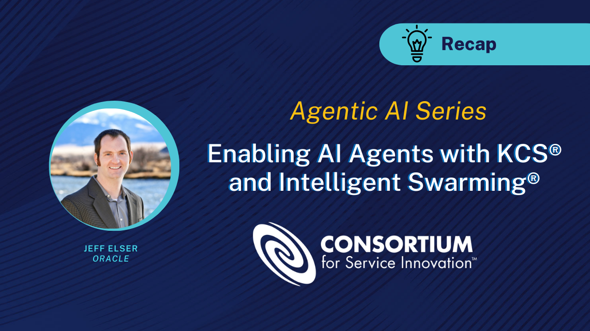
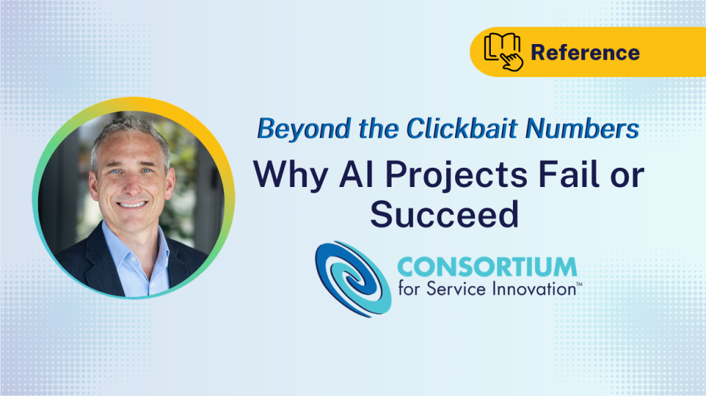
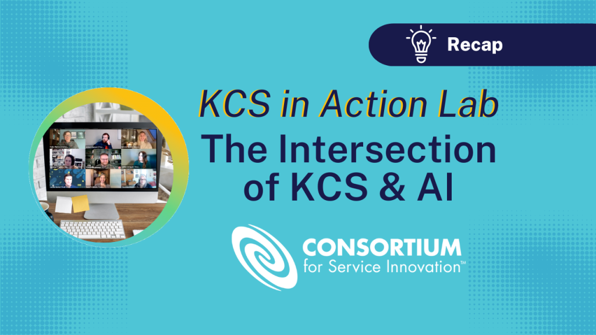
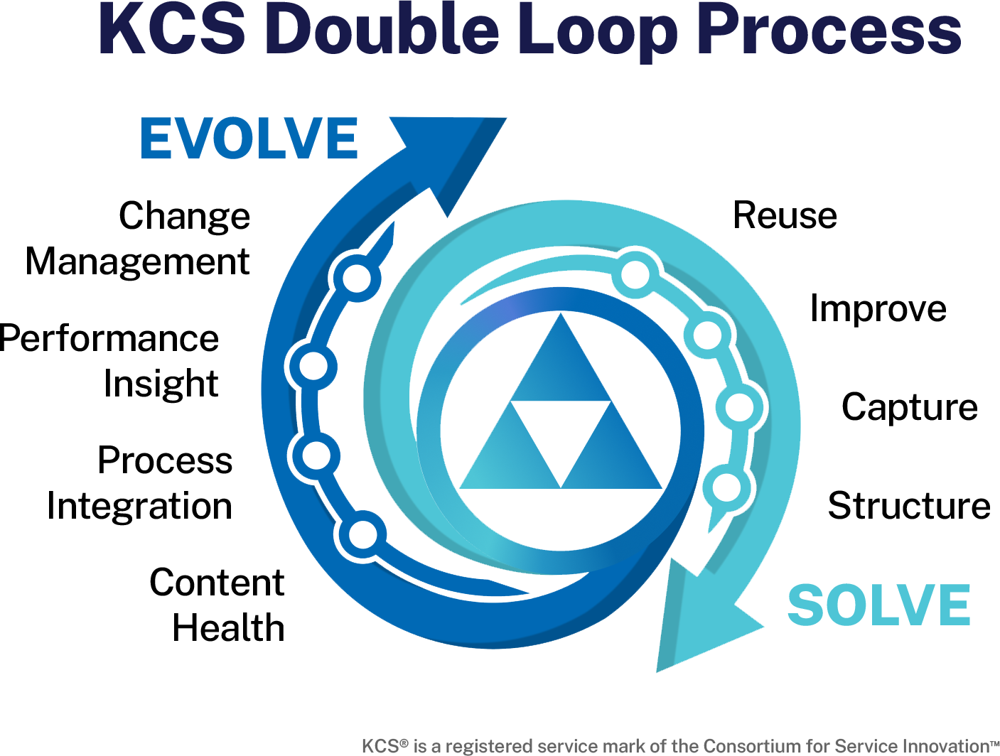

# 補足資料（Supplemental KCS Resources）

> 出典: Consortium for Service Innovation, *Supplemental KCS Resources* — [CC BY-NC-ND 4.0](https://creativecommons.org/licenses/by-nc-nd/4.0/)（一部ページに表示。原文を日本語に翻訳し、ページを章ごとにまとめ直したもの）  
> 元のページ:
> - [Supplemental KCS Resources](https://library.serviceinnovation.org/KCS/KCS_Resources)
> - [Appreciation & Acknowledgements](https://library.serviceinnovation.org/KCS/KCS_Resources/Appreciation_Acknowledgements)
> - [External References & Recommended Reading](https://library.serviceinnovation.org/KCS/KCS_Resources/External_References)
> - [KCS Glossary](https://library.serviceinnovation.org/KCS/KCS_Resources/KCS_Glossary)
> - [Attribution and Ownership for KCS Methodology](https://library.serviceinnovation.org/KCS/KCS_Resources/KCS_Ownership_Attribution)
> - [Knowledge-Powered AI](https://library.serviceinnovation.org/KCS/KCS_Resources/Knowledge-Powered_AI)
> - [What's New in Knowledge-Centered Success?](https://library.serviceinnovation.org/KCS/KCS_Resources/New_in_Knowledge-Centered_Success)

- [謝辞（Appreciation & Acknowledgements）](11-supplemental-resources.md#page-8741)
  Consortium for Service Innovation の過去と現在のメンバーが、KCSの方法論の進化に貢献している。

- [外部の参考文献と推薦図書（External References & Recommended Reading）](11-supplemental-resources.md#page-356)
  KCSの方法論に寄与してきた、影響力のある考え方、思想家、資料。

- [KCS用語集（KCS Glossary）](11-supplemental-resources.md#page-353)
  KCSの文書で使われる用語について。

- [KCSの方法論の帰属と所有（Attribution and Ownership for KCS Methodology）](11-supplemental-resources.md#page-5393)
  KCSの方法論に言及するときに、適切に出典を示す方法。

- [ナレッジを動力とするAI（Knowledge-Powered AI）](11-supplemental-resources.md#page-8130)
  Consortiumのメンバーは、ナレッジを動力とするAIの機能の活用で最前線にいる。

- [Knowledge-Centered Success の新しい点（What's New in Knowledge-Centered Success?）](11-supplemental-resources.md#page-8875)
  KCS v6 から Knowledge-Centered Success への更新点のまとめ。

## 謝辞（Appreciation & Acknowledgements）

Consortium for Service Innovation の過去と現在のメンバーが、KCSの方法論の進化に貢献している。

### 感謝

Knowledge-Centered Success の文書は、[Consortiumのメンバー](https://www.serviceinnovation.org/current-members/)の厚意によって作られ、継続的に更新され、一般に公開されている。この文書は、非常に多くの実践者の導入の経験を反映している。特に、自らの知見、実験、フィードバックを共有してくれた人たちに感謝する。

#### Knowledge-Centered Success Practices Guide チーム（2027年版）

- Heather Ausmus
- Monique Cadena
- Jennifer Crippen
- Janine Deegan
- Andreea Dudas
- Sara Feldman
- Adam Hansen
- David Kay
- Lana Kosnik
- Jae-Jae Lombardo
- Pat McBride
- Kelly Murray
- Gowri Peddirisi
- Laurel Poertner
- Christina Roosen
- Erik Rutten
- Shari Wennes
- Kristin Wilson

#### PAR 2.0：プロセス整合性レビュー（Process Alignment Review）

名称の変更についての注記：Process Adherence Review（プロセス準拠レビュー）についてフィードバックを集めた際、Consortiumのメンバーは、*準拠（adherence）*という言葉がKCSの原則とコアコンセプトに反しており、場合によっては*人事考課*を連想させる、という事実について考えた。Process Alignment Review（プロセス整合性レビュー）という名称は、学習という点で私たちが目指していることの核心を突いている。Solve Loop に参加する機会のうち、どれだけの頻度でそうしたか、である。

長年の現場の経験、思慮深さ、貢献によって、この方法論を理解しやすく、使いやすく、意味のあるものにし続けてくれている David Kay と Jennifer Crippen に特に感謝する。

- Monique Cadena
- Kristin Cline
- Janine Deegan
- Adam Hansen
- Adam Mullen
- Kelly Murray
- Mitzi Newland
- Padma Prasad
- Christina Roosen
- Jason Rowland
- Dave Stewart
- Tomer Shoshan
- Sander van der Moolen
- Jacob Watts
- Sue Wong
- Larry Yang

#### プラクティスの背後にある理由（The Why Behind the Practices）

このプロジェクトは、「人員も、資金も、時間も無く、ツールもひどい状態でのKCS」というConsortiumのメンバーのセッションから生まれ、以下の人たちの経験の集まりを反映している。一人ひとりの視点とフィードバックに感謝する。

- Tamara Amlung, pro accessio
- Arnfinn Austefjord, Consortium
- Denise Baldwin, SDL
- Jennifer Crippen, DB Kay & Associates
- Arun Daniel, Dell
- Judith de Jong, SDL
- Karen Eisen, Alida
- Sara Feldman, Consortium
- Victor Feyen, Topdesk
- David Hahn, Humana
- Bret Halford, SAP
- Jenna Hoffman, Intel
- Gerald Joiner, Humana
- Terry Kim, SDL
- Kelly Murray, Consortium
- Mitzi Newland, PAR
- Jason O'Donnell, Autodesk
- Nikki Peck, Humana
- Matt Seaman, Consortium
- Christian Tobbe, Humana
- Carla Verwijs, Sequal
- Jacob Watts, PAR

#### KCS v6 Practices Guide

KCS v6 は、25年以上にわたる集合的な思考、投資、実験、知見に基づいている。その道のりは1992年に、「サポートの経験を記録し、構造化し、再利用できたらどうだろうか」という単純な前提から始まった。長年にわたってKCSのプラクティスを作り検証してきた集合的な取り組みへの貢献者を、すべて挙げることは不可能である。KCSの考え方と設計についての初期の取り組みは、John Chmaj と Livia Wilson が進行役を務め、記録した。

KCS v6 は、Consortiumの多くのメンバーの経験と貢献に基づいて、Greg Oxton、Melissa George、Kelly Murray が執筆した。多くのテクニックへの貢献と、文書全体の編集とコメントについて、David Kay に特に感謝する。KCS v6 Practices チームに感謝する。

- Arnfinn Austefjord
- Russ Brooks
- Monique Cadena
- Jennifer Crippen
- Amy Dotson
- Beth Haggett
- David Kay
- Kristin Cline Hunter
- Jennifer MacIntosh
- David Stanley-Jones
- Devra Struzenberg

## 外部の参考文献と推薦図書（External References & Recommended Reading）

### KCSの学術的な基盤

KCSは、一連の研究と学術的な成果に基づいている。KCSの発展に最も影響を与えた成果の一部を挙げる\*。

- [Agile Manifesto and Principles](https://www.agilealliance.org/agile101/the-agile-manifesto/)（アジャイルソフトウェア開発宣言と原則）
- [The Medici Effect: What Elephants and Epidemics Can Teach Us About Innovation](http://amzn.to/2pFXmAh)、Frans Johannson 著（邦題『メディチ・インパクト』）
- [Group Genius: The Creative Power of Collaboration](http://amzn.to/2r9MHQq)、Keith Sawyer 著（邦題『凡才の集団は孤高の天才に勝る』）
- [Cynefin フレームワーク](http://cognitive-edge.com/videos/cynefin-framework-introduction/)
- [Deming の原則](https://deming.org/management-system/fourteenpoints)
- [ダブルループ学習](https://en.wikipedia.org/wiki/Double-loop_learning)
- 自律システム（Autonomic systems）

"One More Time: How Do You Motivate Employees?" Herzberg, Frederick. (2003). Boston, MA: [Harvard Business Review](http://harvardbusinessonline.hbsp.harvard.edu/b01/en/common/item_detail.jhtml;jsessionid=U0VIONC4M2O4MAKRGWDSELQBKE0YIISW?referral=9422&id=R0301F).（無料版のPDF：<http://apln-richmond.pbwiki.com/f/HerzbergArticle.pdf>）

書誌情報は原文のまま載せる。

- Allee, Verna. *The Future of Knowledge*. Butterworth-Heinemann, 2002. www.vernaallee.com

- Christensen, Clayton M. *The Innovator's Dilemma*. Harvard Business School Press, 1997. [www.claytonchristensen.com](http://www.claytonchristensen.com)（邦題『イノベーションのジレンマ』）

- Collins, Jim. *Good to Great*. Random House Business Books, 2001. www.jimcollins.com（邦題『ビジョナリー・カンパニー2 飛躍の法則』）

- Covey, Stephen R. *The 7 Habits of Highly Effective People*. Free Press, 1990. www.stephencovey.com（邦題『7つの習慣』）

- Cross, Rob, and Parker, Andrew. *The Hidden Power of Social Networks*. Harvard Business School Press, 2004. www.robcross.org

- Hagel, III, John, and Brown, John Seely. *The Only Sustainable Edge*. Harvard Business School Press, 2005. [www.edgeperspectives.com](http://www.edgeperspectives.com)

- Hamel, Gary with Breen, Bill. *The Future of Management*. Harvard Business School Press, 2007. www.garyhamel.com（邦題『経営の未来』）

- Kaplan, Robert S., and Norton, David P. *The Balanced Scorecard: Translating Strategy into Action*. Harvard Business School Press, 1996. www.balancedscorecard.org（邦題『バランス・スコアカード』）

- Kay, David B., and Tourniaire, Francoise. *Collective Wisdom: Transforming Support with Knowledge*. Help Desk Institute, 2006. www.collectivewisdomthebook.com

- Kepner, Charles H., and Tregoe, Benjamin B. *The Rational Manager: A Systematic Approach to Problem Solving and Decision Making*. Kepner-Tregoe Inc., 1976. www.kepner-tregoe.com（邦題『管理者の判断力』）

- Lencioni, Patrick M. *The Five Dysfunctions of a Team: A Leadership Fable*. Jossey-Bass, 2002. [www.tablegroup.com](http://www.tablegroup.com)（邦題『あなたのチームは、機能してますか？』）

- Nonaka, Ikujiro, and Takeuchi, Hirotaka. The Knowledge Creating Company: How Japanese Companies Create the Dynamics of Innovation. Oxford University Press, 1995.（野中郁次郎・竹内弘高『知識創造企業』）

- Pink, Daniel, *Drive*: *the surprising truth about what motivates us*（邦題『モチベーション3.0』）

- Reichheld, Frederick F. *Loyalty Rules*. Harvard Business School Press, 2003. www.loyaltyrules.com

- Snowden, David, *Complex Acts of Knowing*, Journal of Knowledge Management, v. 6 (May 2002), p. 100-111. www.kwork.org/Resources/snowden.pdf

- Sterne, Jim. *Web Metrics: Proven Methods for Measuring Web Site Success.* Wiley, 2002. <http://www.targeting.com/book5.html>

- Wheatley, Margaret. *Leadership and the New Science*, Berrett-Koehler Publishers, 1992. www.margaretwheatley.com（邦題『リーダーシップとニューサイエンス』）

- Zuboff, Shoshana, and Maxmin, James. *The Support Economy*. Penguin Books, 2002. [www.thesupporteconomy.com](http://www.thesupporteconomy.com)

### 相乗効果

KCSの方法論は、次の実践と相乗効果がある。

- ITIL
- アジャイル
- Kepner-Tregoe（原文の表記は Kepner-Tragoe）

*\*Amazon のリンクは、Consortiumの活動を支えるアフィリエイトリンクである*

## KCS用語集（KCS Glossary）

用語は英語の見出し語のアルファベット順に並べ、訳語を括弧で添える。

### \[A\]

**Article Audience（記事の公開範囲）**
記事が見られる対象者。社内、顧客、パートナー、一般公開。以前は記事の可視性（article visibility）と呼ばれていた。

**Article Confidence（記事の確度）**
記事が成熟するにつれてたどるプロセス（作成中、未検証、検証済み、アーカイブ済み）。記事の確度は、記事の解決策とコンテンツ標準への準拠に、どれだけ確信を持っているかを示す。

**Article Governance（記事のガバナンス）**
記事を作成・編集できる利用者や利用者のグループ。

**Article State（記事の状態）**
記事の確度、公開範囲（以前の可視性）、ガバナンスの組み合わせ。

### \[B\]

**Balanced Scorecard（バランスト・スコアカード）**
個人と組織の目標を結び付ける、目標と測定項目の手法。パフォーマンスを複数の視点から見る。（Kaplan と Norton の The Balanced Scorecard を参照）

### \[C\]

**Coach（コーチ）**
KCS Candidate と KCS Contributor の成長を支えるKCSの役割。

**Content Standard（コンテンツ標準）**
KCS記事の内容と構造について組織が下した決定を記述した、正式な文書。

**Content Standard Checklist（コンテンツ標準チェックリスト）**
KCS Contributor が、KCSのコンテンツ標準で定めた基準を理解し、それに基づいて記事を作成できることを確かめるための枠組みを提供する。

**Context（コンテキスト）**
Solve Loop で記録されるもので、依頼者の必要と体験を依頼者自身の言葉で記述したもの。

### \[D\]

**Demand-Driven Visibility（需要に応じた公開範囲の拡大）**
記事は見つけられ使われるにつれて改善される。記事は、正確で役に立つことが実証されるにつれて、より広い対象者へと移される。

**Environment（環境）**
KCS記事の要素の1つで、課題に関係する、顧客が持っている製品情報やテクノロジー（ハードウェア、ソフトウェア、ネットワークなど）を含む。最近何か変更があったか。

### \[E\]

**Evolve Loop content（Evolve Loop のコンテンツ）**
Solve Loop で生まれたナレッジとパターンから作られるコンテンツ。

**Exception（例外）**
次のものを含む、あらゆる種類の課題。

- 「ハウツー」やQ&A
- 相互運用性の課題
- 構成の課題
- 不具合
- 診断の手順
- 手続き

**External（社外向け）**
KCS記事が組織の外で利用できることを示す。公開範囲のメタデータの欄が、パートナー、顧客、一般公開のいずれかに設定されている。

**Fix it（直す）**
KCS Contributor または Publisher が、ワークフローの中で既存の記事を変更すること。

**Flag it（指摘する）**
ライセンスを持たない利用者が記事にコメントし、権限を持つナレッジワーカーがそれを変更できるようにすること。

### \[I\]

**Issue（課題）**
質問、問題、例外。人がやり取りする動機。KCS記事のテンプレートの欄の1つで、依頼者からの質問を記録する。あらゆる種類のやり取りや例外。

### \[K\]

**KCS Candidate**
ナレッジベースへの暫定的な貢献者。コンテンツの記録と構造化に慣れている、ナレッジベースの基本的な利用者。社内向けの記事を作成し、自分の記事を変更できるが、他の人の記事は変更できない。

**KCS Contributor**
定められた対象者に公開するための記事を作成・変更・レビューする。

**KCS Council**
定期的に集まり、コンテンツ標準、ワークフロー、テクノロジーの統合、フィードバックの仕組みを継続的に改善するための場を提供する、部門横断のグループ。導入の初期には、実践の活動に焦点を当てる。道のりの後半では、継続的改善に焦点を当てる。

**KCS Publisher**
社外の対象者にコンテンツを公開する。

**Knowledge Domain Analysis (KDA)（ナレッジドメイン分析）**
ナレッジベースの健全性を維持し、ナレッジベースの影響を評価し高めるために行う、Evolve Loop の活動。

**Knowledge Domain Expert (KDE)**
ナレッジベースの健全性に気を配る。技術的な専門知識と、KCSのプロセスについての広い理解の両方を持つ。

### \[L\]

**Licensed Users（ライセンスを持つ利用者）**
KCS Contributor と KCS Publisher。

**Linked（紐付け）**
課題を解決するコンテンツを依頼に結び付けること。

### \[N\]

**Not Validated（未検証）**
記事の内容や構造への確信が低いことを示す、KCS記事の状態。

### \[P\]

**Practice（プラクティス）**
[KCSのプラクティス](https://library.serviceinnovation.org/Archive/KCS_v6_FOR_RETHINKING/Knowledge_Centered_Success_Practices_Guide_2027)は、私たちが何をする必要があるかを整理する。プラクティスは、活動を整理するうえでの、原則とコアコンセプトの適用、つまり使い方である。

- プラクティスは、テクニック（どのように）を整理する助けになる
- プラクティスには、複数のテクニックや機能（技術サポート、人事、金融サービスなど）にまたがって当てはまる、物事の進め方の例（バランスト・スコアカードやバリューフットプリントの導入など）が含まれる。
- プラクティスは、定義とテクニックで構成される。テクニックはプラクティスの詳細であり、多くの場合、さまざまな方法で実現できる。

### \[R\]

**Ratio of known to new（既知と新規の比率）**
ナレッジベースにおける、既存の記事の再利用と、作成された新しい記事との比較。

**Requestor（依頼者）**
情報・ナレッジ、あるいは課題の解決策を求めるナレッジワーカー。

**Responder（対応者）**
ナレッジを提供したり、課題の解決策を提供したり、課題の解決策を作るのを手助けしたりするナレッジワーカー。

**Reuse（再利用）**
記事が適用された回数。記事の再利用は、記事の価値を測る価値ある方法である。

### \[V\]

**Validated（検証済み）**
完成していて再利用できるとみなされるKCS記事。解決策に確信があり、コンテンツ標準に準拠している。

### \[W\]

**Work- in-progress (WIP)（作成中）**
未完成のKCS記事。問題や質問は記録されているが、解決策はわかっていない。

## KCSの方法論の帰属と所有（Attribution and Ownership for KCS Methodology）

KCSの方法論に言及するときに、適切に出典を示す方法。

文書や発表でKCSに初めて言及するときは、上付きの®を付けなければならない。また、次の文を脚注または括弧書きで添えること：「KCS® is a service mark of the Consortium for Service Innovation™.」

### クリエイティブ・コモンズのライセンス

商用利用、あるいはこのライセンスの範囲を超える許可については、<support@serviceinnovation.org> にメールすること。

#### あなたは次のことが自由にできる

- **共有**：どんなメディアや形式でも、資料を複製し、再配布する
- ライセンスの条件に従う限り、許諾者はこれらの自由を取り消せない。

#### 次の条件に従うこと

- **表示**：適切な出典を示し、ライセンスへのリンクを提供し、変更があったらその旨を示さなければならない。合理的な方法であればどのように行ってもよいが、許諾者があなたやあなたの利用を支持していると示唆するような方法は除く。
- **非営利**：資料を営利目的で利用してはならない。
- **改変禁止**：資料をリミックスしたり、改変したり、加工したりした場合、改変した資料を配布してはならない。
- **追加の制約は課せない**：ライセンスが許可していることを他の人が行うのを法的に制限する、法的な条項や技術的な手段を適用してはならない。

#### 注意事項

- 資料の中でパブリックドメインに属する要素や、適用される例外や制限によって利用が認められている場合は、ライセンスに従う必要はない。
- 保証は一切与えられない。ライセンスは、意図する利用に必要なすべての許可を与えるものではないかもしれない。例えば、パブリシティ権、プライバシー権、著作者人格権といった他の権利が、資料の利用の仕方を制限することがある。
- これらの資料の商用ライセンスの取得については、<info@serviceinnovation.org> にメールすること。

#### クリエイティブ・コモンズのライセンスはどう機能するのか

クリエイティブ・コモンズは、ナレッジと創作物を共有するための、標準化され広く受け入れられているライセンス契約を提供する非営利団体である。

この特定のライセンスのもとでは、Consortium for Service Innovation への適切な出典表示（下記を参照）を行い、ライセンスへのリンクを提供し、変更があったらその旨を示す限り、KCS v6 Practices Guide を非営利の利用のために自由に共有できる。Consortium for Service Innovation の書面による明示的な許可なく、資料を営利（売上を生む）目的で利用してはならない。質問は [Consortium へ問い合わせる](mailto:info@serviceinnovation.org) こと。

#### 適切な出典表示

KCS®の方法論は、Consortium for Service Innovation の登録サービスマークである。文書や発表でKCSに初めて言及するときは、上付きの®を付けなければならない。また、次の文を脚注または括弧書きで添えること：「KCS® is a service mark of the Consortium for Service Innovation™.」

Consortium for Service Innovation の書面による明示的な許可なく、KCSを商用の提供物の名称に使うことはできない。質問は [Consortium へ問い合わせる](mailto:info@serviceinnovation.org) こと。

#### 参加者がお金を払って参加するが、自分は発表の報酬を受け取らない業界の会議で、KCSについて発表してもよいか

よい。ただし、Consortiumの知的財産を利用した部分はすべて、Consortium for Service Innovation に帰属することを示すこと。

#### KCSの知的財産を商用（売上を生む）の提供物に使う許可はどう得ればよいか

Consortiumは、Consortiumの知的財産と登録サービスマークであるKCSの商用利用を可能にする、いくつかの制度を提供している。

- [KCS Certified External Trainer Certification Instructions](https://library.serviceinnovation.org/KCS/KCS_Certification_and_Training/20_Trainer_v6_Instructions)
- [KCS Verified Tool Program](https://www.serviceinnovation.org/kcs/kcs-v6-verified-tools/)
- [KCS Aligned Tool and Services Programs](https://www.serviceinnovation.org/kcs/kcs-v6-aligned-tools/)

これらの制度で扱われない商用利用については、[Consortium へ問い合わせる](mailto:support@serviceinnovation.org)こと。

### KCSの方法論は誰が所有しているのか

Consortium for Service Innovation が方法論を所有し、登録サービスマーク「KCS®」を所有している。Consortiumは非営利の業界団体なので、方法論を集合的に作ったConsortiumのメンバーが方法論を所有している。Consortiumは、方法論の発展を促し、その一貫性を守る。

#### なぜConsortiumはKCSの文書を無料で公開しているのか

Consortiumは、自らの知的財産について非常に寛大な非営利団体である。Consortiumが作るもののほとんどすべては、クリエイティブ・コモンズ 表示-非営利 4.0 国際ライセンス（CC BY-NC 4.0）のもとにある。Consortiumのメンバーは、自分たちの成果と学びを業界と喜んで共有している。Consortiumが所有する知的財産に基づく商用利用（売上を生む提供物）や、KCSのサービスマークの利用は、別の商用利用契約のもとで行わなければならず、それには提供物が方法論に準拠しているかのレビューが含まれる。

方法論への準拠のレビューと商用利用の契約無しに、ConsortiumのKCSの知的財産を使った商用の提供物は、すべて無許可である。そのような研修や認定の制度はクリエイティブ・コモンズのライセンスに違反しており、Consortiumは認めていない。

#### 他の組織によるKCSの認定を、Consortiumは認めているか

Consortium for Service Innovation は、KCSの認定を発行することが認められた唯一の認定機関であり、認定は認定試験に合格することで得られる。これらの公式の認定試験は、そうした活動を認められた [KCS Certified Trainer](https://www.serviceinnovation.org/faq-about-kcs/#training) による研修と合わせて実施されることがある。KCSの認定を提供すると主張する他の組織やグループは、Consortium for Service Innovation から認められておらず、KCS v6 のクリエイティブ・コモンズ 表示-非営利 4.0 国際ライセンスの契約に違反している。

[HDI is not an authorized provider of KCS training or certification](https://library.serviceinnovation.org/Get_Help/KCS_Methodology_Help/HDI_is_not_an_authorized_provider_of_KCS_training_or_certification)（HDI はKCSの研修や認定の認められた提供者ではない）も参照のこと。

#### KCSはどのように作られたのか

Knowledge-Centered Service（KCS）は1992年、サービス組織の非営利の連合である Consortium for Service Innovation が、サービスの環境でナレッジを共有し管理するより良い方法を探り始めたときに生まれた。当初の目標は、集合的なナレッジを活かして、サービスの効率を高め、課題をより速く解決することだった。

KCSは、Consortium for Service Innovation の[メンバー](https://www.serviceinnovation.org/current-members/)が作り、維持している方法論である。この方法論は、メンバーの集合的な思考と集合的な経験に基づいて、原則・プラクティス・テクニックの豊かな集まりへと進化してきた。ナレッジワーカー、依頼者、そしてKCSのプラクティスに従う組織に大きな効果を生み出すことから、何千人もの認定実践者を持つグローバルな実践として広がってきた。

## ナレッジを動力とするAI（Knowledge-Powered AI）

Consortiumのメンバーは、ナレッジを動力とするAIの機能の活用で最前線にいる。

### Consortium for Service Innovation はAIにどう取り組んでいるのか

AIについてのConsortiumの視点は単純である。AIが最も価値を届けるのは、強いナレッジの実践の上に作られたときである。

Consortium for Service Innovation は、人工知能がサービス組織をどう強化できるかを、特にナレッジが顧客体験の中心にある環境で、積極的に探っている。

この取り組みの多くは、[自動化の基盤としてのKCS®](https://www.serviceinnovation.org/knowledge-powered-ai/)に根差している。KCSは、人とAIシステムの両方が頼れる、信頼でき再利用できるナレッジを作るのに必要なプラクティスを提供する。

詳しい議論と実験の多くはメンバーのフォーラムの中で行われているが、Consortiumは、組織がよく考えられた持続可能な形でAIに備える助けになる知見を定期的に共有している。

#### AIと Knowledge-Centered Success（KCS）

AI、特に生成AIを導入する組織は、AIシステムの効果は使うナレッジ次第だとすぐに気づく。KCSは、次のようなナレッジを作るための実績のある手法を提供する。

- 構造化され、再利用できる
- 継続的に改善される
- 実際の顧客の需要のコンテキストの中で作られる

メンバーは、KCSのプラクティスが、組織がAIを活用した環境に向けてナレッジを準備するのにどう役立つか、そして自動化を取り入れてKCSのプラクティスをどう改善するかを探っている。KCSの更新版である [Knowledge-Centered Success](https://www.serviceinnovation.org/from-service-to-success-kcs-is-evolving/) は、[Service Innovation Summit 2026](https://www.serviceinnovation.org/summit-2026-recap/) で発表された。

Consortiumのイベントと作業セッションを通じて、メンバー企業はAIの取り組みからの初期の実験と教訓を頻繁に共有している。最新の経験の大部分は次のものにまとめられている。

- メンバー限定：AI Blueprint（メンバーのログインが必要）
- 公開の指針：[AI Implementation Essentials](https://www.serviceinnovation.org/ai-implementation-essentials/)

[Service Innovation Blog](https://www.serviceinnovation.org/blog/) と[継続的なイベント](https://www.serviceinnovation.org/events)を通じて、公開の資料も頻繁に共有している。

  

*図：ブログ記事へのリンク：Agentic AI シリーズ「KCS® と Intelligent Swarming® で AIエージェントを動かす」（Jeff Elser, Oracle）の振り返り。*

*図：ブログ記事へのリンク：AIプロジェクトが失敗する理由・成功する理由。*

*図：ブログ記事へのリンク：KCSとAIが交わるところでよくある課題（KCSA Lab の振り返り）。*

#### よく探られている領域

- **AIを活用した検索とセルフサービス**：顧客と従業員がより速く答えを見つけられるよう助ける。
- **担当者支援ツール**：サポートエンジニアに、コンテキストに即した指針と推奨されるナレッジを提供する。
- **ナレッジの欠落の特定**：AIを使って、欠けているコンテンツや繰り返し起きる課題を検出する。
- **コンテンツの分類とタグ付け**：ナレッジの整理と発見のされ方を改善する。
- **品質についての自動化された知見**：コンテンツのレビューとコーチングのプロセスを支援する。

こうした会話によって、メンバーはAIの取り組みを拡大する前に、取り組み方を比べ、結果を共有し、戦略を磨き上げることができる。

#### Intelligent Swarming とAI

AIは、Consortiumの協働的なサポートモデルである Intelligent Swarming のコンテキストでも探られている。

**AIによって可能になりうる機能：**

- 専門家を推薦する
- 複雑な課題を手助けできる協力者を見つける
- スウォームの最中に関連するナレッジを浮かび上がらせる

このコンテキストでは、AIは協働を置き換えるのではなく、チームが人をナレッジと専門性により速く結び付ける助けになる。

#### 顧客体験のモデルと予測的な関わり

Consortiumの[顧客体験のモデル](https://www.serviceinnovation.org/customer-success/)も、AIに関する議論が行われているもう1つの領域である。

**これらのモデルは、組織が次のことを理解する助けになる：**

- 顧客の摩擦がどこで起きるか
- 需要がサポートのシステムをどう流れるか
- 顧客の道のりのより早い段階で、ナレッジがどこで課題を防げるか

メンバーは、AIが先回りした[予測的な顧客との関わり（Predictive Customer Engagement）](https://www.serviceinnovation.org/predictive-customer-engagement/)をどう支えられるか、つまり新たに生じつつある問題を見つけ、顧客がサポートに連絡する必要が生じる前にナレッジを届けることを探っている。

#### リーダーシップと組織の準備

AIの導入を成功させるには、新しいテクノロジー以上のものが必要であり、メンバーは、AIを活用した職場環境を支えるのに必要な[リーダーシップと文化の変化](https://www.serviceinnovation.org/leadership-framework/)を積極的に探っている。

**よく扱われるテーマ：**

- ナレッジワーカーがAIに支援されたワークフローに適応するのを助ける
- AIが生成した応答への信頼を築く
- AIの取り組みを測定可能な事業成果に合わせる
- AIの機能と並行して、ナレッジの実践が確実に成熟するようにする
- これらの議論は、適応する組織とリーダーシップについてのConsortiumの取り組みと密接につながっている。

### 新しいこと、生まれつつあること

KCSと共有された経験にAIの探求を根差させることで、Consortiumは、組織が実験の段階を越えて、信頼でき拡大できる、ナレッジを動力とするAIの機能へと進むのを助けている。こうした会話は、組織が初期の教訓を共有し、仲間とともに取り組み方を確かめ、AIの機能が進化し続ける中でよくある落とし穴を避ける助けになる。

最近のConsortiumのイベントと作業セッションを通じて、組織がナレッジ主導のサービス環境でAIを試す中で、いくつかのテーマが浮かび上がっている。

- **AIに支援されたナレッジの記録**
  メンバーは、記録の瞬間にAIがナレッジワーカーを支える方法を探っている。課題を記録しているあいだに、記事の構造を提案し、重複を見つけ、欠けているコンテキストを促すことである。
- **AIが生成したコンテンツのガバナンス**
  AIがナレッジの下書きや要約をできるようになるにつれて、組織は、明確な所有者、レビューのワークフロー、KCSに沿ったコンテンツの健全性の実践を通じて、どう信頼を保つかを話し合っている。
- **AIに向けたナレッジの準備**
  多くのチームが、AIの取り組みによって既存のナレッジの実践の欠落が浮かび上がることに気づいている。AIシステムが組織のナレッジを確実に活かせるよう、構造、再利用、コンテンツの質を改善することに、会話の焦点がますます当てられている。
- **コーチングと品質のツールとしてのAI**
  サポートのやり取りのパターンを見つけたり、ナレッジ記事の改善を提案したり、学習の機会を浮かび上がらせたりして、AIでコーチングの仕組みを支援する実験をしている組織もある。
- **チャットボットを超えたAIの利用場面の拡大**
  初期のAIの取り組みはセルフサービスに焦点を当てることが多かったが、メンバーの議論では、AIが社内のワークフローをどう支援できるか、つまりサポートエンジニアを助け、ナレッジマネジメントのプロセスを改善し、新たに生じつつある課題をより早く見つけられるかが、ますます探られている。

## Knowledge-Centered Success の新しい点（What's New in Knowledge-Centered Success?）

KCS v6 から Knowledge-Centered Success への更新点のまとめ。

*図：KCSのダブルループのプロセス（2026年版）。Solve Loop：再利用・改善・記録・構造化。Evolve Loop：コンテンツの健全性・プロセスの統合・パフォーマンスの把握・チェンジマネジメント。*

[Knowledge-Centered Success Practices Guide](02-practices-guide-introduction.md) は、各プラクティスとテクニックの背後にある*なぜ*に焦点を当てており、人が*どのように*進めるのが最善かについて健全な判断を下せるようにしている。

新しいAIと自動化のツールを踏まえて、この文書は、誰が、あるいは何が依頼をしていて、誰が、あるいは何が答えを届けているかにかかわらず、何が使われているかについての知見を提供しながら、ナレッジを見つけられ、正確で、意味のある状態に保つ方法についての指針を示している。

KCS v6 Practices Guide に基づく方法論のこの版は、それを知っている人にとってはとても自然で心地よく、初めての人にとっては直感的で取り組みやすく感じられるはずである。

### 大きな移動

KCSのダブルループのモデルは引き続き当てはまり、これらのプラクティスはすべて同時に行われる。ただし、伝えやすさのために、一部のプラクティスとテクニックの登場する順序が変わった。

ダブルループは時計回りに説明されるので、Solve Loop は**再利用（Reuse）**から話を始めるよう並べ替えた。これはKCSの実践で最もよくある活動である。再利用を最初に説明することで、すでに知っていることを活かし、ナレッジの利用を記録することの効果に焦点を当て続けやすくなる。**改善（Improve）**は、使われるその瞬間にナレッジを正確に保つことに焦点を当てる。**記録（Capture）**は、やり取りの中でコンテキストを記録することの重要性を述べ、同時に、記事の作成はまだ記事が無いときにだけ行われることをはっきりさせている。**構造化（Structure）**は、人と機械の両方にとって読みやすさを高めることで、記録したナレッジを活かす選択肢を示している。

Evolve Loop の順序は変わらないが、**コンテンツの健全性（Content Health）**のプラクティスはわかりやすさのために編集し、構成し直した。行動についての会話はワークフローの中で行われるので、**プロセスの統合（Process Integration）**に、KCSの役割と習熟度モデル、成功のためのコーチングを含めた。パフォーマンスの評価（Performance Assessment）は、**パフォーマンスの把握（Performance Insight）**に改めた。これには、システムの中の個人のパフォーマンス、プログラム全体のパフォーマンス、組織への効果が含まれる。リーダーシップとコミュニケーション（Leadership and Communication）は**チェンジマネジメント（Change Management）**と呼ぶようになった。これは動機付けの理解から始まり、関心と理解を持続させるためのテクニックを示している。

全体を通じたその他の名称の変更は次のとおりである。

- KCSのライセンスモデル（licensing model）は、ソフトウェアのライセンスとの混同を避けるため、習熟度モデル（proficiency model）と呼ぶようになった。
- 戦略的フレームワーク（strategic framework）はインパクトマップ（impact map）になった。誰が戦略を所有しているかにかかわらず、KCSの活動と事業成果との結び付きを作ることを促すためである。

### 新しいコンテンツ

[KCSが機能する理由](02-practices-guide-introduction.md#page-7098)には、ナレッジを複雑系として理解することと、ダブルループのシステムがその複雑さに対処するのに役立つ理由についての節が含まれる。Solve Loop の活動を視覚化する方法として、Solve Loop のワークフローの例も含まれる。

Solve Loop と Evolve Loop のページは、各プラクティスと各テクニックの背後にある目的の概要を示している。これらの目的の記述は[プラクティスの目的](08-lessons-learned-and-purpose.md#page-8246)にまとめられ、関係する場合は各ページの冒頭にも繰り返されている。

記録のプラクティスには、記録のプラクティスと新しい記事を作成する活動とを区別するため、新しいテクニック[新しい記事は需要に応じて作成する](03-solve-loop.md#page-8046)が加わった。

[ナレッジの最適化](04-evolve-loop-content-health.md#page-7126)は、コンテンツの健全性の下の新しいテクニックである。このテクニックは、KCSのシステムから学んだことを見つけ出し、それに基づいて行動することを強調している。いつ始め、誰が関わりうるかについての情報と、アーカイブの戦略を作ることについての新しい指針が含まれる。ナレッジドメイン分析は、引き続きナレッジの最適化の重要な機能である。

[テクノロジーの統合](05-process-integration.md#page-8180)は、考慮事項と設計の基準を含むよう大幅に更新された。

[プロセス整合性レビュー](05-process-integration.md#page-7862)は、PAR 2.0 を反映して全面的に更新された。

プロセスの統合のプラクティスに置かれるようになった[成功のためのコーチング](05-process-integration.md#page-7138)には、コーチングの仕組みの作り方についての情報が含まれる。KCSのコーチの役割を担う人向けに [KCS Coach Reference Guide](09-coach-reference-guide.md) がある。これには、以前 Handling Doubts and Misconceptions として公開されていた内容が含まれる。

[Measuring Self-Service Success](10-measuring-self-service-success.md) は、KCS v6 ではコンテンツの健全性の下にあった、セルフサービスの戦略についての内容の一部を含むよう更新された。

新しい場所へのリンクを含む詳しい変更点は、下の表にある。

### 研修と認定

**既存の v6 の研修と認定は引き続き完全に有効であり、KCSの強固な基盤を提供し続ける。** 今後の更新が作られているあいだ、待つ必要は無い。

- 更新された認定の提供は、2027年4月に開始される。
- 詳しくは [Knowledge-Centered Success Training and Certification](https://library.serviceinnovation.org/KCS/KCS_Certification_and_Training/Knowledge-Centered_Success_Training_and_Certification) にある。

### 今後の予定

KCS v6 の文書は、引き続きConsortiumのライブラリで利用できる。Consortium for Service Innovation のメンバーは、今後1年で次の資料の更新に取り組む。次の世代の指針に影響を与えるため、ぜひ[参加してほしい](https://www.serviceinnovation.org/join-us/)。

- ナレッジの最適化と KCS Knowledge Domain Analysis Reference Guide に、AIツールの手入れと育て方を取り入れる。
- KCS Adoption and Transformation Guide を、新しい用語とプラクティスに合わせる。
- 価値の測定と伝達のワーキンググループが、パフォーマンスの把握の進化を続ける。
- KCS Verified と Aligned のツール・サービスの制度を、新しいプラクティスに合わせて更新する。

### 詳しい変更点

| **KCS v6 の元の内容** | **新しい場所** |
|---|---|
| Why KCS? | [How KCS Works Across the Enterprise](https://www.serviceinnovation.org/how-kcs-works-across-the-enterprise/) |
| **再利用** | |
| Linking（紐付け） | [再利用を記録する](03-solve-loop.md#page-8039) |
| **改善** | |
| License to Modify（変更のライセンス） | [改善する権限を与える](03-solve-loop.md#page-8042) |
| **記録** | |
| Searching is Creating（検索することは作成することである） | [検索することは記録することである](03-solve-loop.md#page-8045) |
| **コンテンツの健全性** | |
| Developing a Content Standard（コンテンツ標準を作る） | [記事の構造](04-evolve-loop-content-health.md#page-7118) |
| Creating Evolve Loop Articles（Evolve Loop の記事を作る） | [ナレッジの最適化](04-evolve-loop-content-health.md#page-7126)（訳注：原文のリンクはこのページ自身を指していたので、該当ページに直した） |
| Archiving Old Articles（古い記事のアーカイブ） | [アーカイブの戦略](04-evolve-loop-content-health.md#page-7126) |
| Dealing with Legacy Data（既存データへの対処） | *更新版の Adoption & Transformation Guide に近日掲載* |
| Priming the Knowledge Base with New Information（新しい情報でナレッジベースに呼び水を入れる） | [ナレッジの最適化](04-evolve-loop-content-health.md#page-7126) |
| Global Support Considerations（グローバルなサポートの考慮事項） | 記事の構造（[多言語への配慮](04-evolve-loop-content-health.md#page-7118)） |
| Knowledge Domain Analysis（ナレッジドメイン分析） | [ナレッジの最適化](04-evolve-loop-content-health.md#page-7126) |
| Self-Service Success and Self-Service Measures（セルフサービスの成功とセルフサービスの測定項目） | [Measuring Self-Service Success (2027)](10-measuring-self-service-success.md) |
| **プロセスの統合** | |
| Structured Problem Solving（構造化された問題解決） | [構造化されたワークフローへの統合](05-process-integration.md#page-7131) |
| Seamless Technology Integration（継ぎ目の無いテクノロジーの統合） | [テクノロジーの統合](05-process-integration.md#page-8180) |
| Search Technology for KCS（KCSのための検索テクノロジー） | *廃止* |
| Closed Loop Feedback for the Whole System（システム全体の閉じたフィードバック） | [プロセスの統合](05-process-integration.md) |
| KCS Process Adherence Review（KCSプロセス準拠レビュー） | [プロセス整合性レビュー](05-process-integration.md#page-7862) |
| **パフォーマンスの評価（Performance Assessment）** | **パフォーマンスの把握（Performance Insight）** |
| KCS Roles and the Licensing Model（KCSの役割とライセンスモデル） | [KCSの役割と習熟度モデル](05-process-integration.md#page-7137)（*プロセスの統合へ*） |
| Coaching for Success（成功のためのコーチング） | [成功のためのコーチング](05-process-integration.md#page-7138)（*プロセスの統合へ*） |
| Assessing the Creation of Value（価値の創出の評価） | [正しいものを測る](06-performance-insight.md#page-8228)と[個人とチームの測定](06-performance-insight.md#page-7139)に分割 |
| **リーダーシップとコミュニケーション（Leadership and Communication）** | **チェンジマネジメント（Change Management）** |
| Create a Strategic Framework（戦略的フレームワークを作る） | [インパクトマップを作る](07-change-management.md#page-7142)（訳注：原文のリンクはこのページ自身を指していたので、該当ページに直した） |
| KCS Benefits and ROI（KCSの効果とROI） | [KCSプログラムの効果とROI](06-performance-insight.md#page-7143)（*パフォーマンスの把握へ*） |
| Recognition Programs（表彰の仕組み） | チームワークを促す |
| Leadership Accountability to the Knowledge Worker（ナレッジワーカーに対するリーダーシップの説明責任） | [内発的な動機を活かす](07-change-management.md#page-8217) |
| Leadership and Communication Indicators（リーダーシップとコミュニケーションの指標） | *廃止* |
