<!-- footer: 個人の学習用（共有しない）｜出典: Consortium for Service Innovation, KCS Library -->
<!-- class: title -->
# KCS 本編の要点

**Knowledge-Centered Success（KCS®）を30枚で**

原則・ダブルループ・8つのプラクティス・役割・測定・落とし穴

個人の学習用（訳文 `ja/01〜11` の要約）

---

# KCSとは

- ワークフローの中でナレッジを**再利用し、改善し、（無ければ）作成する**方法論
- 狙う3つの効果
  - 業務の効率を上げる
  - セルフサービスと自動化の成功率を高める
  - 製品・サービスを改善し、組織的な学習を可能にする
- ナレッジに日々触れている人が、ナレッジのオーナーシップを持つ
- 名称は Knowledge-Centered **Service** から **Success** に改めた（2027年版。AIと自動化の時代に合わせて適用範囲を広げた）

---

# ナレッジとは何か

- **ナレッジ ＝ 行動に移せる情報**。情報は使われる瞬間にナレッジになる
- ナレッジの性質
  - やり取りと経験を通じて得られる
  - 絶えず変化する（学ぶのをやめない）
  - 100%完全にも、100%正確にもならない
  - 専門家ではなく、**使用を通じて**検証される
- 必要な考え方の転換：個人→チーム／活動→価値の創出／完成→進化／エスカレーション→協働／コンテンツ→コンテキスト／知っている→学び共有する

---

# 4つの原則

- **豊かさ**：多く共有するほど、多く学ぶ
- **価値を生む**：作業はタスク単位で、思考は全体像で
- **需要主導**：「念のため」ではなく「必要なときに必要なだけ」
- **信頼**：関与させ、権限を与え、意欲を引き出す

原則は「なぜ」を教える。譲れない基準。

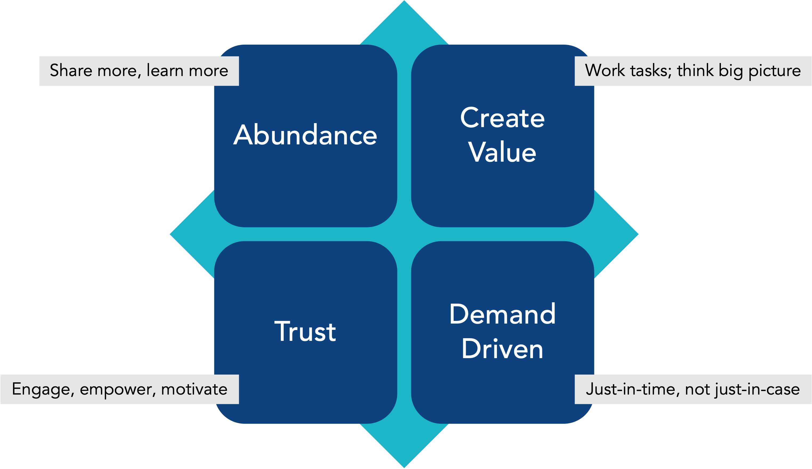

---

# 10のコアコンセプト

<!-- class: small -->
1. 変革と継続的改善（ダブルループ）
2. あらゆる階層の賛同（押し付けた変化は反発を受ける）
3. リーダーシップが欠かせない
4. 集合的な経験（多対多。どの専門家より完全で正確）
5. 集団的なオーナーシップ（使う人が質に責任を持つ）
6. 解決しようとする前に理解しようとする
7. 解決に足りる（完璧でなくても価値がある）
8. ナレッジの統合（ナレッジベースを最後ではなく最初に使う）
9. 成功のためのコーチング
10. 価値を評価する（活動に目標を置かない）

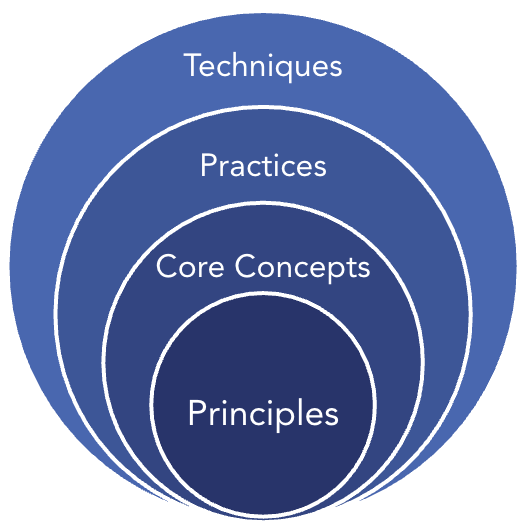

---

# ダブルループ

- **Solve Loop**：対応者が依頼を解決するときの責任。受け身で1件ごとに完結
  - 再利用・改善・記録・構造化
- **Evolve Loop**：リーダーシップと組織レベルのプロセス。Solve Loop の集まりから学ぶ
  - コンテンツの健全性・プロセスの統合・パフォーマンスの把握・チェンジマネジメント
- 2つは相互依存で、合わさって**自己修正するシステム**になる

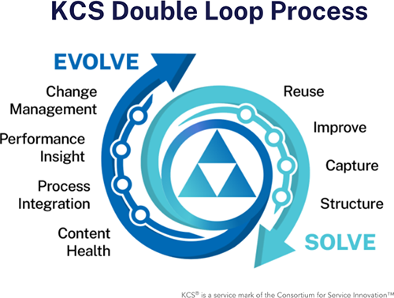

---

# ナレッジは複雑系

- Cynefin フレームワーク
  - **煩雑**：因果が明確。分析して決める（飛行機の製造）
  - **複雑**：因果が不明確。実験→観察→次の実験（企業文化）
- ナレッジの流れは複雑系。だから直線的なプロセスではなく、**ダブルループ**で扱う
- 「作業はタスク単位で（Solve Loop）、思考は全体像で（Evolve Loop）」

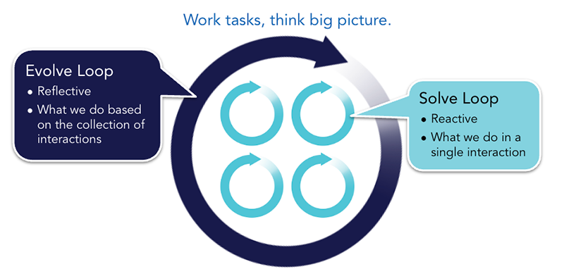

---

# KCS記事：3つの視点をつなぐ

- **依頼者**：コンテキスト（依頼者自身の言葉での課題と環境）
- **対応者**：経験（解決策と原因）
- **組織**：情報（メタデータ：状態・作成日・再利用回数・変更履歴）
- 記事には**再利用できる部分**だけを入れる。会社名や連絡先など依頼者固有の情報は入れない

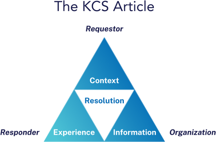

---

# 記事の構造（単純なテンプレート）

| 欄 | 中身 |
|---|---|
| **課題** | 依頼者の言葉で表した状況。技術的に正確でなくてよい（依頼者のもの） |
| **環境** | 製品・バージョン・構成。解決の前後で変わらない。厳密に書く |
| **解決策** | 答え、または解決の手順 |
| **原因** | 任意。課題が同じでも別の問題を区別する |
| **メタデータ** | 公開範囲・確度・ガバナンス・再利用回数など |
| **タイトル** | 主な課題 ＋ 主な環境 |

構造は人と機械（AI）の両方にとって読みやすさを高める

---

# Solve Loop のワークフロー

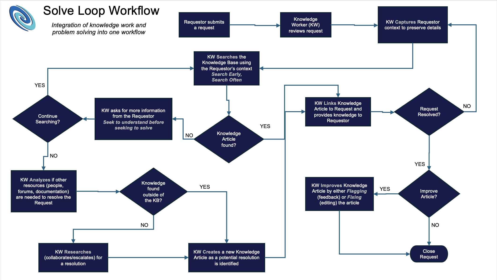

---

# プラクティス1：再利用（Reuse）

- **早めに探し、何度も探す**：依頼者の記述ですぐ検索し、情報が増えるたびに検索し直す
- **集合的に知っていることを理解しようとする**：作成中（WIP）の記事も見える化。ただし、いつまでも探さない
- **再利用を記録する**：記事を依頼に**紐付ける**。このデータが Evolve Loop の分析の元になる
  - 維持管理され、検索でき、対象者がアクセスでき、対象者のコンテキストに即していれば、KCS以外のコンテンツに紐付けてもよい

---

# プラクティス2：改善（Improve）

- **再利用はレビューである**：使われる瞬間にレビューする。使われない記事に手間をかけない
- **指摘するか、直すか**：自信と権限があれば直す。無ければ指摘する
  - 課題の記述は依頼者のもの。書き換えず、**付け加える**
  - 1つの解決策と原因につき1記事。「もし〜なら」が要るなら記事を分ける
- **改善する権限を与える**：習熟度モデルで権限を与える。KCS Publisher が多いほどタイムリーで正確になる

---

# プラクティス3：記録（Capture）

- **その場で記録する**：コンテキストは使われる瞬間に最もはっきりする（暗黙知は事後に再現できない）
- **依頼者のコンテキストを記録する**：依頼者の言葉と言い回しが、他の依頼者の見つけやすさを高める
- **検索することは記録することである**：検索語が記事の書き出しになる。セルフサービスからの「行き止まりを作らない」
- **新しい記事は需要に応じて作成する**：記録は毎回、作成は記事が無いときだけ

> 解決する価値のある課題なら、残しておく価値がある

---

# プラクティス4：構造化（Structure）と「解決に足りる」

- **単純なテンプレートを使う**：課題・環境・解決策・原因・メタデータ
- **完全な文ではなく、完結した考えを**：箇条書きで短く。書く側も読む側も楽
- **解決に足りる**
  - 将来の価値は予測できない／記録したものの**80%は再利用されない**
  - 最小限の労力で記録し、需要に改善を任せる
  - コンテンツ標準とワークフローも作り込みすぎない（「単純に保つ」）

---

# プラクティス5：コンテンツの健全性 ― 記事の状態

- **確度**：作成中（WIP）→ 未検証 → 検証済み → アーカイブ済み
  - 未検証は「すべてを記録する」を支える。再利用されれば検証へ
  - 削除よりアーカイブ（依頼とのリンクを残す）
- **公開範囲**：社内／パートナー／顧客／一般公開。成熟すると、必要なときに必要なだけ社外へ公開する
- **ガバナンス**：経験に基づく記事（開かれている）／コンプライアンスに基づく記事（指定者だけ）

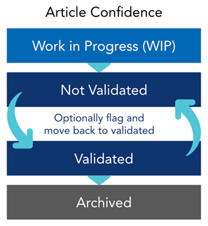

---

# 記事の状態のマトリクス

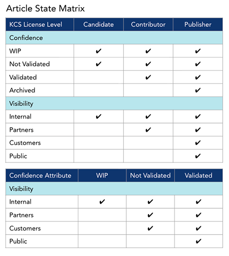

---

# ナレッジの最適化とナレッジドメイン分析

- Solve Loop から浮かぶパターンを見つけ、行動する（新しいテクニック）
- Knowledge Domain Expert のアウトプット
  - 見つけやすさの問題・コンテンツの欠落・重複の統合
  - 広範な課題の根本原因分析 → 製品・プロセス・方針の改善
- **重複**はある程度健全。統合するときは古い記事を残す
- **アーカイブで見つけやすさは直らない**（症状への対処）。コンテキスト・構造・環境の記述を見直す
- **KCSの停滞**：記事が社外へ流れないと、効果が見えず関心が失われる

---

# コンテンツ標準チェックリスト

- 記事が**コンテンツ標準**に沿っているかを見るコーチングのツール（技術的なレビューではない）
- 主要6項目：固有か／完全か／内容は明確か／タイトルが記事と結び付いているか／リンクは有効か／メタデータは正しいか
- 目標は90%（誤りに2倍の重み）。80%を一貫して下回るとKCSの役割を見直す
- 会話は数字ではなく、**理解と行動**について

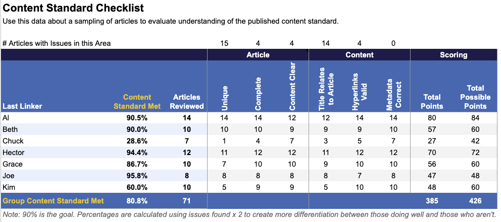

---

# プラクティス6：プロセスの統合

- 構造化された問題解決：**文字どおりの記録 → 診断 → 調査**。どの段階でもナレッジベースと行き来する
- 診断に移るのが早すぎると、結論に飛びつき、既存の記事を見落とす
- テクノロジー：**会話の速さ**で動く。正しいことを簡単にする
- 協働：Intelligent Swarming（新しい課題は人と人をつなぐ）

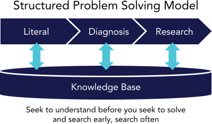

---

# プロセス整合性レビュー（PAR）

- 閉じたケースをサンプリングし、Solve Loop の機会に応えたかを見る
- 3段階のモデル：基本（再利用）→ 拡張（＋作成）→ 包括（＋再利用と改善）
- 主な成果の指標
  - **再利用率**・**再利用の正確さ**（ほぼ100%であるべき）
  - **作成率**・**再利用と改善の率**（改善が最も難しい）
  - **Solve Loop 指数**（80%以上で健全）
- コンテンツ標準チェックリスト（記事）＋ PAR（ケース）で、コーチが行動を見る

---

# 役割と習熟度モデル

- **KCS Candidate**：未検証の記事まで。コーチがレビュー
- **KCS Contributor**：検証済みの記事を作成・検証できる
- **KCS Publisher**：社外に公開できる。成熟したら大部分をここへ
- **コーチ**：変革の推進役。同僚がパートタイムで担う
- **Knowledge Domain Expert**：ドメインのナレッジの健全性とパターン分析
- **KCS Council**：コンテンツ標準・ワークフローを継続的に改善する部門横断の場

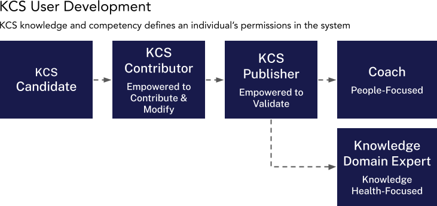

---

# 成功のためのコーチング

- 研修だけ：生産性 +22% ／ 研修＋コーチング：**+86%**
- コーチの候補は、チームで最も**信頼されている人**（専門家である必要はない）
- 比率の目安：立ち上げ期 1:5〜1:8 → 成熟期 1:50
- コーチの時間は、依頼の対応とコーチングで半々
- 学びたいという**需要を生むのはリーダーシップ**、それを満たすのがコーチ
- コーチ・リファレンスガイド（ja/09）：5つのスキル（傾聴・問いかけ・振り返り・承認・提唱）、BABRモデル、7つの疑問への対応

---

# プラクティス7：パフォーマンスの把握

- **活動（先行指標）に目標を置かない**。目標は成果（遅行指標）に置く
  - 活動の目標はナレッジベースを損なう（月10件作れ → 中身の無い記事）
- 見分け方：測りやすくごまかしやすい＝活動／測りにくい・事後にしか測れない＝成果
- 活動は**傾向**を見る。会話は数字ではなく行動について

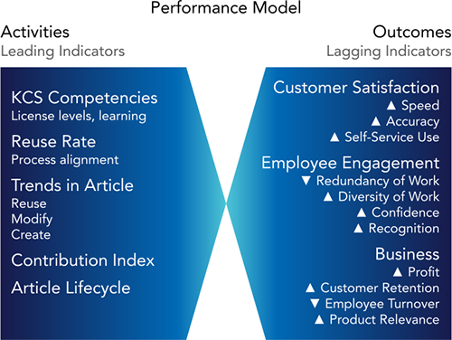

---

# 三角測量とバリューフットプリント

- 価値の創出を示す**単一の指標は無い**
- 活動の傾向 × 成果 × コンテンツ標準チェックリスト・PAR で評価する
- 例：Hector と Kim は紐付け率だけ見ると同じ。プロファイルとチェックリストを見ると、Kim は検索せずに作成し、重複が多い
- レーダーチャートで、先行指標はチームの平均と、遅行指標は目標と比べる

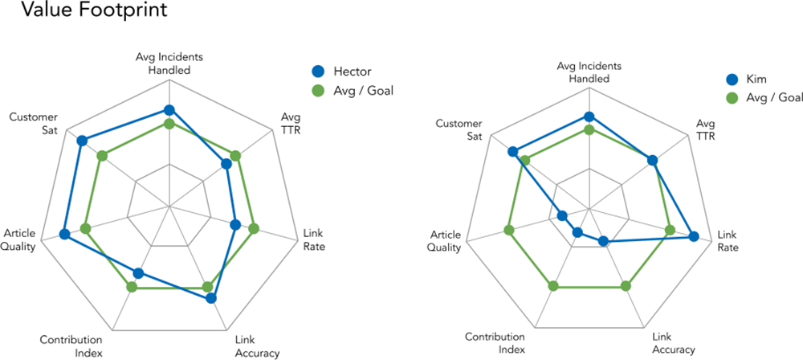

---

# KCSのROI（直接的な効果のみの例）

<!-- class: small -->
| 複雑さ | 高 | 中 | 低 |
|---|---|---|---|
| 既知／新規の解決時間（分） | 10 / 90 | 7 / 40 | 3 / 15 |
| 新しい問題の割合 | 50% | 35% | 20% |
| 成熟までの月数 | 8.6 | 4.2 | 2.1 |
| 1日の処理能力の改善 | 112% | 57% | 21% |
| ROI（24か月） | 2450% | 1564% | 525% |

- 効果は「直接的 → 応用的（自動化など）→ 波及的（新サービス）」の3段階
- 増えた処理能力は、**使い道の計画が無いと消える**。人員削減の「褒美」にしない

---

# プラクティス8：チェンジマネジメント

- 動機付け：報酬（アメとムチ）は機能しない
  - Herzberg：達成・承認・仕事そのもの・責任
  - Pink：熟達・自律性・目的
- ビジョンの4要素：魅力的な目的／ミッション／価値観／ブランドプロミス
- **インパクトマップ**：KCSの効果を組織の目標に結び付ける（1〜2時間で作れる）
- 最大の失敗原因は、現場のマネージャーが「管理から導く」へ転換しないこと
- 成功した組織の反省：「もっとコミュニケーションをとるべきだった」

---

# セルフサービスと顧客の需要

- 需要の量：有人 X ／ セルフサービス **10X** ／ コミュニティ **30X**。有人が応えるのは3%未満
- 設計基準：見つけやすさ・入手しやすさ（90/0のルール）・アクセス・ナビゲーション（行き止まりを作らない）・マーケティング
- 作成率と再利用率が交わったら、セルフサービスを広めどき
- コスト回避（デフレクション）だけで測るのは視野が狭い

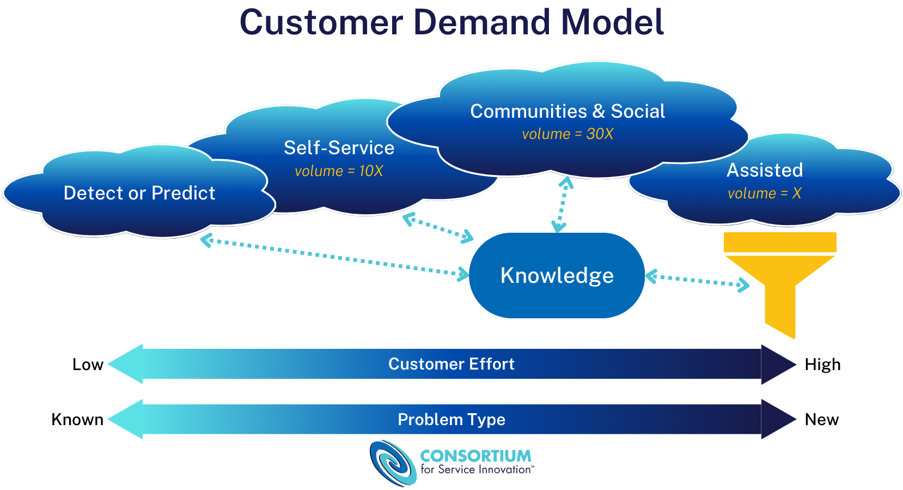

---

# 落とし穴と教訓

- よくある落とし穴
  - マネジメントの当事者意識の欠如
  - 効果的でないコーチングの仕組み
  - ワークフローとコンテンツ標準をナレッジワーカーに設計させていない
  - 成熟しても測定項目を変えていない（セルフサービスが効くと従来の指標は「悪化」する）
- **判断が必要**：良いナレッジベースは良い判断の必要を減らさない。むしろ増やす
- 釣り合い：個人とチーム／活動と成果／完成と進化／コンテンツとコンテキスト／知ることと学ぶこと／マネジメントとリーダーシップ

---

<!-- class: title -->
# 出典

Consortium for Service Innovation, **KCS Library**（https://library.serviceinnovation.org/KCS）

Practices Guide (2027)・Measuring Self-Service Success (2027)：CC BY-NC 4.0
Principles and Core Concepts・Coach Reference Guide・Supplemental Resources：CC BY-NC-ND 4.0

KCS® is a service mark of the Consortium for Service Innovation™.

個人の学習用。共有しない。
