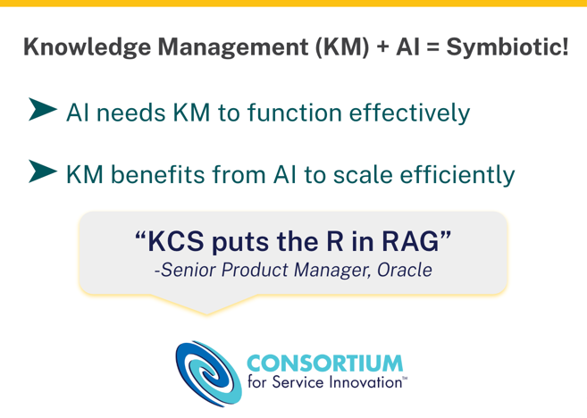
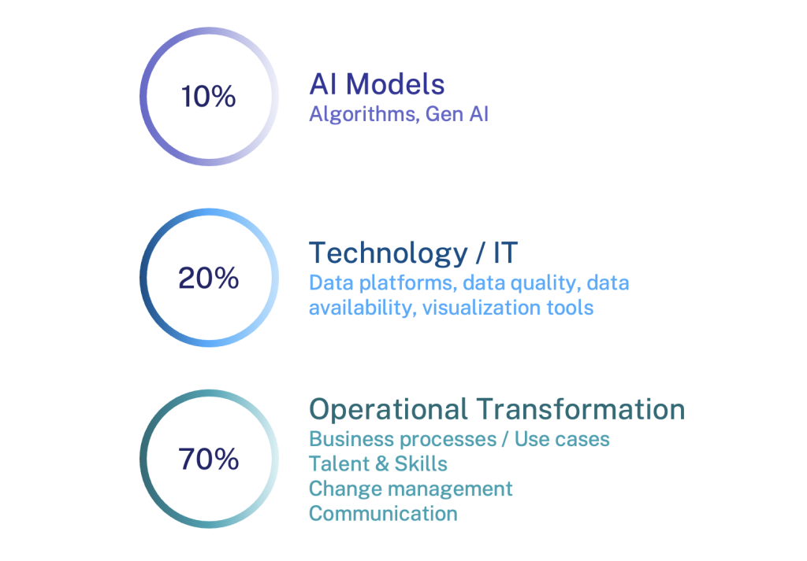
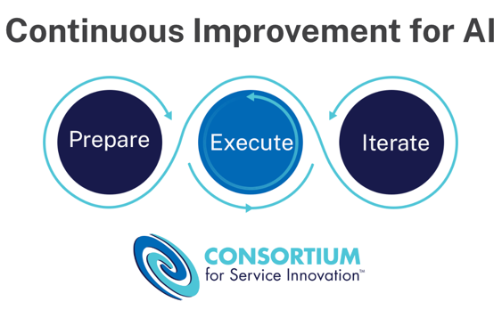
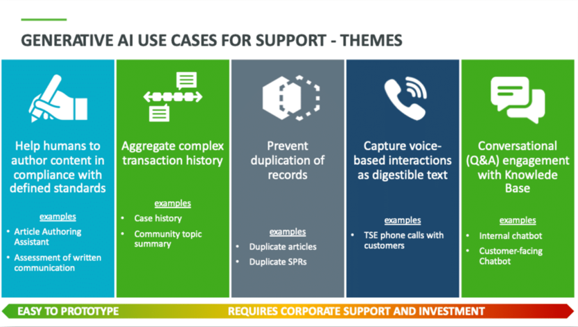
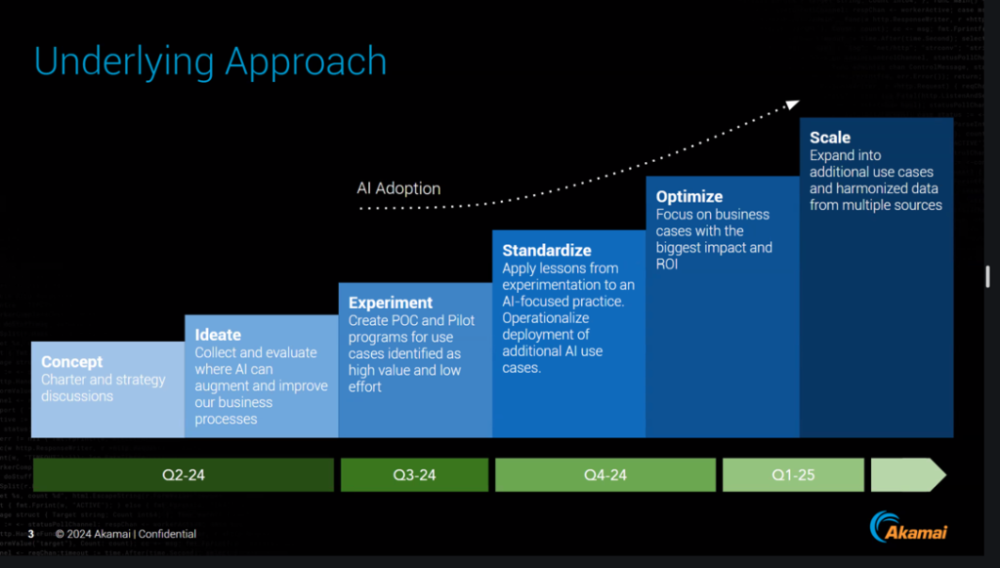
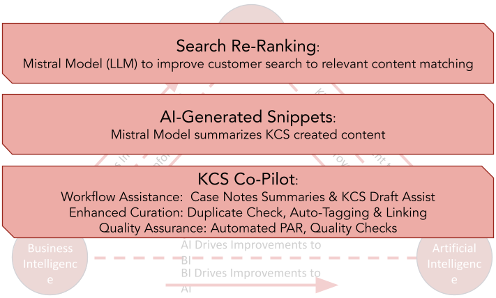

<!-- footer: 個人の学習用（共有しない）｜出典: Consortium for Service Innovation, serviceinnovation.org -->
<!-- class: title -->
# AI × KCS

**ナレッジを動力とするAI を12枚で**

AI導入の要点・事例・失敗の理由・エージェント型AI

個人の学習用（訳文 `ai/ja/01〜05` の要約）

---

# KMとAIは共生関係

- AIの成果は、AIが引き出す**ナレッジの良し悪し**で決まる
- AIは**KMを必要とし**、KMは**AIで規模を広げられる**
  - KCSが、AIの参照するコンテンツを検証済みで、人の聞き方に沿ったものにする
  - AIが、記事の下書き・重複の検出・欠落の分析を効率化する
- 「KCSは RAG の R（検索）を担う」（Oracle）

---

# 成功の比重は 10 / 20 / 70

- Boston Consulting Group の調査
  - AIモデル **10%**
  - テクノロジー／データ **20%**
  - **業務の変革 70%**（プロセス・ユースケース、人材、チェンジマネジメント、コミュニケーション）
- KCSを実践してきた組織は、ナレッジの基盤と変革の経験の両方を持っている

---

# AI導入の3段階

- **準備**：期待を設定し、信頼を築く。事業戦略に根差す
- **実行**：ユースケースごとに、試行してから本番へ広げる
- **改善の繰り返し**：見守り、学び、磨き続ける
- 準備と改善は全体に、実行はユースケースごとに繰り返す
- 大前提：**あなたのユースケースは何か**（どのプロセス・事業課題・人・顧客に効くのか）

---

# 行動項目のチェックリスト

- **準備：基盤を作る**
  - 戦略：自動化を組織の目標に結び付け、利害関係者の足並みをそろえ、資源を見極める
  - 準備状況：プロセス・データの責任者、**ナレッジマネジメントの強化**、依存関係、リスク評価
  - チェンジマネジメント：コミュニケーション計画、短期・中期・長期のロードマップ
  - ユースケースの基準：試行の優先順位、成功の評価方法
- **実行：意図を持って立ち上げる**
  - 試行：評価基準、チーム、購入か構築か、範囲を絞った計画
  - 本番へ拡大：長期の資源、見守りの指標とフィードバックのループ、ガバナンスとコンプライアンス
- **改善の繰り返し**：戦略の維持（研修・実験）、テクノロジーの維持（モデルとデータの調整）

---

# 事例：PTC ― ユースケースを見つける

- 主要なプロセスを選び、責任者と専門家でワークショップ
- 導入のしやすさ × 価値で優先順位を付ける
- 成熟したKCSを活かし、**記事作成アシスタント**から始めた（下書きをAIが作り、ナレッジワーカーがレビュー）
- 展開の流れ：概念実証 → 試作 → ROIの検証 → 展開 → 業務システムとの統合

---

# 事例：Akamai ― 期待を管理し、構築か購入かを決める

- 全社的な手順で、実験から本番へ慎重に移る
- **AI導入曲線**で節目と期待をそろえる：構想 → 発想 → 実験 → 標準化 → 最適化 → 拡大
- 選択肢：パートナー／プラットフォーム／自社開発。技術の導入・法務とセキュリティ・拡大に耐える設計で比べる
- リーダーの委員会がユースケースの優先順位を付ける

---

# 事例：Red Hat ― ナレッジの拡充を自動化する

- KM・AI・BI のエコシステム：KMがAIにコンテンツを供給し、AIとBIがKMの改善を推し進める
- 展開したもの
  - 検索の再順位付け（LLMで関連コンテンツを照合）
  - AI生成の要約（KCSで作られたコンテンツから）
  - **KCSコパイロット**：ケースのメモの要約と記事の下書き、重複チェック・自動タグ付け、**PARの自動化**

---

# AIプロジェクトはなぜ失敗するのか

- 試行の「失敗」率が高いのは悪くない（実験している証拠）
- 問題は**本番後の70〜90%**の失敗
- よくある原因
  - 誇大な宣伝・派手なアイデア（具体的なユースケースが無い）
  - 事業目標との不整合（「AIが必要だ」は目標ではない）
  - **質の悪いデータ（失敗の理由の最大85%）**
  - 古いシステム、膨らむコスト、不十分なチェンジマネジメント
- AIは技術の導入ではなく、**事業と業務のソリューション**として捉え直す

---

# エージェント型AIとKCS

- ナレッジマネジメントは顧客サービスを超え、企業全体の**コンテンツインテリジェンス**へ
- **AIエージェントは道具ではなく働き手**。ただし人と同等ではない
  - 定型の判断・パターン発見はエージェント、曖昧さ・リスク・倫理・例外は人
  - 人とエージェントが一緒にスウォームする設計に価値がある
- KCSの原則はエージェントにもそのまま当てはまる。特に**信頼**：ナレッジがAIを根拠付け、出力への信頼を育てる
- 測るのは活動ではなく価値（エージェントがコンテンツをどう使い、どこで価値が生まれたか）

---

# まとめ：本編とのつながり

| AIの論点 | 本編での対応 |
|---|---|
| 信頼できるナレッジの基盤 | 再利用はレビュー、記事の状態（03・04章） |
| 構造化されたコンテンツ | 単純なテンプレート、完結した考え（03章） |
| ナレッジの欠落・重複の発見 | ナレッジの最適化・KDA（04章） |
| 品質のチェックの自動化 | コンテンツ標準チェックリスト・PAR（04・05章） |
| 業務の変革 70% | チェンジマネジメント・コーチング（05・07章） |
| 活動ではなく価値を測る | パフォーマンスの把握（06章） |

---

<!-- class: title -->
# 出典

Consortium for Service Innovation（https://www.serviceinnovation.org）

AI Implementation Essentials／Knowledge-Powered AI／AI Case Studies／Why AI Projects Fail or Succeed／Connecting Agentic AI to KCS® and Intelligent Swarming®

いずれもクリエイティブ・コモンズの表示なし（© Consortium for Service Innovation）

KCS® is a service mark of the Consortium for Service Innovation™.

個人の学習用。共有しない。
